# sub_0032E327

- RVA: `0x0032E327`–`0x0032E4E7` (길이 `448` bytes)
- VA: `0x000000014032E327`
- 실행 섹션: `.text`
- PDB 이름 있음: `아니요`; PDB Function 태그: `아니요`
- unwind 정보 RVA: `0x00076354`
- 디코드: `101`개 명령, `448/448` bytes 표시
- 미해석 바이트: `0` (있으면 어셈블리에 `.byte`로 보존)

> 이 문서는 커널 이미지의 기계어와 PDB 기호를 분석해 생성했습니다. 4번과 5번은 함수 원형과 자료형을 바이너리 사용 방식에서 추정한 C 해석이며 원본 소스 복구 결과는 아닙니다.

## 1. Dependencies

- 직접 호출 지점: **7**; 고유 호출 대상: **6**
- 직접 호출자로 확인된 함수: **0**
- RIP 상대 이미지 참조: **5**

### Outgoing calls
- `0x0032E38E` → [MiLockVadCore](../29/MiLockVadCore_function_00297170.md) (function, `0x00297170`)
- `0x0032E39B` → [MiLocateLockedVadEvent](../2A/MiLocateLockedVadEvent_function_002A7A0C.md) (function, `0x002A7A0C`)
- `0x0032E3C4` → [MiUnlockVadCore](../43/MiUnlockVadCore_function_004311C0.md) (function, `0x004311C0`)
- `0x0032E40E` → [ExpWaitForSpinLockSharedAndAcquire](../36/ExpWaitForSpinLockSharedAndAcquire_function_00362380.md) (function, `0x00362380`)
- `0x0032E42B` → [MiIsVadLargePrivate](MiIsVadLargePrivate_function_0032F720.md) (function, `0x0032F720`)
- `0x0032E46E` → [ExpReleaseSpinLockSharedFromDpcLevelInstrumented](../2F/ExpReleaseSpinLockSharedFromDpcLevelInstrumented_function_002F0F48.md) (function, `0x002F0F48`)
- `0x0032E492` → [ExpReleaseSpinLockSharedFromDpcLevelInstrumented](../2F/ExpReleaseSpinLockSharedFromDpcLevelInstrumented_function_002F0F48.md) (function, `0x002F0F48`)

### Direct callers
- 이 함수 시작 RVA로 연결되는 직접 call은 확인되지 않았습니다. 간접 호출은 완전히 역산할 수 없습니다.

### Static image references
- `0x0032E330` → RVA `0x00E2DB70` (`.data`; read)
- `0x0032E345` → RVA `0x00FC6B06` (`ALMOSTRO`; read)
- `0x0032E3D0` → RVA `0x00E2DC80` (`.data`; read)
- `0x0032E454` → RVA `0x00F0DE58` (`.data`; read)
- `0x0032E49E` → RVA `0x00E2DB68` (`.data`; read)

## 2. Other-region calls and transfers

- 다른 실행 섹션으로 향하는 call: **0**
- call이 아닌 외부 분기/꼬리 이동: **22**
  - `0x0032E32A` → [sub_0032E02E + 0xB5](Unknown_function_0032E02E.md) (`tail-transfer`)
  - `0x0032E337` → [sub_0032E02E + 0x26E](Unknown_function_0032E02E.md) (`tail-transfer`)
  - `0x0032E376` → [sub_0032E02E + 0x26E](Unknown_function_0032E02E.md) (`tail-transfer`)
  - `0x0032E380` → [sub_0032E02E + 0x1FA](Unknown_function_0032E02E.md) (`tail-transfer`)
  - `0x0032E3A6` → [sub_006E1EEA](../6E/Unknown_function_006E1EEA.md) (`tail-transfer`)
  - `0x0032E3B9` → [sub_006E1EEA](../6E/Unknown_function_006E1EEA.md) (`tail-transfer`)
  - `0x0032E3CB` → [sub_0032E02E + 0x236](Unknown_function_0032E02E.md) (`tail-transfer`)
  - `0x0032E3FF` → [sub_0032E02E + 0x26E](Unknown_function_0032E02E.md) (`tail-transfer`)
  - `0x0032E406` → [sub_0032E02E + 0xF8](Unknown_function_0032E02E.md) (`tail-transfer`)
  - `0x0032E413` → [sub_0032E02E + 0x105](Unknown_function_0032E02E.md) (`tail-transfer`)
  - `0x0032E432` → [sub_0032E02E + 0x236](Unknown_function_0032E02E.md) (`tail-transfer`)
  - `0x0032E44F` → [sub_0032E02E + 0x26E](Unknown_function_0032E02E.md) (`tail-transfer`)
  - `0x0032E45C` → [sub_0032E02E + 0x25A](Unknown_function_0032E02E.md) (`tail-transfer`)
  - `0x0032E473` → [sub_0032E02E + 0x26E](Unknown_function_0032E02E.md) (`tail-transfer`)
  - `0x0032E499` → [sub_0032E02E + 0x26E](Unknown_function_0032E02E.md) (`tail-transfer`)
  - `0x0032E4A5` → [sub_0032E02E + 0x26E](Unknown_function_0032E02E.md) (`tail-transfer`)
  - `0x0032E4B1` → [sub_0032E02E + 0x236](Unknown_function_0032E02E.md) (`tail-transfer`)
  - `0x0032E4B9` → [sub_0032E02E + 0x1E5](Unknown_function_0032E02E.md) (`tail-transfer`)
  - `0x0032E4C6` → [sub_0032E02E + 0x236](Unknown_function_0032E02E.md) (`tail-transfer`)
  - `0x0032E4CD` → [sub_0032E02E + 0x236](Unknown_function_0032E02E.md) (`tail-transfer`)
  - `0x0032E4DA` → [sub_0032E02E + 0x212](Unknown_function_0032E02E.md) (`tail-transfer`)
  - `0x0032E4E2` → [sub_0032E02E + 0x236](Unknown_function_0032E02E.md) (`tail-transfer`)

## 3. Assembly (complete function range)

```asm
0032E327  48 85 C0                        test rax, rax
0032E32A  0F 84 B3 FD FF FF               je 0x14032e0e3
0032E330  48 8B 3D 39 F8 AF 00            mov rdi, qword ptr [rip + 0xaff839]
0032E337  E9 60 FF FF FF                  jmp 0x14032e29c
0032E33C  65 48 8B 04 25 88 01 00 00      mov rax, qword ptr gs:[0x188]
0032E345  F6 05 BA 87 C9 00 01            test byte ptr [rip + 0xc987ba], 1
0032E34C  48 8B 88 B8 00 00 00            mov rcx, qword ptr [rax + 0xb8]
0032E353  4C 8B 81 10 04 00 00            mov r8, qword ptr [rcx + 0x410]
0032E35A  0F 85 18 01 00 00               jne 0x14032e478
0032E360  F0 41 81 A0 EC 03 00 00 FF FF FF BF  lock and dword ptr [r8 + 0x3ec], 0xbfffffff
0032E36C  F0 41 FF 88 EC 03 00 00         lock dec dword ptr [r8 + 0x3ec]
0032E374  33 FF                           xor edi, edi
0032E376  E9 21 FF FF FF                  jmp 0x14032e29c
0032E37B  8B 43 40                        mov eax, dword ptr [rbx + 0x40]
0032E37E  A8 10                           test al, 0x10
0032E380  0F 84 A2 FE FF FF               je 0x14032e228
0032E386  BA 01 00 00 00                  mov edx, 1
0032E38B  48 8B CB                        mov rcx, rbx
0032E38E  E8 DD 8D F6 FF                  call 0x140297170
0032E393  BA 20 00 00 00                  mov edx, 0x20
0032E398  48 8B CB                        mov rcx, rbx
0032E39B  E8 6C 96 F7 FF                  call 0x1402a7a0c
0032E3A0  48 8B C8                        mov rcx, rax
0032E3A3  48 85 C0                        test rax, rax
0032E3A6  0F 84 3E 3B 3B 00               je 0x1406e1eea
0032E3AC  65 48 8B 04 25 88 01 00 00      mov rax, qword ptr gs:[0x188]
0032E3B5  48 39 41 08                     cmp qword ptr [rcx + 8], rax
0032E3B9  0F 84 2B 3B 3B 00               je 0x1406e1eea
0032E3BF  B2 11                           mov dl, 0x11
0032E3C1  48 8B CE                        mov rcx, rsi
0032E3C4  E8 F7 2D 10 00                  call 0x1404311c0
0032E3C9  33 FF                           xor edi, edi
0032E3CB  E9 94 FE FF FF                  jmp 0x14032e264
0032E3D0  48 8B 0D A9 F8 AF 00            mov rcx, qword ptr [rip + 0xaff8a9]
0032E3D7  48 8B F8                        mov rdi, rax
0032E3DA  48 85 C9                        test rcx, rcx
0032E3DD  74 0D                           je 0x14032e3ec
0032E3DF  A8 10                           test al, 0x10
0032E3E1  75 09                           jne 0x14032e3ec
0032E3E3  48 8B F9                        mov rdi, rcx
0032E3E6  48 F7 D7                        not rdi
0032E3E9  48 23 F8                        and rdi, rax
0032E3EC  48 C1 FF 10                     sar rdi, 0x10
0032E3F0  BD 00 01 00 00                  mov ebp, 0x100
0032E3F5  A8 08                           test al, 8
0032E3F7  B8 01 00 00 00                  mov eax, 1
0032E3FC  0F 45 E8                        cmovne ebp, eax
0032E3FF  E9 98 FE FF FF                  jmp 0x14032e29c
0032E404  85 C0                           test eax, eax
0032E406  0F 89 1A FD FF FF               jns 0x14032e126
0032E40C  B2 FF                           mov dl, 0xff
0032E40E  E8 6D 3F 03 00                  call 0x140362380
0032E413  E9 1B FD FF FF                  jmp 0x14032e133
0032E418  8B C1                           mov eax, ecx
0032E41A  24 70                           and al, 0x70
0032E41C  3C 10                           cmp al, 0x10
0032E41E  74 10                           je 0x14032e430
0032E420  83 E1 70                        and ecx, 0x70
0032E423  80 F9 30                        cmp cl, 0x30
0032E426  74 08                           je 0x14032e430
0032E428  48 8B CB                        mov rcx, rbx
0032E42B  E8 F0 12 00 00                  call 0x14032f720
0032E430  33 FF                           xor edi, edi
0032E432  E9 2D FE FF FF                  jmp 0x14032e264
0032E437  48 8B C1                        mov rax, rcx
0032E43A  4C 3B F0                        cmp r14, rax
0032E43D  0F 82 31 FF FF FF               jb 0x14032e374
0032E443  48 B8 FF FF FF FF FF F6 FF FF   movabs rax, 0xfffff6ffffffffff
0032E44D  33 FF                           xor edi, edi
0032E44F  E9 48 FE FF FF                  jmp 0x14032e29c
0032E454  8B 05 FE F9 BD 00               mov eax, dword ptr [rip + 0xbdf9fe]
0032E45A  85 C0                           test eax, eax
0032E45C  0F 85 26 FE FF FF               jne 0x14032e288
0032E462  48 8B 54 24 38                  mov rdx, qword ptr [rsp + 0x38]
0032E467  49 8D 88 EC 03 00 00            lea rcx, [r8 + 0x3ec]
0032E46E  E8 D5 2A FC FF                  call 0x1402f0f48
0032E473  E9 24 FE FF FF                  jmp 0x14032e29c
0032E478  8B 05 DA F9 BD 00               mov eax, dword ptr [rip + 0xbdf9da]
0032E47E  85 C0                           test eax, eax
0032E480  0F 85 DA FE FF FF               jne 0x14032e360
0032E486  48 8B 54 24 38                  mov rdx, qword ptr [rsp + 0x38]
0032E48B  49 8D 88 EC 03 00 00            lea rcx, [r8 + 0x3ec]
0032E492  E8 B1 2A FC FF                  call 0x1402f0f48
0032E497  33 FF                           xor edi, edi
0032E499  E9 FE FD FF FF                  jmp 0x14032e29c
0032E49E  48 8B 3D C3 F6 AF 00            mov rdi, qword ptr [rip + 0xaff6c3]
0032E4A5  E9 F2 FD FF FF                  jmp 0x14032e29c
0032E4AA  48 8B 3D B7 F6 AF 00            mov rdi, qword ptr [rip + 0xaff6b7]
0032E4B1  E9 AE FD FF FF                  jmp 0x14032e264
0032E4B6  48 85 C0                        test rax, rax
0032E4B9  0F 84 54 FD FF FF               je 0x14032e213
0032E4BF  48 8B 3D AA F6 AF 00            mov rdi, qword ptr [rip + 0xaff6aa]
0032E4C6  E9 99 FD FF FF                  jmp 0x14032e264
0032E4CB  33 FF                           xor edi, edi
0032E4CD  E9 92 FD FF FF                  jmp 0x14032e264
0032E4D2  8B 43 30                        mov eax, dword ptr [rbx + 0x30]
0032E4D5  83 E0 70                        and eax, 0x70
0032E4D8  3C 50                           cmp al, 0x50
0032E4DA  0F 84 60 FD FF FF               je 0x14032e240
0032E4E0  33 FF                           xor edi, edi
0032E4E2  E9 7D FD FF FF                  jmp 0x14032e264
```

## 4. C-style interpretation (structured pseudocode)

```c
__int64 __fastcall sub_0032E327(void)
{
    unsigned __int64 v_stack_p38;
}
```

## 5. (Beta) C Style

```c
void sub_0032E327(void)
{
    uint64_t v_stack_p38;
}
```

## 6. Execution-region graph

[열기: 2D/3D 그래프와 함수 탐색 컨트롤 패널](../../../control-panel.html?section=text&rva=0x0032E327&view=graph)

- 2D 그래프는 위에서 아래로 흐르고, 3D 그래프는 빈 공간을 드래그해 회전합니다. Shift+드래그는 이동, 휠은 확대·축소, 함수 노드 선택은 대상 보고서 이동입니다.

### Static fallback

```mermaid
flowchart TD
  bb_0032E327[BB_0032E327]
  bb_0032E330[BB_0032E330]
  bb_0032E33C[BB_0032E33C]
  bb_0032E360[BB_0032E360]
  bb_0032E374[BB_0032E374]
  bb_0032E37B[BB_0032E37B]
  bb_0032E386[BB_0032E386]
  bb_0032E3AC[BB_0032E3AC]
  bb_0032E3BF[BB_0032E3BF]
  bb_0032E3D0[BB_0032E3D0]
  bb_0032E3DF[BB_0032E3DF]
  bb_0032E3E3[BB_0032E3E3]
  bb_0032E3EC[BB_0032E3EC]
  bb_0032E404[BB_0032E404]
  bb_0032E40C[BB_0032E40C]
  bb_0032E418[BB_0032E418]
  bb_0032E420[BB_0032E420]
  bb_0032E428[BB_0032E428]
  bb_0032E430[BB_0032E430]
  bb_0032E437[BB_0032E437]
  bb_0032E443[BB_0032E443]
  bb_0032E454[BB_0032E454]
  bb_0032E462[BB_0032E462]
  bb_0032E478[BB_0032E478]
  bb_0032E486[BB_0032E486]
  bb_0032E49E[BB_0032E49E]
  bb_0032E4AA[BB_0032E4AA]
  bb_0032E4B6[BB_0032E4B6]
  bb_0032E4BF[BB_0032E4BF]
  bb_0032E4CB[BB_0032E4CB]
  bb_0032E4D2[BB_0032E4D2]
  bb_0032E4E0[BB_0032E4E0]
  bb_0032E327 -->|fallthrough| bb_0032E330
  bb_0032E33C -->|branch| bb_0032E478
  bb_0032E33C -->|fallthrough| bb_0032E360
  bb_0032E360 -->|flow| bb_0032E374
  bb_0032E37B -->|fallthrough| bb_0032E386
  bb_0032E386 -->|fallthrough| bb_0032E3AC
  bb_0032E3AC -->|fallthrough| bb_0032E3BF
  bb_0032E3D0 -->|branch| bb_0032E3EC
  bb_0032E3D0 -->|fallthrough| bb_0032E3DF
  bb_0032E3DF -->|branch| bb_0032E3EC
  bb_0032E3DF -->|fallthrough| bb_0032E3E3
  bb_0032E3E3 -->|flow| bb_0032E3EC
  bb_0032E404 -->|fallthrough| bb_0032E40C
  bb_0032E418 -->|branch| bb_0032E430
  bb_0032E418 -->|fallthrough| bb_0032E420
  bb_0032E420 -->|branch| bb_0032E430
  bb_0032E420 -->|fallthrough| bb_0032E428
  bb_0032E428 -->|flow| bb_0032E430
  bb_0032E437 -->|branch| bb_0032E374
  bb_0032E437 -->|fallthrough| bb_0032E443
  bb_0032E454 -->|fallthrough| bb_0032E462
  bb_0032E478 -->|branch| bb_0032E360
  bb_0032E478 -->|fallthrough| bb_0032E486
  bb_0032E4B6 -->|fallthrough| bb_0032E4BF
  bb_0032E4D2 -->|fallthrough| bb_0032E4E0
```


