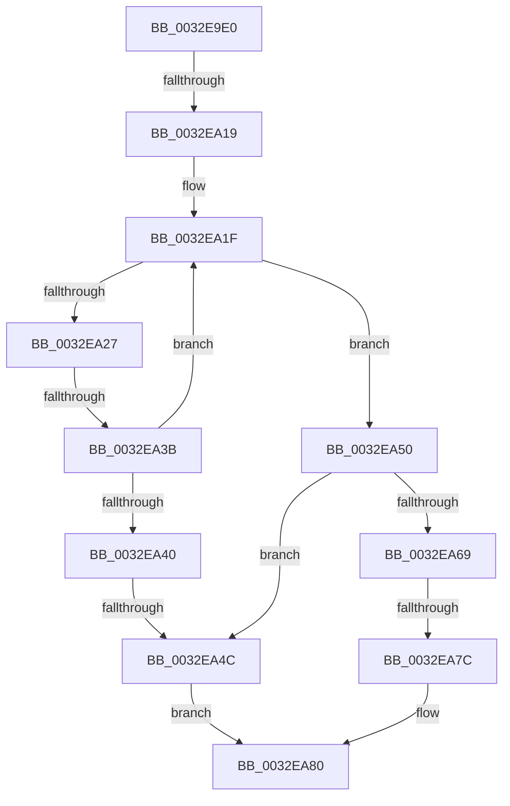

# sub_0032E9E0

- RVA: `0x0032E9E0`–`0x0032EA97` (길이 `183` bytes)
- VA: `0x000000014032E9E0`
- 실행 섹션: `.text`
- PDB 이름 있음: `아니요`; PDB Function 태그: `아니요`
- unwind 정보 RVA: `0x000763C0`
- 디코드: `54`개 명령, `183/183` bytes 표시
- 미해석 바이트: `0` (있으면 어셈블리에 `.byte`로 보존)

> 이 문서는 커널 이미지의 기계어와 PDB 기호를 분석해 생성했습니다. 4번과 5번은 함수 원형과 자료형을 바이너리 사용 방식에서 추정한 C 해석이며 원본 소스 복구 결과는 아닙니다.

## 1. Dependencies

- 직접 호출 지점: **0**; 고유 호출 대상: **0**
- 직접 호출자로 확인된 함수: **0**
- RIP 상대 이미지 참조: **0**

### Outgoing calls
- 직접 디코드된 call 명령이 없습니다.

### Direct callers
- 이 함수 시작 RVA로 연결되는 직접 call은 확인되지 않았습니다. 간접 호출은 완전히 역산할 수 없습니다.

### Static image references
- 디코드된 RIP-relative 메모리 참조가 없습니다.

## 2. Other-region calls and transfers

- 다른 실행 섹션으로 향하는 call: **0**
- call이 아닌 외부 분기/꼬리 이동: **4**
  - `0x0032EA17` → [sub_0032EA98](Unknown_function_0032EA98.md) (`tail-transfer`)
  - `0x0032EA35` → [sub_0032EA98 + 0x94](Unknown_function_0032EA98.md) (`tail-transfer`)
  - `0x0032EA46` → [sub_0032EA98 + 0xA5](Unknown_function_0032EA98.md) (`tail-transfer`)
  - `0x0032EA76` → [sub_0032EA98 + 0xF8](Unknown_function_0032EA98.md) (`tail-transfer`)

## 3. Assembly (complete function range)

```asm
0032E9E0  48 89 7C 24 40                  mov qword ptr [rsp + 0x40], rdi
0032E9E5  45 33 C0                        xor r8d, r8d
0032E9E8  4C 89 06                        mov qword ptr [rsi], r8
0032E9EB  48 8B 1B                        mov rbx, qword ptr [rbx]
0032E9EE  48 8B 79 50                     mov rdi, qword ptr [rcx + 0x50]
0032E9F2  4C 89 74 24 48                  mov qword ptr [rsp + 0x48], r14
0032E9F7  4C 89 7C 24 50                  mov qword ptr [rsp + 0x50], r15
0032E9FC  41 BF 00 00 02 00               mov r15d, 0x20000
0032EA02  48 2B 7B 08                     sub rdi, qword ptr [rbx + 8]
0032EA06  4C 8B 33                        mov r14, qword ptr [rbx]
0032EA09  48 C1 FF 03                     sar rdi, 3
0032EA0D  49 2B FA                        sub rdi, r10
0032EA10  49 03 F9                        add rdi, r9
0032EA13  4D 39 46 40                     cmp qword ptr [r14 + 0x40], r8
0032EA17  74 7F                           je 0x14032ea98
0032EA19  48 8B D7                        mov rdx, rdi
0032EA1C  48 8B CB                        mov rcx, rbx
0032EA1F  8B 41 2C                        mov eax, dword ptr [rcx + 0x2c]
0032EA22  48 3B D0                        cmp rdx, rax
0032EA25  72 29                           jb 0x14032ea50
0032EA27  48 8B 49 10                     mov rcx, qword ptr [rcx + 0x10]
0032EA2B  48 2B D0                        sub rdx, rax
0032EA2E  49 FF C0                        inc r8
0032EA31  49 83 F8 03                     cmp r8, 3
0032EA35  0F 84 F1 00 00 00               je 0x14032eb2c
0032EA3B  48 85 C9                        test rcx, rcx
0032EA3E  75 DF                           jne 0x14032ea1f
0032EA40  41 8B 46 38                     mov eax, dword ptr [r14 + 0x38]
0032EA44  A8 20                           test al, 0x20
0032EA46  0F 84 F1 00 00 00               je 0x14032eb3d
0032EA4C  33 C0                           xor eax, eax
0032EA4E  EB 30                           jmp 0x14032ea80
0032EA50  48 8B FA                        mov rdi, rdx
0032EA53  48 8B D9                        mov rbx, rcx
0032EA56  8B 43 2C                        mov eax, dword ptr [rbx + 0x2c]
0032EA59  8B 4B 34                        mov ecx, dword ptr [rbx + 0x34]
0032EA5C  81 E1 FF FF FF 3F               and ecx, 0x3fffffff
0032EA62  2B C1                           sub eax, ecx
0032EA64  48 3B F8                        cmp rdi, rax
0032EA67  73 E3                           jae 0x14032ea4c
0032EA69  48 8B 4B 08                     mov rcx, qword ptr [rbx + 8]
0032EA6D  48 89 1E                        mov qword ptr [rsi], rbx
0032EA70  8B 43 20                        mov eax, dword ptr [rbx + 0x20]
0032EA73  41 85 C7                        test r15d, eax
0032EA76  0F 85 14 01 00 00               jne 0x14032eb90
0032EA7C  48 8D 04 F9                     lea rax, [rcx + rdi*8]
0032EA80  4C 8B 74 24 48                  mov r14, qword ptr [rsp + 0x48]
0032EA85  48 8B 7C 24 40                  mov rdi, qword ptr [rsp + 0x40]
0032EA8A  4C 8B 7C 24 50                  mov r15, qword ptr [rsp + 0x50]
0032EA8F  48 83 C4 20                     add rsp, 0x20
0032EA93  5E                              pop rsi
0032EA94  5D                              pop rbp
0032EA95  5B                              pop rbx
0032EA96  C3                              ret
```

## 4. C-style interpretation (structured pseudocode)

```c
__int64 __fastcall sub_0032E9E0(__int64 a1, __int64 a2, int a3, __int64 a4, __int64 a5, __int64 a6, __int64 a7, __int64 a8, __int64 a9, __int64 a10)
{
    __int64 result;
    __int64 v_rdi;
    __int64 v_rsp;
    unsigned __int64 v_stack_p40;
    unsigned __int64 v_stack_p48;
    unsigned __int64 v_stack_p50;

    v_stack_p40 = v_rdi;
    a3 = 0;
    *(unsigned __int64 *)(v_rsi) = 0;
    v_stack_p48 = v_r14;
    v_stack_p50 = v_r15;
    v_rdi = (*(unsigned __int64 *)(a1 + 80)) - (*(unsigned __int64 *)(*(unsigned __int64 *)(v_rbx) + 8));
    v_rdi = (v_rdi) >> (3);
    v_rdi = (v_rdi) - (v_r10);
    v_rdi = (v_rdi) + (a4);
loc_0032EA1F:
    if (v_rdi < ((unsigned int)(*(unsigned int *)(*(unsigned __int64 *)(v_rbx) + 44)))) goto loc_0032EA50;
    a2 = (v_rdi) - ((unsigned int)(*(unsigned int *)(*(unsigned __int64 *)(v_rbx) + 44)));
    a3 = (a3) + 1;
    if (*(unsigned __int64 *)(*(unsigned __int64 *)(v_rbx) + 16) != 0) goto loc_0032EA1F;
loc_0032EA4C:
    result = 0;
    goto loc_0032EA80;
loc_0032EA50:
    a1 = (unsigned int)(((unsigned int)(*(unsigned int *)(*(unsigned __int64 *)(*(unsigned __int64 *)(v_rbx) + 16) + 52))) & (0x3FFFFFFFULL));
    result = (unsigned int)(((unsigned int)(*(unsigned int *)(*(unsigned __int64 *)(*(unsigned __int64 *)(v_rbx) + 16) + 44))) - ((unsigned int)(a1)));
    if (a2 >= result) goto loc_0032EA4C;
    *(unsigned __int64 *)(v_rsi) = *(unsigned __int64 *)(*(unsigned __int64 *)(v_rbx) + 16);
loc_0032EA80:
    v_rsp = (v_rsp) + (32);
    return *(unsigned __int64 *)(*(unsigned __int64 *)(*(unsigned __int64 *)(v_rbx) + 16) + 8) + a2 * 8;
}
```

## 5. (Beta) C Style

```c
int64_t sub_0032E9E0(void *Arg1, int64_t Arg2, int32_t Arg3, int64_t Arg4, uint64_t Arg5, uint64_t Arg6, uint64_t Arg7, int64_t Arg8, int64_t Arg9, int64_t Arg10)
{
    uint8_t *arg1 = (uint8_t *)Arg1;

    int64_t result;
    int64_t local_rdi;
    int64_t local_rsp;
    uint64_t v_stack_p40;
    uint64_t v_stack_p48;
    uint64_t v_stack_p50;

    v_stack_p40 = local_rdi;
    Arg3 = 0;
    *(uint64_t *)(local_rsi) = 0;
    v_stack_p48 = local_r14;
    v_stack_p50 = local_r15;
    local_rdi = (*(uint64_t *)(arg1 + 0x50)) - (*(uint64_t *)(*(uint64_t *)(local_rbx) + 0x8));
    local_rdi = (local_rdi) >> (3);
    local_rdi = (local_rdi) - (local_r10);
    local_rdi = (local_rdi) + (Arg4);
loc_0032EA1F:
    if (local_rdi < ((uint32_t)(*(uint32_t *)(*(uint64_t *)(local_rbx) + 0x2C)))) goto loc_0032EA50;
    Arg2 = (local_rdi) - ((uint32_t)(*(uint32_t *)(*(uint64_t *)(local_rbx) + 0x2C)));
    Arg3 = (Arg3) + 1;
    if (*(uint64_t *)(*(uint64_t *)(local_rbx) + 0x10) != 0) goto loc_0032EA1F;
loc_0032EA4C:
    result = 0;
    goto loc_0032EA80;
loc_0032EA50:
    Arg1 = (uint32_t)(((uint32_t)(*(uint32_t *)(*(uint64_t *)(*(uint64_t *)(local_rbx) + 0x10) + 0x34))) & (0x3FFFFFFFULL));
    result = (uint32_t)(((uint32_t)(*(uint32_t *)(*(uint64_t *)(*(uint64_t *)(local_rbx) + 0x10) + 0x2C))) - ((uint32_t)(Arg1)));
    if (Arg2 >= result) goto loc_0032EA4C;
    *(uint64_t *)(local_rsi) = *(uint64_t *)(*(uint64_t *)(local_rbx) + 0x10);
loc_0032EA80:
    local_rsp = (local_rsp) + (32);
    return *(uint64_t *)(*(uint64_t *)(*(uint64_t *)(local_rbx) + 0x10) + 0x8) + Arg2 * 8;
}
```

### 관측된 메모리 오프셋

구조체 형식이 확인되지 않은 접근은 인자 기준의 오프셋으로만 기록했습니다.

| 기준 인자 | 오프셋 표현 | 폭 (bit) | 접근 |
|---|---:|---:|---|
| `Arg1` | `+ 0x50` | `64` | `R` |

## 6. Execution-region graph

[열기: 2D/3D 그래프와 함수 탐색 컨트롤 패널](../../../control-panel.html?section=text&rva=0x0032E9E0&view=graph)

- 2D 그래프는 위에서 아래로 흐르고, 3D 그래프는 빈 공간을 드래그해 회전합니다. Shift+드래그는 이동, 휠은 확대·축소, 함수 노드 선택은 대상 보고서 이동입니다.

### Static fallback


