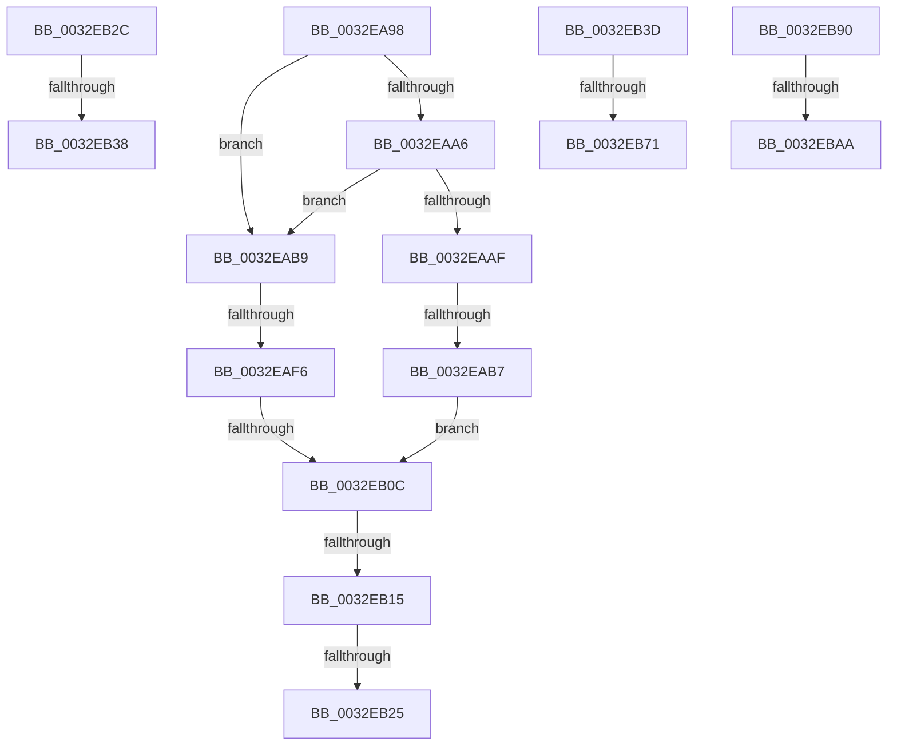

# sub_0032EA98

- RVA: `0x0032EA98`–`0x0032EBD5` (길이 `317` bytes)
- VA: `0x000000014032EA98`
- 실행 섹션: `.text`
- PDB 이름 있음: `아니요`; PDB Function 태그: `아니요`
- unwind 정보 RVA: `0x000763F0`
- 디코드: `81`개 명령, `317/317` bytes 표시
- 미해석 바이트: `0` (있으면 어셈블리에 `.byte`로 보존)

> 이 문서는 커널 이미지의 기계어와 PDB 기호를 분석해 생성했습니다. 4번과 5번은 함수 원형과 자료형을 바이너리 사용 방식에서 추정한 C 해석이며 원본 소스 복구 결과는 아닙니다.

## 1. Dependencies

- 직접 호출 지점: **3**; 고유 호출 대상: **3**
- 직접 호출자로 확인된 함수: **0**
- RIP 상대 이미지 참조: **0**

### Outgoing calls
- `0x0032EB60` → [MiLocateSubsectionNode](../2B/MiLocateSubsectionNode_function_002BBEE0.md) (function, `0x002BBEE0`)
- `0x0032EBBA` → [PsGetProcessSessionIdEx](../22/PsGetProcessSessionIdEx_function_0022F8F0.md) (function, `0x0022F8F0`)
- `0x0032EBC7` → [MiGetSharedProtos](../34/MiGetSharedProtos_function_00348D58.md) (function, `0x00348D58`)

### Direct callers
- 이 함수 시작 RVA로 연결되는 직접 call은 확인되지 않았습니다. 간접 호출은 완전히 역산할 수 없습니다.

### Static image references
- 디코드된 RIP-relative 메모리 참조가 없습니다.

## 2. Other-region calls and transfers

- 다른 실행 섹션으로 향하는 call: **0**
- call이 아닌 외부 분기/꼬리 이동: **12**
  - `0x0032EAB5` → [sub_0032E9E0 + 0x6C](Unknown_function_0032E9E0.md) (`tail-transfer`)
  - `0x0032EAF0` → [sub_0032E9E0 + 0x6C](Unknown_function_0032E9E0.md) (`tail-transfer`)
  - `0x0032EB06` → [sub_0032E9E0 + 0x6C](Unknown_function_0032E9E0.md) (`tail-transfer`)
  - `0x0032EB0F` → [sub_0032E9E0 + 0x6C](Unknown_function_0032E9E0.md) (`tail-transfer`)
  - `0x0032EB1F` → [sub_0032E9E0 + 0x90](Unknown_function_0032E9E0.md) (`tail-transfer`)
  - `0x0032EB27` → [sub_0032E9E0 + 0xA0](Unknown_function_0032E9E0.md) (`tail-transfer`)
  - `0x0032EB32` → [sub_0032E9E0 + 0x5B](Unknown_function_0032E9E0.md) (`tail-transfer`)
  - `0x0032EB38` → [sub_0032E9E0 + 0x60](Unknown_function_0032E9E0.md) (`tail-transfer`)
  - `0x0032EB6B` → [sub_0032E9E0 + 0x6C](Unknown_function_0032E9E0.md) (`tail-transfer`)
  - `0x0032EB8B` → [sub_0032E9E0 + 0x76](Unknown_function_0032E9E0.md) (`tail-transfer`)
  - `0x0032EBA4` → [sub_0032E9E0 + 0x9C](Unknown_function_0032E9E0.md) (`tail-transfer`)
  - `0x0032EBD0` → [sub_0032E9E0 + 0x9C](Unknown_function_0032E9E0.md) (`tail-transfer`)

## 3. Assembly (complete function range)

```asm
0032EA98  41 F7 46 38 00 10 00 00         test dword ptr [r14 + 0x38], 0x1000
0032EAA0  45 8B 4E 60                     mov r9d, dword ptr [r14 + 0x60]
0032EAA4  75 13                           jne 0x14032eab9
0032EAA6  81 7B 30 00 00 00 40            cmp dword ptr [rbx + 0x30], 0x40000000
0032EAAD  73 0A                           jae 0x14032eab9
0032EAAF  8B 43 2C                        mov eax, dword ptr [rbx + 0x2c]
0032EAB2  48 3B F8                        cmp rdi, rax
0032EAB5  73 95                           jae 0x14032ea4c
0032EAB7  EB 53                           jmp 0x14032eb0c
0032EAB9  81 7B 30 00 00 00 40            cmp dword ptr [rbx + 0x30], 0x40000000
0032EAC0  48 8B C7                        mov rax, rdi
0032EAC3  41 B8 00 00 04 00               mov r8d, 0x40000
0032EAC9  4D 0F 42 C7                     cmovb r8, r15
0032EACD  33 D2                           xor edx, edx
0032EACF  49 F7 F0                        div r8
0032EAD2  33 D2                           xor edx, edx
0032EAD4  8B C8                           mov ecx, eax
0032EAD6  4C 8B D0                        mov r10, rax
0032EAD9  48 8B C7                        mov rax, rdi
0032EADC  49 F7 F0                        div r8
0032EADF  48 8B FA                        mov rdi, rdx
0032EAE2  48 8D 51 01                     lea rdx, [rcx + 1]
0032EAE6  48 85 FF                        test rdi, rdi
0032EAE9  48 0F 44 D1                     cmove rdx, rcx
0032EAED  49 3B D1                        cmp rdx, r9
0032EAF0  0F 87 56 FF FF FF               ja 0x14032ea4c
0032EAF6  49 6B C2 58                     imul rax, r10, 0x58
0032EAFA  48 03 C3                        add rax, rbx
0032EAFD  48 8B D8                        mov rbx, rax
0032EB00  8B 40 2C                        mov eax, dword ptr [rax + 0x2c]
0032EB03  48 3B F8                        cmp rdi, rax
0032EB06  0F 83 40 FF FF FF               jae 0x14032ea4c
0032EB0C  48 85 DB                        test rbx, rbx
0032EB0F  0F 84 37 FF FF FF               je 0x14032ea4c
0032EB15  48 89 1E                        mov qword ptr [rsi], rbx
0032EB18  48 8B 4B 08                     mov rcx, qword ptr [rbx + 8]
0032EB1C  48 85 C9                        test rcx, rcx
0032EB1F  0F 85 4B FF FF FF               jne 0x14032ea70
0032EB25  33 C0                           xor eax, eax
0032EB27  E9 54 FF FF FF                  jmp 0x14032ea80
0032EB2C  41 8B 46 38                     mov eax, dword ptr [r14 + 0x38]
0032EB30  A8 20                           test al, 0x20
0032EB32  0F 85 03 FF FF FF               jne 0x14032ea3b
0032EB38  E9 03 FF FF FF                  jmp 0x14032ea40
0032EB3D  8B 4B 20                        mov ecx, dword ptr [rbx + 0x20]
0032EB40  44 8B C5                        mov r8d, ebp
0032EB43  8B 43 24                        mov eax, dword ptr [rbx + 0x24]
0032EB46  81 E1 C0 FF 00 00               and ecx, 0xffc0
0032EB4C  48 C1 E1 1A                     shl rcx, 0x1a
0032EB50  48 0B C8                        or rcx, rax
0032EB53  48 03 F9                        add rdi, rcx
0032EB56  49 8B CE                        mov rcx, r14
0032EB59  48 C1 E7 0C                     shl rdi, 0xc
0032EB5D  48 8B D7                        mov rdx, rdi
0032EB60  E8 7B D3 F8 FF                  call 0x1402bbee0
0032EB65  48 8B D8                        mov rbx, rax
0032EB68  48 85 C0                        test rax, rax
0032EB6B  0F 84 DB FE FF FF               je 0x14032ea4c
0032EB71  8B 50 20                        mov edx, dword ptr [rax + 0x20]
0032EB74  8B 48 24                        mov ecx, dword ptr [rax + 0x24]
0032EB77  81 E2 C0 FF 00 00               and edx, 0xffc0
0032EB7D  48 C1 E2 1A                     shl rdx, 0x1a
0032EB81  48 0B D1                        or rdx, rcx
0032EB84  48 C1 EF 0C                     shr rdi, 0xc
0032EB88  48 2B FA                        sub rdi, rdx
0032EB8B  E9 C6 FE FF FF                  jmp 0x14032ea56
0032EB90  41 F7 46 38 00 00 00 08         test dword ptr [r14 + 0x38], 0x8000000
0032EB98  0F 95 C2                        setne dl
0032EB9B  40 F6 C5 02                     test bpl, 2
0032EB9F  0F 94 C0                        sete al
0032EBA2  84 D0                           test al, dl
0032EBA4  0F 84 D2 FE FF FF               je 0x14032ea7c
0032EBAA  65 48 8B 0C 25 88 01 00 00      mov rcx, qword ptr gs:[0x188]
0032EBB3  48 8B 89 B8 00 00 00            mov rcx, qword ptr [rcx + 0xb8]
0032EBBA  E8 31 0D F0 FF                  call 0x14022f8f0
0032EBBF  4C 8B C3                        mov r8, rbx
0032EBC2  8B D0                           mov edx, eax
0032EBC4  49 8B CE                        mov rcx, r14
0032EBC7  E8 8C A1 01 00                  call 0x140348d58
0032EBCC  48 8B 48 48                     mov rcx, qword ptr [rax + 0x48]
0032EBD0  E9 A7 FE FF FF                  jmp 0x14032ea7c
```

## 4. C-style interpretation (structured pseudocode)

```c
__int64 __fastcall sub_0032EA98(__int64 a1, int a2)
{
    __int64 result;

    if (((*(unsigned int *)(v_r14 + 56)) & (0x1000ULL)) != 0) goto loc_0032EAB9;
    if ((*(unsigned int *)(v_rbx + 48)) >= 0x40000000ULL) goto loc_0032EAB9;
    goto loc_0032EB0C;
loc_0032EAB9:
    a3 = (unsigned int)(0x40000ULL);
    if ((*(unsigned int *)(v_rbx + 48)) < 0x40000000ULL) { a3 = v_r15; }
    a2 = 0;
    a2 = 0;
    a2 = (unsigned int)((unsigned int)(v_rdi)) + 1;
    if (0 == 0) { a2 = (unsigned int)((unsigned int)(v_rdi)); }
    result = (v_rdi) * (v_rdi);
    result = (result) + (v_rbx);
loc_0032EB0C:
    *(unsigned __int64 *)(v_rsi) = result;
    result = 0;
}
```

## 5. (Beta) C Style

```c
int64_t sub_0032EA98(int64_t Arg1, int32_t Arg2)
{
    int64_t result;

    if (((*(uint32_t *)(local_r14 + 0x38)) & (0x1000ULL)) != 0) goto loc_0032EAB9;
    if ((*(uint32_t *)(local_rbx + 0x30)) >= 0x40000000ULL) goto loc_0032EAB9;
    goto loc_0032EB0C;
loc_0032EAB9:
    a3 = (uint32_t)(0x40000ULL);
    if ((*(uint32_t *)(local_rbx + 0x30)) < 0x40000000ULL) { a3 = local_r15; }
    Arg2 = 0;
    Arg2 = 0;
    Arg2 = (uint32_t)((uint32_t)(local_rdi)) + 1;
    if (0 == 0) { Arg2 = (uint32_t)((uint32_t)(local_rdi)); }
    result = (local_rdi) * (local_rdi);
    result = (result) + (local_rbx);
loc_0032EB0C:
    *(uint64_t *)(local_rsi) = result;
    result = 0;
}
```

## 6. Execution-region graph

[열기: 2D/3D 그래프와 함수 탐색 컨트롤 패널](../../../control-panel.html?section=text&rva=0x0032EA98&view=graph)

- 2D 그래프는 위에서 아래로 흐르고, 3D 그래프는 빈 공간을 드래그해 회전합니다. Shift+드래그는 이동, 휠은 확대·축소, 함수 노드 선택은 대상 보고서 이동입니다.

### Static fallback


