# sub_0032F7AB

- RVA: `0x0032F7AB`–`0x0032FB87` (길이 `988` bytes)
- VA: `0x000000014032F7AB`
- 실행 섹션: `.text`
- PDB 이름 있음: `아니요`; PDB Function 태그: `아니요`
- unwind 정보 RVA: `0x00076458`
- 디코드: `216`개 명령, `988/988` bytes 표시
- 미해석 바이트: `0` (있으면 어셈블리에 `.byte`로 보존)

> 이 문서는 커널 이미지의 기계어와 PDB 기호를 분석해 생성했습니다. 4번과 5번은 함수 원형과 자료형을 바이너리 사용 방식에서 추정한 C 해석이며 원본 소스 복구 결과는 아닙니다.

## 1. Dependencies

- 직접 호출 지점: **5**; 고유 호출 대상: **5**
- 직접 호출자로 확인된 함수: **0**
- RIP 상대 이미지 참조: **2**

### Outgoing calls
- `0x0032FA37` → [memset](../6C/memset_function_006C6C40.md) (function, `0x006C6C40`)
- `0x0032FA75` → [MiComputeZeroClusterMaximum](../44/MiComputeZeroClusterMaximum_function_0044B15C.md) (function, `0x0044B15C`)
- `0x0032FB40` → [MiLockVadTree](../27/MiLockVadTree_function_0027C0F0.md) (function, `0x0027C0F0`)
- `0x0032FB48` → [MiLocateAddress](../31/MiLocateAddress_function_003168D0.md) (function, `0x003168D0`)
- `0x0032FB6F` → [ExReleaseSpinLockSharedFromDpcLevel](../24/ExReleaseSpinLockSharedFromDpcLevel_function_0024A590.md) (function, `0x0024A590`)

### Direct callers
- 이 함수 시작 RVA로 연결되는 직접 call은 확인되지 않았습니다. 간접 호출은 완전히 역산할 수 없습니다.

### Static image references
- `0x0032F804` → RVA `0x00E30088` (`.data`; read)
- `0x0032F8DF` → RVA `0x00000000` (`image boundary/outside`; read)

## 2. Other-region calls and transfers

- 다른 실행 섹션으로 향하는 call: **0**
- call이 아닌 외부 분기/꼬리 이동: **25**
  - `0x0032F7CF` → [sub_00330069](../33/Unknown_function_00330069.md) (`tail-transfer`)
  - `0x0032F7F7` → [sub_0032FE5C + 0x1BA](Unknown_function_0032FE5C.md) (`tail-transfer`)
  - `0x0032F825` → [sub_00330069 + 0x25](../33/Unknown_function_00330069.md) (`tail-transfer`)
  - `0x0032F8A4` → [sub_0032FE5C + 0x1CD](Unknown_function_0032FE5C.md) (`tail-transfer`)
  - `0x0032F8B8` → [sub_0032FE5C + 0x1DA](Unknown_function_0032FE5C.md) (`tail-transfer`)
  - `0x0032F8CA` → [sub_00330069 + 0x10](../33/Unknown_function_00330069.md) (`tail-transfer`)
  - `0x0032F8F0` → [sub_0032FE5C + 0x31](Unknown_function_0032FE5C.md) (`tail-transfer`)
  - `0x0032F8F8` → [sub_0032FE5C + 0x140](Unknown_function_0032FE5C.md) (`tail-transfer`)
  - `0x0032F900` → [sub_0032FE5C + 0x140](Unknown_function_0032FE5C.md) (`tail-transfer`)
  - `0x0032F946` → [sub_0032FBA9](Unknown_function_0032FBA9.md) (`tail-transfer`)
  - `0x0032F968` → [sub_0032FBA9 + 0x9D](Unknown_function_0032FBA9.md) (`tail-transfer`)
  - `0x0032F97A` → [sub_0032FBA9 + 0x9D](Unknown_function_0032FBA9.md) (`tail-transfer`)
  - `0x0032F99E` → [sub_0032FBA9 + 0x9D](Unknown_function_0032FBA9.md) (`tail-transfer`)
  - `0x0032F9AB` → [sub_0032FBA9 + 0x9D](Unknown_function_0032FBA9.md) (`tail-transfer`)
  - `0x0032F9C1` → [sub_00330069 + 0x46](../33/Unknown_function_00330069.md) (`tail-transfer`)
  - `0x0032F9CC` → [sub_0032FBA9 + 0x9D](Unknown_function_0032FBA9.md) (`tail-transfer`)
  - `0x0032FA06` → [sub_0032FE5C + 0xEA](Unknown_function_0032FE5C.md) (`tail-transfer`)
  - `0x0032FA27` → [sub_0032FBA9 + 0x9D](Unknown_function_0032FBA9.md) (`tail-transfer`)
  - `0x0032FA7E` → [sub_0032FBA9 + 0xAD](Unknown_function_0032FBA9.md) (`tail-transfer`)
  - `0x0032FA94` → [sub_0032FBA9 + 0x275](Unknown_function_0032FBA9.md) (`tail-transfer`)
  - `0x0032FAD6` → [sub_0032FE5C + 0x83](Unknown_function_0032FE5C.md) (`tail-transfer`)
  - `0x0032FAE3` → [sub_0032FE5C + 0xCB](Unknown_function_0032FE5C.md) (`tail-transfer`)
  - `0x0032FAFE` → [sub_0032FBA9 + 0xB9](Unknown_function_0032FBA9.md) (`tail-transfer`)
  - `0x0032FB07` → [sub_0032FE5C + 0x190](Unknown_function_0032FE5C.md) (`tail-transfer`)
  - `0x0032FB13` → [sub_0032FBA9 + 0xB9](Unknown_function_0032FBA9.md) (`tail-transfer`)

## 3. Assembly (complete function range)

```asm
0032F7AB  48 89 9C 24 90 01 00 00         mov qword ptr [rsp + 0x190], rbx
0032F7B3  4C 89 A4 24 88 01 00 00         mov qword ptr [rsp + 0x188], r12
0032F7BB  4C 89 AC 24 80 01 00 00         mov qword ptr [rsp + 0x180], r13
0032F7C3  4C 89 B4 24 78 01 00 00         mov qword ptr [rsp + 0x178], r14
0032F7CB  41 F6 C0 20                     test r8b, 0x20
0032F7CF  0F 85 94 08 00 00               jne 0x140330069
0032F7D5  65 48 8B 04 25 88 01 00 00      mov rax, qword ptr gs:[0x188]
0032F7DE  49 8B 52 38                     mov rdx, qword ptr [r10 + 0x38]
0032F7E2  48 89 95 D8 00 00 00            mov qword ptr [rbp + 0xd8], rdx
0032F7E9  4C 8B 88 B8 00 00 00            mov r9, qword ptr [rax + 0xb8]
0032F7F0  48 8B 47 48                     mov rax, qword ptr [rdi + 0x48]
0032F7F4  48 85 C0                        test rax, rax
0032F7F7  0F 85 19 08 00 00               jne 0x140330016
0032F7FD  0F B7 8A AE 00 00 00            movzx ecx, word ptr [rdx + 0xae]
0032F804  48 8B 05 7D 08 B0 00            mov rax, qword ptr [rip + 0xb0087d]
0032F80B  4C 8B 1C C8                     mov r11, qword ptr [rax + rcx*8]
0032F80F  4C 89 5C 24 68                  mov qword ptr [rsp + 0x68], r11
0032F814  41 0F BA E0 08                  bt r8d, 8
0032F819  73 10                           jae 0x14032f82b
0032F81B  49 8B 89 70 02 00 00            mov rcx, qword ptr [r9 + 0x270]
0032F822  48 85 C9                        test rcx, rcx
0032F825  0F 85 63 08 00 00               jne 0x14033008e
0032F82B  4D 8B EF                        mov r13, r15
0032F82E  49 B8 00 00 00 00 80 F6 FF FF   movabs r8, 0xfffff68000000000
0032F838  49 C1 ED 09                     shr r13, 9
0032F83C  49 C7 C2 FF FF FF FF            mov r10, 0xffffffffffffffff
0032F843  48 B8 F8 FF FF FF 7F 00 00 00   movabs rax, 0x7ffffffff8
0032F84D  4C 89 95 D0 00 00 00            mov qword ptr [rbp + 0xd0], r10
0032F854  4C 23 E8                        and r13, rax
0032F857  41 BE 01 00 00 00               mov r14d, 1
0032F85D  49 8B C0                        mov rax, r8
0032F860  8B 5F 30                        mov ebx, dword ptr [rdi + 0x30]
0032F863  45 8D 4E 01                     lea r9d, [r14 + 1]
0032F867  4C 03 E8                        add r13, rax
0032F86A  0F 57 C0                        xorps xmm0, xmm0
0032F86D  33 C0                           xor eax, eax
0032F86F  B9 09 00 00 00                  mov ecx, 9
0032F874  89 85 C8 00 00 00               mov dword ptr [rbp + 0xc8], eax
0032F87A  48 89 44 24 50                  mov qword ptr [rsp + 0x50], rax
0032F87F  0F 11 44 24 40                  movups xmmword ptr [rsp + 0x40], xmm0
0032F884  8B 82 B8 00 00 00               mov eax, dword ptr [rdx + 0xb8]
0032F88A  89 8D C0 00 00 00               mov dword ptr [rbp + 0xc0], ecx
0032F890  A8 0F                           test al, 0xf
0032F892  75 30                           jne 0x14032f8c4
0032F894  65 48 8B 0C 25 88 01 00 00      mov rcx, qword ptr gs:[0x188]
0032F89D  80 B9 27 07 00 00 FF            cmp byte ptr [rcx + 0x727], 0xff
0032F8A4  0F 85 7F 07 00 00               jne 0x140330029
0032F8AA  48 8B 81 B8 00 00 00            mov rax, qword ptr [rcx + 0xb8]
0032F8B1  80 B8 EE 06 00 00 FF            cmp byte ptr [rax + 0x6ee], 0xff
0032F8B8  0F 85 78 07 00 00               jne 0x140330036
0032F8BE  8B 8D C0 00 00 00               mov ecx, dword ptr [rbp + 0xc0]
0032F8C4  F7 07 00 00 04 00               test dword ptr [rdi], 0x40000
0032F8CA  0F 85 A9 07 00 00               jne 0x140330079
0032F8D0  48 83 7F 40 00                  cmp qword ptr [rdi + 0x40], 0
0032F8D5  0F 84 3D 02 00 00               je 0x14032fb18
0032F8DB  4C 8B 67 40                     mov r12, qword ptr [rdi + 0x40]
0032F8DF  48 8D 0D 1A 07 CD FF            lea rcx, [rip - 0x32f8e6]
0032F8E6  8B 07                           mov eax, dword ptr [rdi]
0032F8E8  4C 89 64 24 58                  mov qword ptr [rsp + 0x58], r12
0032F8ED  4D 85 E4                        test r12, r12
0032F8F0  0F 84 97 05 00 00               je 0x14032fe8d
0032F8F6  A8 03                           test al, 3
0032F8F8  0F 85 9E 06 00 00               jne 0x14032ff9c
0032F8FE  A8 40                           test al, 0x40
0032F900  0F 85 96 06 00 00               jne 0x14032ff9c
0032F906  41 8B 5C 24 30                  mov ebx, dword ptr [r12 + 0x30]
0032F90B  8B D3                           mov edx, ebx
0032F90D  C1 EB 0C                        shr ebx, 0xc
0032F910  83 E3 7F                        and ebx, 0x7f
0032F913  4C 89 95 D0 00 00 00            mov qword ptr [rbp + 0xd0], r10
0032F91A  48 BE 00 D0 BE 7D FB F6 FF FF   movabs rsi, 0xfffff6fb7dbed000
0032F924  49 BC F8 D7 BE 7D FB F6 FF FF   movabs r12, 0xfffff6fb7dbed7f8
0032F92E  0F BA E2 15                     bt edx, 0x15
0032F932  73 18                           jae 0x14032f94c
0032F934  8B C2                           mov eax, edx
0032F936  48 C1 E8 13                     shr rax, 0x13
0032F93A  83 E0 03                        and eax, 3
0032F93D  48 83 BC C1 78 45 01 00 10      cmp qword ptr [rcx + rax*8 + 0x14578], 0x10
0032F946  0F 84 5D 02 00 00               je 0x14032fba9
0032F94C  44 8B 07                        mov r8d, dword ptr [rdi]
0032F94F  41 F6 C0 43                     test r8b, 0x43
0032F953  0F 94 C1                        sete cl
0032F956  41 F6 C5 7F                     test r13b, 0x7f
0032F95A  0F 94 C0                        sete al
0032F95D  22 C8                           and cl, al
0032F95F  0F BA E2 15                     bt edx, 0x15
0032F963  0F 92 C0                        setb al
0032F966  84 C8                           test al, cl
0032F968  0F 84 D8 02 00 00               je 0x14032fc46
0032F96E  81 E2 00 00 60 00               and edx, 0x600000
0032F974  81 FA 00 00 60 00               cmp edx, 0x600000
0032F97A  0F 84 C6 02 00 00               je 0x14032fc46
0032F980  48 8B 44 24 58                  mov rax, qword ptr [rsp + 0x58]
0032F985  0F B6 48 20                     movzx ecx, byte ptr [rax + 0x20]
0032F989  8B 40 18                        mov eax, dword ptr [rax + 0x18]
0032F98C  48 C1 E1 20                     shl rcx, 0x20
0032F990  48 0B C1                        or rax, rcx
0032F993  48 83 C0 10                     add rax, 0x10
0032F997  48 C1 E0 0C                     shl rax, 0xc
0032F99B  4C 3B F8                        cmp r15, rax
0032F99E  0F 82 A2 02 00 00               jb 0x14032fc46
0032F9A4  49 F7 C5 FF 0F 00 00            test r13, 0xfff
0032F9AB  0F 84 95 02 00 00               je 0x14032fc46
0032F9B1  48 B8 00 00 00 00 80 F6 FF FF   movabs rax, 0xfffff68000000000
0032F9BB  48 8B C0                        mov rax, rax
0032F9BE  4C 3B F8                        cmp r15, rax
0032F9C1  0F 83 E8 06 00 00               jae 0x1403300af
0032F9C7  41 0F BA E0 12                  bt r8d, 0x12
0032F9CC  0F 82 74 02 00 00               jb 0x14032fc46
0032F9D2  45 33 C9                        xor r9d, r9d
0032F9D5  4D 8D 45 F8                     lea r8, [r13 - 8]
0032F9D9  0F 1F 80 00 00 00 00            nop dword ptr [rax]
0032F9E0  49 8B 10                        mov rdx, qword ptr [r8]
0032F9E3  48 8B C6                        mov rax, rsi
0032F9E6  4C 3B C0                        cmp r8, rax
0032F9E9  72 21                           jb 0x14032fa0c
0032F9EB  49 8B C4                        mov rax, r12
0032F9EE  4C 3B C0                        cmp r8, rax
0032F9F1  77 19                           ja 0x14032fa0c
0032F9F3  41 84 D6                        test r14b, dl
0032F9F6  74 2B                           je 0x14032fa23
0032F9F8  F6 C2 42                        test dl, 0x42
0032F9FB  0F 95 C1                        setne cl
0032F9FE  F6 C2 20                        test dl, 0x20
0032FA01  0F 95 C0                        setne al
0032FA04  84 C8                           test al, cl
0032FA06  0F 84 3A 05 00 00               je 0x14032ff46
0032FA0C  41 84 D6                        test r14b, dl
0032FA0F  74 12                           je 0x14032fa23
0032FA11  F6 C2 20                        test dl, 0x20
0032FA14  74 0D                           je 0x14032fa23
0032FA16  49 FF C1                        inc r9
0032FA19  49 83 E8 08                     sub r8, 8
0032FA1D  49 83 F9 10                     cmp r9, 0x10
0032FA21  72 BD                           jb 0x14032f9e0
0032FA23  49 83 F9 10                     cmp r9, 0x10
0032FA27  0F 85 19 02 00 00               jne 0x14032fc46
0032FA2D  33 D2                           xor edx, edx
0032FA2F  45 8D 41 68                     lea r8d, [r9 + 0x68]
0032FA33  48 8D 4D F0                     lea rcx, [rbp - 0x10]
0032FA37  E8 04 72 39 00                  call 0x1406c6c40
0032FA3C  4C 8B 44 24 58                  mov r8, qword ptr [rsp + 0x58]
0032FA41  48 8D 45 E0                     lea rax, [rbp - 0x20]
0032FA45  48 8B 95 D8 00 00 00            mov rdx, qword ptr [rbp + 0xd8]
0032FA4C  48 8D 4D F0                     lea rcx, [rbp - 0x10]
0032FA50  48 89 45 F8                     mov qword ptr [rbp - 8], rax
0032FA54  49 81 E7 00 F0 FF FF            and r15, 0xfffffffffffff000
0032FA5B  33 C0                           xor eax, eax
0032FA5D  4C 89 7D E0                     mov qword ptr [rbp - 0x20], r15
0032FA61  48 89 45 08                     mov qword ptr [rbp + 8], rax
0032FA65  48 89 45 10                     mov qword ptr [rbp + 0x10], rax
0032FA69  48 C7 45 E8 00 00 01 00         mov qword ptr [rbp - 0x18], 0x10000
0032FA71  4C 89 75 00                     mov qword ptr [rbp], r14
0032FA75  E8 E2 B6 11 00                  call 0x14044b15c
0032FA7A  48 83 F8 10                     cmp rax, 0x10
0032FA7E  0F 82 D2 01 00 00               jb 0x14032fc56
0032FA84  41 BA 10 00 00 00               mov r10d, 0x10
0032FA8A  45 8D 7A F2                     lea r15d, [r10 - 0xe]
0032FA8E  48 83 7C 24 50 00               cmp qword ptr [rsp + 0x50], 0
0032FA94  0F 85 84 03 00 00               jne 0x14032fe1e
0032FA9A  41 BE 01 00 00 00               mov r14d, 1
0032FAA0  4D 3B F2                        cmp r14, r10
0032FAA3  73 55                           jae 0x14032fafa
0032FAA5  4D 8D 45 08                     lea r8, [r13 + 8]
0032FAA9  0F 1F 80 00 00 00 00            nop dword ptr [rax]
0032FAB0  49 8B 10                        mov rdx, qword ptr [r8]
0032FAB3  48 8B C6                        mov rax, rsi
0032FAB6  4C 3B C0                        cmp r8, rax
0032FAB9  72 21                           jb 0x14032fadc
0032FABB  49 8B C4                        mov rax, r12
0032FABE  4C 3B C0                        cmp r8, rax
0032FAC1  77 19                           ja 0x14032fadc
0032FAC3  F6 C2 01                        test dl, 1
0032FAC6  74 14                           je 0x14032fadc
0032FAC8  F6 C2 42                        test dl, 0x42
0032FACB  0F 95 C1                        setne cl
0032FACE  F6 C2 20                        test dl, 0x20
0032FAD1  0F 95 C0                        setne al
0032FAD4  84 C8                           test al, cl
0032FAD6  0F 84 03 04 00 00               je 0x14032fedf
0032FADC  44 8B 4F 24                     mov r9d, dword ptr [rdi + 0x24]
0032FAE0  45 85 C9                        test r9d, r9d
0032FAE3  0F 85 3E 04 00 00               jne 0x14032ff27
0032FAE9  48 85 D2                        test rdx, rdx
0032FAEC  75 0C                           jne 0x14032fafa
0032FAEE  49 FF C6                        inc r14
0032FAF1  49 83 C0 08                     add r8, 8
0032FAF5  4D 3B F2                        cmp r14, r10
0032FAF8  72 B6                           jb 0x14032fab0
0032FAFA  41 83 FF 02                     cmp r15d, 2
0032FAFE  0F 85 5E 01 00 00               jne 0x14032fc62
0032FB04  4D 3B F2                        cmp r14, r10
0032FB07  0F 85 DF 04 00 00               jne 0x14032ffec
0032FB0D  81 0F 00 02 00 00               or dword ptr [rdi], 0x200
0032FB13  E9 4A 01 00 00                  jmp 0x14032fc62
0032FB18  49 8B C0                        mov rax, r8
0032FB1B  48 B9 78 FF FF FF 3F 00 00 00   movabs rcx, 0x3fffffff78
0032FB25  48 03 C1                        add rax, rcx
0032FB28  4C 3B E8                        cmp r13, rax
0032FB2B  0F 87 AA FD FF FF               ja 0x14032f8db
0032FB31  49 8B C0                        mov rax, r8
0032FB34  4C 3B E8                        cmp r13, rax
0032FB37  0F 82 9E FD FF FF               jb 0x14032f8db
0032FB3D  41 8B CE                        mov ecx, r14d
0032FB40  E8 AB C5 F4 FF                  call 0x14027c0f0
0032FB45  49 8B CF                        mov rcx, r15
0032FB48  E8 83 6D FE FF                  call 0x1403168d0
0032FB4D  48 89 47 40                     mov qword ptr [rdi + 0x40], rax
0032FB51  65 48 8B 04 25 88 01 00 00      mov rax, qword ptr gs:[0x188]
0032FB5A  48 8B 88 B8 00 00 00            mov rcx, qword ptr [rax + 0xb8]
0032FB61  48 8B 89 10 04 00 00            mov rcx, qword ptr [rcx + 0x410]
0032FB68  48 81 C1 EC 03 00 00            add rcx, 0x3ec
0032FB6F  E8 1C AA F1 FF                  call 0x14024a590
0032FB74  4C 8B 95 D0 00 00 00            mov r10, qword ptr [rbp + 0xd0]
0032FB7B  48 8B 95 D8 00 00 00            mov rdx, qword ptr [rbp + 0xd8]
0032FB82  E9 54 FD FF FF                  jmp 0x14032f8db
```

## 4. C-style interpretation (structured pseudocode)

```c
__int64 __fastcall sub_0032F7AB(__int64 a1, __int64 a2, int a3, __int64 a4, __int64 a5, __int64 a6, __int64 a7, __int64 a8, __int64 a9, __int64 a10, __int64 a11)
{
    __int64 result;
    __int64 v_r13;
    __int64 v_r14;
    __int64 v_r15;
    __int64 v_rbx;
    unsigned __int64 v_stack_p178;
    unsigned __int64 v_stack_p180;
    unsigned __int64 v_stack_p188;
    unsigned __int64 v_stack_p190;
    unsigned __int64 v_stack_p50;
    unsigned __int64 v_stack_p58;
    unsigned __int64 v_stack_p68;

    v_stack_p190 = v_rbx;
    v_stack_p188 = v_r12;
    v_stack_p180 = v_r13;
    v_stack_p178 = v_r14;
    *(unsigned __int64 *)(v_rbp + 216) = *(unsigned __int64 *)(v_r10 + 56);
    v_stack_p68 = *(unsigned __int64 *)(*(unsigned __int64 *)(v_rip + 11536509) + *(unsigned __int16 *)(*(unsigned __int64 *)(v_r10 + 56) + 174) * 8);
    if (condition_is_above_or_equal) goto loc_0032F82B;
loc_0032F82B:
    v_r13 = (v_r15) >> (9);
    *(unsigned __int64 *)(v_rbp + 208) = -1;
    v_r13 = (v_r13) & (*(unsigned __int64 *)(v_rip + 11536509));
    v_r13 = (v_r13) + (a3);
    result = 0;
    *(unsigned int *)(v_rbp + 200) = 0;
    v_stack_p50 = 0;
    a8 = v_xmm0;
    *(unsigned int *)(v_rbp + 192) = 9;
    if ((((unsigned __int8)((unsigned int)(*(unsigned int *)(*(unsigned __int64 *)(v_r10 + 56) + 184)))) & (15)) != 0) goto loc_0032F8C4;
loc_0032F8C4:
    if ((*(unsigned __int64 *)(v_rdi + 64)) == 0) goto loc_0032FB18;
loc_0032F8DB:
    v_stack_p58 = *(unsigned __int64 *)(v_rdi + 64);
    v_rbx = (unsigned int)(((unsigned int)(*(unsigned int *)(*(unsigned __int64 *)(v_rdi + 64) + 48))) >> (12));
    v_rbx = (unsigned int)((v_rbx) & (127));
    *(unsigned __int64 *)(v_rbp + 208) = -1;
    if (condition_is_above_or_equal) goto loc_0032F94C;
    result = ((unsigned int)((unsigned int)((unsigned int)((unsigned int)((unsigned int)(*(unsigned int *)(*(unsigned __int64 *)(v_rdi + 64) + 48))))))) >> (19);
    result = (unsigned int)((result) & (3));
loc_0032F94C:
    a1 = ((((unsigned __int8)((unsigned int)(*(unsigned int *)(v_rdi)))) & (67)) == 0) ? 1 : 0;
    result = ((((unsigned __int8)(v_r13)) & (127)) == 0) ? 1 : 0;
    a1 = (unsigned __int8)((a1) & ((unsigned __int8)(result)));
    result = (condition_is_below) ? 1 : 0;
    a2 = (unsigned int)(((unsigned int)((unsigned int)((unsigned int)(*(unsigned int *)(*(unsigned __int64 *)(v_rdi + 64) + 48))))) & (0x600000ULL));
    a1 = (*(unsigned __int8 *)(a11 + 32)) << (32);
    result = ((unsigned int)(*(unsigned int *)(a11 + 24))) | (a1);
    result = (result) + (16);
    result = (result) << (12);
    a4 = 0;
loc_0032F9E0:
    if ((v_r13 - 8) < v_rsi) goto loc_0032FA0C;
    if ((v_r13 - 8) > (*(unsigned __int64 *)(v_rdi + 64))) goto loc_0032FA0C;
    if (((1) & ((unsigned __int8)(*(unsigned __int64 *)(v_r13 - 8)))) == 0) goto loc_0032FA23;
    a1 = ((((unsigned __int8)(*(unsigned __int64 *)(v_r13 - 8))) & (66)) != 0) ? 1 : 0;
    result = ((((unsigned __int8)(*(unsigned __int64 *)(v_r13 - 8))) & (32)) != 0) ? 1 : 0;
loc_0032FA0C:
    if (((1) & ((unsigned __int8)(*(unsigned __int64 *)(v_r13 - 8)))) == 0) goto loc_0032FA23;
    if ((((unsigned __int8)(*(unsigned __int64 *)(v_r13 - 8))) & (32)) == 0) goto loc_0032FA23;
    a4 = (a4) + 1;
    a3 = (v_r13 - 8) - (8);
    if (a4 < 16) goto loc_0032F9E0;
loc_0032FA23:
    a2 = 0;
    result = memset(v_rbp - 16, a2, a4 + 104, a4);
    *(unsigned __int64 *)(v_rbp - 8) = v_rbp - 32;
    v_r15 = (v_r15) & (0xFFFFFFFFFFFFF000ULL);
    result = 0;
    *(unsigned __int64 *)(v_rbp - 32) = v_r15;
    *(unsigned __int64 *)(v_rbp + 8) = 0;
    *(unsigned __int64 *)(v_rbp + 16) = 0;
    *(unsigned __int64 *)(v_rbp - 24) = 0x10000ULL;
    *(unsigned __int64 *)(v_rbp) = 1;
    result = MiComputeZeroClusterMaximum(v_rbp - 16, *(unsigned __int64 *)(v_rbp + 216), a11, a4);
    if (1 >= 16) goto loc_0032FAFA;
loc_0032FAB0:
    if ((v_r13 + 8) < v_rsi) goto loc_0032FADC;
    if ((v_r13 + 8) > (*(unsigned __int64 *)(v_rdi + 64))) goto loc_0032FADC;
    if ((((unsigned __int8)(*(unsigned __int64 *)(v_r13 + 8))) & (1)) == 0) goto loc_0032FADC;
    a1 = ((((unsigned __int8)(*(unsigned __int64 *)(v_r13 + 8))) & (66)) != 0) ? 1 : 0;
    result = ((((unsigned __int8)(*(unsigned __int64 *)(v_r13 + 8))) & (32)) != 0) ? 1 : 0;
loc_0032FADC:
    if (*(unsigned __int64 *)(v_r13 + 8) != 0) goto loc_0032FAFA;
    v_r14 = (1) + 1;
    a3 = (v_r13 + 8) + (8);
    if (v_r14 < 16) goto loc_0032FAB0;
loc_0032FAFA:
loc_0032FB18:
    result = (a3) + (a1);
    if (v_r13 > result) goto loc_0032F8DB;
    if (v_r13 < a3) goto loc_0032F8DB;
    result = MiLockVadTree((unsigned int)((unsigned int)(v_r14)), *(unsigned __int64 *)(v_r13 + 8), a3, (unsigned int)(*(unsigned int *)(v_rdi + 36)));
    result = MiLocateAddress(16 - 14, *(unsigned __int64 *)(v_r13 + 8), a3, (unsigned int)(*(unsigned int *)(v_rdi + 36)));
    *(unsigned __int64 *)(v_rdi + 64) = result;
    a1 = (*(unsigned __int64 *)(*(unsigned __int64 *)(*(unsigned __int64 *)(gs_base + (0 + 392)) + 184) + 1040)) + (0x3ECULL);
    result = ExReleaseSpinLockSharedFromDpcLevel(a1, *(unsigned __int64 *)(v_r13 + 8), a3, (unsigned int)(*(unsigned int *)(v_rdi + 36)));
    goto loc_0032F8DB;
}
```

## 5. (Beta) C Style

```c
int64_t sub_0032F7AB(int64_t Arg1, int64_t Arg2, int32_t Arg3, int64_t Arg4, uint64_t Arg5, uint64_t Arg6, uint64_t Arg7, int64_t Arg8, uint64_t Arg9, int64_t Arg10, void *Arg11)
{
    uint8_t *arg11 = (uint8_t *)Arg11;

    int64_t result;
    int64_t local_r13;
    int64_t local_r14;
    int64_t local_r15;
    int64_t local_rbx;
    uint64_t v_stack_p178;
    uint64_t v_stack_p180;
    uint64_t v_stack_p188;
    uint64_t v_stack_p190;
    uint64_t v_stack_p50;
    uint64_t v_stack_p58;
    uint64_t v_stack_p68;

    v_stack_p190 = local_rbx;
    v_stack_p188 = local_r12;
    v_stack_p180 = local_r13;
    v_stack_p178 = local_r14;
    *(uint64_t *)(local_rbp + 0xD8) = *(uint64_t *)(local_r10 + 0x38);
    v_stack_p68 = *(uint64_t *)(*(uint64_t *)(v_rip + 0xB0087D) + *(uint16_t *)(*(uint64_t *)(local_r10 + 0x38) + 0xAE) * 8);
    if (condition_is_above_or_equal) goto loc_0032F82B;
loc_0032F82B:
    local_r13 = (local_r15) >> (9);
    *(uint64_t *)(local_rbp + 0xD0) = -1;
    local_r13 = (local_r13) & (*(uint64_t *)(v_rip + 0xB0087D));
    local_r13 = (local_r13) + (Arg3);
    result = 0;
    *(uint32_t *)(local_rbp + 0xC8) = 0;
    v_stack_p50 = 0;
    Arg8 = v_xmm0;
    *(uint32_t *)(local_rbp + 0xC0) = 9;
    if ((((uint8_t)((uint32_t)(*(uint32_t *)(*(uint64_t *)(local_r10 + 0x38) + 0xB8)))) & (15)) != 0) goto loc_0032F8C4;
loc_0032F8C4:
    if ((*(uint64_t *)(local_rdi + 0x40)) == 0) goto loc_0032FB18;
loc_0032F8DB:
    v_stack_p58 = *(uint64_t *)(local_rdi + 0x40);
    local_rbx = (uint32_t)(((uint32_t)(*(uint32_t *)(*(uint64_t *)(local_rdi + 0x40) + 0x30))) >> (12));
    local_rbx = (uint32_t)((local_rbx) & (127));
    *(uint64_t *)(local_rbp + 0xD0) = -1;
    if (condition_is_above_or_equal) goto loc_0032F94C;
    result = ((uint32_t)((uint32_t)((uint32_t)((uint32_t)((uint32_t)(*(uint32_t *)(*(uint64_t *)(local_rdi + 0x40) + 0x30))))))) >> (19);
    result = (uint32_t)((result) & (3));
loc_0032F94C:
    Arg1 = ((((uint8_t)((uint32_t)(*(uint32_t *)(local_rdi)))) & (67)) == 0) ? 1 : 0;
    result = ((((uint8_t)(local_r13)) & (127)) == 0) ? 1 : 0;
    Arg1 = (uint8_t)((Arg1) & ((uint8_t)(result)));
    result = (condition_is_below) ? 1 : 0;
    Arg2 = (uint32_t)(((uint32_t)((uint32_t)((uint32_t)(*(uint32_t *)(*(uint64_t *)(local_rdi + 0x40) + 0x30))))) & (0x600000ULL));
    Arg1 = (*(uint8_t *)(arg11 + 0x20)) << (32);
    result = ((uint32_t)(*(uint32_t *)(arg11 + 0x18))) | (Arg1);
    result = (result) + (16);
    result = (result) << (12);
    Arg4 = 0;
loc_0032F9E0:
    if ((local_r13 - 8) < local_rsi) goto loc_0032FA0C;
    if ((local_r13 - 8) > (*(uint64_t *)(local_rdi + 0x40))) goto loc_0032FA0C;
    if (((1) & ((uint8_t)(*(uint64_t *)(local_r13 - 0x8)))) == 0) goto loc_0032FA23;
    Arg1 = ((((uint8_t)(*(uint64_t *)(local_r13 - 0x8))) & (66)) != 0) ? 1 : 0;
    result = ((((uint8_t)(*(uint64_t *)(local_r13 - 0x8))) & (32)) != 0) ? 1 : 0;
loc_0032FA0C:
    if (((1) & ((uint8_t)(*(uint64_t *)(local_r13 - 0x8)))) == 0) goto loc_0032FA23;
    if ((((uint8_t)(*(uint64_t *)(local_r13 - 0x8))) & (32)) == 0) goto loc_0032FA23;
    Arg4 = (Arg4) + 1;
    Arg3 = (local_r13 - 8) - (8);
    if (Arg4 < 16) goto loc_0032F9E0;
loc_0032FA23:
    Arg2 = 0;
    result = memset(local_rbp - 16, Arg2, Arg4 + 104, Arg4);
    *(uint64_t *)(local_rbp - 0x8) = local_rbp - 32;
    local_r15 = (local_r15) & (0xFFFFFFFFFFFFF000ULL);
    result = 0;
    *(uint64_t *)(local_rbp - 0x20) = local_r15;
    *(uint64_t *)(local_rbp + 0x8) = 0;
    *(uint64_t *)(local_rbp + 0x10) = 0;
    *(uint64_t *)(local_rbp - 0x18) = 0x10000ULL;
    *(uint64_t *)(local_rbp) = 1;
    result = MiComputeZeroClusterMaximum(local_rbp - 16, *(uint64_t *)(local_rbp + 0xD8), Arg11, Arg4);
    if (1 >= 16) goto loc_0032FAFA;
loc_0032FAB0:
    if ((local_r13 + 8) < local_rsi) goto loc_0032FADC;
    if ((local_r13 + 8) > (*(uint64_t *)(local_rdi + 0x40))) goto loc_0032FADC;
    if ((((uint8_t)(*(uint64_t *)(local_r13 + 0x8))) & (1)) == 0) goto loc_0032FADC;
    Arg1 = ((((uint8_t)(*(uint64_t *)(local_r13 + 0x8))) & (66)) != 0) ? 1 : 0;
    result = ((((uint8_t)(*(uint64_t *)(local_r13 + 0x8))) & (32)) != 0) ? 1 : 0;
loc_0032FADC:
    if (*(uint64_t *)(local_r13 + 0x8) != 0) goto loc_0032FAFA;
    local_r14 = (1) + 1;
    Arg3 = (local_r13 + 8) + (8);
    if (local_r14 < 16) goto loc_0032FAB0;
loc_0032FAFA:
loc_0032FB18:
    result = (Arg3) + (Arg1);
    if (local_r13 > result) goto loc_0032F8DB;
    if (local_r13 < Arg3) goto loc_0032F8DB;
    result = MiLockVadTree((uint32_t)((uint32_t)(local_r14)), *(uint64_t *)(local_r13 + 0x8), Arg3, (uint32_t)(*(uint32_t *)(local_rdi + 0x24)));
    result = MiLocateAddress(16 - 14, *(uint64_t *)(local_r13 + 0x8), Arg3, (uint32_t)(*(uint32_t *)(local_rdi + 0x24)));
    *(uint64_t *)(local_rdi + 0x40) = result;
    Arg1 = (*(uint64_t *)(*(uint64_t *)(*(uint64_t *)(gs_base + (0 + 0x188)) + 0xB8) + 0x410)) + (0x3ECULL);
    result = ExReleaseSpinLockSharedFromDpcLevel(Arg1, *(uint64_t *)(local_r13 + 0x8), Arg3, (uint32_t)(*(uint32_t *)(local_rdi + 0x24)));
    goto loc_0032F8DB;
}
```

### 관측된 메모리 오프셋

구조체 형식이 확인되지 않은 접근은 인자 기준의 오프셋으로만 기록했습니다.

| 기준 인자 | 오프셋 표현 | 폭 (bit) | 접근 |
|---|---:|---:|---|
| `Arg11` | `+ 0x18` | `32` | `R` |
| `Arg11` | `+ 0x20` | `8` | `R` |

## 6. Execution-region graph

[열기: 2D/3D 그래프와 함수 탐색 컨트롤 패널](../../../control-panel.html?section=text&rva=0x0032F7AB&view=graph)

- 2D 그래프는 위에서 아래로 흐르고, 3D 그래프는 빈 공간을 드래그해 회전합니다. Shift+드래그는 이동, 휠은 확대·축소, 함수 노드 선택은 대상 보고서 이동입니다.

### Static fallback

```mermaid
flowchart TD
  bb_0032F7AB[BB_0032F7AB]
  bb_0032F7D5[BB_0032F7D5]
  bb_0032F7FD[BB_0032F7FD]
  bb_0032F81B[BB_0032F81B]
  bb_0032F82B[BB_0032F82B]
  bb_0032F894[BB_0032F894]
  bb_0032F8AA[BB_0032F8AA]
  bb_0032F8BE[BB_0032F8BE]
  bb_0032F8C4[BB_0032F8C4]
  bb_0032F8D0[BB_0032F8D0]
  bb_0032F8DB[BB_0032F8DB]
  bb_0032F8F6[BB_0032F8F6]
  bb_0032F8FE[BB_0032F8FE]
  bb_0032F906[BB_0032F906]
  bb_0032F934[BB_0032F934]
  bb_0032F94C[BB_0032F94C]
  bb_0032F96E[BB_0032F96E]
  bb_0032F980[BB_0032F980]
  bb_0032F9A4[BB_0032F9A4]
  bb_0032F9B1[BB_0032F9B1]
  bb_0032F9C7[BB_0032F9C7]
  bb_0032F9D2[BB_0032F9D2]
  bb_0032F9E0[BB_0032F9E0]
  bb_0032F9EB[BB_0032F9EB]
  bb_0032F9F3[BB_0032F9F3]
  bb_0032F9F8[BB_0032F9F8]
  bb_0032FA0C[BB_0032FA0C]
  bb_0032FA11[BB_0032FA11]
  bb_0032FA16[BB_0032FA16]
  bb_0032FA23[BB_0032FA23]
  bb_0032FA2D[BB_0032FA2D]
  bb_0032FA84[BB_0032FA84]
  bb_0032FA9A[BB_0032FA9A]
  bb_0032FAA5[BB_0032FAA5]
  bb_0032FAB0[BB_0032FAB0]
  bb_0032FABB[BB_0032FABB]
  bb_0032FAC3[BB_0032FAC3]
  bb_0032FAC8[BB_0032FAC8]
  bb_0032FADC[BB_0032FADC]
  bb_0032FAE9[BB_0032FAE9]
  bb_0032FAEE[BB_0032FAEE]
  bb_0032FAFA[BB_0032FAFA]
  bb_0032FB04[BB_0032FB04]
  bb_0032FB0D[BB_0032FB0D]
  bb_0032FB18[BB_0032FB18]
  bb_0032FB31[BB_0032FB31]
  bb_0032FB3D[BB_0032FB3D]
  bb_0032F7AB -->|fallthrough| bb_0032F7D5
  bb_0032F7D5 -->|fallthrough| bb_0032F7FD
  bb_0032F7FD -->|branch| bb_0032F82B
  bb_0032F7FD -->|fallthrough| bb_0032F81B
  bb_0032F81B -->|fallthrough| bb_0032F82B
  bb_0032F82B -->|branch| bb_0032F8C4
  bb_0032F82B -->|fallthrough| bb_0032F894
  bb_0032F894 -->|fallthrough| bb_0032F8AA
  bb_0032F8AA -->|fallthrough| bb_0032F8BE
  bb_0032F8BE -->|flow| bb_0032F8C4
  bb_0032F8C4 -->|fallthrough| bb_0032F8D0
  bb_0032F8D0 -->|branch| bb_0032FB18
  bb_0032F8D0 -->|fallthrough| bb_0032F8DB
  bb_0032F8DB -->|fallthrough| bb_0032F8F6
  bb_0032F8F6 -->|fallthrough| bb_0032F8FE
  bb_0032F8FE -->|fallthrough| bb_0032F906
  bb_0032F906 -->|branch| bb_0032F94C
  bb_0032F906 -->|fallthrough| bb_0032F934
  bb_0032F934 -->|fallthrough| bb_0032F94C
  bb_0032F94C -->|fallthrough| bb_0032F96E
  bb_0032F96E -->|fallthrough| bb_0032F980
  bb_0032F980 -->|fallthrough| bb_0032F9A4
  bb_0032F9A4 -->|fallthrough| bb_0032F9B1
  bb_0032F9B1 -->|fallthrough| bb_0032F9C7
  bb_0032F9C7 -->|fallthrough| bb_0032F9D2
  bb_0032F9D2 -->|flow| bb_0032F9E0
  bb_0032F9E0 -->|branch| bb_0032FA0C
  bb_0032F9E0 -->|fallthrough| bb_0032F9EB
  bb_0032F9EB -->|branch| bb_0032FA0C
  bb_0032F9EB -->|fallthrough| bb_0032F9F3
  bb_0032F9F3 -->|branch| bb_0032FA23
  bb_0032F9F3 -->|fallthrough| bb_0032F9F8
  bb_0032F9F8 -->|fallthrough| bb_0032FA0C
  bb_0032FA0C -->|branch| bb_0032FA23
  bb_0032FA0C -->|fallthrough| bb_0032FA11
  bb_0032FA11 -->|branch| bb_0032FA23
  bb_0032FA11 -->|fallthrough| bb_0032FA16
  bb_0032FA16 -->|branch| bb_0032F9E0
  bb_0032FA16 -->|fallthrough| bb_0032FA23
  bb_0032FA23 -->|fallthrough| bb_0032FA2D
  bb_0032FA2D -->|fallthrough| bb_0032FA84
  bb_0032FA84 -->|fallthrough| bb_0032FA9A
  bb_0032FA9A -->|branch| bb_0032FAFA
  bb_0032FA9A -->|fallthrough| bb_0032FAA5
  bb_0032FAA5 -->|flow| bb_0032FAB0
  bb_0032FAB0 -->|branch| bb_0032FADC
  bb_0032FAB0 -->|fallthrough| bb_0032FABB
  bb_0032FABB -->|branch| bb_0032FADC
  bb_0032FABB -->|fallthrough| bb_0032FAC3
  bb_0032FAC3 -->|branch| bb_0032FADC
  bb_0032FAC3 -->|fallthrough| bb_0032FAC8
  bb_0032FAC8 -->|fallthrough| bb_0032FADC
  bb_0032FADC -->|fallthrough| bb_0032FAE9
  bb_0032FAE9 -->|branch| bb_0032FAFA
  bb_0032FAE9 -->|fallthrough| bb_0032FAEE
  bb_0032FAEE -->|branch| bb_0032FAB0
  bb_0032FAEE -->|fallthrough| bb_0032FAFA
  bb_0032FAFA -->|fallthrough| bb_0032FB04
  bb_0032FB04 -->|fallthrough| bb_0032FB0D
  bb_0032FB18 -->|branch| bb_0032F8DB
  bb_0032FB18 -->|fallthrough| bb_0032FB31
  bb_0032FB31 -->|branch| bb_0032F8DB
  bb_0032FB31 -->|fallthrough| bb_0032FB3D
  bb_0032FB3D -->|branch| bb_0032F8DB
```


