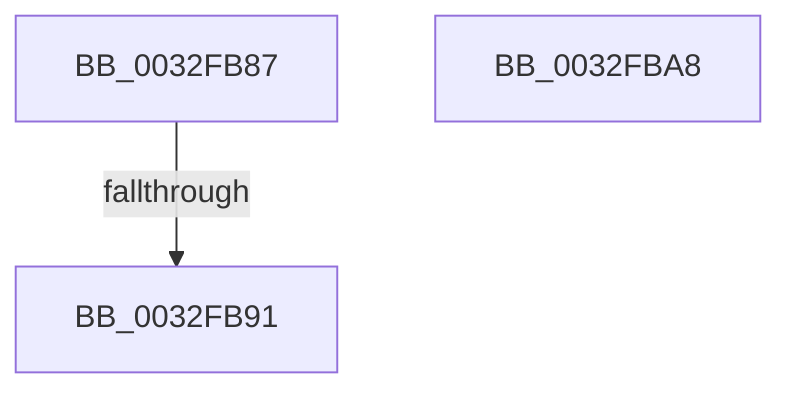

# sub_0032FB87

- RVA: `0x0032FB87`–`0x0032FBA9` (길이 `34` bytes)
- VA: `0x000000014032FB87`
- 실행 섹션: `.text`
- PDB 이름 있음: `아니요`; PDB Function 태그: `아니요`
- unwind 정보 RVA: `0x00076478`
- 디코드: `12`개 명령, `34/34` bytes 표시
- 미해석 바이트: `0` (있으면 어셈블리에 `.byte`로 보존)

> 이 문서는 커널 이미지의 기계어와 PDB 기호를 분석해 생성했습니다. 4번과 5번은 함수 원형과 자료형을 바이너리 사용 방식에서 추정한 C 해석이며 원본 소스 복구 결과는 아닙니다.

## 1. Dependencies

- 직접 호출 지점: **1**; 고유 호출 대상: **1**
- 직접 호출자로 확인된 함수: **0**
- RIP 상대 이미지 참조: **0**

### Outgoing calls
- `0x0032FB94` → [MiAdvanceFaultList](../36/MiAdvanceFaultList_function_003637A0.md) (function, `0x003637A0`)

### Direct callers
- 이 함수 시작 RVA로 연결되는 직접 call은 확인되지 않았습니다. 간접 호출은 완전히 역산할 수 없습니다.

### Static image references
- 디코드된 RIP-relative 메모리 참조가 없습니다.

## 2. Other-region calls and transfers

- 다른 실행 섹션으로 향하는 call: **0**
- call이 아닌 외부 분기/꼬리 이동: **1**
  - `0x0032FB8B` → [sub_00330045](../33/Unknown_function_00330045.md) (`tail-transfer`)

## 3. Assembly (complete function range)

```asm
0032FB87  41 F6 C0 04                     test r8b, 4
0032FB8B  0F 85 B4 04 00 00               jne 0x140330045
0032FB91  48 8B CE                        mov rcx, rsi
0032FB94  E8 07 3C 03 00                  call 0x1403637a0
0032FB99  33 C0                           xor eax, eax
0032FB9B  48 81 C4 98 01 00 00            add rsp, 0x198
0032FBA2  41 5F                           pop r15
0032FBA4  5F                              pop rdi
0032FBA5  5E                              pop rsi
0032FBA6  5D                              pop rbp
0032FBA7  C3                              ret
0032FBA8  CC                              int3
```

## 4. C-style interpretation (structured pseudocode)

```c
__int64 __fastcall sub_0032FB87(__int64 a1, __int64 a2, unsigned __int8 a3)
{
    __int64 result;
    __int64 v_rsp;

    result = MiAdvanceFaultList(v_rsi, a2, a3, a4);
    result = 0;
    v_rsp = (v_rsp) + (408);
    return result;
}
```

## 5. (Beta) C Style

```c
int64_t sub_0032FB87(int64_t Arg1, int64_t Arg2, uint8_t Arg3)
{
    int64_t result;
    int64_t local_rsp;

    result = MiAdvanceFaultList(local_rsi, Arg2, Arg3, a4);
    result = 0;
    local_rsp = (local_rsp) + (408);
    return result;
}
```

## 6. Execution-region graph

[열기: 2D/3D 그래프와 함수 탐색 컨트롤 패널](../../../control-panel.html?section=text&rva=0x0032FB87&view=graph)

- 2D 그래프는 위에서 아래로 흐르고, 3D 그래프는 빈 공간을 드래그해 회전합니다. Shift+드래그는 이동, 휠은 확대·축소, 함수 노드 선택은 대상 보고서 이동입니다.

### Static fallback


