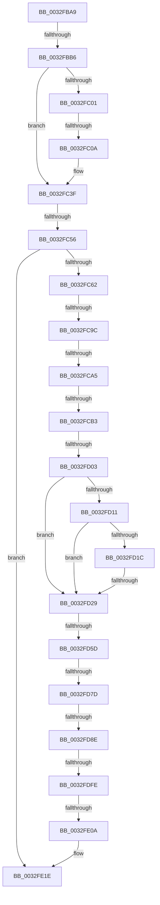

# sub_0032FBA9

- RVA: `0x0032FBA9`–`0x0032FE5B` (길이 `690` bytes)
- VA: `0x000000014032FBA9`
- 실행 섹션: `.text`
- PDB 이름 있음: `아니요`; PDB Function 태그: `아니요`
- unwind 정보 RVA: `0x0007648C`
- 디코드: `154`개 명령, `690/690` bytes 표시
- 미해석 바이트: `0` (있으면 어셈블리에 `.byte`로 보존)

> 이 문서는 커널 이미지의 기계어와 PDB 기호를 분석해 생성했습니다. 4번과 5번은 함수 원형과 자료형을 바이너리 사용 방식에서 추정한 C 해석이며 원본 소스 복구 결과는 아닙니다.

## 1. Dependencies

- 직접 호출 지점: **4**; 고유 호출 대상: **4**
- 직접 호출자로 확인된 함수: **0**
- RIP 상대 이미지 참조: **2**

### Outgoing calls
- `0x0032FBF2` → [MiGetClusterPage](../4D/MiGetClusterPage_function_004DC57C.md) (function, `0x004DC57C`)
- `0x0032FC77` → [memset](../6C/memset_function_006C6C40.md) (function, `0x006C6C40`)
- `0x0032FDF0` → [MiGetPageChain](../33/MiGetPageChain_function_00330130.md) (function, `0x00330130`)
- `0x0032FE29` → [MiCompletePrivateZeroFault](../33/MiCompletePrivateZeroFault_function_00330CC0.md) (function, `0x00330CC0`)

### Direct callers
- 이 함수 시작 RVA로 연결되는 직접 call은 확인되지 않았습니다. 간접 호출은 완전히 역산할 수 없습니다.

### Static image references
- `0x0032FC81` → RVA `0x00000000` (`image boundary/outside`; read)
- `0x0032FD47` → RVA `0x00E38D10` (`.data`; read)

## 2. Other-region calls and transfers

- 다른 실행 섹션으로 향하는 call: **0**
- call이 아닌 외부 분기/꼬리 이동: **13**
  - `0x0032FBB0` → [sub_0032F7AB + 0x1A1](Unknown_function_0032F7AB.md) (`tail-transfer`)
  - `0x0032FC04` → [sub_00330069 + 0x91](../33/Unknown_function_00330069.md) (`tail-transfer`)
  - `0x0032FC50` → [sub_0032F7AB + 0x2E3](Unknown_function_0032F7AB.md) (`tail-transfer`)
  - `0x0032FC96` → [sub_0032FE5C + 0x132](Unknown_function_0032FE5C.md) (`tail-transfer`)
  - `0x0032FC9F` → [sub_0032FE5C + 0x138](Unknown_function_0032FE5C.md) (`tail-transfer`)
  - `0x0032FCAD` → [sub_0032FE5C + 0x17D](Unknown_function_0032FE5C.md) (`tail-transfer`)
  - `0x0032FCFD` → [sub_0032FE5C + 0x10](Unknown_function_0032FE5C.md) (`tail-transfer`)
  - `0x0032FD23` → [sub_0032FE5C + 0x161](Unknown_function_0032FE5C.md) (`tail-transfer`)
  - `0x0032FD57` → [sub_00330069 + 0xA8](../33/Unknown_function_00330069.md) (`tail-transfer`)
  - `0x0032FD77` → [sub_0032FE5C](Unknown_function_0032FE5C.md) (`tail-transfer`)
  - `0x0032FD88` → [sub_0032FE5C](Unknown_function_0032FE5C.md) (`tail-transfer`)
  - `0x0032FDFC` → [sub_0032FE5C + 0x21](Unknown_function_0032FE5C.md) (`tail-transfer`)
  - `0x0032FE04` → [sub_0032FE5C + 0x19B](Unknown_function_0032FE5C.md) (`tail-transfer`)

## 3. Assembly (complete function range)

```asm
0032FBA9  83 BD C0 00 00 00 09            cmp dword ptr [rbp + 0xc0], 9
0032FBB0  0F 85 96 FD FF FF               jne 0x14032f94c
0032FBB6  48 8B 44 24 60                  mov rax, qword ptr [rsp + 0x60]
0032FBBB  48 8D 4C 24 40                  lea rcx, [rsp + 0x40]
0032FBC0  48 89 4C 24 38                  mov qword ptr [rsp + 0x38], rcx
0032FBC5  41 B9 10 00 00 00               mov r9d, 0x10
0032FBCB  48 8B 4C 24 58                  mov rcx, qword ptr [rsp + 0x58]
0032FBD0  49 8B D7                        mov rdx, r15
0032FBD3  44 0F B6 40 45                  movzx r8d, byte ptr [rax + 0x45]
0032FBD8  48 8B 40 60                     mov rax, qword ptr [rax + 0x60]
0032FBDC  45 23 C6                        and r8d, r14d
0032FBDF  48 89 44 24 30                  mov qword ptr [rsp + 0x30], rax
0032FBE4  8B 47 24                        mov eax, dword ptr [rdi + 0x24]
0032FBE7  89 44 24 28                     mov dword ptr [rsp + 0x28], eax
0032FBEB  8B 47 20                        mov eax, dword ptr [rdi + 0x20]
0032FBEE  89 44 24 20                     mov dword ptr [rsp + 0x20], eax
0032FBF2  E8 85 C9 1A 00                  call 0x1404dc57c
0032FBF7  48 8B 4C 24 50                  mov rcx, qword ptr [rsp + 0x50]
0032FBFC  48 85 C9                        test rcx, rcx
0032FBFF  74 3E                           je 0x14032fc3f
0032FC01  49 3B CE                        cmp rcx, r14
0032FC04  0F 84 F0 04 00 00               je 0x1403300fa
0032FC0A  49 81 E7 00 00 FF FF            and r15, 0xffffffffffff0000
0032FC11  48 B8 F8 FF FF FF 7F 00 00 00   movabs rax, 0x7ffffffff8
0032FC1B  4D 8B EF                        mov r13, r15
0032FC1E  4C 89 7F 10                     mov qword ptr [rdi + 0x10], r15
0032FC22  49 C1 ED 09                     shr r13, 9
0032FC26  41 BE 10 00 00 00               mov r14d, 0x10
0032FC2C  4C 23 E8                        and r13, rax
0032FC2F  48 B8 00 00 00 00 80 F6 FF FF   movabs rax, 0xfffff68000000000
0032FC39  48 8B C0                        mov rax, rax
0032FC3C  4C 03 E8                        add r13, rax
0032FC3F  4C 8B 95 D0 00 00 00            mov r10, qword ptr [rbp + 0xd0]
0032FC46  44 8B BD C8 00 00 00            mov r15d, dword ptr [rbp + 0xc8]
0032FC4D  45 85 FF                        test r15d, r15d
0032FC50  0F 85 38 FE FF FF               jne 0x14032fa8e
0032FC56  48 83 7C 24 50 00               cmp qword ptr [rsp + 0x50], 0
0032FC5C  0F 85 BC 01 00 00               jne 0x14032fe1e
0032FC62  33 D2                           xor edx, edx
0032FC64  48 C7 85 C8 00 00 00 00 00 00 00  mov qword ptr [rbp + 0xc8], 0
0032FC6F  48 8D 4D 8C                     lea rcx, [rbp - 0x74]
0032FC73  44 8D 42 54                     lea r8d, [rdx + 0x54]
0032FC77  E8 C4 6F 39 00                  call 0x1406c6c40
0032FC7C  4C 8B 6C 24 60                  mov r13, qword ptr [rsp + 0x60]
0032FC81  4C 8D 25 78 03 CD FF            lea r12, [rip - 0x32fc88]
0032FC88  4D 8B FE                        mov r15, r14
0032FC8B  8B 4F 20                        mov ecx, dword ptr [rdi + 0x20]
0032FC8E  41 B8 01 00 00 00               mov r8d, 1
0032FC94  85 C9                           test ecx, ecx
0032FC96  0F 84 F2 02 00 00               je 0x14032ff8e
0032FC9C  83 F9 1F                        cmp ecx, 0x1f
0032FC9F  0F 84 EF 02 00 00               je 0x14032ff94
0032FCA5  8B C1                           mov eax, ecx
0032FCA7  C1 E8 03                        shr eax, 3
0032FCAA  83 F8 03                        cmp eax, 3
0032FCAD  0F 84 26 03 00 00               je 0x14032ffd9
0032FCB3  41 3B C0                        cmp eax, r8d
0032FCB6  41 BA 00 00 00 00               mov r10d, 0
0032FCBC  45 0F 44 C2                     cmove r8d, r10d
0032FCC0  48 8B 44 24 68                  mov rax, qword ptr [rsp + 0x68]
0032FCC5  41 0F B6 4D 45                  movzx ecx, byte ptr [r13 + 0x45]
0032FCCA  48 8B 57 10                     mov rdx, qword ptr [rdi + 0x10]
0032FCCE  83 E1 01                        and ecx, 1
0032FCD1  4C 8B B5 D8 00 00 00            mov r14, qword ptr [rbp + 0xd8]
0032FCD8  49 8B 75 60                     mov rsi, qword ptr [r13 + 0x60]
0032FCDC  48 89 44 24 70                  mov qword ptr [rsp + 0x70], rax
0032FCE1  8B 45 8C                        mov eax, dword ptr [rbp - 0x74]
0032FCE4  83 E0 CF                        and eax, 0xffffffcf
0032FCE7  C1 E1 04                        shl ecx, 4
0032FCEA  0B C8                           or ecx, eax
0032FCEC  4C 89 74 24 78                  mov qword ptr [rsp + 0x78], r14
0032FCF1  89 4D 8C                        mov dword ptr [rbp - 0x74], ecx
0032FCF4  48 89 55 80                     mov qword ptr [rbp - 0x80], rdx
0032FCF8  89 5D 88                        mov dword ptr [rbp - 0x78], ebx
0032FCFB  85 DB                           test ebx, ebx
0032FCFD  0F 85 69 01 00 00               jne 0x14032fe6c
0032FD03  65 48 8B 0C 25 88 01 00 00      mov rcx, qword ptr gs:[0x188]
0032FD0C  4D 85 F6                        test r14, r14
0032FD0F  74 18                           je 0x14032fd29
0032FD11  41 8B 86 B8 00 00 00            mov eax, dword ptr [r14 + 0xb8]
0032FD18  A8 0F                           test al, 0xf
0032FD1A  75 0D                           jne 0x14032fd29
0032FD1C  80 B9 4A 02 00 00 01            cmp byte ptr [rcx + 0x24a], 1
0032FD23  0F 84 94 02 00 00               je 0x14032ffbd
0032FD29  8B 81 4C 02 00 00               mov eax, dword ptr [rcx + 0x24c]
0032FD2F  4D 8B 8C C4 40 8C FC 00         mov r9, qword ptr [r12 + rax*8 + 0xfc8c40]
0032FD37  41 8B 81 54 87 00 00            mov eax, dword ptr [r9 + 0x8754]
0032FD3E  8B C8                           mov ecx, eax
0032FD40  48 69 D1 80 DF 00 00            imul rdx, rcx, 0xdf80
0032FD47  48 03 15 C2 8F B0 00            add rdx, qword ptr [rip + 0xb08fc2]
0032FD4E  8B 8A 50 3B 00 00               mov ecx, dword ptr [rdx + 0x3b50]
0032FD54  F6 C1 01                        test cl, 1
0032FD57  0F 85 B4 03 00 00               jne 0x140330111
0032FD5D  32 D2                           xor dl, dl
0032FD5F  83 E0 3F                        and eax, 0x3f
0032FD62  83 E2 01                        and edx, 1
0032FD65  0D 80 03 00 00                  or eax, 0x380
0032FD6A  03 C0                           add eax, eax
0032FD6C  0B C2                           or eax, edx
0032FD6E  C1 E0 08                        shl eax, 8
0032FD71  89 45 A0                        mov dword ptr [rbp - 0x60], eax
0032FD74  4D 85 F6                        test r14, r14
0032FD77  0F 84 DF 00 00 00               je 0x14032fe5c
0032FD7D  41 8B 86 B8 00 00 00            mov eax, dword ptr [r14 + 0xb8]
0032FD84  24 0F                           and al, 0xf
0032FD86  3C 01                           cmp al, 1
0032FD88  0F 83 CE 00 00 00               jae 0x14032fe5c
0032FD8E  4C 89 75 98                     mov qword ptr [rbp - 0x68], r14
0032FD92  8B 45 A0                        mov eax, dword ptr [rbp - 0x60]
0032FD95  48 8D 4C 24 70                  lea rcx, [rsp + 0x70]
0032FD9A  25 FF FF F3 FF                  and eax, 0xfff3ffff
0032FD9F  41 C1 E0 12                     shl r8d, 0x12
0032FDA3  41 0B C0                        or eax, r8d
0032FDA6  48 89 75 B0                     mov qword ptr [rbp - 0x50], rsi
0032FDAA  8B B5 C0 00 00 00               mov esi, dword ptr [rbp + 0xc0]
0032FDB0  0F 57 C0                        xorps xmm0, xmm0
0032FDB3  89 45 A0                        mov dword ptr [rbp - 0x60], eax
0032FDB6  48 8D 85 C8 00 00 00            lea rax, [rbp + 0xc8]
0032FDBD  48 89 45 B8                     mov qword ptr [rbp - 0x48], rax
0032FDC1  8B 45 8C                        mov eax, dword ptr [rbp - 0x74]
0032FDC4  83 E0 F0                        and eax, 0xfffffff0
0032FDC7  C7 45 90 39 00 00 00            mov dword ptr [rbp - 0x70], 0x39
0032FDCE  0B C6                           or eax, esi
0032FDD0  48 C7 45 A8 FF FF FF FF         mov qword ptr [rbp - 0x58], 0xffffffffffffffff
0032FDD8  89 45 8C                        mov dword ptr [rbp - 0x74], eax
0032FDDB  33 C0                           xor eax, eax
0032FDDD  48 89 45 D8                     mov qword ptr [rbp - 0x28], rax
0032FDE1  4C 89 95 C8 00 00 00            mov qword ptr [rbp + 0xc8], r10
0032FDE8  4C 89 7D C0                     mov qword ptr [rbp - 0x40], r15
0032FDEC  0F 11 45 C8                     movups xmmword ptr [rbp - 0x38], xmm0
0032FDF0  E8 3B 03 00 00                  call 0x140330130
0032FDF5  4C 8B 75 D8                     mov r14, qword ptr [rbp - 0x28]
0032FDF9  4D 85 F6                        test r14, r14
0032FDFC  74 7F                           je 0x14032fe7d
0032FDFE  48 83 7C 24 40 00               cmp qword ptr [rsp + 0x40], 0
0032FE04  0F 85 ED 01 00 00               jne 0x14032fff7
0032FE0A  0F 10 45 C8                     movups xmm0, xmmword ptr [rbp - 0x38]
0032FE0E  F2 0F 10 4D D8                  movsd xmm1, qword ptr [rbp - 0x28]
0032FE13  0F 11 44 24 40                  movups xmmword ptr [rsp + 0x40], xmm0
0032FE18  F2 0F 11 4C 24 50               movsd qword ptr [rsp + 0x50], xmm1
0032FE1E  4D 8B C6                        mov r8, r14
0032FE21  48 8D 54 24 40                  lea rdx, [rsp + 0x40]
0032FE26  48 8B CF                        mov rcx, rdi
0032FE29  E8 92 0E 00 00                  call 0x140330cc0
0032FE2E  4C 8B AC 24 80 01 00 00         mov r13, qword ptr [rsp + 0x180]
0032FE36  4C 8B A4 24 88 01 00 00         mov r12, qword ptr [rsp + 0x188]
0032FE3E  48 8B 9C 24 90 01 00 00         mov rbx, qword ptr [rsp + 0x190]
0032FE46  4C 8B B4 24 78 01 00 00         mov r14, qword ptr [rsp + 0x178]
0032FE4E  48 81 C4 98 01 00 00            add rsp, 0x198
0032FE55  41 5F                           pop r15
0032FE57  5F                              pop rdi
0032FE58  5E                              pop rsi
0032FE59  5D                              pop rbp
0032FE5A  C3                              ret
```

## 4. C-style interpretation (structured pseudocode)

```c
__int64 __fastcall sub_0032FBA9(__int64 a1, __int64 a2, __int64 a3, __int64 a4, __int64 a5, __int64 a6, __int64 a7, __int64 a8, __int64 a9, __int64 a10, __int64 a11, __int64 a12, __int64 a13, __int64 a14, __int64 a15, __int64 a16, __int64 a17, __int64 a18, __int64 a19, __int64 a20, __int64 a21, __int64 a22, __int64 a23, __int64 a24, __int64 a25, __int64 a26, __int64 a27, __int64 a28, __int64 a29, __int64 a30, __int64 a31, __int64 a32, __int64 a33, __int64 a34, __int64 a35, __int64 a36, __int64 a37, __int64 a38, __int64 a39, __int64 a40, __int64 a41, __int64 a42, __int64 a43, __int64 a44, __int64 a45, __int64 a46, __int64 a47, __int64 a48, __int64 a49, __int64 a50)
{
    __int64 result;
    __int64 v_r13;
    __int64 v_r15;
    __int64 v_rsp;
    unsigned int v_stack_p20;
    unsigned int v_stack_p28;
    unsigned __int64 v_stack_p30;
    unsigned __int64 v_stack_p38;
    unsigned __int64 v_stack_p50;
    unsigned __int64 v_stack_p70;
    unsigned __int64 v_stack_p78;

    v_stack_p38 = a8;
    a3 = (unsigned int)((*(unsigned __int8 *)(a12 + 69)) & ((unsigned int)(v_r14)));
    v_stack_p30 = *(unsigned __int64 *)(a12 + 96);
    v_stack_p28 = (unsigned int)((unsigned int)(*(unsigned int *)(v_rdi + 36)));
    v_stack_p20 = (unsigned int)((unsigned int)(*(unsigned int *)(v_rdi + 32)));
    result = MiGetClusterPage(a11, v_r15, a3, 16);
    if (a10 == 0) goto loc_0032FC3F;
    v_r15 = (v_r15) & (0xFFFFFFFFFFFF0000ULL);
    *(unsigned __int64 *)(v_rdi + 16) = v_r15;
    v_r13 = (v_r15) >> (9);
    v_r13 = (v_r13) & (result);
    v_r13 = (v_r13) + (result);
loc_0032FC3F:
    if (a10 != 0) goto loc_0032FE1E;
    a2 = 0;
    *(unsigned __int64 *)(v_rbp + 200) = 0;
    result = memset(v_rbp - 116, a2, a2 + 84, 16);
    result = (unsigned int)(((unsigned int)((unsigned int)((unsigned int)(*(unsigned int *)(v_rdi + 32))))) >> (3));
    a3 = 1;
    if (((unsigned int)(result)) == 1) { a3 = 0; }
    a1 = (unsigned int)((*(unsigned __int8 *)(a12 + 69)) & (1));
    v_stack_p70 = a13;
    result = (unsigned int)(((unsigned int)(*(unsigned int *)(v_rbp - 116))) & (0xFFFFFFCFULL));
    a1 = (unsigned int)((a1) << (4));
    a1 = (unsigned int)((a1) | ((unsigned int)(result)));
    v_stack_p78 = *(unsigned __int64 *)(v_rbp + 216);
    *(unsigned int *)(v_rbp - 116) = (unsigned int)(a1);
    *(unsigned __int64 *)(v_rbp - 128) = *(unsigned __int64 *)(v_rdi + 16);
    *(unsigned int *)(v_rbp - 120) = (unsigned int)(v_rbx);
    if (*(unsigned __int64 *)(v_rbp + 216) == 0) goto loc_0032FD29;
    if ((((unsigned __int8)((unsigned int)(*(unsigned int *)(*(unsigned __int64 *)(v_rbp + 216) + 184)))) & (15)) != 0) goto loc_0032FD29;
loc_0032FD29:
    a2 = (*(unsigned __int64 *)(v_rdi + 16)) * ((unsigned int)((unsigned int)((unsigned int)(*(unsigned int *)(*(unsigned __int64 *)(v_rip - 3341448 + (unsigned int)(*(unsigned int *)(*(unsigned __int64 *)(gs_base + (0 + 392)) + 588)) * 8 + 16550976) + 34644)))));
    a2 = (a2) + (*(unsigned __int64 *)(v_rip + 11571138));
    a2 = 0;
    result = (unsigned int)(((unsigned int)(*(unsigned int *)(*(unsigned __int64 *)(v_rip - 3341448 + (unsigned int)(*(unsigned int *)(*(unsigned __int64 *)(gs_base + (0 + 392)) + 588)) * 8 + 16550976) + 34644))) & (63));
    a2 = (unsigned int)((a2) & (1));
    result = (unsigned int)((result) | (896));
    result = (unsigned int)((result) + ((unsigned int)(result)));
    result = (unsigned int)((result) | ((unsigned int)(a2)));
    result = (unsigned int)((result) << (8));
    *(unsigned int *)(v_rbp - 96) = (unsigned int)(result);
    result = (unsigned __int8)(((unsigned int)(*(unsigned int *)(*(unsigned __int64 *)(v_rbp + 216) + 184))) & (15));
    *(unsigned __int64 *)(v_rbp - 104) = *(unsigned __int64 *)(v_rbp + 216);
    result = (unsigned int)(((unsigned int)(*(unsigned int *)(v_rbp - 96))) & (0xFFF3FFFFULL));
    a3 = (unsigned int)((a3) << (18));
    result = (unsigned int)((result) | ((unsigned int)(a3)));
    *(unsigned __int64 *)(v_rbp - 80) = *(unsigned __int64 *)(a12 + 96);
    *(unsigned int *)(v_rbp - 96) = (unsigned int)(result);
    *(unsigned __int64 *)(v_rbp - 72) = v_rbp + 200;
    result = (unsigned int)(((unsigned int)(*(unsigned int *)(v_rbp - 116))) & (0xFFFFFFF0ULL));
    *(unsigned int *)(v_rbp - 112) = 57;
    result = (unsigned int)((result) | ((unsigned int)((unsigned int)(*(unsigned int *)(v_rbp + 192)))));
    *(unsigned __int64 *)(v_rbp - 88) = -1;
    *(unsigned int *)(v_rbp - 116) = (unsigned int)(result);
    result = 0;
    *(unsigned __int64 *)(v_rbp - 40) = 0;
    *(unsigned __int64 *)(v_rbp + 200) = 0;
    *(unsigned __int64 *)(v_rbp - 64) = 16;
    *(unsigned __int64 *)(v_rbp - 56) = v_xmm0;
    result = MiGetPageChain(a14, a2, a3, *(unsigned __int64 *)(v_rip - 3341448 + (unsigned int)(*(unsigned int *)(*(unsigned __int64 *)(gs_base + (0 + 392)) + 588)) * 8 + 16550976));
    a8 = v_xmm0;
    v_stack_p50 = v_xmm1;
loc_0032FE1E:
    result = MiCompletePrivateZeroFault(v_rdi, a8, *(unsigned __int64 *)(v_rbp - 40), *(unsigned __int64 *)(v_rip - 3341448 + (unsigned int)(*(unsigned int *)(*(unsigned __int64 *)(gs_base + (0 + 392)) + 588)) * 8 + 16550976));
    v_rsp = (v_rsp) + (408);
    return result;
}
```

## 5. (Beta) C Style

```c
int64_t sub_0032FBA9(int64_t Arg1, int64_t Arg2, int64_t Arg3, int64_t Arg4, uint64_t Arg5, uint64_t Arg6, uint64_t Arg7, int64_t Arg8, uint64_t Arg9, int64_t Arg10, int64_t Arg11, void *Arg12, int64_t Arg13, int64_t Arg14, uint64_t Arg15, uint64_t Arg16, uint64_t Arg17, uint64_t Arg18, uint64_t Arg19, uint64_t Arg20, uint64_t Arg21, uint64_t Arg22, uint64_t Arg23, uint64_t Arg24, uint64_t Arg25, uint64_t Arg26, uint64_t Arg27, uint64_t Arg28, uint64_t Arg29, uint64_t Arg30, uint64_t Arg31, uint64_t Arg32, uint64_t Arg33, uint64_t Arg34, uint64_t Arg35, uint64_t Arg36, uint64_t Arg37, uint64_t Arg38, uint64_t Arg39, uint64_t Arg40, uint64_t Arg41, uint64_t Arg42, uint64_t Arg43, uint64_t Arg44, uint64_t Arg45, uint64_t Arg46, int64_t Arg47, int64_t Arg48, int64_t Arg49, int64_t Arg50)
{
    uint8_t *arg12 = (uint8_t *)Arg12;

    int64_t result;
    int64_t local_r13;
    int64_t local_r15;
    int64_t local_rsp;
    uint32_t v_stack_p20;
    uint32_t v_stack_p28;
    uint64_t v_stack_p30;
    uint64_t v_stack_p38;
    uint64_t v_stack_p50;
    uint64_t v_stack_p70;
    uint64_t v_stack_p78;

    v_stack_p38 = Arg8;
    Arg3 = (uint32_t)((*(uint8_t *)(arg12 + 0x45)) & ((uint32_t)(local_r14)));
    v_stack_p30 = *(uint64_t *)(arg12 + 0x60);
    v_stack_p28 = (uint32_t)((uint32_t)(*(uint32_t *)(local_rdi + 0x24)));
    v_stack_p20 = (uint32_t)((uint32_t)(*(uint32_t *)(local_rdi + 0x20)));
    result = MiGetClusterPage(Arg11, local_r15, Arg3, 16);
    if (Arg10 == 0) goto loc_0032FC3F;
    local_r15 = (local_r15) & (0xFFFFFFFFFFFF0000ULL);
    *(uint64_t *)(local_rdi + 0x10) = local_r15;
    local_r13 = (local_r15) >> (9);
    local_r13 = (local_r13) & (result);
    local_r13 = (local_r13) + (result);
loc_0032FC3F:
    if (Arg10 != 0) goto loc_0032FE1E;
    Arg2 = 0;
    *(uint64_t *)(local_rbp + 0xC8) = 0;
    result = memset(local_rbp - 116, Arg2, Arg2 + 84, 16);
    result = (uint32_t)(((uint32_t)((uint32_t)((uint32_t)(*(uint32_t *)(local_rdi + 0x20))))) >> (3));
    Arg3 = 1;
    if (((uint32_t)(result)) == 1) { Arg3 = 0; }
    Arg1 = (uint32_t)((*(uint8_t *)(arg12 + 0x45)) & (1));
    v_stack_p70 = Arg13;
    result = (uint32_t)(((uint32_t)(*(uint32_t *)(local_rbp - 0x74))) & (0xFFFFFFCFULL));
    Arg1 = (uint32_t)((Arg1) << (4));
    Arg1 = (uint32_t)((Arg1) | ((uint32_t)(result)));
    v_stack_p78 = *(uint64_t *)(local_rbp + 0xD8);
    *(uint32_t *)(local_rbp - 0x74) = (uint32_t)(Arg1);
    *(uint64_t *)(local_rbp - 0x80) = *(uint64_t *)(local_rdi + 0x10);
    *(uint32_t *)(local_rbp - 0x78) = (uint32_t)(local_rbx);
    if (*(uint64_t *)(local_rbp + 0xD8) == 0) goto loc_0032FD29;
    if ((((uint8_t)((uint32_t)(*(uint32_t *)(*(uint64_t *)(local_rbp + 0xD8) + 0xB8)))) & (15)) != 0) goto loc_0032FD29;
loc_0032FD29:
    Arg2 = (*(uint64_t *)(local_rdi + 0x10)) * ((uint32_t)((uint32_t)((uint32_t)(*(uint32_t *)(*(uint64_t *)(v_rip - 0x32FC88 + (uint32_t)(*(uint32_t *)(*(uint64_t *)(gs_base + (0 + 0x188)) + 0x24C)) * 8 + 0xFC8C40) + 0x8754)))));
    Arg2 = (Arg2) + (*(uint64_t *)(v_rip + 0xB08FC2));
    Arg2 = 0;
    result = (uint32_t)(((uint32_t)(*(uint32_t *)(*(uint64_t *)(v_rip - 0x32FC88 + (uint32_t)(*(uint32_t *)(*(uint64_t *)(gs_base + (0 + 0x188)) + 0x24C)) * 8 + 0xFC8C40) + 0x8754))) & (63));
    Arg2 = (uint32_t)((Arg2) & (1));
    result = (uint32_t)((result) | (896));
    result = (uint32_t)((result) + ((uint32_t)(result)));
    result = (uint32_t)((result) | ((uint32_t)(Arg2)));
    result = (uint32_t)((result) << (8));
    *(uint32_t *)(local_rbp - 0x60) = (uint32_t)(result);
    result = (uint8_t)(((uint32_t)(*(uint32_t *)(*(uint64_t *)(local_rbp + 0xD8) + 0xB8))) & (15));
    *(uint64_t *)(local_rbp - 0x68) = *(uint64_t *)(local_rbp + 0xD8);
    result = (uint32_t)(((uint32_t)(*(uint32_t *)(local_rbp - 0x60))) & (0xFFF3FFFFULL));
    Arg3 = (uint32_t)((Arg3) << (18));
    result = (uint32_t)((result) | ((uint32_t)(Arg3)));
    *(uint64_t *)(local_rbp - 0x50) = *(uint64_t *)(arg12 + 0x60);
    *(uint32_t *)(local_rbp - 0x60) = (uint32_t)(result);
    *(uint64_t *)(local_rbp - 0x48) = local_rbp + 200;
    result = (uint32_t)(((uint32_t)(*(uint32_t *)(local_rbp - 0x74))) & (0xFFFFFFF0ULL));
    *(uint32_t *)(local_rbp - 0x70) = 57;
    result = (uint32_t)((result) | ((uint32_t)((uint32_t)(*(uint32_t *)(local_rbp + 0xC0)))));
    *(uint64_t *)(local_rbp - 0x58) = -1;
    *(uint32_t *)(local_rbp - 0x74) = (uint32_t)(result);
    result = 0;
    *(uint64_t *)(local_rbp - 0x28) = 0;
    *(uint64_t *)(local_rbp + 0xC8) = 0;
    *(uint64_t *)(local_rbp - 0x40) = 16;
    *(uint64_t *)(local_rbp - 0x38) = v_xmm0;
    result = MiGetPageChain(Arg14, Arg2, Arg3, *(uint64_t *)(v_rip - 0x32FC88 + (uint32_t)(*(uint32_t *)(*(uint64_t *)(gs_base + (0 + 0x188)) + 0x24C)) * 8 + 0xFC8C40));
    Arg8 = v_xmm0;
    v_stack_p50 = v_xmm1;
loc_0032FE1E:
    result = MiCompletePrivateZeroFault(local_rdi, Arg8, *(uint64_t *)(local_rbp - 0x28), *(uint64_t *)(v_rip - 0x32FC88 + (uint32_t)(*(uint32_t *)(*(uint64_t *)(gs_base + (0 + 0x188)) + 0x24C)) * 8 + 0xFC8C40));
    local_rsp = (local_rsp) + (408);
    return result;
}
```

### 관측된 메모리 오프셋

구조체 형식이 확인되지 않은 접근은 인자 기준의 오프셋으로만 기록했습니다.

| 기준 인자 | 오프셋 표현 | 폭 (bit) | 접근 |
|---|---:|---:|---|
| `Arg12` | `+ 0x45` | `8` | `R` |
| `Arg12` | `+ 0x60` | `64` | `R` |

## 6. Execution-region graph

[열기: 2D/3D 그래프와 함수 탐색 컨트롤 패널](../../../control-panel.html?section=text&rva=0x0032FBA9&view=graph)

- 2D 그래프는 위에서 아래로 흐르고, 3D 그래프는 빈 공간을 드래그해 회전합니다. Shift+드래그는 이동, 휠은 확대·축소, 함수 노드 선택은 대상 보고서 이동입니다.

### Static fallback


