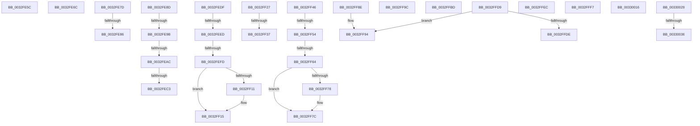

# sub_0032FE5C

- RVA: `0x0032FE5C`–`0x00330045` (길이 `489` bytes)
- VA: `0x000000014032FE5C`
- 실행 섹션: `.text`
- PDB 이름 있음: `아니요`; PDB Function 태그: `아니요`
- unwind 정보 RVA: `0x000764C0`
- 디코드: `106`개 명령, `489/489` bytes 표시
- 미해석 바이트: `0` (있으면 어셈블리에 `.byte`로 보존)

> 이 문서는 커널 이미지의 기계어와 PDB 기호를 분석해 생성했습니다. 4번과 5번은 함수 원형과 자료형을 바이너리 사용 방식에서 추정한 C 해석이며 원본 소스 복구 결과는 아닙니다.

## 1. Dependencies

- 직접 호출 지점: **5**; 고유 호출 대상: **3**
- 직접 호출자로 확인된 함수: **0**
- RIP 상대 이미지 참조: **1**

### Outgoing calls
- `0x0032FEB2` → [MiComputeZeroClusterMaximum](../44/MiComputeZeroClusterMaximum_function_0044B15C.md) (function, `0x0044B15C`)
- `0x0032FEDF` → [MiPteHasShadow](MiPteHasShadow_function_0032B998.md) (function, `0x0032B998`)
- `0x0032FF2A` → [IS_PTE_NOT_DEMAND_ZERO](../22/IS_PTE_NOT_DEMAND_ZERO_function_0022F4D0.md) (function, `0x0022F4D0`)
- `0x0032FF46` → [MiPteHasShadow](MiPteHasShadow_function_0032B998.md) (function, `0x0032B998`)
- `0x0032FFA2` → [MiComputeZeroClusterMaximum](../44/MiComputeZeroClusterMaximum_function_0044B15C.md) (function, `0x0044B15C`)

### Direct callers
- 이 함수 시작 RVA로 연결되는 직접 call은 확인되지 않았습니다. 간접 호출은 완전히 역산할 수 없습니다.

### Static image references
- `0x0032FFB1` → RVA `0x00000000` (`image boundary/outside`; read)

## 2. Other-region calls and transfers

- 다른 실행 섹션으로 향하는 call: **0**
- call이 아닌 외부 분기/꼬리 이동: **25**
  - `0x0032FE67` → [sub_0032FBA9 + 0x1E9](Unknown_function_0032FBA9.md) (`tail-transfer`)
  - `0x0032FE78` → [sub_0032FBA9 + 0x195](Unknown_function_0032FBA9.md) (`tail-transfer`)
  - `0x0032FE80` → [sub_00330069 + 0x5E](../33/Unknown_function_00330069.md) (`tail-transfer`)
  - `0x0032FE8B` → [sub_0032FBA9 + 0x285](Unknown_function_0032FBA9.md) (`tail-transfer`)
  - `0x0032FE95` → [sub_0032FBA9 + 0xAD](Unknown_function_0032FBA9.md) (`tail-transfer`)
  - `0x0032FEA6` → [sub_0032FBA9 + 0xAD](Unknown_function_0032FBA9.md) (`tail-transfer`)
  - `0x0032FEBD` → [sub_0032FBA9 + 0xAD](Unknown_function_0032FBA9.md) (`tail-transfer`)
  - `0x0032FEDA` → [sub_0032F7AB + 0x2E3](Unknown_function_0032F7AB.md) (`tail-transfer`)
  - `0x0032FEE7` → [sub_0032F7AB + 0x331](Unknown_function_0032F7AB.md) (`tail-transfer`)
  - `0x0032FEF7` → [sub_0032F7AB + 0x331](Unknown_function_0032F7AB.md) (`tail-transfer`)
  - `0x0032FF22` → [sub_0032F7AB + 0x331](Unknown_function_0032F7AB.md) (`tail-transfer`)
  - `0x0032FF31` → [sub_0032F7AB + 0x34F](Unknown_function_0032F7AB.md) (`tail-transfer`)
  - `0x0032FF41` → [sub_0032F7AB + 0x341](Unknown_function_0032F7AB.md) (`tail-transfer`)
  - `0x0032FF4E` → [sub_0032F7AB + 0x261](Unknown_function_0032F7AB.md) (`tail-transfer`)
  - `0x0032FF5E` → [sub_0032F7AB + 0x261](Unknown_function_0032F7AB.md) (`tail-transfer`)
  - `0x0032FF89` → [sub_0032F7AB + 0x261](Unknown_function_0032F7AB.md) (`tail-transfer`)
  - `0x0032FF97` → [sub_0032FBA9 + 0x117](Unknown_function_0032FBA9.md) (`tail-transfer`)
  - `0x0032FFB8` → [sub_0032F7AB + 0x15B](Unknown_function_0032F7AB.md) (`tail-transfer`)
  - `0x0032FFD4` → [sub_0032FBA9 + 0x195](Unknown_function_0032FBA9.md) (`tail-transfer`)
  - `0x0032FFE7` → [sub_0032FBA9 + 0x117](Unknown_function_0032FBA9.md) (`tail-transfer`)
  - `0x0032FFF2` → [sub_0032FBA9 + 0xB9](Unknown_function_0032FBA9.md) (`tail-transfer`)
  - `0x00330011` → [sub_0032FBA9 + 0x275](Unknown_function_0032FBA9.md) (`tail-transfer`)
  - `0x00330024` → [sub_0032F7AB + 0x59](Unknown_function_0032F7AB.md) (`tail-transfer`)
  - `0x00330030` → [sub_0032F7AB + 0xFF](Unknown_function_0032F7AB.md) (`tail-transfer`)
  - `0x00330040` → [sub_0032F7AB + 0x125](Unknown_function_0032F7AB.md) (`tail-transfer`)

## 3. Assembly (complete function range)

```asm
0032FE5C  49 8D 81 50 87 00 00            lea rax, [r9 + 0x8750]
0032FE63  48 89 45 98                     mov qword ptr [rbp - 0x68], rax
0032FE67  E9 26 FF FF FF                  jmp 0x14032fd92
0032FE6C  65 4C 8B 0C 25 20 00 00 00      mov r9, qword ptr gs:[0x20]
0032FE75  8D 43 FF                        lea eax, [rbx - 1]
0032FE78  E9 C1 FE FF FF                  jmp 0x14032fd3e
0032FE7D  83 FE 09                        cmp esi, 9
0032FE80  0F 85 41 02 00 00               jne 0x1403300c7
0032FE86  B8 17 00 00 C0                  mov eax, 0xc0000017
0032FE8B  EB A1                           jmp 0x14032fe2e
0032FE8D  25 01 01 00 00                  and eax, 0x101
0032FE92  41 3B C6                        cmp eax, r14d
0032FE95  0F 85 BB FD FF FF               jne 0x14032fc56
0032FE9B  8B 82 B8 00 00 00               mov eax, dword ptr [rdx + 0xb8]
0032FEA1  24 0F                           and al, 0xf
0032FEA3  41 3A C6                        cmp al, r14b
0032FEA6  0F 82 AA FD FF FF               jb 0x14032fc56
0032FEAC  45 33 C0                        xor r8d, r8d
0032FEAF  48 8B CE                        mov rcx, rsi
0032FEB2  E8 A5 B2 11 00                  call 0x14044b15c
0032FEB7  4C 8B D0                        mov r10, rax
0032FEBA  49 3B C6                        cmp rax, r14
0032FEBD  0F 86 93 FD FF FF               jbe 0x14032fc56
0032FEC3  45 8B FE                        mov r15d, r14d
0032FEC6  48 BE 00 D0 BE 7D FB F6 FF FF   movabs rsi, 0xfffff6fb7dbed000
0032FED0  49 BC F8 D7 BE 7D FB F6 FF FF   movabs r12, 0xfffff6fb7dbed7f8
0032FEDA  E9 AF FB FF FF                  jmp 0x14032fa8e
0032FEDF  E8 B4 BA FF FF                  call 0x14032b998
0032FEE4  48 85 C0                        test rax, rax
0032FEE7  0F 84 EF FB FF FF               je 0x14032fadc
0032FEED  48 8B 88 08 05 00 00            mov rcx, qword ptr [rax + 0x508]
0032FEF4  48 85 C9                        test rcx, rcx
0032FEF7  0F 84 DF FB FF FF               je 0x14032fadc
0032FEFD  49 8B C0                        mov rax, r8
0032FF00  48 C1 E8 03                     shr rax, 3
0032FF04  25 FF 01 00 00                  and eax, 0x1ff
0032FF09  48 8B 04 C1                     mov rax, qword ptr [rcx + rax*8]
0032FF0D  A8 20                           test al, 0x20
0032FF0F  74 04                           je 0x14032ff15
0032FF11  48 83 CA 20                     or rdx, 0x20
0032FF15  48 8B CA                        mov rcx, rdx
0032FF18  48 83 CA 42                     or rdx, 0x42
0032FF1C  A8 42                           test al, 0x42
0032FF1E  48 0F 44 D1                     cmove rdx, rcx
0032FF22  E9 B5 FB FF FF                  jmp 0x14032fadc
0032FF27  48 8B CA                        mov rcx, rdx
0032FF2A  E8 A1 F5 EF FF                  call 0x14022f4d0
0032FF2F  85 C0                           test eax, eax
0032FF31  0F 85 C3 FB FF FF               jne 0x14032fafa
0032FF37  48 C1 EA 05                     shr rdx, 5
0032FF3B  83 E2 1F                        and edx, 0x1f
0032FF3E  44 3B CA                        cmp r9d, edx
0032FF41  E9 A6 FB FF FF                  jmp 0x14032faec
0032FF46  E8 4D BA FF FF                  call 0x14032b998
0032FF4B  48 85 C0                        test rax, rax
0032FF4E  0F 84 B8 FA FF FF               je 0x14032fa0c
0032FF54  48 8B 88 08 05 00 00            mov rcx, qword ptr [rax + 0x508]
0032FF5B  48 85 C9                        test rcx, rcx
0032FF5E  0F 84 A8 FA FF FF               je 0x14032fa0c
0032FF64  49 8B C0                        mov rax, r8
0032FF67  48 C1 E8 03                     shr rax, 3
0032FF6B  25 FF 01 00 00                  and eax, 0x1ff
0032FF70  48 8B 04 C1                     mov rax, qword ptr [rcx + rax*8]
0032FF74  A8 20                           test al, 0x20
0032FF76  74 04                           je 0x14032ff7c
0032FF78  48 83 CA 20                     or rdx, 0x20
0032FF7C  48 8B CA                        mov rcx, rdx
0032FF7F  48 83 CA 42                     or rdx, 0x42
0032FF83  A8 42                           test al, 0x42
0032FF85  48 0F 44 D1                     cmove rdx, rcx
0032FF89  E9 7E FA FF FF                  jmp 0x14032fa0c
0032FF8E  41 B8 03 00 00 00               mov r8d, 3
0032FF94  45 33 D2                        xor r10d, r10d
0032FF97  E9 24 FD FF FF                  jmp 0x14032fcc0
0032FF9C  4D 8B C4                        mov r8, r12
0032FF9F  48 8B CE                        mov rcx, rsi
0032FFA2  E8 B5 B1 11 00                  call 0x14044b15c
0032FFA7  4C 8B D0                        mov r10, rax
0032FFAA  44 89 B5 C8 00 00 00            mov dword ptr [rbp + 0xc8], r14d
0032FFB1  48 8D 0D 48 00 CD FF            lea rcx, [rip - 0x32ffb8]
0032FFB8  E9 49 F9 FF FF                  jmp 0x14032f906
0032FFBD  48 8B 81 B8 00 00 00            mov rax, qword ptr [rcx + 0xb8]
0032FFC4  65 4C 8B 0C 25 20 00 00 00      mov r9, qword ptr gs:[0x20]
0032FFCD  0F B7 80 04 01 00 00            movzx eax, word ptr [rax + 0x104]
0032FFD4  E9 65 FD FF FF                  jmp 0x14032fd3e
0032FFD9  F6 C1 07                        test cl, 7
0032FFDC  74 B6                           je 0x14032ff94
0032FFDE  41 B8 02 00 00 00               mov r8d, 2
0032FFE4  45 33 D2                        xor r10d, r10d
0032FFE7  E9 D4 FC FF FF                  jmp 0x14032fcc0
0032FFEC  41 BE 01 00 00 00               mov r14d, 1
0032FFF2  E9 6B FC FF FF                  jmp 0x14032fc62
0032FFF7  48 8B 4C 24 48                  mov rcx, qword ptr [rsp + 0x48]
0032FFFC  48 8B 45 C8                     mov rax, qword ptr [rbp - 0x38]
00330000  48 89 01                        mov qword ptr [rcx], rax
00330003  48 8B 45 D0                     mov rax, qword ptr [rbp - 0x30]
00330007  4C 01 74 24 50                  add qword ptr [rsp + 0x50], r14
0033000C  48 89 44 24 48                  mov qword ptr [rsp + 0x48], rax
00330011  E9 08 FE FF FF                  jmp 0x14032fe1e
00330016  48 8B 80 20 02 00 00            mov rax, qword ptr [rax + 0x220]
0033001D  0F B7 88 AE 04 00 00            movzx ecx, word ptr [rax + 0x4ae]
00330024  E9 DB F7 FF FF                  jmp 0x14032f804
00330029  44 84 B1 AA 05 00 00            test byte ptr [rcx + 0x5aa], r14b
00330030  0F 85 74 F8 FF FF               jne 0x14032f8aa
00330036  C7 85 C0 00 00 00 08 00 00 00   mov dword ptr [rbp + 0xc0], 8
00330040  E9 8B F8 FF FF                  jmp 0x14032f8d0
```

## 4. C-style interpretation (structured pseudocode)

```c
__int64 __fastcall sub_0032FE5C(__int64 a1, __int64 a2, int a3, __int64 a4)
{
    unsigned __int64 v_stack_p48;
    unsigned __int64 v_stack_p50;

    *(unsigned __int64 *)(v_rbp - 104) = a4 + 34640;
}
```

## 5. (Beta) C Style

```c
int64_t sub_0032FE5C(int64_t Arg1, int64_t Arg2, int32_t Arg3, void *Arg4)
{
    uint8_t *arg4 = (uint8_t *)Arg4;

    uint64_t v_stack_p48;
    uint64_t v_stack_p50;

    *(void **)(local_rbp - 0x68) = Arg4 + 34640;
}
```

### 관측된 메모리 오프셋

구조체 형식이 확인되지 않은 접근은 인자 기준의 오프셋으로만 기록했습니다.

| 기준 인자 | 오프셋 표현 | 폭 (bit) | 접근 |
|---|---:|---:|---|
| `Arg4` | `+ 0x8750` | `64` | `R` |

## 6. Execution-region graph

[열기: 2D/3D 그래프와 함수 탐색 컨트롤 패널](../../../control-panel.html?section=text&rva=0x0032FE5C&view=graph)

- 2D 그래프는 위에서 아래로 흐르고, 3D 그래프는 빈 공간을 드래그해 회전합니다. Shift+드래그는 이동, 휠은 확대·축소, 함수 노드 선택은 대상 보고서 이동입니다.

### Static fallback


