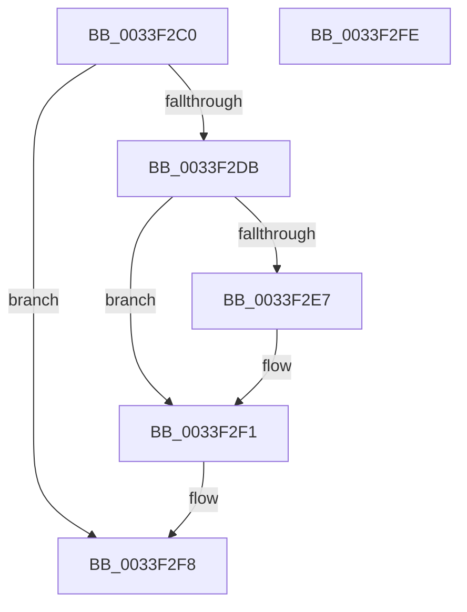

# CcFreeVirtualAddress

- RVA: `0x0033F2C0`–`0x0033F2FF` (길이 `63` bytes)
- VA: `0x000000014033F2C0`
- 실행 섹션: `.text`
- PDB 이름 있음: `예`; PDB Function 태그: `아니요`
- unwind 정보 RVA: `0x0005CF00`
- 디코드: `19`개 명령, `63/63` bytes 표시
- 미해석 바이트: `0` (있으면 어셈블리에 `.byte`로 보존)

> 이 문서는 커널 이미지의 기계어와 PDB 기호를 분석해 생성했습니다. 4번과 5번은 함수 원형과 자료형을 바이너리 사용 방식에서 추정한 C 해석이며 원본 소스 복구 결과는 아닙니다.

## 1. Dependencies

- 직접 호출 지점: **1**; 고유 호출 대상: **1**
- 직접 호출자로 확인된 함수: **4**
- RIP 상대 이미지 참조: **0**

### Outgoing calls
- `0x0033F2EC` → [KeSetEvent](KeSetEvent_function_0033F310.md) (function, `0x0033F310`)

### Direct callers
- [CcPinMappedData](../../page/9D/CcPinMappedData_function_009D5B50.md) at `0x009D5C53`
- [CcMapAndCopyFromCache](../../page/A4/CcMapAndCopyFromCache_function_00A47060.md) at `0x00A4713E`
- [CcMapAndCopyFromCache](../../page/A4/CcMapAndCopyFromCache_function_00A47060.md) at `0x00A47270`
- [CcMdlRead](../../page/AB/CcMdlRead_function_00ABA520.md) at `0x00ABA69D`
- [CcMdlRead$fin$0](../../page/B1/CcMdlRead_fin_0_function_00B139D8.md) at `0x00B13A15`

### Static image references
- 디코드된 RIP-relative 메모리 참조가 없습니다.

## 2. Other-region calls and transfers

- 다른 실행 섹션으로 향하는 call: **0**
- 별도 외부 분기/꼬리 이동을 확인하지 못했습니다.

## 3. Assembly (complete function range)

```asm
0033F2C0  40 53                           push rbx
0033F2C2  48 83 EC 20                     sub rsp, 0x20
0033F2C6  48 8B 59 08                     mov rbx, qword ptr [rcx + 8]
0033F2CA  B8 FF FF FF FF                  mov eax, 0xffffffff
0033F2CF  F0 0F C1 41 10                  lock xadd dword ptr [rcx + 0x10], eax
0033F2D4  FF C8                           dec eax
0033F2D6  66 85 C0                        test ax, ax
0033F2D9  75 1D                           jne 0x14033f2f8
0033F2DB  48 8B 8B C0 00 00 00            mov rcx, qword ptr [rbx + 0xc0]
0033F2E2  48 85 C9                        test rcx, rcx
0033F2E5  74 0A                           je 0x14033f2f1
0033F2E7  45 33 C0                        xor r8d, r8d
0033F2EA  33 D2                           xor edx, edx
0033F2EC  E8 1F 00 00 00                  call 0x14033f310
0033F2F1  F0 FF 8B 28 02 00 00            lock dec dword ptr [rbx + 0x228]
0033F2F8  48 83 C4 20                     add rsp, 0x20
0033F2FC  5B                              pop rbx
0033F2FD  C3                              ret
0033F2FE  CC                              int3
```

## 4. C-style interpretation (structured pseudocode)

```c
__int64 __fastcall CcFreeVirtualAddress(__int64 a1, int a2, int a3)
{
    __int64 result;
    __int64 v_rsp;

    v_rsp = (v_rsp) - (32);
    result = (unsigned int)(((unsigned int)(0xFFFFFFFFULL)) - 1);
    if ((unsigned __int16)(result) != 0) goto loc_0033F2F8;
    if (*(unsigned __int64 *)(*(unsigned __int64 *)(a1 + 8) + 192) != 0) {
        a3 = 0;
        a2 = 0;
        result = KeSetEvent(*(unsigned __int64 *)(*(unsigned __int64 *)(a1 + 8) + 192), a2, a3, a4);
    }
loc_0033F2F8:
    v_rsp = (v_rsp) + (32);
    return result;
}
```

## 5. (Beta) C Style

```c
int64_t CcFreeVirtualAddress(void *Arg1, int32_t Arg2, int32_t Arg3)
{
    uint8_t *arg1 = (uint8_t *)Arg1;

    int64_t result;
    int64_t local_rsp;

    local_rsp = (local_rsp) - (32);
    result = (uint32_t)(((uint32_t)(0xFFFFFFFFULL)) - 1);
    if ((uint16_t)(result) != 0) goto loc_0033F2F8;
    if (*(uint64_t *)(*(uint64_t *)(arg1 + 0x8) + 0xC0) != 0) {
        Arg3 = 0;
        Arg2 = 0;
        result = KeSetEvent(*(uint64_t *)(*(uint64_t *)(arg1 + 0x8) + 0xC0), Arg2, Arg3, a4);
    }
loc_0033F2F8:
    local_rsp = (local_rsp) + (32);
    return result;
}
```

### 관측된 메모리 오프셋

구조체 형식이 확인되지 않은 접근은 인자 기준의 오프셋으로만 기록했습니다.

| 기준 인자 | 오프셋 표현 | 폭 (bit) | 접근 |
|---|---:|---:|---|
| `Arg1` | `+ 0x8` | `64` | `R` |
| `Arg1` | `+ 0x10` | `32` | `R/W` |

## 6. Execution-region graph

[열기: 2D/3D 그래프와 함수 탐색 컨트롤 패널](../../../control-panel.html?section=text&rva=0x0033F2C0&view=graph)

- 2D 그래프는 위에서 아래로 흐르고, 3D 그래프는 빈 공간을 드래그해 회전합니다. Shift+드래그는 이동, 휠은 확대·축소, 함수 노드 선택은 대상 보고서 이동입니다.

### Static fallback


