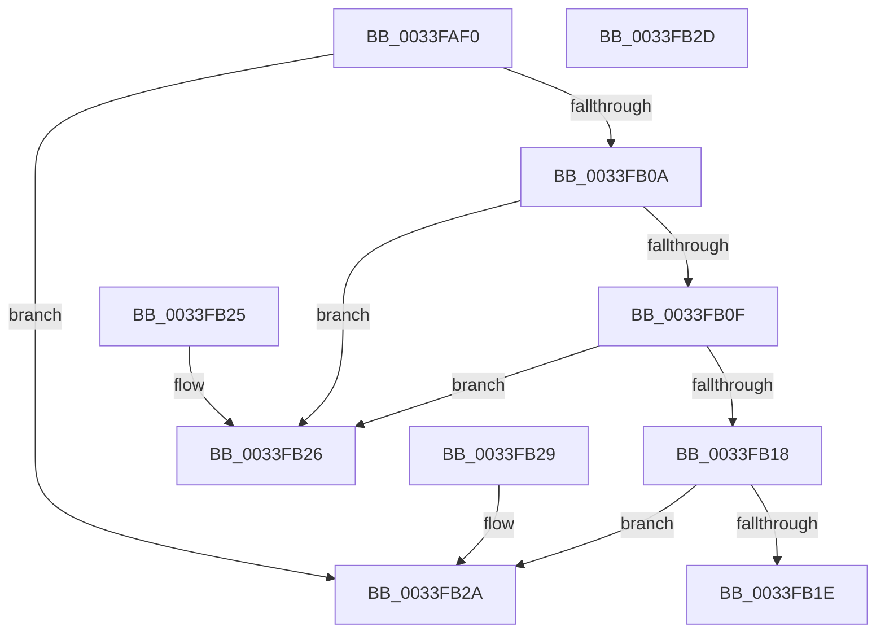

# ExpNewThreadNecessary

- RVA: `0x0033FAF0`–`0x0033FB2E` (길이 `62` bytes)
- VA: `0x000000014033FAF0`
- 실행 섹션: `.text`
- PDB 이름 있음: `예`; PDB Function 태그: `아니요`
- unwind 정보 RVA: `0x000DB714`
- 디코드: `22`개 명령, `62/62` bytes 표시
- 미해석 바이트: `0` (있으면 어셈블리에 `.byte`로 보존)

> 이 문서는 커널 이미지의 기계어와 PDB 기호를 분석해 생성했습니다. 4번과 5번은 함수 원형과 자료형을 바이너리 사용 방식에서 추정한 C 해석이며 원본 소스 복구 결과는 아닙니다.

## 1. Dependencies

- 직접 호출 지점: **0**; 고유 호출 대상: **0**
- 직접 호출자로 확인된 함수: **2**
- RIP 상대 이미지 참조: **0**

### Outgoing calls
- 직접 디코드된 call 명령이 없습니다.

### Direct callers
- [ExpPartitionCreateThreadIfNecessary](ExpPartitionCreateThreadIfNecessary_function_0033FAA0.md) at `0x0033FAB4`
- [ExpWorkQueueManagerThread](../../page/AF/ExpWorkQueueManagerThread_function_00AF6D60.md) at `0x00AF6FB0`
- [ExpWorkQueueManagerThread](../../page/AF/ExpWorkQueueManagerThread_function_00AF6D60.md) at `0x00AF70E0`

### Static image references
- 디코드된 RIP-relative 메모리 참조가 없습니다.

## 2. Other-region calls and transfers

- 다른 실행 섹션으로 향하는 call: **0**
- 별도 외부 분기/꼬리 이동을 확인하지 못했습니다.

## 3. Assembly (complete function range)

```asm
0033FAF0  8B 81 CC 02 00 00               mov eax, dword ptr [rcx + 0x2cc]
0033FAF6  44 8B 81 C8 02 00 00            mov r8d, dword ptr [rcx + 0x2c8]
0033FAFD  44 0F B6 89 D0 02 00 00         movzx r9d, byte ptr [rcx + 0x2d0]
0033FB05  44 3B C0                        cmp r8d, eax
0033FB08  7C 20                           jl 0x14033fb2a
0033FB0A  44 3B C2                        cmp r8d, edx
0033FB0D  7D 17                           jge 0x14033fb26
0033FB0F  48 8D 41 08                     lea rax, [rcx + 8]
0033FB13  48 39 00                        cmp qword ptr [rax], rax
0033FB16  75 0E                           jne 0x14033fb26
0033FB18  83 79 04 00                     cmp dword ptr [rcx + 4], 0
0033FB1C  75 0C                           jne 0x14033fb2a
0033FB1E  45 84 C9                        test r9b, r9b
0033FB21  0F 95 C0                        setne al
0033FB24  C3                              ret
0033FB25  CC                              int3
0033FB26  32 C0                           xor al, al
0033FB28  C3                              ret
0033FB29  CC                              int3
0033FB2A  B0 01                           mov al, 1
0033FB2C  C3                              ret
0033FB2D  CC                              int3
```

## 4. C-style interpretation (structured pseudocode)

```c
__int64 __fastcall ExpNewThreadNecessary(__int64 a1, int a2)
{
    __int64 result;

    if (((unsigned int)((unsigned int)(*(unsigned int *)(a1 + 712)))) < ((unsigned int)((unsigned int)(*(unsigned int *)(a1 + 716))))) goto loc_0033FB2A;
    if (((unsigned int)((unsigned int)(*(unsigned int *)(a1 + 712)))) >= a2) goto loc_0033FB26;
    if ((*(unsigned __int64 *)(a1 + 8)) != (a1 + 8)) goto loc_0033FB26;
    if ((*(unsigned int *)(a1 + 4)) != 0) goto loc_0033FB2A;
    result = ((unsigned __int8)(*(unsigned __int8 *)(a1 + 720)) != 0) ? 1 : 0;
    return result;
loc_0033FB26:
    result = 0;
    return result;
loc_0033FB2A:
    return 1;
}
```

## 5. (Beta) C Style

```c
int64_t ExpNewThreadNecessary(void *Arg1, int32_t Arg2)
{
    uint8_t *arg1 = (uint8_t *)Arg1;

    int64_t result;

    if (((uint32_t)((uint32_t)(*(uint32_t *)(arg1 + 0x2C8)))) < ((uint32_t)((uint32_t)(*(uint32_t *)(arg1 + 0x2CC))))) goto loc_0033FB2A;
    if (((uint32_t)((uint32_t)(*(uint32_t *)(arg1 + 0x2C8)))) >= Arg2) goto loc_0033FB26;
    if ((*(uint64_t *)(arg1 + 0x8)) != (Arg1 + 8)) goto loc_0033FB26;
    if ((*(uint32_t *)(arg1 + 0x4)) != 0) goto loc_0033FB2A;
    result = ((uint8_t)(*(uint8_t *)(arg1 + 0x2D0)) != 0) ? 1 : 0;
    return result;
loc_0033FB26:
    result = 0;
    return result;
loc_0033FB2A:
    return 1;
}
```

### 관측된 메모리 오프셋

구조체 형식이 확인되지 않은 접근은 인자 기준의 오프셋으로만 기록했습니다.

| 기준 인자 | 오프셋 표현 | 폭 (bit) | 접근 |
|---|---:|---:|---|
| `Arg1` | `+ 0x0` | `64` | `R` |
| `Arg1` | `+ 0x4` | `32` | `R` |
| `Arg1` | `+ 0x8` | `64` | `R` |
| `Arg1` | `+ 0x2C8` | `32` | `R` |
| `Arg1` | `+ 0x2CC` | `32` | `R` |
| `Arg1` | `+ 0x2D0` | `8` | `R` |

## 6. Execution-region graph

[열기: 2D/3D 그래프와 함수 탐색 컨트롤 패널](../../../control-panel.html?section=text&rva=0x0033FAF0&view=graph)

- 2D 그래프는 위에서 아래로 흐르고, 3D 그래프는 빈 공간을 드래그해 회전합니다. Shift+드래그는 이동, 휠은 확대·축소, 함수 노드 선택은 대상 보고서 이동입니다.

### Static fallback


