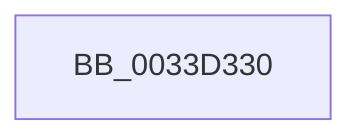

# IoReleaseRemoveLockEx

- RVA: `0x0033D330`–`0x0033D336` (길이 `6` bytes)
- VA: `0x000000014033D330`
- 실행 섹션: `.text`
- PDB 이름 있음: `예`; PDB Function 태그: `예`
- unwind 정보 RVA: `0x000770BC`
- 디코드: `2`개 명령, `6/6` bytes 표시
- 미해석 바이트: `0` (있으면 어셈블리에 `.byte`로 보존)

> 이 문서는 커널 이미지의 기계어와 PDB 기호를 분석해 생성했습니다. 4번과 5번은 함수 원형과 자료형을 바이너리 사용 방식에서 추정한 C 해석이며 원본 소스 복구 결과는 아닙니다.

## 1. Dependencies

- 직접 호출 지점: **0**; 고유 호출 대상: **0**
- 직접 호출자로 확인된 함수: **10**
- RIP 상대 이미지 참조: **0**

### Outgoing calls
- 직접 디코드된 call 명령이 없습니다.

### Direct callers
- [sub_00393E0F](../39/Unknown_function_00393E0F.md) at `0x00393ECE`
- [PoFxPrepareDevice](../49/PoFxPrepareDevice_function_00499F0C.md) at `0x0049A0B7`
- [PopFxAcpiForwardPepAcpiNotifyRequest](../4C/PopFxAcpiForwardPepAcpiNotifyRequest_function_004C7650.md) at `0x004C76C9`
- [PopFxAcpiForwardPepWorkRequest](../4F/PopFxAcpiForwardPepWorkRequest_function_004F65A4.md) at `0x004F6630`
- [PopFxReleaseAcpiRefDevice](../5D/PopFxReleaseAcpiRefDevice_function_005D3444.md) at `0x005D3455`
- [PopFxAcpiForwardNotification](../5D/PopFxAcpiForwardNotification_function_005DD554.md) at `0x005DD5C3`
- [DifIoReleaseRemoveLockExWrapper](../62/DifIoReleaseRemoveLockExWrapper_function_0062C810.md) at `0x0062C8F4`
- [sub_00BACF95](../../pagevrfy/BA/Unknown_function_00BACF95.md) at `0x00BACFA2`
- [ViFilterGenericCompletionRoutine](../../pagevrfy/BA/ViFilterGenericCompletionRoutine_function_00BAD430.md) at `0x00BAD453`
- [ViFilterStartCompletionRoutine](../../pagevrfy/BA/ViFilterStartCompletionRoutine_function_00BAD530.md) at `0x00BAD569`

### Static image references
- 디코드된 RIP-relative 메모리 참조가 없습니다.

## 2. Other-region calls and transfers

- 다른 실행 섹션으로 향하는 call: **0**
- 별도 외부 분기/꼬리 이동을 확인하지 못했습니다.

## 3. Assembly (complete function range)

```asm
0033D330  40 57                           push rdi
0033D332  48 83 EC 40                     sub rsp, 0x40
```

## 4. C-style interpretation (structured pseudocode)

```c
void __fastcall IoReleaseRemoveLockEx(void)
{
    __int64 v_rsp;

    v_rsp = (v_rsp) - (64);
    return;
}
```

## 5. (Beta) C Style

```c
void IoReleaseRemoveLockEx(void)
{
    int64_t local_rsp;

    local_rsp = (local_rsp) - (64);
    return;
}
```

## 6. Execution-region graph

[열기: 2D/3D 그래프와 함수 탐색 컨트롤 패널](../../../control-panel.html?section=text&rva=0x0033D330&view=graph)

- 2D 그래프는 위에서 아래로 흐르고, 3D 그래프는 빈 공간을 드래그해 회전합니다. Shift+드래그는 이동, 휠은 확대·축소, 함수 노드 선택은 대상 보고서 이동입니다.

### Static fallback


