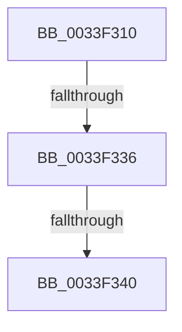

# KeSetEvent

- RVA: `0x0033F310`–`0x0033F345` (길이 `53` bytes)
- VA: `0x000000014033F310`
- 실행 섹션: `.text`
- PDB 이름 있음: `예`; PDB Function 태그: `아니요`
- unwind 정보 RVA: `0x00077370`
- 디코드: `15`개 명령, `53/53` bytes 표시
- 미해석 바이트: `0` (있으면 어셈블리에 `.byte`로 보존)

> 이 문서는 커널 이미지의 기계어와 PDB 기호를 분석해 생성했습니다. 4번과 5번은 함수 원형과 자료형을 바이너리 사용 방식에서 추정한 C 해석이며 원본 소스 복구 결과는 아닙니다.

## 1. Dependencies

- 직접 호출 지점: **0**; 고유 호출 대상: **0**
- 직접 호출자로 확인된 함수: **467**
- RIP 상대 이미지 참조: **0**

### Outgoing calls
- 직접 디코드된 call 명령이 없습니다.

### Direct callers
- [SMKM_STORE&lt;SM_TRAITS&gt;::SmStReadThread](../20/SMKM_STORE_SM_TRAITS_SmStReadThread_function_00203230.md) at `0x0020329E`
- [SMKM_STORE&lt;SM_TRAITS&gt;::SmStReadThread](../20/SMKM_STORE_SM_TRAITS_SmStReadThread_function_00203230.md) at `0x00203431`
- [sub_002055DD](../20/Unknown_function_002055DD.md) at `0x002057C9`
- [sub_002055DD](../20/Unknown_function_002055DD.md) at `0x00205802`
- [SMKM_STORE_MGR&lt;SM_TRAITS&gt;::SmIoCtxWorkItemComplete](../20/SMKM_STORE_MGR_SM_TRAITS_SmIoCtxWorkItemComplete_function_00205850.md) at `0x002059EF`
- [SMKM_STORE_MGR&lt;SM_TRAITS&gt;::SmIoCtxWorkItemComplete](../20/SMKM_STORE_MGR_SM_TRAITS_SmIoCtxWorkItemComplete_function_00205850.md) at `0x00205AE1`
- [sub_002066BE](../20/Unknown_function_002066BE.md) at `0x002067B7`
- [IopCompleteRequest](../20/IopCompleteRequest_function_0020AF50.md) at `0x0020B20A`
- [IopCompleteRequest](../20/IopCompleteRequest_function_0020AF50.md) at `0x0020B325`
- [IopCompleteRequest](../20/IopCompleteRequest_function_0020AF50.md) at `0x0020B4F2`
- [sub_002175E7](../21/Unknown_function_002175E7.md) at `0x002176BA`
- [sub_002180B5](../21/Unknown_function_002180B5.md) at `0x00218189`
- [sub_002188FB](../21/Unknown_function_002188FB.md) at `0x002189C9`
- [SepRmCallLsa](../22/SepRmCallLsa_function_00223630.md) at `0x002238F4`
- [SepRmCallLsa](../22/SepRmCallLsa_function_00223630.md) at `0x00223913`
- [CcFlushCacheOneRange](../23/CcFlushCacheOneRange_function_00236A30.md) at `0x00236C45`
- [MmFlushSection](../23/MmFlushSection_function_002375E4.md) at `0x00237852`
- [MmFlushSection](../23/MmFlushSection_function_002375E4.md) at `0x00237888`
- [MmFlushSection](../23/MmFlushSection_function_002375E4.md) at `0x002378A1`
- [sub_00245F85](../24/Unknown_function_00245F85.md) at `0x00246023`
- [sub_00245F85](../24/Unknown_function_00245F85.md) at `0x00246065`
- [sub_00246856](../24/Unknown_function_00246856.md) at `0x002468E6`
- [sub_00246856](../24/Unknown_function_00246856.md) at `0x00246926`
- [sub_00246D01](../24/Unknown_function_00246D01.md) at `0x00246D9C`
- [sub_00246D01](../24/Unknown_function_00246D01.md) at `0x00246DDE`
- [sub_002484B4](../24/Unknown_function_002484B4.md) at `0x00248637`
- [sub_002484B4](../24/Unknown_function_002484B4.md) at `0x00248668`
- [sub_00248F71](../24/Unknown_function_00248F71.md) at `0x0024900F`
- [sub_0024904B](../24/Unknown_function_0024904B.md) at `0x00249061`
- [sub_00249157](../24/Unknown_function_00249157.md) at `0x00249184`
- [sub_0024918B](../24/Unknown_function_0024918B.md) at `0x002491CD`
- [ExReleaseRundownProtectionCacheAwareEx](../25/ExReleaseRundownProtectionCacheAwareEx_function_0025F050.md) at `0x0025F0BC`
- [ExfTryToWakePushLock](../26/ExfTryToWakePushLock_function_00265DD0.md) at `0x00265E8D`
- [SMKM_STORE_MGR&lt;SM_TRAITS&gt;::SmCompressCtxWorkerThread](../26/SMKM_STORE_MGR_SM_TRAITS_SmCompressCtxWorkerThread_function_00267D20.md) at `0x00267E25`
- [SMKM_STORE_MGR&lt;SM_TRAITS&gt;::SmCompressCtxWorkerThread](../26/SMKM_STORE_MGR_SM_TRAITS_SmCompressCtxWorkerThread_function_00267D20.md) at `0x00267F55`
- [SMKM_STORE_MGR&lt;SM_TRAITS&gt;::SmCompressCtxWorkerThread](../26/SMKM_STORE_MGR_SM_TRAITS_SmCompressCtxWorkerThread_function_00267D20.md) at `0x00267F83`
- [SMKM_STORE_MGR&lt;SM_TRAITS&gt;::SmCompressCtxWorkerThread](../26/SMKM_STORE_MGR_SM_TRAITS_SmCompressCtxWorkerThread_function_00267D20.md) at `0x0026819C`
- [PopIrpWorker](../26/PopIrpWorker_function_0026D410.md) at `0x0026D7E8`
- [PopPepUpdateConstraints](../26/PopPepUpdateConstraints_function_0026F5C8.md) at `0x0026F76B`
- [PopFxReleasePowerIrp](../27/PopFxReleasePowerIrp_function_00270274.md) at `0x002702E7`
- [PopFxDereferenceDevice](../27/PopFxDereferenceDevice_function_0027038C.md) at `0x002703B7`
- [MiResolveTransitionFault](../28/MiResolveTransitionFault_function_00282940.md) at `0x002837C9`
- [sub_00283850](../28/Unknown_function_00283850.md) at `0x00283A03`
- [MiReleasePageFileInfo](../28/MiReleasePageFileInfo_function_00283FD0.md) at `0x00284209`
- [MiReleasePageFileInfo](../28/MiReleasePageFileInfo_function_00283FD0.md) at `0x00284510`
- [MiCheckControlArea](../28/MiCheckControlArea_function_002861B0.md) at `0x002864EB`
- [MiReturnCrossPartitionCharges](../28/MiReturnCrossPartitionCharges_function_002867D0.md) at `0x00286864`
- [MiChargeCommit](../28/MiChargeCommit_function_00286EB0.md) at `0x002874FB`
- [MiChargeCommit](../28/MiChargeCommit_function_00286EB0.md) at `0x00287566`
- [sub_00287E84](../28/Unknown_function_00287E84.md) at `0x00287F54`
- [MiFlushComplete](../29/MiFlushComplete_function_002980A0.md) at `0x00298126`
- [MiFreeOverlappedFlushEntry](../29/MiFreeOverlappedFlushEntry_function_00298240.md) at `0x0029829D`
- [IopfCompleteRequest](../29/IopfCompleteRequest_function_0029B5F8.md) at `0x0029B97B`
- [MiFreePageToSlabEntry](../2A/MiFreePageToSlabEntry_function_002A0D94.md) at `0x002A0F02`
- [sub_002A1645](../2A/Unknown_function_002A1645.md) at `0x002A16DD`
- [ExpUnblockPushLock](../2A/ExpUnblockPushLock_function_002A40FC.md) at `0x002A4177`
- [ExReleaseRundownProtectionEx](../2A/ExReleaseRundownProtectionEx_function_002A55B0.md) at `0x002A5606`
- [MiMarkMdlComplete](../2A/MiMarkMdlComplete_function_002A75D0.md) at `0x002A779C`
- [MiCopyDataPageToImagePage](../2A/MiCopyDataPageToImagePage_function_002AE818.md) at `0x002AED31`
- [MiGetSlabRepurposedStandbyListWorker](../2A/MiGetSlabRepurposedStandbyListWorker_function_002AF534.md) at `0x002AF6BA`
- [MiStoreWriteModifiedPages](../2B/MiStoreWriteModifiedPages_function_002B46C4.md) at `0x002B547A`
- [MiFinishHardFault](../2B/MiFinishHardFault_function_002B6F10.md) at `0x002B7272`
- [MiInsertPageInList](../2B/MiInsertPageInList_function_002BA000.md) at `0x002BA8A1`
- [MiInsertPageInList](../2B/MiInsertPageInList_function_002BA000.md) at `0x002BA92F`
- [MiInsertPageInList](../2B/MiInsertPageInList_function_002BA000.md) at `0x002BAA10`
- [PopFxCompleteComponentActivation](../2B/PopFxCompleteComponentActivation_function_002BDDE4.md) at `0x002BDE12`
- [PopPepCompleteComponentIdleStateChangeActivity](../2B/PopPepCompleteComponentIdleStateChangeActivity_function_002BF1B0.md) at `0x002BF1FD`
- [PopFxReferenceDevice](../2B/PopFxReferenceDevice_function_002BFD9C.md) at `0x002BFDE3`
- [PopFxComponentWork](../2C/PopFxComponentWork_function_002C0420.md) at `0x002C048B`
- [PopFxTryReferenceDevice](../2C/PopFxTryReferenceDevice_function_002C0628.md) at `0x002C066C`
- [MiIncrementZeroEngineThread](../2C/MiIncrementZeroEngineThread_function_002CBB80.md) at `0x002CBBB3`
- [PpmReleaseLock](../2D/PpmReleaseLock_function_002DA428.md) at `0x002DA43E`
- [MiWorkingSetManager](../2D/MiWorkingSetManager_function_002DA7E0.md) at `0x002DAA4F`
- [MiWorkingSetManager](../2D/MiWorkingSetManager_function_002DA7E0.md) at `0x002DAAB6`
- [MiScheduleZeroPageThreads](../2D/MiScheduleZeroPageThreads_function_002DB1DC.md) at `0x002DB4A9`
- [MiScheduleZeroPageThreads](../2D/MiScheduleZeroPageThreads_function_002DB1DC.md) at `0x002DB4BB`
- [PopQueueTargetDpc](../2D/PopQueueTargetDpc_function_002DD8F0.md) at `0x002DD9D9`
- [AlpcpSignalAndWait](../2F/AlpcpSignalAndWait_function_002F9620.md) at `0x002F98F0`
- [EtwpReserveTraceBuffer](../2F/EtwpReserveTraceBuffer_function_002FC8C0.md) at `0x002FCC7F`
- [sub_003178C4](../31/Unknown_function_003178C4.md) at `0x0031790A`
- [sub_00317914](../31/Unknown_function_00317914.md) at `0x00317975`
- [SMKM_STORE_MGR&lt;SM_TRAITS&gt;::SmWorkItemFreeResource](../31/SMKM_STORE_MGR_SM_TRAITS_SmWorkItemFreeResource_function_003179B4.md) at `0x00317A27`
- [SMKM_STORE&lt;SM_TRAITS&gt;::SmStWorkItemQueue](../31/SMKM_STORE_SM_TRAITS_SmStWorkItemQueue_function_00317A34.md) at `0x00317B56`
- [SMKM_STORE&lt;SM_TRAITS&gt;::SmStWorkItemQueue](../31/SMKM_STORE_SM_TRAITS_SmStWorkItemQueue_function_00317A34.md) at `0x00317C55`
- [MiReleaseNonPagedResources](../32/MiReleaseNonPagedResources_function_0032299C.md) at `0x00322C31`
- [MiReleaseNonPagedResources](../32/MiReleaseNonPagedResources_function_0032299C.md) at `0x00322C5F`
- [sub_00327F8E](../32/Unknown_function_00327F8E.md) at `0x00327FB9`
- [sub_00327FD5](../32/Unknown_function_00327FD5.md) at `0x00327FEB`
- [sub_003354FB](Unknown_function_003354FB.md) at `0x00335930`
- [sub_00336094](Unknown_function_00336094.md) at `0x003360F5`
- [sub_00336094](Unknown_function_00336094.md) at `0x00336117`
- [sub_00336094](Unknown_function_00336094.md) at `0x00336139`
- [sub_00336094](Unknown_function_00336094.md) at `0x003361D0`
- [MiUnlinkFreeOrZeroedPage](MiUnlinkFreeOrZeroedPage_function_00336C40.md) at `0x003375C4`
- [sub_0033C441](Unknown_function_0033C441.md) at `0x0033C674`
- [sub_0033C441](Unknown_function_0033C441.md) at `0x0033C692`
- [sub_0033D365](Unknown_function_0033D365.md) at `0x0033D36E`
- [sub_0033DA89](Unknown_function_0033DA89.md) at `0x0033DC5F`
- [sub_0033EABD](Unknown_function_0033EABD.md) at `0x0033EC46`
- [sub_0033EABD](Unknown_function_0033EABD.md) at `0x0033EE22`
- [sub_0033EABD](Unknown_function_0033EABD.md) at `0x0033EE44`
- [sub_0033EABD](Unknown_function_0033EABD.md) at `0x0033EE66`
- [sub_0033EABD](Unknown_function_0033EABD.md) at `0x0033EF03`
- [sub_0033EFBD](Unknown_function_0033EFBD.md) at `0x0033F0F1`
- [CcFreeVirtualAddress](CcFreeVirtualAddress_function_0033F2C0.md) at `0x0033F2EC`
- [ExpPartitionCreateThreadIfNecessary](ExpPartitionCreateThreadIfNecessary_function_0033FAA0.md) at `0x0033FAD2`
- [CcPinFileData](CcPinFileData_function_0033FB40.md) at `0x00340854`
- [CcPinFileData](CcPinFileData_function_0033FB40.md) at `0x00340B1B`
- [MiDecrementVadsBeingDeleted](../34/MiDecrementVadsBeingDeleted_function_00341010.md) at `0x00341032`
- [sub_003410A7](../34/Unknown_function_003410A7.md) at `0x003410E3`
- [sub_00341DB3](../34/Unknown_function_00341DB3.md) at `0x0034204A`
- [sub_00342A4A](../34/Unknown_function_00342A4A.md) at `0x00342AA9`
- [sub_00342C29](../34/Unknown_function_00342C29.md) at `0x00342C86`
- [ExReleaseRundownProtectionCacheAware](../34/ExReleaseRundownProtectionCacheAware_function_00342DF0.md) at `0x00342E50`
- [sub_00344B95](../34/Unknown_function_00344B95.md) at `0x00344BF3`
- [MiQueuePageAccessLog](../34/MiQueuePageAccessLog_function_00348EB0.md) at `0x00348FC6`
- [MiQueuePageAccessLog](../34/MiQueuePageAccessLog_function_00348EB0.md) at `0x00348FE1`
- [ExfReleaseRundownProtection](../34/ExfReleaseRundownProtection_function_00349EB0.md) at `0x00349EFF`
- [PfpEventHandleFullBuffer](../34/PfpEventHandleFullBuffer_function_0034A640.md) at `0x0034A67D`
- [sub_0034CD25](../34/Unknown_function_0034CD25.md) at `0x0034CE09`
- [MiStoreUpdateMemoryConditions](../34/MiStoreUpdateMemoryConditions_function_0034CF3C.md) at `0x0034D126`
- [MiProcessWorkingSets](../34/MiProcessWorkingSets_function_0034E710.md) at `0x0034EDAC`
- [CcAsyncLazywriteWorker](../35/CcAsyncLazywriteWorker_function_00354C28.md) at `0x00354E26`
- [KiInSwapSingleProcess](../35/KiInSwapSingleProcess_function_00355474.md) at `0x003555F6`
- [CcDereferencePartition](../35/CcDereferencePartition_function_003572F0.md) at `0x00357330`
- [CcWriteBehindPostProcess](../35/CcWriteBehindPostProcess_function_00357BB4.md) at `0x00357F63`
- [sub_003585CB](../35/Unknown_function_003585CB.md) at `0x00358604`
- [CcPostDeferredWrites](../35/CcPostDeferredWrites_function_003590FC.md) at `0x00359238`
- [CcUnpinFileDataEx](../35/CcUnpinFileDataEx_function_00359DEC.md) at `0x00359E50`
- [CcUnpinFileDataEx](../35/CcUnpinFileDataEx_function_00359DEC.md) at `0x00359F8F`
- [CcUnpinFileDataEx](../35/CcUnpinFileDataEx_function_00359DEC.md) at `0x0035A0C1`
- [MiQueueControlAreaDelete](../36/MiQueueControlAreaDelete_function_00369018.md) at `0x00369076`
- [MiDeleteControlArea](../36/MiDeleteControlArea_function_003691F4.md) at `0x00369349`
- [MiPrivateFixup](../36/MiPrivateFixup_function_003693E8.md) at `0x00369B37`
- [MiCopyFileOnlyGlobalSubsectionPage](../36/MiCopyFileOnlyGlobalSubsectionPage_function_0036A9EC.md) at `0x0036AD8D`
- [MiPfIssueCoalescedSupport](../36/MiPfIssueCoalescedSupport_function_0036AE14.md) at `0x0036B03B`
- [MiPfCompleteCoalescedIo](../36/MiPfCompleteCoalescedIo_function_0036C344.md) at `0x0036C41F`
- [SmKmUnlockMdl](../37/SmKmUnlockMdl_function_00372A44.md) at `0x00372AE3`
- [MiUpdateSlabTypeAvailablePages](../37/MiUpdateSlabTypeAvailablePages_function_00378DC0.md) at `0x00378E65`
- [MiRecordLargePageCandidate](../37/MiRecordLargePageCandidate_function_0037A624.md) at `0x0037A738`
- [MiIssueHardFaultIo](../38/MiIssueHardFaultIo_function_003812EC.md) at `0x003814C3`
- [MiIssueHardFaultIo](../38/MiIssueHardFaultIo_function_003812EC.md) at `0x00381545`
- [MiIssueHardFaultIo](../38/MiIssueHardFaultIo_function_003812EC.md) at `0x00381584`
- [CcDeleteBcbs](../38/CcDeleteBcbs_function_00389BF0.md) at `0x00389CCB`
- [CcPurgeAndClearCacheSection](../38/CcPurgeAndClearCacheSection_function_0038A614.md) at `0x0038A797`
- [CcDeleteSharedCacheMap](../38/CcDeleteSharedCacheMap_function_0038A804.md) at `0x0038ABB8`
- [CcDeleteSharedCacheMap](../38/CcDeleteSharedCacheMap_function_0038A804.md) at `0x0038ABE7`
- [CcDereferencePartitionAndPrivateVolumeCacheMap](../38/CcDereferencePartitionAndPrivateVolumeCacheMap_function_0038B94C.md) at `0x0038B9D1`
- [ExNotifyCallback](../39/ExNotifyCallback_function_003926B0.md) at `0x003927A4`
- [AlpcpSignal](../39/AlpcpSignal_function_003955E0.md) at `0x00395834`
- [KiReadyOutSwappedThreads](../39/KiReadyOutSwappedThreads_function_00396E30.md) at `0x0039706D`
- [KiRequestProcessInSwap](../39/KiRequestProcessInSwap_function_003981D4.md) at `0x003982FF`
- [KiInswapAndReadyThread](../39/KiInswapAndReadyThread_function_00398318.md) at `0x003984AC`
- [KiProcessDisconnectList](../39/KiProcessDisconnectList_function_0039F804.md) at `0x0039F84E`
- [KiInvokeInterruptServiceRoutine](../39/KiInvokeInterruptServiceRoutine_function_0039F8E0.md) at `0x0039FA27`
- [NtSignalAndWaitForSingleObject](../3A/NtSignalAndWaitForSingleObject_function_003A11D0.md) at `0x003A1352`
- [MiStoreEvictThread](../3A/MiStoreEvictThread_function_003A42D0.md) at `0x003A4573`
- [MiStoreContractVirtualPagefileApc](../3A/MiStoreContractVirtualPagefileApc_function_003A4710.md) at `0x003A48DC`
- [SMKM_STORE&lt;SM_TRAITS&gt;::SmStCleanup](../3B/SMKM_STORE_SM_TRAITS_SmStCleanup_function_003B00E0.md) at `0x003B0136`
- [SMKM_STORE&lt;SM_TRAITS&gt;::SmStCleanup](../3B/SMKM_STORE_SM_TRAITS_SmStCleanup_function_003B00E0.md) at `0x003B01A0`
- [SMKM_STORE&lt;SM_TRAITS&gt;::SmStHelperSendCommand](../3B/SMKM_STORE_SM_TRAITS_SmStHelperSendCommand_function_003B0530.md) at `0x003B05C5`
- [SmKmStoreHelperSendCommand](../3B/SmKmStoreHelperSendCommand_function_003B0658.md) at `0x003B06BA`
- [SMKM_STORE_MGR&lt;SM_TRAITS&gt;::SmCompressCtxBalancerThread](../3B/SMKM_STORE_MGR_SM_TRAITS_SmCompressCtxBalancerThread_function_003B22C0.md) at `0x003B2306`
- [MiObtainDynamicVa](../3B/MiObtainDynamicVa_function_003B501C.md) at `0x003B53DC`
- [sub_003BB64A](../3B/Unknown_function_003BB64A.md) at `0x003BB6AD`
- [MiObtainFreePages](../3B/MiObtainFreePages_function_003BB724.md) at `0x003BB7BF`
- [MiObtainFreePages](../3B/MiObtainFreePages_function_003BB724.md) at `0x003BB7D2`
- [MiUpdateAvailableEventsAtDpc](../3B/MiUpdateAvailableEventsAtDpc_function_003BC804.md) at `0x003BC856`
- [MiUpdateAvailableEventsAtDpc](../3B/MiUpdateAvailableEventsAtDpc_function_003BC804.md) at `0x003BC880`
- [MiFlushAllStoreSwapPages](../3B/MiFlushAllStoreSwapPages_function_003BC890.md) at `0x003BC974`
- [MiWakeModifiedPageWriter](../3B/MiWakeModifiedPageWriter_function_003BCB18.md) at `0x003BCB40`
- [MiWakeModifiedPageWriter](../3B/MiWakeModifiedPageWriter_function_003BCB18.md) at `0x003BCB5A`
- [sub_003BCD6B](../3B/Unknown_function_003BCD6B.md) at `0x003BCD8D`
- [sub_003BCDBD](../3B/Unknown_function_003BCDBD.md) at `0x003BCDD9`
- [sub_003BCDBD](../3B/Unknown_function_003BCDBD.md) at `0x003BCDF6`
- [sub_003BCDBD](../3B/Unknown_function_003BCDBD.md) at `0x003BCE13`
- [MiFlushAllPagesWorker](../3B/MiFlushAllPagesWorker_function_003BCED4.md) at `0x003BCF56`
- [EtwpThreadRundownApc](../3C/EtwpThreadRundownApc_function_003C1B50.md) at `0x003C1BA2`
- [SmKmStoreHelperWorker](../3C/SmKmStoreHelperWorker_function_003C2BC0.md) at `0x003C2C4A`
- [SmKmStoreHelperCommandProcess](../3C/SmKmStoreHelperCommandProcess_function_003C3AA4.md) at `0x003C3CDD`
- [CcMapAndCopyInToCache](../3C/CcMapAndCopyInToCache_function_003CA7F0.md) at `0x003CABCC`
- [CcMapAndCopyInToCache](../3C/CcMapAndCopyInToCache_function_003CA7F0.md) at `0x003CB2EA`
- [CcNotifyWriteBehindVolume](../3C/CcNotifyWriteBehindVolume_function_003CC134.md) at `0x003CC167`
- [CcNotifyWriteBehindVolume](../3C/CcNotifyWriteBehindVolume_function_003CC134.md) at `0x003CC17E`
- [CcNotifyWriteBehindVolume](../3C/CcNotifyWriteBehindVolume_function_003CC134.md) at `0x003CC1A1`
- [CcNotifyWriteBehindVolume](../3C/CcNotifyWriteBehindVolume_function_003CC134.md) at `0x003CC202`
- [CcNotifyWriteBehindVolume](../3C/CcNotifyWriteBehindVolume_function_003CC134.md) at `0x003CC215`
- [CcNotifyWriteBehindInternal](../3C/CcNotifyWriteBehindInternal_function_003CC224.md) at `0x003CC278`
- [CcInitializeCacheMapInternal](../3C/CcInitializeCacheMapInternal_function_003CC720.md) at `0x003CCE4F`
- [CcInitializeCacheMapInternal](../3C/CcInitializeCacheMapInternal_function_003CC720.md) at `0x003CD1AE`
- [CcInitializeCacheMapInternal](../3C/CcInitializeCacheMapInternal_function_003CC720.md) at `0x003CD2B4`
- [CcUninitializeCacheMap](../3C/CcUninitializeCacheMap_function_003CD520.md) at `0x003CD921`
- [CcUninitializeCacheMap](../3C/CcUninitializeCacheMap_function_003CD520.md) at `0x003CD990`
- [CcDeletePrivateVolumeCacheMap](../3C/CcDeletePrivateVolumeCacheMap_function_003CE950.md) at `0x003CEA0D`
- [CcDeletePrivateVolumeCacheMap](../3C/CcDeletePrivateVolumeCacheMap_function_003CE950.md) at `0x003CEA1E`
- [CcDeletePrivateVolumeCacheMap](../3C/CcDeletePrivateVolumeCacheMap_function_003CE950.md) at `0x003CEC33`
- [CcReapPrivateVolumeCachemap](../3C/CcReapPrivateVolumeCachemap_function_003CF1B8.md) at `0x003CF242`
- [MmStoreEvictComplete](../3E/MmStoreEvictComplete_function_003E1840.md) at `0x003E18F7`
- [SMKM_STORE&lt;SM_TRAITS&gt;::SmStUnmapPhysicalRegion](../3E/SMKM_STORE_SM_TRAITS_SmStUnmapPhysicalRegion_function_003E76E0.md) at `0x003E779F`
- [IopCompleteIoRingEntry](../3E/IopCompleteIoRingEntry_function_003ED2C0.md) at `0x003ED3B8`
- [IopCompleteIoRingEntry](../3E/IopCompleteIoRingEntry_function_003ED2C0.md) at `0x003ED3CB`
- [MiWriteComplete](../40/MiWriteComplete_function_004069B0.md) at `0x00406FEE`
- [IoAcquireRemoveLockEx](../43/IoAcquireRemoveLockEx_function_00433420.md) at `0x00433480`
- [SmKmStoreDeleteWhenEmptyWorker](../43/SmKmStoreDeleteWhenEmptyWorker_function_00434130.md) at `0x0043414A`
- [SmFpFree](../43/SmFpFree_function_00436350.md) at `0x00436419`
- [EtwpCovSampCaptureCleanupLookasides](../43/EtwpCovSampCaptureCleanupLookasides_function_0043BFE0.md) at `0x0043C082`
- [EtwpCovSampCaptureBufferQueue](../43/EtwpCovSampCaptureBufferQueue_function_0043C234.md) at `0x0043C2AE`
- [MiUpdateCommitCounts](../43/MiUpdateCommitCounts_function_0043D9CC.md) at `0x0043DB26`
- [MiUpdateCommitCounts](../43/MiUpdateCommitCounts_function_0043D9CC.md) at `0x0043DB4A`
- [LZNT1DecompressChunkWorkItem](../44/LZNT1DecompressChunkWorkItem_function_00448A20.md) at `0x00448A69`
- [IopSessionChangeWorker](../45/IopSessionChangeWorker_function_004522B0.md) at `0x004523DA`
- [ExNotifyWithProcessing](../45/ExNotifyWithProcessing_function_004523F4.md) at `0x00452540`
- [CcPostWorkQueueAsyncRead](../45/CcPostWorkQueueAsyncRead_function_0045D624.md) at `0x0045D76C`
- [PopUpdateWatchdogNoWorkersEvent](../46/PopUpdateWatchdogNoWorkersEvent_function_00461078.md) at `0x00461091`
- [EtwpCovSampCaptureQueueBuffer](../46/EtwpCovSampCaptureQueueBuffer_function_004620D0.md) at `0x00462102`
- [EtwpCovSampCaptureQueueDpc](../46/EtwpCovSampCaptureQueueDpc_function_00462370.md) at `0x004623BF`
- [MiSegmentDereferenceWorker](../46/MiSegmentDereferenceWorker_function_00464D40.md) at `0x00464E3C`
- [MiDecrementControlAreaCount](../46/MiDecrementControlAreaCount_function_00467414.md) at `0x00467453`
- [PopPowerRequestEvaluatePendingRequestStatus](../47/PopPowerRequestEvaluatePendingRequestStatus_function_00477914.md) at `0x00477A7C`
- [PopPowerRequestCallbackWorker](../47/PopPowerRequestCallbackWorker_function_00477AD0.md) at `0x00477C62`
- [PnpDeviceActionWorker](../47/PnpDeviceActionWorker_function_00478400.md) at `0x004788A9`
- [PnpDeviceActionWorker](../47/PnpDeviceActionWorker_function_00478400.md) at `0x00478AB9`
- [PopQueueDirectedDripsWork](../47/PopQueueDirectedDripsWork_function_00478DC4.md) at `0x00478DF8`
- [WmipUnreferenceRegEntry](../47/WmipUnreferenceRegEntry_function_0047B6F0.md) at `0x0047B70E`
- [MiSyncCommitSignals](../47/MiSyncCommitSignals_function_0047CA00.md) at `0x0047CADF`
- [MiSyncCommitSignals](../47/MiSyncCommitSignals_function_0047CA00.md) at `0x0047CAF5`
- [MiModifiedPageWriter](../47/MiModifiedPageWriter_function_0047E5F0.md) at `0x0047E687`
- [MiModifiedPageWriter](../47/MiModifiedPageWriter_function_0047E5F0.md) at `0x0047EAE4`
- [MiModifiedPageWriter](../47/MiModifiedPageWriter_function_0047E5F0.md) at `0x0047EB63`
- [MiFinishResume](../47/MiFinishResume_function_0047F9C0.md) at `0x0047FA94`
- [MiProcessingPageExtendComplete](../48/MiProcessingPageExtendComplete_function_00481370.md) at `0x004813C3`
- [MiAttemptPageFileReductionApc](../48/MiAttemptPageFileReductionApc_function_004815A0.md) at `0x00481710`
- [MiQueuePageFileExtension](../48/MiQueuePageFileExtension_function_0048187C.md) at `0x004818F4`
- [PopUserPresentSet](../48/PopUserPresentSet_function_00482B90.md) at `0x00482C6A`
- [PopCompleteNotifyTransitionCommon](../48/PopCompleteNotifyTransitionCommon_function_00483B4C.md) at `0x00483DBC`
- [WheapProcessWorkQueueItem](../48/WheapProcessWorkQueueItem_function_00484820.md) at `0x004848C3`
- [PfpReturnAccessBuffer](../48/PfpReturnAccessBuffer_function_00488A80.md) at `0x00488B65`
- [PfpReturnAccessBuffer](../48/PfpReturnAccessBuffer_function_00488A80.md) at `0x00488B80`
- [MiAllocatePfnRepurposeLogDispatch](../48/MiAllocatePfnRepurposeLogDispatch_function_00488BD0.md) at `0x00488DA1`
- [MiAllocatePfnRepurposeLogDispatch](../48/MiAllocatePfnRepurposeLogDispatch_function_00488BD0.md) at `0x00488DBC`
- [CmpCompleteFlushAndPurgeIrp](../48/CmpCompleteFlushAndPurgeIrp_function_0048B010.md) at `0x0048B01C`
- [MiStoreDecrementOutstandingWrites](../48/MiStoreDecrementOutstandingWrites_function_0048EF68.md) at `0x0048EF95`
- [CcWorkerThread](../48/CcWorkerThread_function_0048F0F0.md) at `0x0048F2E5`
- [KiBalanceSetManagerDeferredRoutine](../49/KiBalanceSetManagerDeferredRoutine_function_00494F40.md) at `0x00494FA0`
- [ExpEnumerateCallback](../49/ExpEnumerateCallback_function_00497430.md) at `0x004974DE`
- [IopCancelIrpsInCurrentThreadListSpecialApc](../49/IopCancelIrpsInCurrentThreadListSpecialApc_function_00497B40.md) at `0x00497BA9`
- [CcPrepareMdlWrite](../49/CcPrepareMdlWrite_function_004996D0.md) at `0x0049990F`
- [PopUserPresentSetWorker](../49/PopUserPresentSetWorker_function_0049D4F0.md) at `0x0049D612`
- [SMKM_STORE_MGR&lt;SM_TRAITS&gt;::SmCompressCtxQueueEntries](../4A/SMKM_STORE_MGR_SM_TRAITS_SmCompressCtxQueueEntries_function_004A11CC.md) at `0x004A1233`
- [PnpUnlockDeviceActionQueue](../4A/PnpUnlockDeviceActionQueue_function_004A42F4.md) at `0x004A4379`
- [EtwpLoggerDpc](../4A/EtwpLoggerDpc_function_004A5AF0.md) at `0x004A5B30`
- [MiReplenishSlabAllocatorWorker](../4A/MiReplenishSlabAllocatorWorker_function_004A7A90.md) at `0x004A7B27`
- [CmpLazyFlushDpcRoutine](../4A/CmpLazyFlushDpcRoutine_function_004A8900.md) at `0x004A8970`
- [PopBatteryIrpComplete](../4A/PopBatteryIrpComplete_function_004AE360.md) at `0x004AE37B`
- [PopUnregisterPowerSettingCallback](../4B/PopUnregisterPowerSettingCallback_function_004B7594.md) at `0x004B75E1`
- [MmStoreFlushOutstandingEvictions](../4B/MmStoreFlushOutstandingEvictions_function_004B769C.md) at `0x004B76FA`
- [CcPostWorkQueueAsyncLazywrite](../4B/CcPostWorkQueueAsyncLazywrite_function_004BA17C.md) at `0x004BA2CD`
- [PopFxCompleteComponentPerfState](../4C/PopFxCompleteComponentPerfState_function_004C1750.md) at `0x004C1824`
- [ExpWorkQueueManagerReaperTimer](../4C/ExpWorkQueueManagerReaperTimer_function_004C2720.md) at `0x004C272D`
- [VfPoolDelayFreeIfPossible](../4C/VfPoolDelayFreeIfPossible_function_004C65F0.md) at `0x004C663E`
- [PnpUnlockMountableDevice](../4C/PnpUnlockMountableDevice_function_004CDD2C.md) at `0x004CDD4C`
- [CcAsyncLazywriteWorkerMulti](../4D/CcAsyncLazywriteWorkerMulti_function_004D1574.md) at `0x004D1895`
- [KiSynchronizePassiveInterruptExecution](../4D/KiSynchronizePassiveInterruptExecution_function_004D2444.md) at `0x004D24A0`
- [MiTrimUnusedPageFileRegionsApc](../4D/MiTrimUnusedPageFileRegionsApc_function_004D3700.md) at `0x004D37D7`
- [MiFinishPageFileExtension](../4D/MiFinishPageFileExtension_function_004D5EB4.md) at `0x004D5F7E`
- [PopCheckPowerSourceAfterRtcWakeCancel](../4D/PopCheckPowerSourceAfterRtcWakeCancel_function_004D7150.md) at `0x004D71A9`
- [KiReleaseSecondaryPassiveConnectLock](../4D/KiReleaseSecondaryPassiveConnectLock_function_004DA2C4.md) at `0x004DA2D1`
- [MiReadFromMemoryPagefile](../4D/MiReadFromMemoryPagefile_function_004DB6B0.md) at `0x004DB6EA`
- [IopFreeReserveIrp](../4D/IopFreeReserveIrp_function_004DDE98.md) at `0x004DDEF3`
- [MiFlushAllFilesystemPages](../4E/MiFlushAllFilesystemPages_function_004E141C.md) at `0x004E14C2`
- [IopCopyCompleteReadRequest](../4E/IopCopyCompleteReadRequest_function_004E8760.md) at `0x004E879B`
- [PnpRemoveDeviceActionRequests](../4E/PnpRemoveDeviceActionRequests_function_004E89A4.md) at `0x004E8A51`
- [PopPropogateCoolingChange](../4E/PopPropogateCoolingChange_function_004E8FA0.md) at `0x004E90BD`
- [PopPropogateCoolingChange](../4E/PopPropogateCoolingChange_function_004E8FA0.md) at `0x004E90D0`
- [PopPowerAdapterIrpComplete](../4E/PopPowerAdapterIrpComplete_function_004E9630.md) at `0x004E9681`
- [ExpWorkerThread](../4E/ExpWorkerThread_function_004ECAF0.md) at `0x004ECC68`
- [ExpWorkerThread](../4E/ExpWorkerThread_function_004ECAF0.md) at `0x004ED078`
- [MiDecrementCloneHeaderCount](../4F/MiDecrementCloneHeaderCount_function_004F60F0.md) at `0x004F6121`
- [PopFxAcpiForwardPepWorkRequest](../4F/PopFxAcpiForwardPepWorkRequest_function_004F65A4.md) at `0x004F65EF`
- [MiQueueWorkingSetRequest](../4F/MiQueueWorkingSetRequest_function_004F7168.md) at `0x004F71E5`
- [MiStoreExtendVirtualPagefile](../4F/MiStoreExtendVirtualPagefile_function_004F73AC.md) at `0x004F748A`
- [CcCancelMmWaitForUninitializeCacheMap](../4F/CcCancelMmWaitForUninitializeCacheMap_function_004F998C.md) at `0x004F99BA`
- [MiDeleteCloneDescriptor](../4F/MiDeleteCloneDescriptor_function_004F9E28.md) at `0x004F9E9C`
- [HalpDeleteSecondaryIcEntry](../55/HalpDeleteSecondaryIcEntry_function_00556E58.md) at `0x00556EBE`
- [HalpProcessSecondarySignalList](../55/HalpProcessSecondarySignalList_function_00557160.md) at `0x005571BA`
- [CcDrainDelayDeleteForPartitionExit](../57/CcDrainDelayDeleteForPartitionExit_function_0057DBB0.md) at `0x0057DC20`
- [CcProcessDelayedDeletePVCM](../57/CcProcessDelayedDeletePVCM_function_0057DCD0.md) at `0x0057DD92`
- [CcDeletePartition](../57/CcDeletePartition_function_0057DE9C.md) at `0x0057DED8`
- [FsRtlStackOverflowRead](../58/FsRtlStackOverflowRead_function_00583400.md) at `0x00583446`
- [IopFreeBackpocketIrp](../59/IopFreeBackpocketIrp_function_00597338.md) at `0x00597384`
- [IopMcDereferenceMdl](../5A/IopMcDereferenceMdl_function_005A3C18.md) at `0x005A3C77`
- [PnpCompleteSystemStartProcess](../5A/PnpCompleteSystemStartProcess_function_005A6F2C.md) at `0x005A6F7D`
- [PnprQuiesce](../5A/PnprQuiesce_function_005A8DE8.md) at `0x005A8E11`
- [PnpDiagnosticCompletionRoutine](../5A/PnpDiagnosticCompletionRoutine_function_005AA540.md) at `0x005AA579`
- [KiComputeDispatchInterruptCostDpcRoutine](../5B/KiComputeDispatchInterruptCostDpcRoutine_function_005B77D0.md) at `0x005B77ED`
- [KiPassiveIsrWatchdog](../5C/KiPassiveIsrWatchdog_function_005C34A0.md) at `0x005C34B1`
- [KiSignalWaitDisconnectLock](../5C/KiSignalWaitDisconnectLock_function_005C34DC.md) at `0x005C34FA`
- [KeAbCrossThreadDeleteDpcRoutine](../5C/KeAbCrossThreadDeleteDpcRoutine_function_005C55D0.md) at `0x005C5605`
- [KeBalanceSetManager](../5C/KeBalanceSetManager_function_005C5B30.md) at `0x005C5D86`
- [KiDeferredBugcheckRecoveryWorker](../5C/KiDeferredBugcheckRecoveryWorker_function_005C75A0.md) at `0x005C773D`
- [KiFlushScbReferencesDpc](../5C/KiFlushScbReferencesDpc_function_005C8AF0.md) at `0x005C8AFC`
- [PfpScenCtxWaiterTimedOut](../5C/PfpScenCtxWaiterTimedOut_function_005CDB80.md) at `0x005CDB9E`
- [PopDeviceIdleCompletion](../5D/PopDeviceIdleCompletion_function_005D1580.md) at `0x005D15AE`
- [PopBatteryWakeDpc](../5D/PopBatteryWakeDpc_function_005D9550.md) at `0x005D9582`
- [PopIdleWakeDelayedWakeSourceReferencer](../5D/PopIdleWakeDelayedWakeSourceReferencer_function_005DC080.md) at `0x005DC0CA`
- [PopPepStartDeviceUnregisterActivity](../5D/PopPepStartDeviceUnregisterActivity_function_005DD080.md) at `0x005DD08D`
- [SMKM_STORE_MGR&lt;SM_TRAITS&gt;::SmCompressManagerCleanup](../60/SMKM_STORE_MGR_SM_TRAITS_SmCompressManagerCleanup_function_0060C330.md) at `0x0060C38C`
- [SmpDeviceIoCompletion](../61/SmpDeviceIoCompletion_function_00610CC0.md) at `0x00610D45`
- [SmpIoCompletionApc](../61/SmpIoCompletionApc_function_00610D90.md) at `0x00610DDE`
- [SmHwAcceleratorPartitionMgrWakeDescriptorWaiters](../61/SmHwAcceleratorPartitionMgrWakeDescriptorWaiters_function_00611A48.md) at `0x00611A68`
- [DifKeSetEventWrapper](../63/DifKeSetEventWrapper_function_00632920.md) at `0x00632A04`
- [EtwSendTraceBuffer](../65/EtwSendTraceBuffer_function_00651560.md) at `0x00651672`
- [EtwpCovSampCaptureRebalanceDpc](../65/EtwpCovSampCaptureRebalanceDpc_function_00653EF0.md) at `0x00653F12`
- [ExNotifyBootDeviceRemoval](../65/ExNotifyBootDeviceRemoval_function_00657B40.md) at `0x00657B7D`
- [ExRegisterBootDevice](../65/ExRegisterBootDevice_function_00657B90.md) at `0x00657C85`
- [WheapAddErrorSource](../65/WheapAddErrorSource_function_0065E178.md) at `0x0065E1E9`
- [WheaLogInternalEvent](../66/WheaLogInternalEvent_function_006605B0.md) at `0x006606DC`
- [CmFcpWnfScmStateChangeNotificationCallback](../66/CmFcpWnfScmStateChangeNotificationCallback_function_0066B560.md) at `0x0066B598`
- [CmSiSetEvent](../66/CmSiSetEvent_function_0066DE78.md) at `0x0066DE85`
- [MiReAcquireOutSwappedProcessCommit](../66/MiReAcquireOutSwappedProcessCommit_function_0066F598.md) at `0x0066F747`
- [MiReadPagefilePage](../66/MiReadPagefilePage_function_0066F78C.md) at `0x0066F999`
- [MiReleaseCommitForResetPages](../66/MiReleaseCommitForResetPages_function_0066FAF8.md) at `0x0066FC32`
- [MiZeroPageFile](../67/MiZeroPageFile_function_00671180.md) at `0x0067133B`
- [MiDistributeSystemCacheVaReductions](../67/MiDistributeSystemCacheVaReductions_function_00677E94.md) at `0x00677EB8`
- [MiInsertUnusedSubsectionInternal](../67/MiInsertUnusedSubsectionInternal_function_00677EDC.md) at `0x00678048`
- [MiPageNotZero](../67/MiPageNotZero_function_00679DAC.md) at `0x00679E9B`
- [MiPageNotZero](../67/MiPageNotZero_function_00679DAC.md) at `0x00679EB8`
- [MiSignalNonPagedPoolWatchers](../67/MiSignalNonPagedPoolWatchers_function_0067CAC8.md) at `0x0067CB31`
- [MiSignalNonPagedPoolWatchers](../67/MiSignalNonPagedPoolWatchers_function_0067CAC8.md) at `0x0067CB54`
- [MiIrpCompletionApcRoutine](../68/MiIrpCompletionApcRoutine_function_00680390.md) at `0x00680399`
- [MiFinishHoldingDirtyFaults](../68/MiFinishHoldingDirtyFaults_function_006835F8.md) at `0x00683678`
- [MiIncreaseCommitLimits](../68/MiIncreaseCommitLimits_function_0068CADC.md) at `0x0068CB8A`
- [MmManagePartitionSetMemoryThresholds](../69/MmManagePartitionSetMemoryThresholds_function_0069249C.md) at `0x00692508`
- [MiStoreDeletePartition](../69/MiStoreDeletePartition_function_006926F4.md) at `0x006927CA`
- [MiStoreRundownWritesApc](../69/MiStoreRundownWritesApc_function_006930A0.md) at `0x00693103`
- [MiSignalZeroingPassComplete](../69/MiSignalZeroingPassComplete_function_00696690.md) at `0x006966EF`
- [MiWakeAllZeroConductors](../69/MiWakeAllZeroConductors_function_00696724.md) at `0x0069678E`
- [MiZeroEngineSetOptimalCount](../69/MiZeroEngineSetOptimalCount_function_0069682C.md) at `0x006968B1`
- [MiZeroPageThread](../69/MiZeroPageThread_function_00696D80.md) at `0x00696EA2`
- [MiSignalNewAcceleratorsAvailable](../69/MiSignalNewAcceleratorsAvailable_function_006974E4.md) at `0x006976CC`
- [MiSignalNewAcceleratorsAvailable](../69/MiSignalNewAcceleratorsAvailable_function_006974E4.md) at `0x006977ED`
- [PspGetSetContextSpecialApc](../6B/PspGetSetContextSpecialApc_function_006BA460.md) at `0x006BA4E6`
- [CcPinFileData$fin$0](../6D/CcPinFileData_fin_0_function_006D20B0.md) at `0x006D2109`
- [CcMapAndCopyInToCache$fin$1](../6D/CcMapAndCopyInToCache_fin_1_function_006D2AF9.md) at `0x006D2B5A`
- [CcPrepareMdlWrite$fin$0](../6D/CcPrepareMdlWrite_fin_0_function_006D3DF5.md) at `0x006D3E5F`
- [sub_006D7F56](../6D/Unknown_function_006D7F56.md) at `0x006D7F75`
- [sub_006D7F90](../6D/Unknown_function_006D7F90.md) at `0x006D7FAF`
- [sub_006D7FCA](../6D/Unknown_function_006D7FCA.md) at `0x006D7FE9`
- [sub_006D80FC](../6D/Unknown_function_006D80FC.md) at `0x006D811B`
- [sub_006D8136](../6D/Unknown_function_006D8136.md) at `0x006D8155`
- [sub_006DA254](../6D/Unknown_function_006DA254.md) at `0x006DA345`
- [sub_006DA746](../6D/Unknown_function_006DA746.md) at `0x006DA767`
- [sub_006DD81E](../6D/Unknown_function_006DD81E.md) at `0x006DD827`
- [sub_006E1922](../6E/Unknown_function_006E1922.md) at `0x006E1945`
- [sub_006E2AF2](../6E/Unknown_function_006E2AF2.md) at `0x006E2B1B`
- [sub_006E5986](../6E/Unknown_function_006E5986.md) at `0x006E59A8`
- [sub_006E8616](../6E/Unknown_function_006E8616.md) at `0x006E8627`
- [sub_006E8616](../6E/Unknown_function_006E8616.md) at `0x006E866D`
- [sub_006E8616](../6E/Unknown_function_006E8616.md) at `0x006E868B`
- [sub_006EC200](../6E/Unknown_function_006EC200.md) at `0x006EC283`
- [sub_006EC582](../6E/Unknown_function_006EC582.md) at `0x006EC63C`
- [sub_006EF788](../6E/Unknown_function_006EF788.md) at `0x006EF7AB`
- [sub_006F2D60](../6F/Unknown_function_006F2D60.md) at `0x006F2D6C`
- [sub_006F4B72](../6F/Unknown_function_006F4B72.md) at `0x006F4B95`
- [sub_006F502A](../6F/Unknown_function_006F502A.md) at `0x006F502F`
- [sub_006F5246](../6F/Unknown_function_006F5246.md) at `0x006F527F`
- [sub_006F5C9C](../6F/Unknown_function_006F5C9C.md) at `0x006F5CA2`
- [sub_006F8878](../6F/Unknown_function_006F8878.md) at `0x006F88A2`
- [sub_006F88AE](../6F/Unknown_function_006F88AE.md) at `0x006F8DF6`
- [PopPowerAggregatorDozeTimerDisarm](../../page/6F/PopPowerAggregatorDozeTimerDisarm_function_006FE548.md) at `0x006FE5C2`
- [HalpDynamicDeviceInterfaceNotification](../../page/70/HalpDynamicDeviceInterfaceNotification_function_00708410.md) at `0x00708489`
- [HalpDynamicDeviceInterfaceNotification](../../page/70/HalpDynamicDeviceInterfaceNotification_function_00708410.md) at `0x007084E7`
- [HalGetAdapterV3](../../page/70/HalGetAdapterV3_function_00709838.md) at `0x00709CD4`
- [HalGetAdapterV3](../../page/70/HalGetAdapterV3_function_00709838.md) at `0x00709D71`
- [HalGetAdapterV2](../../page/70/HalGetAdapterV2_function_00709DD8.md) at `0x0070A175`
- [HalGetAdapterV2](../../page/70/HalGetAdapterV2_function_00709DD8.md) at `0x0070A1E1`
- [ArbBuildAssignmentOrdering](../../page/70/ArbBuildAssignmentOrdering_function_0070E43C.md) at `0x0070E92E`
- [DbgkpLkmdSnapThreadApc](../../page/71/DbgkpLkmdSnapThreadApc_function_00711AC0.md) at `0x00711B18`
- [FsRtlpOplockWaitCompleteRoutine](../../page/71/FsRtlpOplockWaitCompleteRoutine_function_00715960.md) at `0x00715969`
- [HvlQuerySetBootPagesInfo](../../page/71/HvlQuerySetBootPagesInfo_function_00717D7C.md) at `0x00717E69`
- [IopConnectLinkTrackingPort](../../page/71/IopConnectLinkTrackingPort_function_0071B050.md) at `0x0071B16E`
- [PnpShutdownDevices](../../page/72/PnpShutdownDevices_function_00723F20.md) at `0x00723F6A`
- [PnpReplacePartitionUnit](../../page/73/PnpReplacePartitionUnit_function_00738550.md) at `0x00738FE8`
- [PnpReplacePartitionUnit](../../page/73/PnpReplacePartitionUnit_function_00738550.md) at `0x00738FFA`
- [IopWarmEjectDevice](../../page/74/IopWarmEjectDevice_function_007405EC.md) at `0x007406A2`
- [PfGenerateTrace](../../page/75/PfGenerateTrace_function_0075101C.md) at `0x00751084`
- [PfTCleanup](../../page/75/PfTCleanup_function_00751208.md) at `0x007513BE`
- [PfSnTracingStateExWorkerRoutine](../../page/75/PfSnTracingStateExWorkerRoutine_function_007528B0.md) at `0x0075294C`
- [PfpParametersWatcher](../../page/75/PfpParametersWatcher_function_00753140.md) at `0x0075330B`
- [PopPowerLimitUpdatePendingEvents](../../page/75/PopPowerLimitUpdatePendingEvents_function_007568D4.md) at `0x00756900`
- [PopPowerLimitUpdatePendingEvents](../../page/75/PopPowerLimitUpdatePendingEvents_function_007568D4.md) at `0x00756916`
- [PopPowerAggregatorDozeTimerWorker](../../page/76/PopPowerAggregatorDozeTimerWorker_function_00764490.md) at `0x0076459E`
- [PopPowerAggregatorDozeTimerWorker](../../page/76/PopPowerAggregatorDozeTimerWorker_function_00764490.md) at `0x007645E1`
- [PopPowerAggregatorSystemTransitionEnterStateHandler](../../page/76/PopPowerAggregatorSystemTransitionEnterStateHandler_function_007650E0.md) at `0x0076514C`
- [SshpSessionManagerFlushControlEventBuffer](../../page/77/SshpSessionManagerFlushControlEventBuffer_function_007743C4.md) at `0x00774454`
- [TtmiWriteEventToAllQueues](../../page/77/TtmiWriteEventToAllQueues_function_007775AC.md) at `0x0077764D`
- [TtmiWriteEventToSingleQueue](../../page/77/TtmiWriteEventToSingleQueue_function_0077DE04.md) at `0x0077DF1B`
- [PspDeferredWorkerRoutine](../../page/77/PspDeferredWorkerRoutine_function_0077FB50.md) at `0x0077FB73`
- [PspDeleteServerSiloGlobals](../../page/77/PspDeleteServerSiloGlobals_function_0077FC54.md) at `0x0077FE26`
- [PspSetVmProcessorHostProcessWorkerRoutine](../../page/78/PspSetVmProcessorHostProcessWorkerRoutine_function_00784830.md) at `0x0078485D`
- [PsIsVsmEnclaveTerminated](../../page/78/PsIsVsmEnclaveTerminated_function_00788934.md) at `0x007889A9`
- [PsTerminateVsmEnclave](../../page/78/PsTerminateVsmEnclave_function_00788A64.md) at `0x00788B09`
- [PsTerminateVsmEnclave](../../page/78/PsTerminateVsmEnclave_function_00788A64.md) at `0x00788BA2`
- [PspDereferenceSessionFinal](../../page/78/PspDereferenceSessionFinal_function_00788F5C.md) at `0x00788FE1`
- [RtlpCtSelfSubscribe](../../page/79/RtlpCtSelfSubscribe_function_00794A84.md) at `0x00794A93`
- [Pdcv2pActivationClientCallback](../../page/79/Pdcv2pActivationClientCallback_function_0079B2C0.md) at `0x0079B467`
- [SmcCacheAdd](../../page/7A/SmcCacheAdd_function_007AB670.md) at `0x007AB782`
- [SmcCacheDelete](../../page/7A/SmcCacheDelete_function_007AB84C.md) at `0x007AB88C`
- [EtwInitialize](../../page/7B/EtwInitialize_function_007B4D40.md) at `0x007B4E3B`
- [EtwpCovSampCaptureWorkerThread](../../page/7C/EtwpCovSampCaptureWorkerThread_function_007C19B0.md) at `0x007C1AAE`
- [ExpPartitionDestroy](../../page/7C/ExpPartitionDestroy_function_007CF9B8.md) at `0x007CFA25`
- [CMFSystemThreadRoutine](../../page/7D/CMFSystemThreadRoutine_function_007D3A70.md) at `0x007D4051`
- [MUIRegistrySystemRoutine](../../page/7D/MUIRegistrySystemRoutine_function_007D4170.md) at `0x007D41DB`
- [WheapAttemptPhysicalPageOfflineWorker](../../page/7D/WheapAttemptPhysicalPageOfflineWorker_function_007D7BD0.md) at `0x007D7C16`
- [WheapProcessWaitingETWEvents](../../page/7D/WheapProcessWaitingETWEvents_function_007D8680.md) at `0x007D86E0`
- [WheapProcessWaitingETWEvents](../../page/7D/WheapProcessWaitingETWEvents_function_007D8680.md) at `0x007D874B`
- [WheaRegChangeNotifyCallback](../../page/7D/WheaRegChangeNotifyCallback_function_007D8A50.md) at `0x007D8BF4`
- [CmpFinishSystemHivesLoad](../../page/7D/CmpFinishSystemHivesLoad_function_007DA210.md) at `0x007DA3B3`
- [CmpFinishSystemHivesLoad](../../page/7D/CmpFinishSystemHivesLoad_function_007DA210.md) at `0x007DA69A`
- [CmpFinishSystemHivesLoad](../../page/7D/CmpFinishSystemHivesLoad_function_007DA210.md) at `0x007DA7A3`
- [CmpFinishSystemHivesLoad](../../page/7D/CmpFinishSystemHivesLoad_function_007DA210.md) at `0x007DA8C7`
- [CmpFinishSystemHivesLoad](../../page/7D/CmpFinishSystemHivesLoad_function_007DA210.md) at `0x007DA9D0`
- [CmpFinishSystemHivesLoad](../../page/7D/CmpFinishSystemHivesLoad_function_007DA210.md) at `0x007DAB29`
- [CmpFinishSystemHivesLoad](../../page/7D/CmpFinishSystemHivesLoad_function_007DA210.md) at `0x007DAC14`
- [CmpInitializeSystemHivesLoad](../../page/7D/CmpInitializeSystemHivesLoad_function_007DAC7C.md) at `0x007DAD10`
- [CmpLoadHiveThread](../../page/7D/CmpLoadHiveThread_function_007DB040.md) at `0x007DB324`
- [CmpLoadHiveThread](../../page/7D/CmpLoadHiveThread_function_007DB040.md) at `0x007DB351`
- [CmpLoadHiveThread](../../page/7D/CmpLoadHiveThread_function_007DB040.md) at `0x007DB4FE`
- [CmpPostApcRunDown](../../page/7E/CmpPostApcRunDown_function_007E1F90.md) at `0x007E20C9`
- [CmThawRegistry](../../page/7E/CmThawRegistry_function_007E8510.md) at `0x007E862F`
- [MiHotAddBootDeferredDescriptors](../../page/7F/MiHotAddBootDeferredDescriptors_function_007F94D0.md) at `0x007F94E5`
- [MiInsertPageFileInList](../../page/7F/MiInsertPageFileInList_function_007FFF80.md) at `0x00800413`
- [MiDeletePartitionResources](../../page/80/MiDeletePartitionResources_function_0080D074.md) at `0x0080D096`
- [MmStoreRegister](../../page/80/MmStoreRegister_function_0080E6D8.md) at `0x0080E9D3`
- [MiStartZeroEngineThreads](../../page/81/MiStartZeroEngineThreads_function_00810CCC.md) at `0x00810D57`
- [WdtpBarkWorkerThread](../../page/83/WdtpBarkWorkerThread_function_00835EA0.md) at `0x00835EC2`
- [SbpVmbusNotificationHandler](../../page/83/SbpVmbusNotificationHandler_function_0083C520.md) at `0x0083C54D`
- [CmpSignalDeferredPosts](../../page/84/CmpSignalDeferredPosts_function_008484B0.md) at `0x008484F5`
- [CmpPostNotify](../../page/86/CmpPostNotify_function_008645D8.md) at `0x0086494B`
- [sub_00865B4C](../../page/86/Unknown_function_00865B4C.md) at `0x00865B90`
- [CmLoadAppKey](../../page/87/CmLoadAppKey_function_00876FFC.md) at `0x00877347`
- [sub_0088E1DC](../../page/88/Unknown_function_0088E1DC.md) at `0x0088E57E`
- [DbgkpQueueMessage](../../page/8A/DbgkpQueueMessage_function_008A31C0.md) at `0x008A333E`
- [IopReadFile](../../page/8A/IopReadFile_function_008AEFF0.md) at `0x008AF59D`
- [PfSnEndTrace](../../page/8B/PfSnEndTrace_function_008B04A8.md) at `0x008B06D4`
- [EtwpQueueNotification](../../page/8C/EtwpQueueNotification_function_008C870C.md) at `0x008C8892`
- [EtwpCovSampHashMakeRoomAndAcquireLock](../../page/8D/EtwpCovSampHashMakeRoomAndAcquireLock_function_008D91F8.md) at `0x008D9418`
- [IopWriteFile](../../page/8E/IopWriteFile_function_008E9790.md) at `0x008E99FE`
- [IopXxxControlFile](../../page/8E/IopXxxControlFile_function_008E9AD0.md) at `0x008EA67B`
- [IoDisconnectInterrupt](../../page/90/IoDisconnectInterrupt_function_00900890.md) at `0x0090093C`
- [IopConnectInterrupt](../../page/90/IopConnectInterrupt_function_00900B40.md) at `0x00900C9B`
- [IopDestroyActiveConnectBlock](../../page/90/IopDestroyActiveConnectBlock_function_00900FE8.md) at `0x009010CB`
- [IopDestroyActiveConnectBlock](../../page/90/IopDestroyActiveConnectBlock_function_00900FE8.md) at `0x0090112B`
- [IopInitializeActiveConnectBlock](../../page/90/IopInitializeActiveConnectBlock_function_00901138.md) at `0x00901217`
- [PfGetCompletedTrace](../../page/90/PfGetCompletedTrace_function_00902950.md) at `0x00902E26`
- [CmNotifyRunDown](../../page/90/CmNotifyRunDown_function_00906984.md) at `0x00906BC3`
- [ExpWnfNotifyNameSubscribers](../../page/90/ExpWnfNotifyNameSubscribers_function_0090C160.md) at `0x0090C3D7`
- [PspEvaluateAndNotifyEmptyJob](../../page/91/PspEvaluateAndNotifyEmptyJob_function_00917D88.md) at `0x00917DFB`
- [DbgkpCloseObject](../../page/91/DbgkpCloseObject_function_0091D5F0.md) at `0x0091D642`
- [MiPfExecuteReadList](../../page/93/MiPfExecuteReadList_function_0093E1AC.md) at `0x0093E352`
- [NtCopyFileChunk](../../page/94/NtCopyFileChunk_function_0094B600.md) at `0x0094BD27`
- [PnpCompleteDeviceEvent](../../page/95/PnpCompleteDeviceEvent_function_00955548.md) at `0x0095562A`
- [PnpDeviceEventWorker](../../page/95/PnpDeviceEventWorker_function_009556B0.md) at `0x00955824`
- [PnpDeviceEventWorker](../../page/95/PnpDeviceEventWorker_function_009556B0.md) at `0x00955910`
- [SPCallServerHandleQueryPolicy](../../page/96/SPCallServerHandleQueryPolicy_function_0096AF24.md) at `0x0096BA27`
- [PfTLoggingWorker](../../page/97/PfTLoggingWorker_function_0097B140.md) at `0x0097B339`
- [PfTReplaceCurrentBuffer](../../page/97/PfTReplaceCurrentBuffer_function_0097CB14.md) at `0x0097CB80`
- [IopLoadUnloadDriver](../../page/99/IopLoadUnloadDriver_function_00996B80.md) at `0x00996C27`
- [NtSetEventEx](../../page/99/NtSetEventEx_function_0099C570.md) at `0x0099C629`
- [IopInvalidateVolumesForDevice](../../page/9A/IopInvalidateVolumesForDevice_function_009A5E74.md) at `0x009A60D9`
- [CmpSignalUnloadEventArrayForHive](../../page/9B/CmpSignalUnloadEventArrayForHive_function_009B3788.md) at `0x009B37BE`
- [EtwpLogger](../../page/9B/EtwpLogger_function_009BE310.md) at `0x009BE3C7`
- [EtwpLogger](../../page/9B/EtwpLogger_function_009BE310.md) at `0x009BE607`
- [EtwpLogger](../../page/9B/EtwpLogger_function_009BE310.md) at `0x009BE658`
- [EtwpLogger](../../page/9B/EtwpLogger_function_009BE310.md) at `0x009BE73A`
- [EtwpLogger](../../page/9B/EtwpLogger_function_009BE310.md) at `0x009BE845`
- [EtwpStopLoggerInstance](../../page/9B/EtwpStopLoggerInstance_function_009BEB94.md) at `0x009BEF18`
- [EtwpRealtimeUpdateConsumers](../../page/9B/EtwpRealtimeUpdateConsumers_function_009BEF80.md) at `0x009BF124`
- [EtwpRealtimeUpdateConsumers](../../page/9B/EtwpRealtimeUpdateConsumers_function_009BEF80.md) at `0x009BF173`
- [EtwpRealtimeInjectEtwBuffer](../../page/9B/EtwpRealtimeInjectEtwBuffer_function_009BF910.md) at `0x009BFA9D`
- [EtwpDisassociateConsumer](../../page/9B/EtwpDisassociateConsumer_function_009BFEF0.md) at `0x009BFF25`
- [EtwpShutdownConsumers](../../page/9C/EtwpShutdownConsumers_function_009C1C94.md) at `0x009C1D6B`
- [EtwpShutdownConsumers](../../page/9C/EtwpShutdownConsumers_function_009C1C94.md) at `0x009C1D79`
- [EtwpRealtimeDisconnectAllConsumers](../../page/9C/EtwpRealtimeDisconnectAllConsumers_function_009C1DE4.md) at `0x009C1E2E`
- [PiUEventDereferenceEventEntry](../../page/9C/PiUEventDereferenceEventEntry_function_009C3244.md) at `0x009C3297`
- [ExpWnfNotifySubscription](../../page/9D/ExpWnfNotifySubscription_function_009D587C.md) at `0x009D593D`
- [NtLockFile](../../page/9D/NtLockFile_function_009D86D0.md) at `0x009D8B88`
- [PspReleaseEnclaveThread](../../page/A0/PspReleaseEnclaveThread_function_00A0DA54.md) at `0x00A0DAA1`
- [NtDebugContinue](../../page/A1/NtDebugContinue_function_00A10280.md) at `0x00A10394`
- [DbgkpSetProcessDebugObject](../../page/A1/DbgkpSetProcessDebugObject_function_00A10468.md) at `0x00A10668`
- [DbgkpWakeTarget](../../page/A1/DbgkpWakeTarget_function_00A106AC.md) at `0x00A106FD`
- [IopAcquireReleaseDispatcherLock](../../page/A2/IopAcquireReleaseDispatcherLock_function_00A2BA60.md) at `0x00A2BA9A`
- [PopSystemIdleWorker](../../page/A3/PopSystemIdleWorker_function_00A31A60.md) at `0x00A31B7E`
- [IopMountVolume](../../page/A3/IopMountVolume_function_00A329D0.md) at `0x00A32D5B`
- [IopMountVolume](../../page/A3/IopMountVolume_function_00A329D0.md) at `0x00A32FEC`
- [IopMountVolume](../../page/A3/IopMountVolume_function_00A329D0.md) at `0x00A3305E`
- [IopTrackLink](../../page/A3/IopTrackLink_function_00A36764.md) at `0x00A3707F`
- [PopThermalWorker](../../page/A4/PopThermalWorker_function_00A4E200.md) at `0x00A4E41A`
- [PopThermalWorker](../../page/A4/PopThermalWorker_function_00A4E200.md) at `0x00A4E487`
- [PfTTraceListAdd](../../page/A6/PfTTraceListAdd_function_00A60E00.md) at `0x00A60F17`
- [MiInSwapStoreWorker](../../page/A6/MiInSwapStoreWorker_function_00A61C60.md) at `0x00A61CBC`
- [EtwpSynchronizeWithLogger](../../page/A6/EtwpSynchronizeWithLogger_function_00A66250.md) at `0x00A6628F`
- [SmProcessDeleteNotification](../../page/A6/SmProcessDeleteNotification_function_00A686F4.md) at `0x00A68785`
- [TlgAggregateInternalFlushWorkItemRoutineKernelMode](../../page/A6/TlgAggregateInternalFlushWorkItemRoutineKernelMode_function_00A693B0.md) at `0x00A6942B`
- [CmpWakeWriteQueueWaiters](../../page/A6/CmpWakeWriteQueueWaiters_function_00A6B0C8.md) at `0x00A6B10D`
- [WmipQueueNotification](../../page/A6/WmipQueueNotification_function_00A6D684.md) at `0x00A6D767`
- [CmpGetVolumeClusterSizeCompletion](../../page/A7/CmpGetVolumeClusterSizeCompletion_function_00A70E20.md) at `0x00A70E2C`
- [SshpSessionManagerFlushControlEventBufferWorker](../../page/A7/SshpSessionManagerFlushControlEventBufferWorker_function_00A76CC0.md) at `0x00A76E9C`
- [NtNotifyChangeSession](../../page/A7/NtNotifyChangeSession_function_00A7E630.md) at `0x00A7E80B`
- [NtNotifyChangeSession](../../page/A7/NtNotifyChangeSession_function_00A7E630.md) at `0x00A7E881`
- [NtNotifyChangeSession](../../page/A7/NtNotifyChangeSession_function_00A7E630.md) at `0x00A7E8EC`
- [PopBsdFlush](../../page/A8/PopBsdFlush_function_00A82624.md) at `0x00A826C0`
- [IopCancelIrpsInCurrentThreadListApcRoutine](../../page/A8/IopCancelIrpsInCurrentThreadListApcRoutine_function_00A88700.md) at `0x00A88735`
- [PopFxUnregisterDeviceOrWait](../../page/A8/PopFxUnregisterDeviceOrWait_function_00A8AD00.md) at `0x00A8AD59`
- [PopFxUnregisterDevice](../../page/A8/PopFxUnregisterDevice_function_00A8AE84.md) at `0x00A8B00F`
- [EtwpCovSampCaptureContextSetPaused](../../page/A8/EtwpCovSampCaptureContextSetPaused_function_00A8FAC0.md) at `0x00A8FB23`
- [PiDrvDbLoadNodeWorkerCallback](../../page/A9/PiDrvDbLoadNodeWorkerCallback_function_00A91D40.md) at `0x00A91DDB`
- [HalpGetDynamicDevicePointer](../../page/A9/HalpGetDynamicDevicePointer_function_00A983AC.md) at `0x00A98405`
- [DbgkRegisterErrorPort](../../page/A9/DbgkRegisterErrorPort_function_00A9C39C.md) at `0x00A9C67E`
- [PopCompleteAction](../../page/A9/PopCompleteAction_function_00A9D338.md) at `0x00A9D35B`
- [SmpFlushStorePages](../../page/A9/SmpFlushStorePages_function_00A9DC00.md) at `0x00A9DC24`
- [PopFxUpdateVetoMaskWork](../../page/AB/PopFxUpdateVetoMaskWork_function_00AB2800.md) at `0x00AB296A`
- [PopReleaseTransitionLock](../../page/AB/PopReleaseTransitionLock_function_00ABDABC.md) at `0x00ABDADF`
- [IopSendMessageToTrackService](../../page/AC/IopSendMessageToTrackService_function_00AC0E5C.md) at `0x00AC0F81`
- [IopSendMessageToTrackService](../../page/AC/IopSendMessageToTrackService_function_00AC0E5C.md) at `0x00AC0F99`
- [IopSendMessageToTrackService](../../page/AC/IopSendMessageToTrackService_function_00AC0E5C.md) at `0x00AC10C1`
- [PsSetSessionObjectIoEvent](../../page/AC/PsSetSessionObjectIoEvent_function_00AC3D68.md) at `0x00AC3D7C`
- [PopBatteryReadTag](../../page/AC/PopBatteryReadTag_function_00AC5E1C.md) at `0x00AC5E94`
- [CmpWaitForHiveMount](../../page/AC/CmpWaitForHiveMount_function_00ACB524.md) at `0x00ACB609`
- [ArbArbiterHandler](../../page/AC/ArbArbiterHandler_function_00ACCFD0.md) at `0x00ACD0CD`
- [ArbArbiterHandler](../../page/AC/ArbArbiterHandler_function_00ACCFD0.md) at `0x00ACD0F0`
- [WmipProcessSynchronousEtw](../../page/AC/WmipProcessSynchronousEtw_function_00ACE5FC.md) at `0x00ACE668`
- [IoVerifyVolume](../../page/AC/IoVerifyVolume_function_00ACF200.md) at `0x00ACF3BF`
- [WmipReleaseCollectionEnabled](../../page/AD/WmipReleaseCollectionEnabled_function_00AD6750.md) at `0x00AD6769`
- [sub_00AECA88](../../page/AE/Unknown_function_00AECA88.md) at `0x00AECA92`
- [RtlDecompressFragmentLZNT1](../../page/AE/RtlDecompressFragmentLZNT1_function_00AECAF0.md) at `0x00AECD62`
- [ExpPartitionCreatePool](../../page/AF/ExpPartitionCreatePool_function_00AF68A8.md) at `0x00AF6A85`
- [CmpPostApc](../../page/AF/CmpPostApc_function_00AF78F0.md) at `0x00AF7A42`
- [IopTrackLink$fin$0](../../page/B1/IopTrackLink_fin_0_function_00B11554.md) at `0x00B1158A`
- [sub_00B17686](../../page/B1/Unknown_function_00B17686.md) at `0x00B176A5`
- [sub_00B2EDF4](../../page/B2/Unknown_function_00B2EDF4.md) at `0x00B2EF28`
- [sub_00B48194](../../page/B4/Unknown_function_00B48194.md) at `0x00B481AB`
- [PnprInitiateReplaceOperation](../../pagelk/B6/PnprInitiateReplaceOperation_function_00B64034.md) at `0x00B64325`
- [PnprQuiesceWorker](../../pagelk/B6/PnprQuiesceWorker_function_00B654E0.md) at `0x00B6558B`
- [PnprQuiesceWorker](../../pagelk/B6/PnprQuiesceWorker_function_00B654E0.md) at `0x00B655D7`
- [PfpScenCtxPrefetchStateSet](../../pagelk/B6/PfpScenCtxPrefetchStateSet_function_00B6B4A8.md) at `0x00B6B54A`
- [PopGracefulShutdown](../../pagelk/B6/PopGracefulShutdown_function_00B6BEC8.md) at `0x00B6BF4F`
- [PopHandleWakeSources](../../pagelk/B6/PopHandleWakeSources_function_00B6C264.md) at `0x00B6C50C`
- [PopCheckPowerSourceAfterRtcWakeTimerWorker](../../pagelk/B7/PopCheckPowerSourceAfterRtcWakeTimerWorker_function_00B70AB0.md) at `0x00B70B2C`
- [PopBuildDeviceNotifyListWatchdog](../../pagelk/B7/PopBuildDeviceNotifyListWatchdog_function_00B70C90.md) at `0x00B70C9C`
- [MiShutdownSystem](../../pagelk/B7/MiShutdownSystem_function_00B73934.md) at `0x00B73A10`
- [MiZeroAllPageFiles](../../pagelk/B7/MiZeroAllPageFiles_function_00B73B2C.md) at `0x00B73CDC`
- [MiZeroAllPageFiles](../../pagelk/B7/MiZeroAllPageFiles_function_00B73B2C.md) at `0x00B73CF3`
- [MmDuplicateMemory](../../pagelk/B7/MmDuplicateMemory_function_00B74158.md) at `0x00B744E7`
- [PopEndMirroring](../../pagelk/B7/PopEndMirroring_function_00B75E50.md) at `0x00B75EBE`
- [PopTransitionToSleep](../../pagelk/B7/PopTransitionToSleep_function_00B76970.md) at `0x00B769C3`
- [PopTransitionToSleep](../../pagelk/B7/PopTransitionToSleep_function_00B76970.md) at `0x00B76A10`
- [PopTransitionToSleep](../../pagelk/B7/PopTransitionToSleep_function_00B76970.md) at `0x00B76A43`
- [EmpReleasePagingReference](../../pagelk/B7/EmpReleasePagingReference_function_00B78074.md) at `0x00B78117`
- [ExpSetSwappingKernelApc](../../pagelk/B7/ExpSetSwappingKernelApc_function_00B79740.md) at `0x00B7976D`
- [HalpPiix4Detect](../../pagelk/B7/HalpPiix4Detect_function_00B79E00.md) at `0x00B7A41F`
- [PopFlushVolumeWorker](../../pagelk/B7/PopFlushVolumeWorker_function_00B7AEB0.md) at `0x00B7B134`
- [PfpScenCtxScenarioSet](../../pagelk/B7/PfpScenCtxScenarioSet_function_00B7CFF0.md) at `0x00B7D111`
- [PopTransitionSystemPowerStateEx](../../pagelk/B7/PopTransitionSystemPowerStateEx_function_00B7E8C0.md) at `0x00B7F6D7`
- [KdpTimeSlipWork](../../pagekd/B8/KdpTimeSlipWork_function_00B88650.md) at `0x00B8868C`
- [ViIrpSynchronousCompletionRoutine](../../pagevrfy/B9/ViIrpSynchronousCompletionRoutine_function_00B9E2C0.md) at `0x00B9E2CC`
- [ViPendingQueuePassiveLevelCompletion](../../pagevrfy/BA/ViPendingQueuePassiveLevelCompletion_function_00BA1FE0.md) at `0x00BA20B5`
- [ViFilterRemoveNotificationCompletion](../../pagevrfy/BA/ViFilterRemoveNotificationCompletion_function_00BAD500.md) at `0x00BAD517`
- [AnFwpFadeAnimationTimer](../../pagebgfx/BC/AnFwpFadeAnimationTimer_function_00BC2F50.md) at `0x00BC33EA`
- [sub_00BF16D0](../../init/BF/Unknown_function_00BF16D0.md) at `0x00C17F18`
- [MiInitializePagedPoolEvents](../../init/C6/MiInitializePagedPoolEvents_function_00C64C44.md) at `0x00C64CBC`
- [MiInitializePagedPoolEvents](../../init/C6/MiInitializePagedPoolEvents_function_00C64C44.md) at `0x00C64CDD`
- [Phase1InitializationIoReady](../../init/C7/Phase1InitializationIoReady_function_00C70458.md) at `0x00C7073D`

### Static image references
- 디코드된 RIP-relative 메모리 참조가 없습니다.

## 2. Other-region calls and transfers

- 다른 실행 섹션으로 향하는 call: **0**
- call이 아닌 외부 분기/꼬리 이동: **2**
  - `0x0033F330` → [sub_0033F446 + 0x1](Unknown_function_0033F446.md) (`tail-transfer`)
  - `0x0033F33A` → [sub_0033F446 + 0x8](Unknown_function_0033F446.md) (`tail-transfer`)

## 3. Assembly (complete function range)

```asm
0033F310  44 88 44 24 18                  mov byte ptr [rsp + 0x18], r8b
0033F315  89 54 24 10                     mov dword ptr [rsp + 0x10], edx
0033F319  55                              push rbp
0033F31A  56                              push rsi
0033F31B  57                              push rdi
0033F31C  41 57                           push r15
0033F31E  48 83 EC 68                     sub rsp, 0x68
0033F322  F6 01 7F                        test byte ptr [rcx], 0x7f
0033F325  4C 8D 79 04                     lea r15, [rcx + 4]
0033F329  41 0F B6 E8                     movzx ebp, r8b
0033F32D  48 8B F1                        mov rsi, rcx
0033F330  0F 85 11 01 00 00               jne 0x14033f447
0033F336  41 83 3F 01                     cmp dword ptr [r15], 1
0033F33A  0F 84 0E 01 00 00               je 0x14033f44e
0033F340  BF 01 00 00 00                  mov edi, 1
```

## 4. C-style interpretation (structured pseudocode)

```c
void __fastcall KeSetEvent(__int64 a1, int a2, unsigned __int8 a3)
{
    __int64 v_rsp;
    unsigned int v_stack_p10;
    unsigned __int8 v_stack_p18;

    v_stack_p18 = a3;
    v_stack_p10 = a2;
    v_rsp = (v_rsp) - (104);
    return;
}
```

## 5. (Beta) C Style

```c
void KeSetEvent(void *Event, int32_t Increment, uint8_t Wait)
{
    uint8_t *event = (uint8_t *)Event;

    int64_t local_rsp;
    uint32_t v_stack_p10;
    uint8_t v_stack_p18;

    v_stack_p18 = Wait;
    v_stack_p10 = Increment;
    local_rsp = (local_rsp) - (104);
    return;
}
```

### 관측된 메모리 오프셋

구조체 형식이 확인되지 않은 접근은 인자 기준의 오프셋으로만 기록했습니다.

| 기준 인자 | 오프셋 표현 | 폭 (bit) | 접근 |
|---|---:|---:|---|
| `Event` | `+ 0x0` | `8` | `R` |
| `Event` | `+ 0x0` | `32` | `R` |
| `Event` | `+ 0x4` | `64` | `R` |

## 6. Execution-region graph

[열기: 2D/3D 그래프와 함수 탐색 컨트롤 패널](../../../control-panel.html?section=text&rva=0x0033F310&view=graph)

- 2D 그래프는 위에서 아래로 흐르고, 3D 그래프는 빈 공간을 드래그해 회전합니다. Shift+드래그는 이동, 휠은 확대·축소, 함수 노드 선택은 대상 보고서 이동입니다.

### Static fallback


