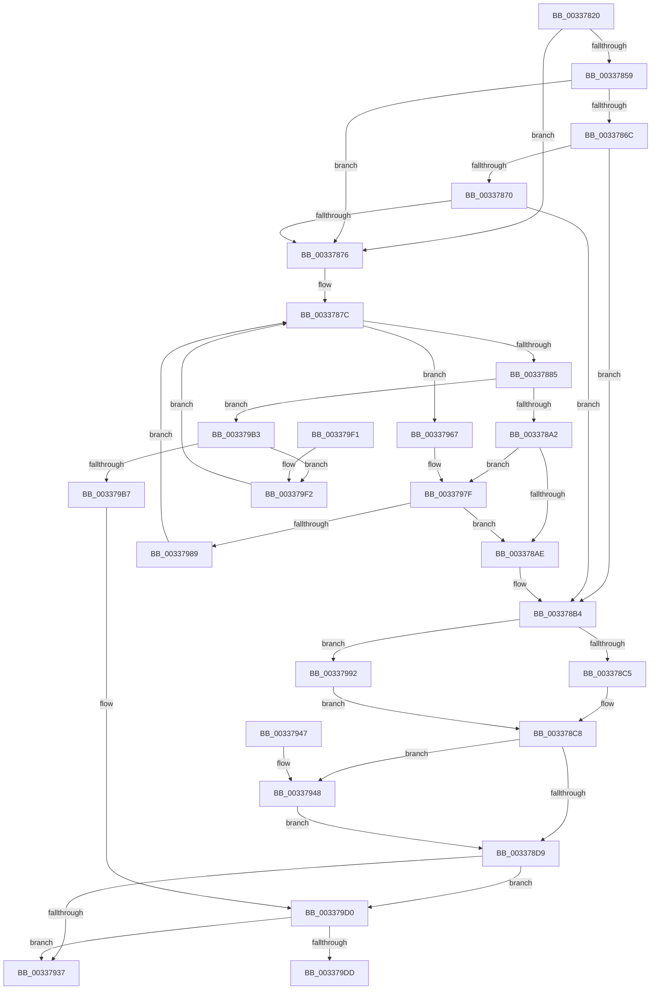

# MI_PAGE_TO_FULL_COLOR

- RVA: `0x00337820`–`0x003379FA` (길이 `474` bytes)
- VA: `0x0000000140337820`
- 실행 섹션: `.text`
- PDB 이름 있음: `예`; PDB Function 태그: `아니요`
- unwind 정보 RVA: `0x000769E8`
- 디코드: `123`개 명령, `474/474` bytes 표시
- 미해석 바이트: `0` (있으면 어셈블리에 `.byte`로 보존)

> 이 문서는 커널 이미지의 기계어와 PDB 기호를 분석해 생성했습니다. 4번과 5번은 함수 원형과 자료형을 바이너리 사용 방식에서 추정한 C 해석이며 원본 소스 복구 결과는 아닙니다.

## 1. Dependencies

- 직접 호출 지점: **3**; 고유 호출 대상: **2**
- 직접 호출자로 확인된 함수: **14**
- RIP 상대 이미지 참조: **6**

### Outgoing calls
- `0x00337979` → [KeBugCheckEx](../4F/KeBugCheckEx_function_004FD660.md) (function, `0x004FD660`)
- `0x003379A4` → [MiSearchChannelTable](MiSearchChannelTable_function_0033BE24.md) (function, `0x0033BE24`)
- `0x003379CA` → [KeBugCheckEx](../4F/KeBugCheckEx_function_004FD660.md) (function, `0x004FD660`)

### Direct callers
- [MiTradePage](../28/MiTradePage_function_0028D160.md) at `0x0028D59D`
- [MiTradePage](../28/MiTradePage_function_0028D160.md) at `0x0028D930`
- [MiSwapStackPage](../29/MiSwapStackPage_function_0029FDE0.md) at `0x0029FEF9`
- [MiDeleteUltraMapContext](../2D/MiDeleteUltraMapContext_function_002DC9A4.md) at `0x002DCA9E`
- [sub_00322E07](../32/Unknown_function_00322E07.md) at `0x00322E07`
- [sub_00322E07](../32/Unknown_function_00322E07.md) at `0x00322E1E`
- [MiUnlinkFreeOrZeroedPage](MiUnlinkFreeOrZeroedPage_function_00336C40.md) at `0x00336D4E`
- [MiPageFreeToZero](MiPageFreeToZero_function_00337A30.md) at `0x00337C6E`
- [MiWalkEntireImage](../36/MiWalkEntireImage_function_00365D70.md) at `0x00366CC3`
- [MiPrivateFixup](../36/MiPrivateFixup_function_003693E8.md) at `0x00369531`
- [MiFreeListPageContentsChanged](../3B/MiFreeListPageContentsChanged_function_003BD4BC.md) at `0x003BD4F6`
- [MiCompleteSecureProcessFault](../46/MiCompleteSecureProcessFault_function_0046710C.md) at `0x00467283`
- [MiReuseUltraPageTable](../47/MiReuseUltraPageTable_function_00472298.md) at `0x004722B4`
- [MiProtectDriverSectionPte](../67/MiProtectDriverSectionPte_function_006706C0.md) at `0x006708CA`
- [MiInsertPossiblyBadPage](../68/MiInsertPossiblyBadPage_function_00689DF0.md) at `0x00689E07`
- [sub_006F9D5A](../6F/Unknown_function_006F9D5A.md) at `0x006F9D7F`

### Static image references
- `0x00337848` → RVA `0x00E2DBC0` (`.data`; read)
- `0x0033784F` → RVA `0x00E2DBC4` (`.data`; read)
- `0x00337860` → RVA `0x00E2DC20` (`.data`; read)
- `0x003378AE` → RVA `0x00E2DBC0` (`.data`; write)
- `0x003378B4` → RVA `0x00E2DC28` (`.data`; read)
- `0x003378DE` → RVA `0x00000000` (`image boundary/outside`; read)

## 2. Other-region calls and transfers

- 다른 실행 섹션으로 향하는 call: **0**
- 별도 외부 분기/꼬리 이동을 확인하지 못했습니다.

## 3. Assembly (complete function range)

```asm
00337820  48 89 5C 24 08                  mov qword ptr [rsp + 8], rbx
00337825  48 89 74 24 10                  mov qword ptr [rsp + 0x10], rsi
0033782A  57                              push rdi
0033782B  48 83 EC 30                     sub rsp, 0x30
0033782F  48 8D 14 49                     lea rdx, [rcx + rcx*2]
00337833  48 8B F9                        mov rdi, rcx
00337836  48 C1 E2 04                     shl rdx, 4
0033783A  48 B8 00 00 00 00 00 DE FF FF   movabs rax, 0xffffde0000000000
00337844  48 8D 34 02                     lea rsi, [rdx + rax]
00337848  48 63 05 71 63 AF 00            movsxd rax, dword ptr [rip + 0xaf6371]
0033784F  8B 0D 6F 63 AF 00               mov ecx, dword ptr [rip + 0xaf636f]
00337855  3B C1                           cmp eax, ecx
00337857  77 1D                           ja 0x140337876
00337859  48 8B D8                        mov rbx, rax
0033785C  48 C1 E3 04                     shl rbx, 4
00337860  48 03 1D B9 63 AF 00            add rbx, qword ptr [rip + 0xaf63b9]
00337867  48 3B 3B                        cmp rdi, qword ptr [rbx]
0033786A  72 0A                           jb 0x140337876
0033786C  3B C1                           cmp eax, ecx
0033786E  74 44                           je 0x1403378b4
00337870  48 3B 7B 10                     cmp rdi, qword ptr [rbx + 0x10]
00337874  72 3E                           jb 0x1403378b4
00337876  45 33 C9                        xor r9d, r9d
00337879  45 8B C1                        mov r8d, r9d
0033787C  41 3B C8                        cmp ecx, r8d
0033787F  0F 8C E2 00 00 00               jl 0x140337967
00337885  41 8D 04 08                     lea eax, [r8 + rcx]
00337889  D1 F8                           sar eax, 1
0033788B  48 63 D8                        movsxd rbx, eax
0033788E  48 C1 E3 04                     shl rbx, 4
00337892  48 03 1D 87 63 AF 00            add rbx, qword ptr [rip + 0xaf6387]
00337899  48 3B 3B                        cmp rdi, qword ptr [rbx]
0033789C  0F 82 11 01 00 00               jb 0x1403379b3
003378A2  3B 05 1C 63 AF 00               cmp eax, dword ptr [rip + 0xaf631c]
003378A8  0F 85 D1 00 00 00               jne 0x14033797f
003378AE  89 05 0C 63 AF 00               mov dword ptr [rip + 0xaf630c], eax
003378B4  48 83 3D 6C 63 AF 00 00         cmp qword ptr [rip + 0xaf636c], 0
003378BC  8B 5B 08                        mov ebx, dword ptr [rbx + 8]
003378BF  0F 85 CD 00 00 00               jne 0x140337992
003378C5  45 32 C9                        xor r9b, r9b
003378C8  48 8B 46 28                     mov rax, qword ptr [rsi + 0x28]
003378CC  41 B8 03 00 00 00               mov r8d, 3
003378D2  48 0F BA E0 28                  bt rax, 0x28
003378D7  72 6F                           jb 0x140337948
003378D9  33 D2                           xor edx, edx
003378DB  41 8B C8                        mov ecx, r8d
003378DE  4C 8D 15 1B 87 CC FF            lea r10, [rip - 0x3378e5]
003378E5  48 8B C7                        mov rax, rdi
003378E8  83 E3 3F                        and ebx, 0x3f
003378EB  41 83 E1 01                     and r9d, 1
003378EF  49 F7 B4 CA 60 1C 01 00         div qword ptr [r10 + rcx*8 + 0x11c60]
003378F7  41 8B 8C 8A C0 DC E2 00         mov ecx, dword ptr [r10 + rcx*4 + 0xe2dcc0]
003378FF  33 D2                           xor edx, edx
00337901  48 F7 F1                        div rcx
00337904  8B 46 20                        mov eax, dword ptr [rsi + 0x20]
00337907  41 8B C8                        mov ecx, r8d
0033790A  C1 E8 10                        shr eax, 0x10
0033790D  83 E1 03                        and ecx, 3
00337910  0F B6 C0                        movzx eax, al
00337913  83 E0 C0                        and eax, 0xffffffc0
00337916  C1 E1 04                        shl ecx, 4
00337919  0B C1                           or eax, ecx
0033791B  0F B6 CA                        movzx ecx, dl
0033791E  C1 E0 03                        shl eax, 3
00337921  0B C3                           or eax, ebx
00337923  03 C0                           add eax, eax
00337925  41 0B C1                        or eax, r9d
00337928  C1 E0 08                        shl eax, 8
0033792B  0B C1                           or eax, ecx
0033792D  41 83 F8 03                     cmp r8d, 3
00337931  0F 85 99 00 00 00               jne 0x1403379d0
00337937  48 8B 5C 24 40                  mov rbx, qword ptr [rsp + 0x40]
0033793C  48 8B 74 24 48                  mov rsi, qword ptr [rsp + 0x48]
00337941  48 83 C4 30                     add rsp, 0x30
00337945  5F                              pop rdi
00337946  C3                              ret
00337947  CC                              int3
00337948  8B 46 24                        mov eax, dword ptr [rsi + 0x24]
0033794B  41 8B C8                        mov ecx, r8d
0033794E  C1 E8 1B                        shr eax, 0x1b
00337951  83 E0 03                        and eax, 3
00337954  2B C8                           sub ecx, eax
00337956  41 8B C0                        mov eax, r8d
00337959  3B C8                           cmp ecx, eax
0033795B  44 8B C1                        mov r8d, ecx
0033795E  44 0F 44 C0                     cmove r8d, eax
00337962  E9 72 FF FF FF                  jmp 0x1403378d9
00337967  4C 8B C7                        mov r8, rdi
0033796A  4C 89 4C 24 20                  mov qword ptr [rsp + 0x20], r9
0033796F  BA 80 51 00 00                  mov edx, 0x5180
00337974  B9 1A 00 00 00                  mov ecx, 0x1a
00337979  E8 E2 5C 1C 00                  call 0x1404fd660
0033797E  CC                              int3
0033797F  48 3B 7B 10                     cmp rdi, qword ptr [rbx + 0x10]
00337983  0F 82 25 FF FF FF               jb 0x1403378ae
00337989  44 8D 40 01                     lea r8d, [rax + 1]
0033798D  E9 EA FE FF FF                  jmp 0x14033787c
00337992  48 C1 FA 04                     sar rdx, 4
00337996  48 B9 AB AA AA AA AA AA AA AA   movabs rcx, 0xaaaaaaaaaaaaaaab
003379A0  48 0F AF CA                     imul rcx, rdx
003379A4  E8 7B 44 00 00                  call 0x14033be24
003379A9  44 0F B6 48 0C                  movzx r9d, byte ptr [rax + 0xc]
003379AE  E9 15 FF FF FF                  jmp 0x1403378c8
003379B3  85 C0                           test eax, eax
003379B5  75 3B                           jne 0x1403379f2
003379B7  4C 89 4C 24 20                  mov qword ptr [rsp + 0x20], r9
003379BC  8D 48 1A                        lea ecx, [rax + 0x1a]
003379BF  4C 8B CB                        mov r9, rbx
003379C2  4C 8B C7                        mov r8, rdi
003379C5  BA 80 51 00 00                  mov edx, 0x5180
003379CA  E8 91 5C 1C 00                  call 0x1404fd660
003379CF  CC                              int3
003379D0  48 81 FF 00 00 10 00            cmp rdi, 0x100000
003379D7  0F 83 5A FF FF FF               jae 0x140337937
003379DD  48 8B 5C 24 40                  mov rbx, qword ptr [rsp + 0x40]
003379E2  0F BA E8 0F                     bts eax, 0xf
003379E6  48 8B 74 24 48                  mov rsi, qword ptr [rsp + 0x48]
003379EB  48 83 C4 30                     add rsp, 0x30
003379EF  5F                              pop rdi
003379F0  C3                              ret
003379F1  CC                              int3
003379F2  8D 48 FF                        lea ecx, [rax - 1]
003379F5  E9 82 FE FF FF                  jmp 0x14033787c
```

## 4. C-style interpretation (structured pseudocode)

```c
__int64 __fastcall MI_PAGE_TO_FULL_COLOR(__int64 a1, __int64 a2, __int64 a3, int a4)
{
    __int64 result;
    __int64 v_rbx;
    __int64 v_rsp;
    unsigned __int64 v_stack_p10;
    unsigned __int64 v_stack_p20;
    unsigned __int64 v_stack_p40;
    unsigned __int64 v_stack_p48;
    unsigned __int64 v_stack_p8;

    v_stack_p8 = v_rbx;
    v_stack_p10 = v_rsi;
    v_rsp = (v_rsp) - (48);
    a2 = (a1 + a1 * 2) << (4);
    if (((unsigned int)((int)(*(unsigned int *)(v_rip + 11494257)))) > ((unsigned int)((unsigned int)(*(unsigned int *)(v_rip + 11494255))))) goto loc_00337876;
    v_rbx = ((int)(*(unsigned int *)(v_rip + 11494257))) << (4);
    v_rbx = (v_rbx) + (*(unsigned __int64 *)(v_rip + 11494329));
    if (a1 < (*(unsigned __int64 *)(v_rbx))) goto loc_00337876;
    if (((unsigned int)((int)(*(unsigned int *)(v_rip + 11494257)))) == ((unsigned int)((unsigned int)(*(unsigned int *)(v_rip + 11494255))))) goto loc_003378B4;
    if (a1 < (*(unsigned __int64 *)(v_rbx + 16))) goto loc_003378B4;
loc_00337876:
    a4 = 0;
loc_0033787C:
    if (((unsigned int)((unsigned int)(*(unsigned int *)(v_rip + 11494255)))) < 0) goto loc_00337967;
    result = (unsigned int)((0 + (unsigned int)(*(unsigned int *)(v_rip + 11494255)) * 1) >> (1));
    v_rbx = ((int)((unsigned int)(result))) << (4);
    v_rbx = (v_rbx) + (*(unsigned __int64 *)(v_rip + 11494279));
    if (a1 < (*(unsigned __int64 *)(v_rbx))) goto loc_003379B3;
    if (((unsigned int)(result)) != (*(unsigned int *)(v_rip + 11494172))) goto loc_0033797F;
loc_003378AE:
    *(unsigned int *)(v_rip + 11494156) = (unsigned int)(result);
loc_003378B4:
    if ((*(unsigned __int64 *)(v_rip + 11494252)) != 0) goto loc_00337992;
    a4 = 0;
loc_003378C8:
    if (condition_is_below) goto loc_00337948;
loc_003378D9:
    a2 = 0;
    v_rbx = (unsigned int)(((unsigned int)(*(unsigned int *)(v_rbx + 8))) & (63));
    a4 = (unsigned int)((a4) & (1));
    a2 = 0;
    result = (unsigned int)(((unsigned int)(*(unsigned int *)(a2 + result * 1 + 32))) >> (16));
    a1 = (unsigned int)((3) & (3));
    result = (unsigned int)(((unsigned __int8)(result)) & (0xFFFFFFC0ULL));
    a1 = (unsigned int)((a1) << (4));
    result = (unsigned int)((result) | ((unsigned int)(a1)));
    result = (unsigned int)((result) << (3));
    result = (unsigned int)((result) | ((unsigned int)(v_rbx)));
    result = (unsigned int)((result) + ((unsigned int)(result)));
    result = (unsigned int)((result) | (a4));
    result = (unsigned int)((result) << (8));
    result = (unsigned int)((result) | (0));
    if (3 != 3) goto loc_003379D0;
loc_00337937:
    v_rsp = (v_rsp) + (48);
    return result;
loc_00337948:
    result = (unsigned int)(((unsigned int)(*(unsigned int *)(v_stack_p10 + 36))) >> (27));
    result = (unsigned int)((result) & (3));
    a1 = (unsigned int)((3) - ((unsigned int)(result)));
    a3 = (unsigned int)((unsigned int)(a1));
    if (((unsigned int)(a1)) == 3) { a3 = 3; }
    goto loc_003378D9;
loc_00337967:
    v_stack_p20 = a4;
    result = KeBugCheckEx(26, (unsigned int)(0x5180ULL), a1, a4);
loc_0033797F:
    if (a1 < (*(unsigned __int64 *)(v_stack_p8 + 16))) goto loc_003378AE;
    goto loc_0033787C;
loc_00337992:
    a2 = ((unsigned int)(0x5180ULL)) >> (4);
    a1 = (26) * (a2);
    result = MiSearchChannelTable(a1, a2, result + 1, a4);
    goto loc_003378C8;
loc_003379B3:
    if ((unsigned int)(result) != 0) goto loc_003379F2;
    v_stack_p20 = *(unsigned __int8 *)(result + 12);
    result = KeBugCheckEx(result + 26, (unsigned int)(0x5180ULL), a1, v_stack_p8);
loc_003379D0:
    if (a1 >= 0x100000ULL) goto loc_00337937;
    v_rsp = (v_rsp) + (48);
    return result;
loc_003379F2:
    goto loc_0033787C;
}
```

## 5. (Beta) C Style

```c
int64_t MI_PAGE_TO_FULL_COLOR(void *Arg1, int64_t Arg2, int64_t Arg3, int32_t Arg4)
{
    uint8_t *arg1 = (uint8_t *)Arg1;

    int64_t result;
    int64_t local_rbx;
    int64_t local_rsp;
    uint64_t v_stack_p10;
    uint64_t v_stack_p20;
    uint64_t v_stack_p40;
    uint64_t v_stack_p48;
    uint64_t v_stack_p8;

    v_stack_p8 = local_rbx;
    v_stack_p10 = local_rsi;
    local_rsp = (local_rsp) - (48);
    Arg2 = (Arg1 + Arg1 * 2) << (4);
    if (((uint32_t)((int32_t)(*(uint32_t *)(v_rip + 0xAF6371)))) > ((uint32_t)((uint32_t)(*(uint32_t *)(v_rip + 0xAF636F))))) goto loc_00337876;
    local_rbx = ((int32_t)(*(uint32_t *)(v_rip + 0xAF6371))) << (4);
    local_rbx = (local_rbx) + (*(uint64_t *)(v_rip + 0xAF63B9));
    if (Arg1 < (*(uint64_t *)(local_rbx))) goto loc_00337876;
    if (((uint32_t)((int32_t)(*(uint32_t *)(v_rip + 0xAF6371)))) == ((uint32_t)((uint32_t)(*(uint32_t *)(v_rip + 0xAF636F))))) goto loc_003378B4;
    if (Arg1 < (*(uint64_t *)(local_rbx + 0x10))) goto loc_003378B4;
loc_00337876:
    Arg4 = 0;
loc_0033787C:
    if (((uint32_t)((uint32_t)(*(uint32_t *)(v_rip + 0xAF636F)))) < 0) goto loc_00337967;
    result = (uint32_t)((0 + (uint32_t)(*(uint32_t *)(v_rip + 0xAF636F)) * 1) >> (1));
    local_rbx = ((int32_t)((uint32_t)(result))) << (4);
    local_rbx = (local_rbx) + (*(uint64_t *)(v_rip + 0xAF6387));
    if (Arg1 < (*(uint64_t *)(local_rbx))) goto loc_003379B3;
    if (((uint32_t)(result)) != (*(uint32_t *)(v_rip + 0xAF631C))) goto loc_0033797F;
loc_003378AE:
    *(uint32_t *)(v_rip + 0xAF630C) = (uint32_t)(result);
loc_003378B4:
    if ((*(uint64_t *)(v_rip + 0xAF636C)) != 0) goto loc_00337992;
    Arg4 = 0;
loc_003378C8:
    if (condition_is_below) goto loc_00337948;
loc_003378D9:
    Arg2 = 0;
    local_rbx = (uint32_t)(((uint32_t)(*(uint32_t *)(local_rbx + 0x8))) & (63));
    Arg4 = (uint32_t)((Arg4) & (1));
    Arg2 = 0;
    result = (uint32_t)(((uint32_t)(*(uint32_t *)(Arg2 + result * 1 + 0x20))) >> (16));
    Arg1 = (uint32_t)((3) & (3));
    result = (uint32_t)(((uint8_t)(result)) & (0xFFFFFFC0ULL));
    Arg1 = (uint32_t)((Arg1) << (4));
    result = (uint32_t)((result) | ((uint32_t)(Arg1)));
    result = (uint32_t)((result) << (3));
    result = (uint32_t)((result) | ((uint32_t)(local_rbx)));
    result = (uint32_t)((result) + ((uint32_t)(result)));
    result = (uint32_t)((result) | (Arg4));
    result = (uint32_t)((result) << (8));
    result = (uint32_t)((result) | (0));
    if (3 != 3) goto loc_003379D0;
loc_00337937:
    local_rsp = (local_rsp) + (48);
    return result;
loc_00337948:
    result = (uint32_t)(((uint32_t)(*(uint32_t *)(v_stack_p10 + 0x24))) >> (27));
    result = (uint32_t)((result) & (3));
    Arg1 = (uint32_t)((3) - ((uint32_t)(result)));
    Arg3 = (uint32_t)((uint32_t)(Arg1));
    if (((uint32_t)(Arg1)) == 3) { Arg3 = 3; }
    goto loc_003378D9;
loc_00337967:
    v_stack_p20 = Arg4;
    result = KeBugCheckEx(26, (uint32_t)(0x5180ULL), Arg1, Arg4);
loc_0033797F:
    if (Arg1 < (*(uint64_t *)(v_stack_p8 + 0x10))) goto loc_003378AE;
    goto loc_0033787C;
loc_00337992:
    Arg2 = ((uint32_t)(0x5180ULL)) >> (4);
    Arg1 = (26) * (Arg2);
    result = MiSearchChannelTable(Arg1, Arg2, result + 1, Arg4);
    goto loc_003378C8;
loc_003379B3:
    if ((uint32_t)(result) != 0) goto loc_003379F2;
    v_stack_p20 = *(uint8_t *)(result + 0xC);
    result = KeBugCheckEx(result + 26, (uint32_t)(0x5180ULL), Arg1, v_stack_p8);
loc_003379D0:
    if (Arg1 >= 0x100000ULL) goto loc_00337937;
    local_rsp = (local_rsp) + (48);
    return result;
loc_003379F2:
    goto loc_0033787C;
}
```

### 관측된 메모리 오프셋

구조체 형식이 확인되지 않은 접근은 인자 기준의 오프셋으로만 기록했습니다.

| 기준 인자 | 오프셋 표현 | 폭 (bit) | 접근 |
|---|---:|---:|---|
| `Arg1` | `+ 0x0 + rcx*2` | `64` | `R` |

## 6. Execution-region graph

[열기: 2D/3D 그래프와 함수 탐색 컨트롤 패널](../../../control-panel.html?section=text&rva=0x00337820&view=graph)

- 2D 그래프는 위에서 아래로 흐르고, 3D 그래프는 빈 공간을 드래그해 회전합니다. Shift+드래그는 이동, 휠은 확대·축소, 함수 노드 선택은 대상 보고서 이동입니다.

### Static fallback


