# MiChangePageAttribute

- RVA: `0x00332ECC`–`0x003332AD` (길이 `993` bytes)
- VA: `0x0000000140332ECC`
- 실행 섹션: `.text`
- PDB 이름 있음: `예`; PDB Function 태그: `아니요`
- unwind 정보 RVA: `0x00076704`
- 디코드: `246`개 명령, `993/993` bytes 표시
- 미해석 바이트: `0` (있으면 어셈블리에 `.byte`로 보존)

> 이 문서는 커널 이미지의 기계어와 PDB 기호를 분석해 생성했습니다. 4번과 5번은 함수 원형과 자료형을 바이너리 사용 방식에서 추정한 C 해석이며 원본 소스 복구 결과는 아닙니다.

## 1. Dependencies

- 직접 호출 지점: **17**; 고유 호출 대상: **16**
- 직접 호출자로 확인된 함수: **32**
- RIP 상대 이미지 참조: **8**

### Outgoing calls
- `0x00332EEA` → [MiMirrorInSingleProcessorMode](../3B/MiMirrorInSingleProcessorMode_function_003B47A0.md) (function, `0x003B47A0`)
- `0x00332EFE` → [MiGetPfnPageSizeIndex](../31/MiGetPfnPageSizeIndex_function_0031C710.md) (function, `0x0031C710`)
- `0x00332F23` → [MiPfnZeroingNeeded](../29/MiPfnZeroingNeeded_function_0029FA80.md) (function, `0x0029FA80`)
- `0x003330A8` → [MiPageCombiningActive](../46/MiPageCombiningActive_function_00462348.md) (function, `0x00462348`)
- `0x003330D0` → [KeShouldYieldProcessor](../27/KeShouldYieldProcessor_function_002773E0.md) (function, `0x002773E0`)
- `0x00333128` → [MiMapPageInHyperSpaceWorker](MiMapPageInHyperSpaceWorker_function_00332B10.md) (function, `0x00332B10`)
- `0x00333138` → [KeInvalidateRangeAllCachesNoIpi](../30/KeInvalidateRangeAllCachesNoIpi_function_00308C50.md) (function, `0x00308C50`)
- `0x00333181` → [MiFlushEntireTbDueToAttributeChange](../30/MiFlushEntireTbDueToAttributeChange_function_00308AE0.md) (function, `0x00308AE0`)
- `0x003331C8` → [MiTbFlushTimeStampMayNeedFlush](../45/MiTbFlushTimeStampMayNeedFlush_function_004584B8.md) (function, `0x004584B8`)
- `0x003331D1` → [MiFlushEntireTbDueToAttributeChange](../30/MiFlushEntireTbDueToAttributeChange_function_00308AE0.md) (function, `0x00308AE0`)
- `0x003331F7` → [KeInvalidateAllCaches](../30/KeInvalidateAllCaches_function_00308CC0.md) (function, `0x00308CC0`)
- `0x0033322D` → [MiLockPageInline](../31/MiLockPageInline_function_0031A340.md) (function, `0x0031A340`)
- `0x00333244` → [MiUnlockPage](../31/MiUnlockPage_function_0031A3E0.md) (function, `0x0031A3E0`)
- `0x00333254` → [MiAbortCombineScan](../2A/MiAbortCombineScan_function_002A1160.md) (function, `0x002A1160`)
- `0x0033327A` → [MiSetOriginalPtePfnFromFreeList](../28/MiSetOriginalPtePfnFromFreeList_function_0028A99C.md) (function, `0x0028A99C`)
- `0x0033328E` → [KiCheckVpBackingLongSpinWaitHypercall](../30/KiCheckVpBackingLongSpinWaitHypercall_function_0030F490.md) (function, `0x0030F490`)
- `0x003332A0` → [HvlNotifyLongSpinWait](../30/HvlNotifyLongSpinWait_function_0030F460.md) (function, `0x0030F460`)

### Direct callers
- [MiCopySinglePage](../22/MiCopySinglePage_function_00228FA4.md) at `0x00229150`
- [MiCopySinglePage](../22/MiCopySinglePage_function_00228FA4.md) at `0x00229165`
- [MiCombineInitialInstance](../22/MiCombineInitialInstance_function_0022BC0C.md) at `0x0022C9BC`
- [MiGetPage](../28/MiGetPage_function_002884C0.md) at `0x00288F4B`
- [MiGetPage](../28/MiGetPage_function_002884C0.md) at `0x002895F6`
- [MiGetPage](../28/MiGetPage_function_002884C0.md) at `0x002898B2`
- [MiDemoteLocalLargePage](../28/MiDemoteLocalLargePage_function_0028A4F0.md) at `0x0028A96E`
- [MiDemoteLocalLargePage](../28/MiDemoteLocalLargePage_function_0028A4F0.md) at `0x0028A98C`
- [MiPageAttributeBatchChangeNeeded](../29/MiPageAttributeBatchChangeNeeded_function_0029FAD0.md) at `0x0029FB31`
- [MiReplaceTransitionPage](../2B/MiReplaceTransitionPage_function_002B1120.md) at `0x002B1257`
- [sub_002B1D4E](../2B/Unknown_function_002B1D4E.md) at `0x002B20BE`
- [MiStealPage](../2B/MiStealPage_function_002B28D0.md) at `0x002B2D4C`
- [MiInitializeReadInProgressPfn](../2B/MiInitializeReadInProgressPfn_function_002B6990.md) at `0x002B6B58`
- [sub_002B79EA](../2B/Unknown_function_002B79EA.md) at `0x002B7A5D`
- [MiMakePageAvoidRead](../2B/MiMakePageAvoidRead_function_002B7DE0.md) at `0x002B8005`
- [MiZeroAndConvertPage](../2C/MiZeroAndConvertPage_function_002C8480.md) at `0x002C857E`
- [MiZeroAndConvertPage](../2C/MiZeroAndConvertPage_function_002C8480.md) at `0x002C85A7`
- [MiZeroAndConvertPage](../2C/MiZeroAndConvertPage_function_002C8480.md) at `0x002C85C5`
- [MiFreeSlabEntry](../2D/MiFreeSlabEntry_function_002DC650.md) at `0x002DC95B`
- [MiGetPageChain](MiGetPageChain_function_00330130.md) at `0x0033074C`
- [MiInitializePfn](MiInitializePfn_function_00331E60.md) at `0x00332112`
- [MiZeroPhysicalPage](MiZeroPhysicalPage_function_00332590.md) at `0x0033269C`
- [sub_0033282A](Unknown_function_0033282A.md) at `0x00332840`
- [MiFinalizePageAttribute](MiFinalizePageAttribute_function_00332E30.md) at `0x00332E50`
- [MiCoalesceFreeSmallPages](MiCoalesceFreeSmallPages_function_00336340.md) at `0x00336AE4`
- [sub_003456C4](../34/Unknown_function_003456C4.md) at `0x003456F4`
- [MiDeleteClusterPage](../34/MiDeleteClusterPage_function_00346CB0.md) at `0x00347085`
- [MiZeroAndReleasePages](../37/MiZeroAndReleasePages_function_003748D0.md) at `0x00374CC2`
- [MiGetSlabPage](../37/MiGetSlabPage_function_00376FBC.md) at `0x00377142`
- [MiDuplicateCloneLeaf](../38/MiDuplicateCloneLeaf_function_003825F0.md) at `0x00382A0D`
- [MiAllocateLargeZeroPages](../3B/MiAllocateLargeZeroPages_function_003B743C.md) at `0x003B76DA`
- [MiGetFastLargePages](../3B/MiGetFastLargePages_function_003B7EE0.md) at `0x003B82B8`
- [MiSetPfnOwnedAndActive](../46/MiSetPfnOwnedAndActive_function_004652AC.md) at `0x00465453`
- [MiBuildForkPageTable](../4A/MiBuildForkPageTable_function_004ACF5C.md) at `0x004AD317`
- [MiAddExpansionNonPagedPool](../68/MiAddExpansionNonPagedPool_function_00682B4C.md) at `0x00682C4E`
- [MiResolveAwePageConflict](../68/MiResolveAwePageConflict_function_00689758.md) at `0x00689876`
- [MiComputeCacheAttributeSpeeds](../69/MiComputeCacheAttributeSpeeds_function_006999E8.md) at `0x00699B85`
- [MiComputeCacheAttributeSpeeds](../69/MiComputeCacheAttributeSpeeds_function_006999E8.md) at `0x00699C57`
- [MiComputeCacheAttributeSpeeds](../69/MiComputeCacheAttributeSpeeds_function_006999E8.md) at `0x00699CA7`
- [sub_006FA666](../6F/Unknown_function_006FA666.md) at `0x006FA6B5`

### Static image references
- `0x00332F05` → RVA `0x00011C60` (`.rdata`; read)
- `0x003330EF` → RVA `0x00E2DC58` (`.data`; read/write)
- `0x00333164` → RVA `0x00010880` (`.rdata`; read)
- `0x003331BC` → RVA `0x00FCF080` (`CACHEALI`; read)
- `0x003331E8` → RVA `0x00E2DC5C` (`.data`; read)
- `0x003331F1` → RVA `0x00E2DC54` (`.data`; read/write)
- `0x00333209` → RVA `0x00FC52AC` (`ALMOSTRO`; reference)
- `0x00333284` → RVA `0x00FC6AB8` (`ALMOSTRO`; read)

## 2. Other-region calls and transfers

- 다른 실행 섹션으로 향하는 call: **0**
- 별도 외부 분기/꼬리 이동을 확인하지 못했습니다.

## 3. Assembly (complete function range)

```asm
00332ECC  89 54 24 10                     mov dword ptr [rsp + 0x10], edx
00332ED0  48 89 4C 24 08                  mov qword ptr [rsp + 8], rcx
00332ED5  53                              push rbx
00332ED6  55                              push rbp
00332ED7  56                              push rsi
00332ED8  57                              push rdi
00332ED9  41 54                           push r12
00332EDB  41 55                           push r13
00332EDD  41 56                           push r14
00332EDF  41 57                           push r15
00332EE1  48 83 EC 48                     sub rsp, 0x48
00332EE5  8B DA                           mov ebx, edx
00332EE7  48 8B E9                        mov rbp, rcx
00332EEA  E8 B1 18 08 00                  call 0x1403b47a0
00332EEF  41 8B F0                        mov esi, r8d
00332EF2  48 8B CD                        mov rcx, rbp
00332EF5  83 CE 01                        or esi, 1
00332EF8  85 C0                           test eax, eax
00332EFA  41 0F 44 F0                     cmove esi, r8d
00332EFE  E8 0D 98 FE FF                  call 0x14031c710
00332F03  8B C0                           mov eax, eax
00332F05  4C 8D 05 54 ED CD FF            lea r8, [rip - 0x3212ac]
00332F0C  4D 8B 04 C0                     mov r8, qword ptr [r8 + rax*8]
00332F10  48 8B 45 28                     mov rax, qword ptr [rbp + 0x28]
00332F14  40 F6 C6 08                     test sil, 8
00332F18  0F 84 04 03 00 00               je 0x140333222
00332F1E  8B D3                           mov edx, ebx
00332F20  48 8B CD                        mov rcx, rbp
00332F23  E8 58 CB F6 FF                  call 0x14029fa80
00332F28  45 33 D2                        xor r10d, r10d
00332F2B  85 C0                           test eax, eax
00332F2D  0F 85 34 03 00 00               jne 0x140333267
00332F33  8B 45 20                        mov eax, dword ptr [rbp + 0x20]
00332F36  4F 8D 3C 40                     lea r15, [r8 + r8*2]
00332F3A  C1 E8 10                        shr eax, 0x10
00332F3D  48 8B FD                        mov rdi, rbp
00332F40  49 C1 E7 04                     shl r15, 4
00332F44  41 B5 11                        mov r13b, 0x11
00332F47  4C 03 FD                        add r15, rbp
00332F4A  0F B6 D8                        movzx ebx, al
00332F4D  48 C1 EB 06                     shr rbx, 6
00332F51  4C 89 7C 24 30                  mov qword ptr [rsp + 0x30], r15
00332F56  48 89 5C 24 28                  mov qword ptr [rsp + 0x28], rbx
00332F5B  49 3B EF                        cmp rbp, r15
00332F5E  0F 83 16 01 00 00               jae 0x14033307a
00332F64  45 8B F2                        mov r14d, r10d
00332F67  44 89 54 24 20                  mov dword ptr [rsp + 0x20], r10d
00332F6C  4C 8B E7                        mov r12, rdi
00332F6F  49 3B FF                        cmp rdi, r15
00332F72  73 20                           jae 0x140332f94
00332F74  40 F6 C6 01                     test sil, 1
00332F78  0F 85 28 01 00 00               jne 0x1403330a6
00332F7E  45 85 F6                        test r14d, r14d
00332F81  0F 84 05 01 00 00               je 0x14033308c
00332F87  F0 48 0F BA 6F 18 3F            lock bts qword ptr [rdi + 0x18], 0x3f
00332F8E  0F 83 12 01 00 00               jae 0x1403330a6
00332F94  48 8B 5C 24 28                  mov rbx, qword ptr [rsp + 0x28]
00332F99  44 88 AC 24 A8 00 00 00         mov byte ptr [rsp + 0xa8], r13b
00332FA1  48 83 FB 03                     cmp rbx, 3
00332FA5  0F 85 F3 01 00 00               jne 0x14033319e
00332FAB  8B 54 24 20                     mov edx, dword ptr [rsp + 0x20]
00332FAF  49 8B FC                        mov rdi, r12
00332FB2  45 8B E2                        mov r12d, r10d
00332FB5  45 85 F6                        test r14d, r14d
00332FB8  0F 84 94 00 00 00               je 0x140333052
00332FBE  44 8B BC 24 98 00 00 00         mov r15d, dword ptr [rsp + 0x98]
00332FC6  44 8B EE                        mov r13d, esi
00332FC9  41 8A CF                        mov cl, r15b
00332FCC  48 BD FF FF FF FF FF FF FF 7F   movabs rbp, 0x7fffffffffffffff
00332FD6  C0 E1 06                        shl cl, 6
00332FD9  88 8C 24 A0 00 00 00            mov byte ptr [rsp + 0xa0], cl
00332FE0  41 83 E5 01                     and r13d, 1
00332FE4  4C 8D 4F 20                     lea r9, [rdi + 0x20]
00332FE8  41 8B 01                        mov eax, dword ptr [r9]
00332FEB  89 44 24 24                     mov dword ptr [rsp + 0x24], eax
00332FEF  C1 E8 10                        shr eax, 0x10
00332FF2  24 3F                           and al, 0x3f
00332FF4  0A C1                           or al, cl
00332FF6  88 44 24 26                     mov byte ptr [rsp + 0x26], al
00332FFA  8B 44 24 24                     mov eax, dword ptr [rsp + 0x24]
00332FFE  89 47 20                        mov dword ptr [rdi + 0x20], eax
00333001  85 D2                           test edx, edx
00333003  0F 84 DC 00 00 00               je 0x1403330e5
00333009  48 8B 47 18                     mov rax, qword ptr [rdi + 0x18]
0033300D  49 B8 FF FF FF FF FF FF FF C7   movabs r8, 0xc7ffffffffffffff
00333017  49 23 C0                        and rax, r8
0033301A  48 89 47 18                     mov qword ptr [rdi + 0x18], rax
0033301E  45 85 ED                        test r13d, r13d
00333021  75 0E                           jne 0x140333031
00333023  41 8D 46 FF                     lea eax, [r14 - 1]
00333027  44 3B E0                        cmp r12d, eax
0033302A  73 05                           jae 0x140333031
0033302C  F0 48 21 6F 18                  lock and qword ptr [rdi + 0x18], rbp
00333031  48 83 C7 30                     add rdi, 0x30
00333035  41 FF C4                        inc r12d
00333038  45 3B E6                        cmp r12d, r14d
0033303B  72 A7                           jb 0x140332fe4
0033303D  48 8B AC 24 90 00 00 00         mov rbp, qword ptr [rsp + 0x90]
00333045  4C 8B 7C 24 30                  mov r15, qword ptr [rsp + 0x30]
0033304A  44 8A AC 24 A8 00 00 00         mov r13b, byte ptr [rsp + 0xa8]
00333052  40 F6 C6 01                     test sil, 1
00333056  75 19                           jne 0x140333071
00333058  41 80 FD 02                     cmp r13b, 2
0033305C  0F 82 DB 01 00 00               jb 0x14033323d
00333062  48 B8 FF FF FF FF FF FF FF 7F   movabs rax, 0x7fffffffffffffff
0033306C  F0 48 21 47 E8                  lock and qword ptr [rdi - 0x18], rax
00333071  49 3B FF                        cmp rdi, r15
00333074  0F 82 EA FE FF FF               jb 0x140332f64
0033307A  48 83 C4 48                     add rsp, 0x48
0033307E  41 5F                           pop r15
00333080  41 5E                           pop r14
00333082  41 5D                           pop r13
00333084  41 5C                           pop r12
00333086  5F                              pop rdi
00333087  5E                              pop rsi
00333088  5D                              pop rbp
00333089  5B                              pop rbx
0033308A  C3                              ret
0033308B  CC                              int3
0033308C  40 F6 C6 10                     test sil, 0x10
00333090  0F 84 94 01 00 00               je 0x14033322a
00333096  41 8B DA                        mov ebx, r10d
00333099  F0 48 0F BA 6F 18 3F            lock bts qword ptr [rdi + 0x18], 0x3f
003330A0  0F 82 61 01 00 00               jb 0x140333207
003330A6  33 C9                           xor ecx, ecx
003330A8  E8 9B F2 12 00                  call 0x140462348
003330AD  85 C0                           test eax, eax
003330AF  0F 85 9C 01 00 00               jne 0x140333251
003330B5  41 FF C6                        inc r14d
003330B8  48 83 C7 30                     add rdi, 0x30
003330BC  41 80 FD 02                     cmp r13b, 2
003330C0  0F 83 A9 FE FF FF               jae 0x140332f6f
003330C6  41 F6 C6 3F                     test r14b, 0x3f
003330CA  0F 85 9F FE FF FF               jne 0x140332f6f
003330D0  E8 0B 43 F4 FF                  call 0x1402773e0
003330D5  45 33 D2                        xor r10d, r10d
003330D8  85 C0                           test eax, eax
003330DA  0F 84 8F FE FF FF               je 0x140332f6f
003330E0  E9 AF FE FF FF                  jmp 0x140332f94
003330E5  48 83 FB 01                     cmp rbx, 1
003330E9  0F 85 1A FF FF FF               jne 0x140333009
003330EF  FF 05 63 AB AF 00               inc dword ptr [rip + 0xafab63]
003330F5  48 B8 20 00 00 00 00 DE FF FF   movabs rax, 0xffffde0000000020
003330FF  4C 2B C8                        sub r9, rax
00333102  44 8D 43 01                     lea r8d, [rbx + 1]
00333106  49 C1 F9 04                     sar r9, 4
0033310A  48 B9 AB AA AA AA AA AA AA AA   movabs rcx, 0xaaaaaaaaaaaaaaab
00333114  49 0F AF C9                     imul rcx, r9
00333118  45 3B F8                        cmp r15d, r8d
0033311B  45 0F 45 C2                     cmovne r8d, r10d
0033311F  33 D2                           xor edx, edx
00333121  41 81 C8 00 00 00 C0            or r8d, 0xc0000000
00333128  E8 E3 F9 FF FF                  call 0x140332b10
0033312D  BA 00 10 00 00                  mov edx, 0x1000
00333132  48 8B C8                        mov rcx, rax
00333135  48 8B D8                        mov rbx, rax
00333138  E8 13 5B FD FF                  call 0x140308c50
0033313D  48 B8 F8 FF FF FF 7F 00 00 00   movabs rax, 0x7ffffffff8
00333147  48 C1 EB 09                     shr rbx, 9
0033314B  48 23 D8                        and rbx, rax
0033314E  48 B8 00 00 00 00 80 F6 FF FF   movabs rax, 0xfffff68000000000
00333158  65 48 8B 0C 25 20 00 00 00      mov rcx, qword ptr gs:[0x20]
00333161  48 03 D8                        add rbx, rax
00333164  48 8B 05 15 D7 CD FF            mov rax, qword ptr [rip - 0x3228eb]
0033316B  45 33 D2                        xor r10d, r10d
0033316E  48 8B 91 38 88 00 00            mov rdx, qword ptr [rcx + 0x8838]
00333175  4C 89 12                        mov qword ptr [rdx], r10
00333178  48 89 03                        mov qword ptr [rbx], rax
0033317B  41 83 FF 03                     cmp r15d, 3
0033317F  75 08                           jne 0x140333189
00333181  E8 5A 59 FD FF                  call 0x140308ae0
00333186  45 33 D2                        xor r10d, r10d
00333189  8B 54 24 20                     mov edx, dword ptr [rsp + 0x20]
0033318D  48 8B 5C 24 28                  mov rbx, qword ptr [rsp + 0x28]
00333192  8A 8C 24 A0 00 00 00            mov cl, byte ptr [rsp + 0xa0]
00333199  E9 6B FE FF FF                  jmp 0x140333009
0033319E  40 F6 C6 04                     test sil, 4
003331A2  75 32                           jne 0x1403331d6
003331A4  40 F6 C6 02                     test sil, 2
003331A8  75 27                           jne 0x1403331d1
003331AA  48 8B 4D 18                     mov rcx, qword ptr [rbp + 0x18]
003331AE  48 C1 E9 3B                     shr rcx, 0x3b
003331B2  83 E1 07                        and ecx, 7
003331B5  74 1A                           je 0x1403331d1
003331B7  F0 44 09 14 24                  lock or dword ptr [rsp], r10d
003331BC  8B 15 BE BE C9 00               mov edx, dword ptr [rip + 0xc9bebe]
003331C2  41 B8 07 00 00 00               mov r8d, 7
003331C8  E8 EB 52 12 00                  call 0x1404584b8
003331CD  84 C0                           test al, al
003331CF  74 05                           je 0x1403331d6
003331D1  E8 0A 59 FD FF                  call 0x140308ae0
003331D6  48 83 FB 01                     cmp rbx, 1
003331DA  74 0C                           je 0x1403331e8
003331DC  8B 54 24 20                     mov edx, dword ptr [rsp + 0x20]
003331E0  45 33 D2                        xor r10d, r10d
003331E3  E9 C7 FD FF FF                  jmp 0x140332faf
003331E8  44 3B 35 6D AA AF 00            cmp r14d, dword ptr [rip + 0xafaa6d]
003331EF  72 EB                           jb 0x1403331dc
003331F1  FF 05 5D AA AF 00               inc dword ptr [rip + 0xafaa5d]
003331F7  E8 C4 5A FD FF                  call 0x140308cc0
003331FC  BA 01 00 00 00                  mov edx, 1
00333201  89 54 24 20                     mov dword ptr [rsp + 0x20], edx
00333205  EB D9                           jmp 0x1403331e0
00333207  FF C3                           inc ebx
00333209  85 1D 9D 20 C9 00               test dword ptr [rip + 0xc9209d], ebx
0033320F  74 73                           je 0x140333284
00333211  F3 90                           pause
00333213  48 8B 47 18                     mov rax, qword ptr [rdi + 0x18]
00333217  48 85 C0                        test rax, rax
0033321A  0F 89 79 FE FF FF               jns 0x140333099
00333220  EB E5                           jmp 0x140333207
00333222  45 33 D2                        xor r10d, r10d
00333225  E9 09 FD FF FF                  jmp 0x140332f33
0033322A  48 8B CF                        mov rcx, rdi
0033322D  E8 0E 71 FE FF                  call 0x14031a340
00333232  44 8A E8                        mov r13b, al
00333235  45 33 D2                        xor r10d, r10d
00333238  E9 69 FE FF FF                  jmp 0x1403330a6
0033323D  48 8D 4F D0                     lea rcx, [rdi - 0x30]
00333241  41 8A D5                        mov dl, r13b
00333244  E8 97 71 FE FF                  call 0x14031a3e0
00333249  45 33 D2                        xor r10d, r10d
0033324C  E9 20 FE FF FF                  jmp 0x140333071
00333251  48 8B CF                        mov rcx, rdi
00333254  E8 07 DF F6 FF                  call 0x1402a1160
00333259  83 E6 FB                        and esi, 0xfffffffb
0033325C  83 CE 02                        or esi, 2
0033325F  45 33 D2                        xor r10d, r10d
00333262  E9 4E FE FF FF                  jmp 0x1403330b5
00333267  48 8D 4D 10                     lea rcx, [rbp + 0x10]
0033326B  48 8B 01                        mov rax, qword ptr [rcx]
0033326E  48 A9 E0 03 00 00               test rax, 0x3e0
00333274  0F 85 B9 FC FF FF               jne 0x140332f33
0033327A  E8 1D 77 F5 FF                  call 0x14028a99c
0033327F  E9 AF FC FF FF                  jmp 0x140332f33
00333284  8B 05 2E 38 C9 00               mov eax, dword ptr [rip + 0xc9382e]
0033328A  A8 40                           test al, 0x40
0033328C  74 83                           je 0x140333211
0033328E  E8 FD C1 FD FF                  call 0x14030f490
00333293  45 33 D2                        xor r10d, r10d
00333296  84 C0                           test al, al
00333298  0F 84 73 FF FF FF               je 0x140333211
0033329E  8B CB                           mov ecx, ebx
003332A0  E8 BB C1 FD FF                  call 0x14030f460
003332A5  45 33 D2                        xor r10d, r10d
003332A8  E9 66 FF FF FF                  jmp 0x140333213
```

## 4. C-style interpretation (structured pseudocode)

```c
__int64 __fastcall MiChangePageAttribute(__int64 a1, int a2, int a3)
{
    __int64 result;
    __int64 v_r10;
    __int64 v_r12;
    __int64 v_r13;
    __int64 v_r14;
    __int64 v_r15;
    __int64 v_rbx;
    __int64 v_rdi;
    __int64 v_rsi;
    __int64 v_rsp;
    unsigned __int64 v_stack_m58;
    unsigned __int64 v_stack_m60;
    unsigned __int8 v_stack_m62;
    unsigned int v_stack_m64;
    unsigned int v_stack_m68;
    unsigned int v_stack_p0;
    unsigned int v_stack_p10;
    unsigned __int8 v_stack_p18;
    unsigned __int8 v_stack_p20;
    unsigned __int64 v_stack_p28;
    unsigned __int64 v_stack_p8;
    unsigned __int8 v_stack_pA0;

    v_stack_p10 = a2;
    v_stack_p8 = a1;
    v_rsp = (v_rsp) - (72);
    result = MiMirrorInSingleProcessorMode(a1, a2, a3, a4);
    v_rsi = (unsigned int)(((unsigned int)(a3)) | (1));
    if ((unsigned int)(result) == 0) { v_rsi = a3; }
    result = MiGetPfnPageSizeIndex(a1, a2, a3, a4);
    if ((((unsigned __int8)(v_rsi)) & (8)) == 0) goto loc_00333222;
    result = MiPfnZeroingNeeded(a1, (unsigned int)((unsigned int)((unsigned int)(a2))), *(unsigned __int64 *)(v_rip - 3281580 + (unsigned int)((unsigned int)(result)) * 8), a4);
    v_r10 = 0;
    if ((unsigned int)(result) != 0) goto loc_00333267;
loc_00332F33:
    result = (unsigned int)(((unsigned int)(*(unsigned int *)(a1 + 32))) >> (16));
    v_r15 = (*(unsigned __int64 *)(v_rip - 3281580 + (unsigned int)((unsigned int)(result)) * 8) + *(unsigned __int64 *)(v_rip - 3281580 + (unsigned int)((unsigned int)(result)) * 8) * 2) << (4);
    v_r15 = (v_r15) + (a1);
    v_rbx = ((unsigned __int8)(result)) >> (6);
    v_stack_m58 = v_r15;
    v_stack_m60 = v_rbx;
    if (a1 >= v_r15) goto loc_0033307A;
loc_00332F64:
    v_stack_m68 = 0;
loc_00332F6F:
    if (a1 >= v_r15) goto loc_00332F94;
    if ((((unsigned __int8)(v_rsi)) & (1)) != 0) goto loc_003330A6;
    if (0 == 0) goto loc_0033308C;
    if (condition_is_above_or_equal) goto loc_003330A6;
loc_00332F94:
    v_stack_p20 = 17;
    if (v_stack_m60 != 3) goto loc_0033319E;
loc_00332FAF:
    if (0 == 0) goto loc_00333052;
    a1 = (unsigned __int8)(((unsigned __int8)((unsigned int)(v_stack_p10))) << (6));
    v_stack_p18 = (unsigned __int8)(a1);
    v_r13 = (unsigned int)(((unsigned int)((unsigned int)(v_rsi))) & (1));
loc_00332FE4:
    v_stack_m64 = (unsigned int)((unsigned int)(*(unsigned int *)(a1 + 32)));
    result = (unsigned int)(((unsigned int)(*(unsigned int *)(a1 + 32))) >> (16));
    result = (unsigned __int8)((result) & (63));
    result = (unsigned __int8)((result) | ((unsigned __int8)(a1)));
    v_stack_m62 = (unsigned __int8)(result);
    *(unsigned int *)(a1 + 32) = (unsigned int)((unsigned int)(v_stack_m64));
    if ((unsigned int)((unsigned int)(v_stack_m68)) == 0) goto loc_003330E5;
loc_00333009:
    result = (*(unsigned __int64 *)(a1 + 24)) & (*(unsigned __int64 *)(v_rip - 3281580 + (unsigned int)((unsigned int)(result)) * 8));
    *(unsigned __int64 *)(a1 + 24) = result;
    if ((unsigned int)(v_r13) != 0) goto loc_00333031;
    if (0 < ((unsigned int)(0 - 1))) {
    }
    v_rdi = (a1) + (48);
    v_r12 = (unsigned int)((0) + 1);
    if (((unsigned int)(v_r12)) < 0) goto loc_00332FE4;
loc_00333052:
    if ((((unsigned __int8)(v_rsi)) & (1)) != 0) goto loc_00333071;
    if (((unsigned __int8)(v_stack_p20)) < 2) goto loc_0033323D;
loc_00333071:
    if (v_rdi < v_stack_m58) goto loc_00332F64;
loc_0033307A:
    v_rsp = (v_rsp) + (72);
    return 0 - 1;
loc_0033308C:
    if ((((unsigned __int8)(v_rsi)) & (16)) == 0) goto loc_0033322A;
loc_00333099:
    if (condition_is_below) goto loc_00333207;
loc_003330A6:
    a1 = 0;
    result = MiPageCombiningActive(a1, (unsigned int)(v_stack_m68), *(unsigned __int64 *)(v_rip - 3281580 + (unsigned int)((unsigned int)(result)) * 8), a1 + 32);
    if ((unsigned int)(result) != 0) goto loc_00333251;
loc_003330B5:
    v_r14 = (unsigned int)((0) + 1);
    v_rdi = (v_rdi) + (48);
    if (((unsigned __int8)(v_stack_p20)) >= 2) goto loc_00332F6F;
    if ((((unsigned __int8)(v_r14)) & (63)) != 0) goto loc_00332F6F;
    result = KeShouldYieldProcessor(a1, (unsigned int)(v_stack_m68), *(unsigned __int64 *)(v_rip - 3281580 + (unsigned int)((unsigned int)(result)) * 8), a1 + 32);
    v_r10 = 0;
    if ((unsigned int)(result) == 0) goto loc_00332F6F;
    goto loc_00332F94;
loc_003330E5:
    if (0 != 1) goto loc_00333009;
    a4 = (a1 + 32) - (result);
    a4 = (a4) >> (4);
    a1 = (a1) * (a4);
    a3 = 0 + 1;
    if (((unsigned int)(v_stack_m58)) != ((unsigned int)(0 + 1))) { a3 = 0; }
    a2 = 0;
    a3 = (unsigned int)((a3) | (0xC0000000ULL));
    result = MiMapPageInHyperSpaceWorker(a1, a2, a3, a4);
    result = KeInvalidateRangeAllCachesNoIpi(result, (unsigned int)(0x1000ULL), a3, a4);
    v_rbx = (result) >> (9);
    v_rbx = (v_rbx) & (result);
    v_rbx = (v_rbx) + (result);
    v_r10 = 0;
    *(unsigned __int64 *)(*(unsigned __int64 *)(*(unsigned __int64 *)(gs_base + (0 + 32)) + 34872)) = 0;
    *(unsigned __int64 *)(v_rbx) = *(unsigned __int64 *)(v_rip - 3287275);
    result = *(unsigned __int64 *)(v_rip - 3287275);
    if (((unsigned int)(v_stack_m58)) == 3) {
        result = MiFlushEntireTbDueToAttributeChange(*(unsigned __int64 *)(gs_base + (0 + 32)), *(unsigned __int64 *)(*(unsigned __int64 *)(gs_base + (0 + 32)) + 34872), a3, a4);
        v_r10 = 0;
    }
    goto loc_00333009;
loc_0033319E:
    if ((((unsigned __int8)(v_rsi)) & (4)) != 0) goto loc_003331D6;
    if ((((unsigned __int8)(v_rsi)) & (2)) != 0) goto loc_003331D1;
    a1 = (*(unsigned __int64 *)(v_stack_p8 + 24)) >> (59);
    a1 = (unsigned int)((a1) & (7));
    if (condition_is_equal) goto loc_003331D1;
    result = MiTbFlushTimeStampMayNeedFlush(a1, (unsigned int)(*(unsigned int *)(v_rip + 13221566)), 7, a4);
    if ((unsigned __int8)(result) != 0) {
        result = MiFlushEntireTbDueToAttributeChange(a1, (unsigned int)(*(unsigned int *)(v_rip + 13221566)), 7, a4);
    }
    if (v_stack_p28 == 1) goto loc_003331E8;
loc_003331DC:
loc_003331E0:
    v_r10 = 0;
    goto loc_00332FAF;
loc_003331E8:
    if (((unsigned int)(v_r14)) < (*(unsigned int *)(v_rip + 11512429))) goto loc_003331DC;
    result = KeInvalidateAllCaches(a1, (unsigned int)(v_stack_p20), 7, a4);
    v_stack_p20 = 1;
    goto loc_003331E0;
loc_00333207:
    v_rbx = (unsigned int)((v_stack_p28) + 1);
    if (((*(unsigned int *)(v_rip + 13181085)) & ((unsigned int)(v_rbx))) == 0) goto loc_00333284;
loc_00333211:
loc_00333213:
    if (!sign_flag) goto loc_00333099;
    goto loc_00333207;
loc_00333222:
    v_r10 = 0;
    goto loc_00332F33;
loc_0033322A:
    result = MiLockPageInline(v_rdi, 1, 7, a4);
    v_r10 = 0;
    goto loc_003330A6;
loc_0033323D:
    result = MiUnlockPage(v_rdi - 48, (unsigned __int8)((unsigned __int8)(result)), 7, a4);
    v_r10 = 0;
    goto loc_00333071;
loc_00333251:
    result = MiAbortCombineScan(v_rdi, (unsigned __int8)((unsigned __int8)(result)), 7, a4);
    v_rsi = (unsigned int)((v_rsi) & (0xFFFFFFFBULL));
    v_rsi = (unsigned int)((v_rsi) | (2));
    v_r10 = 0;
    goto loc_003330B5;
loc_00333267:
    if (((*(unsigned __int64 *)(v_stack_p8 + 16)) & (992)) != 0) goto loc_00332F33;
    result = MiSetOriginalPtePfnFromFreeList(v_stack_p8 + 16, (unsigned __int8)((unsigned __int8)(result)), 7, a4);
    goto loc_00332F33;
loc_00333284:
    if ((((unsigned __int8)((unsigned int)(*(unsigned int *)(v_rip + 13187118)))) & (64)) == 0) goto loc_00333211;
    result = KiCheckVpBackingLongSpinWaitHypercall(v_stack_p8 + 16, (unsigned __int8)((unsigned __int8)(result)), 7, a4);
    v_r10 = 0;
    if ((unsigned __int8)(result) == 0) goto loc_00333211;
    result = HvlNotifyLongSpinWait((unsigned int)((unsigned int)(v_rbx)), (unsigned __int8)((unsigned __int8)(result)), 7, a4);
    v_r10 = 0;
    goto loc_00333213;
}
```

## 5. (Beta) C Style

```c
int64_t MiChangePageAttribute(void *Arg1, int32_t Arg2, int32_t Arg3)
{
    uint8_t *arg1 = (uint8_t *)Arg1;

    int64_t result;
    int64_t local_r10;
    int64_t local_r12;
    int64_t local_r13;
    int64_t local_r14;
    int64_t local_r15;
    int64_t local_rbx;
    int64_t local_rdi;
    int64_t local_rsi;
    int64_t local_rsp;
    uint64_t v_stack_m58;
    uint64_t v_stack_m60;
    uint8_t v_stack_m62;
    uint32_t v_stack_m64;
    uint32_t v_stack_m68;
    uint32_t v_stack_p0;
    uint32_t v_stack_p10;
    uint8_t v_stack_p18;
    uint8_t v_stack_p20;
    uint64_t v_stack_p28;
    uint64_t v_stack_p8;
    uint8_t v_stack_pA0;

    v_stack_p10 = Arg2;
    v_stack_p8 = Arg1;
    local_rsp = (local_rsp) - (72);
    result = MiMirrorInSingleProcessorMode(Arg1, Arg2, Arg3, a4);
    local_rsi = (uint32_t)(((uint32_t)(Arg3)) | (1));
    if ((uint32_t)(result) == 0) { local_rsi = Arg3; }
    result = MiGetPfnPageSizeIndex(Arg1, Arg2, Arg3, a4);
    if ((((uint8_t)(local_rsi)) & (8)) == 0) goto loc_00333222;
    result = MiPfnZeroingNeeded(Arg1, (uint32_t)((uint32_t)((uint32_t)(Arg2))), *(uint64_t *)(v_rip - 0x3212AC + (uint32_t)((uint32_t)(result)) * 8), a4);
    local_r10 = 0;
    if ((uint32_t)(result) != 0) goto loc_00333267;
loc_00332F33:
    result = (uint32_t)(((uint32_t)(*(uint32_t *)(arg1 + 0x20))) >> (16));
    local_r15 = (*(uint64_t *)(v_rip - 0x3212AC + (uint32_t)((uint32_t)(result)) * 8) + *(uint64_t *)(v_rip - 0x3212AC + (uint32_t)((uint32_t)(result)) * 8) * 2) << (4);
    local_r15 = (local_r15) + (Arg1);
    local_rbx = ((uint8_t)(result)) >> (6);
    v_stack_m58 = local_r15;
    v_stack_m60 = local_rbx;
    if (Arg1 >= local_r15) goto loc_0033307A;
loc_00332F64:
    v_stack_m68 = 0;
loc_00332F6F:
    if (Arg1 >= local_r15) goto loc_00332F94;
    if ((((uint8_t)(local_rsi)) & (1)) != 0) goto loc_003330A6;
    if (0 == 0) goto loc_0033308C;
    if (condition_is_above_or_equal) goto loc_003330A6;
loc_00332F94:
    v_stack_p20 = 17;
    if (v_stack_m60 != 3) goto loc_0033319E;
loc_00332FAF:
    if (0 == 0) goto loc_00333052;
    Arg1 = (uint8_t)(((uint8_t)((uint32_t)(v_stack_p10))) << (6));
    v_stack_p18 = (uint8_t)(Arg1);
    local_r13 = (uint32_t)(((uint32_t)((uint32_t)(local_rsi))) & (1));
loc_00332FE4:
    v_stack_m64 = (uint32_t)((uint32_t)(*(uint32_t *)(arg1 + 0x20)));
    result = (uint32_t)(((uint32_t)(*(uint32_t *)(arg1 + 0x20))) >> (16));
    result = (uint8_t)((result) & (63));
    result = (uint8_t)((result) | ((uint8_t)(Arg1)));
    v_stack_m62 = (uint8_t)(result);
    *(uint32_t *)(arg1 + 0x20) = (uint32_t)((uint32_t)(v_stack_m64));
    if ((uint32_t)((uint32_t)(v_stack_m68)) == 0) goto loc_003330E5;
loc_00333009:
    result = (*(uint64_t *)(arg1 + 0x18)) & (*(uint64_t *)(v_rip - 0x3212AC + (uint32_t)((uint32_t)(result)) * 8));
    *(uint64_t *)(arg1 + 0x18) = result;
    if ((uint32_t)(local_r13) != 0) goto loc_00333031;
    if (0 < ((uint32_t)(0 - 1))) {
    }
    local_rdi = (Arg1) + (48);
    local_r12 = (uint32_t)((0) + 1);
    if (((uint32_t)(local_r12)) < 0) goto loc_00332FE4;
loc_00333052:
    if ((((uint8_t)(local_rsi)) & (1)) != 0) goto loc_00333071;
    if (((uint8_t)(v_stack_p20)) < 2) goto loc_0033323D;
loc_00333071:
    if (local_rdi < v_stack_m58) goto loc_00332F64;
loc_0033307A:
    local_rsp = (local_rsp) + (72);
    return 0 - 1;
loc_0033308C:
    if ((((uint8_t)(local_rsi)) & (16)) == 0) goto loc_0033322A;
loc_00333099:
    if (condition_is_below) goto loc_00333207;
loc_003330A6:
    Arg1 = 0;
    result = MiPageCombiningActive(Arg1, (uint32_t)(v_stack_m68), *(uint64_t *)(v_rip - 0x3212AC + (uint32_t)((uint32_t)(result)) * 8), Arg1 + 32);
    if ((uint32_t)(result) != 0) goto loc_00333251;
loc_003330B5:
    local_r14 = (uint32_t)((0) + 1);
    local_rdi = (local_rdi) + (48);
    if (((uint8_t)(v_stack_p20)) >= 2) goto loc_00332F6F;
    if ((((uint8_t)(local_r14)) & (63)) != 0) goto loc_00332F6F;
    result = KeShouldYieldProcessor(Arg1, (uint32_t)(v_stack_m68), *(uint64_t *)(v_rip - 0x3212AC + (uint32_t)((uint32_t)(result)) * 8), Arg1 + 32);
    local_r10 = 0;
    if ((uint32_t)(result) == 0) goto loc_00332F6F;
    goto loc_00332F94;
loc_003330E5:
    if (0 != 1) goto loc_00333009;
    a4 = (Arg1 + 32) - (result);
    a4 = (a4) >> (4);
    Arg1 = (Arg1) * (a4);
    Arg3 = 0 + 1;
    if (((uint32_t)(v_stack_m58)) != ((uint32_t)(0 + 1))) { Arg3 = 0; }
    Arg2 = 0;
    Arg3 = (uint32_t)((Arg3) | (0xC0000000ULL));
    result = MiMapPageInHyperSpaceWorker(Arg1, Arg2, Arg3, a4);
    result = KeInvalidateRangeAllCachesNoIpi(result, (uint32_t)(0x1000ULL), Arg3, a4);
    local_rbx = (result) >> (9);
    local_rbx = (local_rbx) & (result);
    local_rbx = (local_rbx) + (result);
    local_r10 = 0;
    *(uint64_t *)(*(uint64_t *)(*(uint64_t *)(gs_base + (0 + 0x20)) + 0x8838)) = 0;
    *(uint64_t *)(local_rbx) = *(uint64_t *)(v_rip - 0x3228EB);
    result = *(uint64_t *)(v_rip - 0x3228EB);
    if (((uint32_t)(v_stack_m58)) == 3) {
        result = MiFlushEntireTbDueToAttributeChange(*(uint64_t *)(gs_base + (0 + 0x20)), *(uint64_t *)(*(uint64_t *)(gs_base + (0 + 0x20)) + 0x8838), Arg3, a4);
        local_r10 = 0;
    }
    goto loc_00333009;
loc_0033319E:
    if ((((uint8_t)(local_rsi)) & (4)) != 0) goto loc_003331D6;
    if ((((uint8_t)(local_rsi)) & (2)) != 0) goto loc_003331D1;
    Arg1 = (*(uint64_t *)(v_stack_p8 + 0x18)) >> (59);
    Arg1 = (uint32_t)((Arg1) & (7));
    if (condition_is_equal) goto loc_003331D1;
    result = MiTbFlushTimeStampMayNeedFlush(Arg1, (uint32_t)(*(uint32_t *)(v_rip + 0xC9BEBE)), 7, a4);
    if ((uint8_t)(result) != 0) {
        result = MiFlushEntireTbDueToAttributeChange(Arg1, (uint32_t)(*(uint32_t *)(v_rip + 0xC9BEBE)), 7, a4);
    }
    if (v_stack_p28 == 1) goto loc_003331E8;
loc_003331DC:
loc_003331E0:
    local_r10 = 0;
    goto loc_00332FAF;
loc_003331E8:
    if (((uint32_t)(local_r14)) < (*(uint32_t *)(v_rip + 0xAFAA6D))) goto loc_003331DC;
    result = KeInvalidateAllCaches(Arg1, (uint32_t)(v_stack_p20), 7, a4);
    v_stack_p20 = 1;
    goto loc_003331E0;
loc_00333207:
    local_rbx = (uint32_t)((v_stack_p28) + 1);
    if (((*(uint32_t *)(v_rip + 0xC9209D)) & ((uint32_t)(local_rbx))) == 0) goto loc_00333284;
loc_00333211:
loc_00333213:
    if (!sign_flag) goto loc_00333099;
    goto loc_00333207;
loc_00333222:
    local_r10 = 0;
    goto loc_00332F33;
loc_0033322A:
    result = MiLockPageInline(local_rdi, 1, 7, a4);
    local_r10 = 0;
    goto loc_003330A6;
loc_0033323D:
    result = MiUnlockPage(local_rdi - 48, (uint8_t)((uint8_t)(result)), 7, a4);
    local_r10 = 0;
    goto loc_00333071;
loc_00333251:
    result = MiAbortCombineScan(local_rdi, (uint8_t)((uint8_t)(result)), 7, a4);
    local_rsi = (uint32_t)((local_rsi) & (0xFFFFFFFBULL));
    local_rsi = (uint32_t)((local_rsi) | (2));
    local_r10 = 0;
    goto loc_003330B5;
loc_00333267:
    if (((*(uint64_t *)(v_stack_p8 + 0x10)) & (992)) != 0) goto loc_00332F33;
    result = MiSetOriginalPtePfnFromFreeList(v_stack_p8 + 16, (uint8_t)((uint8_t)(result)), 7, a4);
    goto loc_00332F33;
loc_00333284:
    if ((((uint8_t)((uint32_t)(*(uint32_t *)(v_rip + 0xC9382E)))) & (64)) == 0) goto loc_00333211;
    result = KiCheckVpBackingLongSpinWaitHypercall(v_stack_p8 + 16, (uint8_t)((uint8_t)(result)), 7, a4);
    local_r10 = 0;
    if ((uint8_t)(result) == 0) goto loc_00333211;
    result = HvlNotifyLongSpinWait((uint32_t)((uint32_t)(local_rbx)), (uint8_t)((uint8_t)(result)), 7, a4);
    local_r10 = 0;
    goto loc_00333213;
}
```

### 관측된 메모리 오프셋

구조체 형식이 확인되지 않은 접근은 인자 기준의 오프셋으로만 기록했습니다.

| 기준 인자 | 오프셋 표현 | 폭 (bit) | 접근 |
|---|---:|---:|---|
| `Arg1` | `+ 0x0` | `64` | `R` |
| `Arg1` | `+ 0x10` | `64` | `R` |
| `Arg1` | `+ 0x20` | `32` | `R` |
| `Arg1` | `+ 0x28` | `64` | `R` |

## 6. Execution-region graph

[열기: 2D/3D 그래프와 함수 탐색 컨트롤 패널](../../../control-panel.html?section=text&rva=0x00332ECC&view=graph)

- 2D 그래프는 위에서 아래로 흐르고, 3D 그래프는 빈 공간을 드래그해 회전합니다. Shift+드래그는 이동, 휠은 확대·축소, 함수 노드 선택은 대상 보고서 이동입니다.

### Static fallback

```mermaid
flowchart TD
  bb_00332ECC[BB_00332ECC]
  bb_00332F1E[BB_00332F1E]
  bb_00332F33[BB_00332F33]
  bb_00332F64[BB_00332F64]
  bb_00332F6F[BB_00332F6F]
  bb_00332F74[BB_00332F74]
  bb_00332F7E[BB_00332F7E]
  bb_00332F87[BB_00332F87]
  bb_00332F94[BB_00332F94]
  bb_00332FAB[BB_00332FAB]
  bb_00332FAF[BB_00332FAF]
  bb_00332FBE[BB_00332FBE]
  bb_00332FE4[BB_00332FE4]
  bb_00333009[BB_00333009]
  bb_00333023[BB_00333023]
  bb_0033302C[BB_0033302C]
  bb_00333031[BB_00333031]
  bb_0033303D[BB_0033303D]
  bb_00333052[BB_00333052]
  bb_00333058[BB_00333058]
  bb_00333062[BB_00333062]
  bb_00333071[BB_00333071]
  bb_0033307A[BB_0033307A]
  bb_0033308B[BB_0033308B]
  bb_0033308C[BB_0033308C]
  bb_00333096[BB_00333096]
  bb_00333099[BB_00333099]
  bb_003330A6[BB_003330A6]
  bb_003330B5[BB_003330B5]
  bb_003330C6[BB_003330C6]
  bb_003330D0[BB_003330D0]
  bb_003330E0[BB_003330E0]
  bb_003330E5[BB_003330E5]
  bb_003330EF[BB_003330EF]
  bb_00333181[BB_00333181]
  bb_00333189[BB_00333189]
  bb_0033319E[BB_0033319E]
  bb_003331A4[BB_003331A4]
  bb_003331AA[BB_003331AA]
  bb_003331B7[BB_003331B7]
  bb_003331D1[BB_003331D1]
  bb_003331D6[BB_003331D6]
  bb_003331DC[BB_003331DC]
  bb_003331E0[BB_003331E0]
  bb_003331E8[BB_003331E8]
  bb_003331F1[BB_003331F1]
  bb_00333207[BB_00333207]
  bb_00333211[BB_00333211]
  bb_00333213[BB_00333213]
  bb_00333220[BB_00333220]
  bb_00333222[BB_00333222]
  bb_0033322A[BB_0033322A]
  bb_0033323D[BB_0033323D]
  bb_00333251[BB_00333251]
  bb_00333267[BB_00333267]
  bb_0033327A[BB_0033327A]
  bb_00333284[BB_00333284]
  bb_0033328E[BB_0033328E]
  bb_0033329E[BB_0033329E]
  bb_00332ECC -->|branch| bb_00333222
  bb_00332ECC -->|fallthrough| bb_00332F1E
  bb_00332F1E -->|branch| bb_00333267
  bb_00332F1E -->|fallthrough| bb_00332F33
  bb_00332F33 -->|branch| bb_0033307A
  bb_00332F33 -->|fallthrough| bb_00332F64
  bb_00332F64 -->|flow| bb_00332F6F
  bb_00332F6F -->|branch| bb_00332F94
  bb_00332F6F -->|fallthrough| bb_00332F74
  bb_00332F74 -->|branch| bb_003330A6
  bb_00332F74 -->|fallthrough| bb_00332F7E
  bb_00332F7E -->|branch| bb_0033308C
  bb_00332F7E -->|fallthrough| bb_00332F87
  bb_00332F87 -->|branch| bb_003330A6
  bb_00332F87 -->|fallthrough| bb_00332F94
  bb_00332F94 -->|branch| bb_0033319E
  bb_00332F94 -->|fallthrough| bb_00332FAB
  bb_00332FAB -->|flow| bb_00332FAF
  bb_00332FAF -->|branch| bb_00333052
  bb_00332FAF -->|fallthrough| bb_00332FBE
  bb_00332FBE -->|flow| bb_00332FE4
  bb_00332FE4 -->|branch| bb_003330E5
  bb_00332FE4 -->|fallthrough| bb_00333009
  bb_00333009 -->|branch| bb_00333031
  bb_00333009 -->|fallthrough| bb_00333023
  bb_00333023 -->|branch| bb_00333031
  bb_00333023 -->|fallthrough| bb_0033302C
  bb_0033302C -->|flow| bb_00333031
  bb_00333031 -->|branch| bb_00332FE4
  bb_00333031 -->|fallthrough| bb_0033303D
  bb_0033303D -->|flow| bb_00333052
  bb_00333052 -->|branch| bb_00333071
  bb_00333052 -->|fallthrough| bb_00333058
  bb_00333058 -->|branch| bb_0033323D
  bb_00333058 -->|fallthrough| bb_00333062
  bb_00333062 -->|flow| bb_00333071
  bb_00333071 -->|branch| bb_00332F64
  bb_00333071 -->|fallthrough| bb_0033307A
  bb_0033308B -->|flow| bb_0033308C
  bb_0033308C -->|branch| bb_0033322A
  bb_0033308C -->|fallthrough| bb_00333096
  bb_00333096 -->|flow| bb_00333099
  bb_00333099 -->|branch| bb_00333207
  bb_00333099 -->|fallthrough| bb_003330A6
  bb_003330A6 -->|branch| bb_00333251
  bb_003330A6 -->|fallthrough| bb_003330B5
  bb_003330B5 -->|branch| bb_00332F6F
  bb_003330B5 -->|fallthrough| bb_003330C6
  bb_003330C6 -->|branch| bb_00332F6F
  bb_003330C6 -->|fallthrough| bb_003330D0
  bb_003330D0 -->|branch| bb_00332F6F
  bb_003330D0 -->|fallthrough| bb_003330E0
  bb_003330E0 -->|branch| bb_00332F94
  bb_003330E5 -->|branch| bb_00333009
  bb_003330E5 -->|fallthrough| bb_003330EF
  bb_003330EF -->|branch| bb_00333189
  bb_003330EF -->|fallthrough| bb_00333181
  bb_00333181 -->|flow| bb_00333189
  bb_00333189 -->|branch| bb_00333009
  bb_0033319E -->|branch| bb_003331D6
  bb_0033319E -->|fallthrough| bb_003331A4
  bb_003331A4 -->|branch| bb_003331D1
  bb_003331A4 -->|fallthrough| bb_003331AA
  bb_003331AA -->|branch| bb_003331D1
  bb_003331AA -->|fallthrough| bb_003331B7
  bb_003331B7 -->|branch| bb_003331D6
  bb_003331B7 -->|fallthrough| bb_003331D1
  bb_003331D1 -->|flow| bb_003331D6
  bb_003331D6 -->|branch| bb_003331E8
  bb_003331D6 -->|fallthrough| bb_003331DC
  bb_003331DC -->|flow| bb_003331E0
  bb_003331E0 -->|branch| bb_00332FAF
  bb_003331E8 -->|branch| bb_003331DC
  bb_003331E8 -->|fallthrough| bb_003331F1
  bb_003331F1 -->|branch| bb_003331E0
  bb_00333207 -->|branch| bb_00333284
  bb_00333207 -->|fallthrough| bb_00333211
  bb_00333211 -->|flow| bb_00333213
  bb_00333213 -->|branch| bb_00333099
  bb_00333213 -->|fallthrough| bb_00333220
  bb_00333220 -->|branch| bb_00333207
  bb_00333222 -->|branch| bb_00332F33
  bb_0033322A -->|branch| bb_003330A6
  bb_0033323D -->|branch| bb_00333071
  bb_00333251 -->|branch| bb_003330B5
  bb_00333267 -->|branch| bb_00332F33
  bb_00333267 -->|fallthrough| bb_0033327A
  bb_0033327A -->|branch| bb_00332F33
  bb_00333284 -->|branch| bb_00333211
  bb_00333284 -->|fallthrough| bb_0033328E
  bb_0033328E -->|branch| bb_00333211
  bb_0033328E -->|fallthrough| bb_0033329E
  bb_0033329E -->|branch| bb_00333213
```


