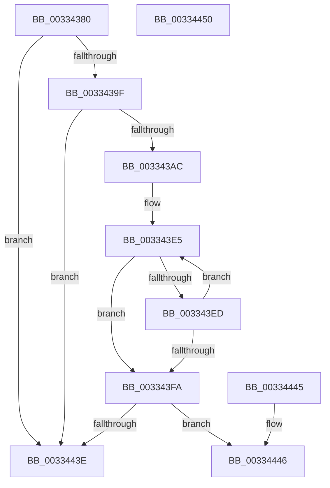

# MiConfirmPageIsZero

- RVA: `0x00334380`–`0x00334451` (길이 `209` bytes)
- VA: `0x0000000140334380`
- 실행 섹션: `.text`
- PDB 이름 있음: `예`; PDB Function 태그: `아니요`
- unwind 정보 RVA: `0x000767E0`
- 디코드: `47`개 명령, `209/209` bytes 표시
- 미해석 바이트: `0` (있으면 어셈블리에 `.byte`로 보존)

> 이 문서는 커널 이미지의 기계어와 PDB 기호를 분석해 생성했습니다. 4번과 5번은 함수 원형과 자료형을 바이너리 사용 방식에서 추정한 C 해석이며 원본 소스 복구 결과는 아닙니다.

## 1. Dependencies

- 직접 호출 지점: **1**; 고유 호출 대상: **1**
- 직접 호출자로 확인된 함수: **2**
- RIP 상대 이미지 참조: **1**

### Outgoing calls
- `0x003343D3` → [MiMapPageInHyperSpaceWorker](MiMapPageInHyperSpaceWorker_function_00332B10.md) (function, `0x00332B10`)

### Direct callers
- [MiWsleFree](../28/MiWsleFree_function_00284600.md) at `0x00284D56`
- [MiSharePages](../31/MiSharePages_function_00315110.md) at `0x003157FC`

### Static image references
- `0x00334428` → RVA `0x00010880` (`.rdata`; read)

## 2. Other-region calls and transfers

- 다른 실행 섹션으로 향하는 call: **0**
- 별도 외부 분기/꼬리 이동을 확인하지 못했습니다.

## 3. Assembly (complete function range)

```asm
00334380  48 83 EC 28                     sub rsp, 0x28
00334384  48 8B 41 18                     mov rax, qword ptr [rcx + 0x18]
00334388  48 BA FF FF FF FF FF FF FF 3F   movabs rdx, 0x3fffffffffffffff
00334392  48 23 C2                        and rax, rdx
00334395  48 83 F8 01                     cmp rax, 1
00334399  0F 85 9F 00 00 00               jne 0x14033443e
0033439F  8B 41 20                        mov eax, dword ptr [rcx + 0x20]
003343A2  66 83 F8 01                     cmp ax, 1
003343A6  0F 85 92 00 00 00               jne 0x14033443e
003343AC  48 B8 00 00 00 00 00 DE FF FF   movabs rax, 0xffffde0000000000
003343B6  48 2B C8                        sub rcx, rax
003343B9  33 D2                           xor edx, edx
003343BB  48 C1 F9 04                     sar rcx, 4
003343BF  48 B8 AB AA AA AA AA AA AA AA   movabs rax, 0xaaaaaaaaaaaaaaab
003343C9  48 0F AF C8                     imul rcx, rax
003343CD  41 B8 00 00 00 80               mov r8d, 0x80000000
003343D3  E8 38 E7 FF FF                  call 0x140332b10
003343D8  4C 8B D0                        mov r10, rax
003343DB  4C 8B C8                        mov r9, rax
003343DE  48 8D 88 F8 0F 00 00            lea rcx, [rax + 0xff8]
003343E5  48 8B 11                        mov rdx, qword ptr [rcx]
003343E8  49 0B 11                        or rdx, qword ptr [r9]
003343EB  75 0D                           jne 0x1403343fa
003343ED  49 83 C1 08                     add r9, 8
003343F1  48 83 E9 08                     sub rcx, 8
003343F5  4C 3B C9                        cmp r9, rcx
003343F8  76 EB                           jbe 0x1403343e5
003343FA  49 C1 EA 09                     shr r10, 9
003343FE  48 B8 F8 FF FF FF 7F 00 00 00   movabs rax, 0x7ffffffff8
00334408  4C 23 D0                        and r10, rax
0033440B  48 B8 00 00 00 00 80 F6 FF FF   movabs rax, 0xfffff68000000000
00334415  4C 03 D0                        add r10, rax
00334418  65 48 8B 04 25 20 00 00 00      mov rax, qword ptr gs:[0x20]
00334421  48 8B 90 38 88 00 00            mov rdx, qword ptr [rax + 0x8838]
00334428  48 8B 05 51 C4 CD FF            mov rax, qword ptr [rip - 0x323baf]
0033442F  48 C7 02 00 00 00 00            mov qword ptr [rdx], 0
00334436  49 89 02                        mov qword ptr [r10], rax
00334439  4C 3B C9                        cmp r9, rcx
0033443C  77 08                           ja 0x140334446
0033443E  33 C0                           xor eax, eax
00334440  48 83 C4 28                     add rsp, 0x28
00334444  C3                              ret
00334445  CC                              int3
00334446  B8 01 00 00 00                  mov eax, 1
0033444B  48 83 C4 28                     add rsp, 0x28
0033444F  C3                              ret
00334450  CC                              int3
```

## 4. C-style interpretation (structured pseudocode)

```c
__int64 __fastcall MiConfirmPageIsZero(__int64 a1)
{
    __int64 result;
    __int64 v_r10;
    __int64 v_rsp;

    v_rsp = (v_rsp) - (40);
    result = (*(unsigned __int64 *)(a1 + 24)) & (a2);
    if (result != 1) goto loc_0033443E;
    if (((unsigned __int16)((unsigned int)(*(unsigned int *)(a1 + 32)))) != 1) goto loc_0033443E;
    a1 = (a1) - ((unsigned int)(*(unsigned int *)(a1 + 32)));
    a2 = 0;
    a1 = (a1) >> (4);
    a1 = (a1) * ((unsigned int)(*(unsigned int *)(a1 + 32)));
    result = MiMapPageInHyperSpaceWorker(a1, a2, (unsigned int)(0x80000000ULL), a4);
loc_003343E5:
    a2 = (*(unsigned __int64 *)(result + 4088)) | (*(unsigned __int64 *)(result));
    if (condition_is_not_equal) goto loc_003343FA;
    a4 = (result) + (8);
    a1 = (result + 4088) - (8);
    if (a4 <= a1) goto loc_003343E5;
loc_003343FA:
    v_r10 = (result) >> (9);
    v_r10 = (v_r10) & (result);
    v_r10 = (v_r10) + (result);
    *(unsigned __int64 *)(*(unsigned __int64 *)(*(unsigned __int64 *)(gs_base + (0 + 32)) + 34872)) = 0;
    *(unsigned __int64 *)(v_r10) = *(unsigned __int64 *)(v_rip - 3292079);
    if (a4 > a1) goto loc_00334446;
loc_0033443E:
    result = 0;
    v_rsp = (v_rsp) + (40);
    return result;
loc_00334446:
    v_rsp = (v_rsp) + (40);
    return 1;
}
```

## 5. (Beta) C Style

```c
int64_t MiConfirmPageIsZero(void *Arg1)
{
    uint8_t *arg1 = (uint8_t *)Arg1;

    int64_t result;
    int64_t local_r10;
    int64_t local_rsp;

    local_rsp = (local_rsp) - (40);
    result = (*(uint64_t *)(arg1 + 0x18)) & (a2);
    if (result != 1) goto loc_0033443E;
    if (((uint16_t)((uint32_t)(*(uint32_t *)(arg1 + 0x20)))) != 1) goto loc_0033443E;
    Arg1 = (Arg1) - ((uint32_t)(*(uint32_t *)(arg1 + 0x20)));
    a2 = 0;
    Arg1 = (Arg1) >> (4);
    Arg1 = (Arg1) * ((uint32_t)(*(uint32_t *)(arg1 + 0x20)));
    result = MiMapPageInHyperSpaceWorker(Arg1, a2, (uint32_t)(0x80000000ULL), a4);
loc_003343E5:
    a2 = (*(uint64_t *)(result + 0xFF8)) | (*(uint64_t *)(result));
    if (condition_is_not_equal) goto loc_003343FA;
    a4 = (result) + (8);
    Arg1 = (result + 4088) - (8);
    if (a4 <= Arg1) goto loc_003343E5;
loc_003343FA:
    local_r10 = (result) >> (9);
    local_r10 = (local_r10) & (result);
    local_r10 = (local_r10) + (result);
    *(uint64_t *)(*(uint64_t *)(*(uint64_t *)(gs_base + (0 + 0x20)) + 0x8838)) = 0;
    *(uint64_t *)(local_r10) = *(uint64_t *)(v_rip - 0x323BAF);
    if (a4 > Arg1) goto loc_00334446;
loc_0033443E:
    result = 0;
    local_rsp = (local_rsp) + (40);
    return result;
loc_00334446:
    local_rsp = (local_rsp) + (40);
    return 1;
}
```

### 관측된 메모리 오프셋

구조체 형식이 확인되지 않은 접근은 인자 기준의 오프셋으로만 기록했습니다.

| 기준 인자 | 오프셋 표현 | 폭 (bit) | 접근 |
|---|---:|---:|---|
| `Arg1` | `+ 0x18` | `64` | `R` |
| `Arg1` | `+ 0x20` | `32` | `R` |

## 6. Execution-region graph

[열기: 2D/3D 그래프와 함수 탐색 컨트롤 패널](../../../control-panel.html?section=text&rva=0x00334380&view=graph)

- 2D 그래프는 위에서 아래로 흐르고, 3D 그래프는 빈 공간을 드래그해 회전합니다. Shift+드래그는 이동, 휠은 확대·축소, 함수 노드 선택은 대상 보고서 이동입니다.

### Static fallback


