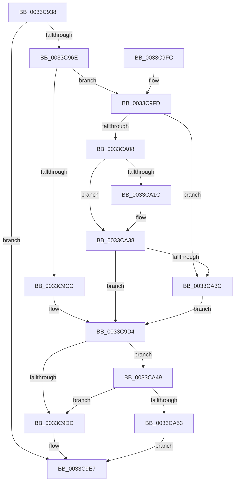

# MiDecayNodeNowEmpty

- RVA: `0x0033C938`–`0x0033CA66` (길이 `302` bytes)
- VA: `0x000000014033C938`
- 실행 섹션: `.text`
- PDB 이름 있음: `예`; PDB Function 태그: `아니요`
- unwind 정보 RVA: `0x0006D084`
- 디코드: `78`개 명령, `302/302` bytes 표시
- 미해석 바이트: `0` (있으면 어셈블리에 `.byte`로 보존)

> 이 문서는 커널 이미지의 기계어와 PDB 기호를 분석해 생성했습니다. 4번과 5번은 함수 원형과 자료형을 바이너리 사용 방식에서 추정한 C 해석이며 원본 소스 복구 결과는 아닙니다.

## 1. Dependencies

- 직접 호출 지점: **5**; 고유 호출 대상: **5**
- 직접 호출자로 확인된 함수: **2**
- RIP 상대 이미지 참조: **7**

### Outgoing calls
- `0x0033C971` → [MiRemoveDecayClusterTimer](../28/MiRemoveDecayClusterTimer_function_00288178.md) (function, `0x00288178`)
- `0x0033C991` → [MiSwizzleInvalidPte](../28/MiSwizzleInvalidPte_function_0028F5E0.md) (function, `0x0028F5E0`)
- `0x0033C9A8` → [ExAcquireSpinLockExclusiveAtDpcLevel](../24/ExAcquireSpinLockExclusiveAtDpcLevel_function_00248E80.md) (function, `0x00248E80`)
- `0x0033CA2D` → [memset](../6C/memset_function_006C6C40.md) (function, `0x006C6C40`)
- `0x0033CA5F` → [ExpReleaseSpinLockExclusiveFromDpcLevelInstrumented](../2C/ExpReleaseSpinLockExclusiveFromDpcLevelInstrumented_function_002C0F44.md) (function, `0x002C0F44`)

### Direct callers
- [sub_0033C8CB](Unknown_function_0033C8CB.md) at `0x0033C8CE`
- [sub_006DDDE8](../6D/Unknown_function_006DDDE8.md) at `0x006DDDEB`

### Static image references
- `0x0033C996` → RVA `0x00E35C00` (`.data`; read)
- `0x0033C99D` → RVA `0x00E35C20` (`.data`; read)
- `0x0033C9BD` → RVA `0x00E35C30` (`.data`; read)
- `0x0033C9D4` → RVA `0x00FC6B06` (`ALMOSTRO`; read)
- `0x0033C9DD` → RVA `0x00E35C20` (`.data`; write)
- `0x0033C9FD` → RVA `0x00000000` (`image boundary/outside`; read)
- `0x0033CA49` → RVA `0x00F0DE58` (`.data`; read)

## 2. Other-region calls and transfers

- 다른 실행 섹션으로 향하는 call: **0**
- 별도 외부 분기/꼬리 이동을 확인하지 못했습니다.

## 3. Assembly (complete function range)

```asm
0033C938  48 89 5C 24 08                  mov qword ptr [rsp + 8], rbx
0033C93D  48 89 6C 24 10                  mov qword ptr [rsp + 0x10], rbp
0033C942  48 89 74 24 18                  mov qword ptr [rsp + 0x18], rsi
0033C947  57                              push rdi
0033C948  48 83 EC 20                     sub rsp, 0x20
0033C94C  48 8D 1C 49                     lea rbx, [rcx + rcx*2]
0033C950  48 8B F9                        mov rdi, rcx
0033C953  48 C1 E3 04                     shl rbx, 4
0033C957  48 B8 00 00 00 00 00 DE FF FF   movabs rax, 0xffffde0000000000
0033C961  48 03 D8                        add rbx, rax
0033C964  8B 43 20                        mov eax, dword ptr [rbx + 0x20]
0033C967  C1 E8 18                        shr eax, 0x18
0033C96A  A8 08                           test al, 8
0033C96C  75 79                           jne 0x14033c9e7
0033C96E  48 8B CB                        mov rcx, rbx
0033C971  E8 02 B8 F4 FF                  call 0x140288178
0033C976  48 B8 FF FF FF FF FF 00 00 00   movabs rax, 0xffffffffff
0033C980  48 8B CF                        mov rcx, rdi
0033C983  48 23 C8                        and rcx, rax
0033C986  48 C1 E1 0C                     shl rcx, 0xc
0033C98A  48 81 C9 80 08 00 00            or rcx, 0x880
0033C991  E8 4A 2C F5 FF                  call 0x14028f5e0
0033C996  48 2B 3D 63 92 AF 00            sub rdi, qword ptr [rip + 0xaf9263]
0033C99D  48 8D 0D 7C 92 AF 00            lea rcx, [rip + 0xaf927c]
0033C9A4  48 89 43 10                     mov qword ptr [rbx + 0x10], rax
0033C9A8  E8 D3 C4 F0 FF                  call 0x140248e80
0033C9AD  8B CF                           mov ecx, edi
0033C9AF  BE 01 00 00 00                  mov esi, 1
0033C9B4  83 E1 07                        and ecx, 7
0033C9B7  8B FF                           mov edi, edi
0033C9B9  48 C1 EF 03                     shr rdi, 3
0033C9BD  48 03 3D 6C 92 AF 00            add rdi, qword ptr [rip + 0xaf926c]
0033C9C4  8D 51 01                        lea edx, [rcx + 1]
0033C9C7  83 FA 08                        cmp edx, 8
0033C9CA  77 31                           ja 0x14033c9fd
0033C9CC  0F BE 07                        movsx eax, byte ptr [rdi]
0033C9CF  0F AB C8                        bts eax, ecx
0033C9D2  88 07                           mov byte ptr [rdi], al
0033C9D4  F6 05 2B A1 C8 00 01            test byte ptr [rip + 0xc8a12b], 1
0033C9DB  75 6C                           jne 0x14033ca49
0033C9DD  C7 05 39 92 AF 00 00 00 00 00   mov dword ptr [rip + 0xaf9239], 0
0033C9E7  48 8B 5C 24 30                  mov rbx, qword ptr [rsp + 0x30]
0033C9EC  48 8B 6C 24 38                  mov rbp, qword ptr [rsp + 0x38]
0033C9F1  48 8B 74 24 40                  mov rsi, qword ptr [rsp + 0x40]
0033C9F6  48 83 C4 20                     add rsp, 0x20
0033C9FA  5F                              pop rdi
0033C9FB  C3                              ret
0033C9FC  CC                              int3
0033C9FD  48 8D 2D FC 35 CC FF            lea rbp, [rip - 0x33ca04]
0033CA04  85 C9                           test ecx, ecx
0033CA06  74 34                           je 0x14033ca3c
0033CA08  8A 84 29 20 2D 01 00            mov al, byte ptr [rcx + rbp + 0x12d20]
0033CA0F  8D 72 F8                        lea esi, [rdx - 8]
0033CA12  08 07                           or byte ptr [rdi], al
0033CA14  48 FF C7                        inc rdi
0033CA17  83 FE 08                        cmp esi, 8
0033CA1A  76 1C                           jbe 0x14033ca38
0033CA1C  8B DE                           mov ebx, esi
0033CA1E  BA FF 00 00 00                  mov edx, 0xff
0033CA23  48 C1 EB 03                     shr rbx, 3
0033CA27  48 8B CF                        mov rcx, rdi
0033CA2A  4C 8B C3                        mov r8, rbx
0033CA2D  E8 0E A2 38 00                  call 0x1406c6c40
0033CA32  48 03 FB                        add rdi, rbx
0033CA35  83 E6 07                        and esi, 7
0033CA38  85 F6                           test esi, esi
0033CA3A  74 98                           je 0x14033c9d4
0033CA3C  8B C6                           mov eax, esi
0033CA3E  8A 84 28 90 C8 02 00            mov al, byte ptr [rax + rbp + 0x2c890]
0033CA45  08 07                           or byte ptr [rdi], al
0033CA47  EB 8B                           jmp 0x14033c9d4
0033CA49  8B 05 09 14 BD 00               mov eax, dword ptr [rip + 0xbd1409]
0033CA4F  85 C0                           test eax, eax
0033CA51  75 8A                           jne 0x14033c9dd
0033CA53  48 8B 54 24 28                  mov rdx, qword ptr [rsp + 0x28]
0033CA58  48 8D 0D C1 91 AF 00            lea rcx, [rip + 0xaf91c1]
0033CA5F  E8 E0 44 F8 FF                  call 0x1402c0f44
0033CA64  EB 81                           jmp 0x14033c9e7
```

## 4. C-style interpretation (structured pseudocode)

```c
__int64 __fastcall MiDecayNodeNowEmpty(__int64 a1)
{
    __int64 result;
    __int64 v_rbx;
    __int64 v_rdi;
    __int64 v_rsi;
    __int64 v_rsp;
    unsigned __int64 v_stack_p10;
    unsigned __int64 v_stack_p18;
    unsigned __int64 v_stack_p28;
    unsigned __int64 v_stack_p8;

    v_stack_p8 = v_rbx;
    v_stack_p10 = v_rbp;
    v_stack_p18 = v_rsi;
    v_rsp = (v_rsp) - (32);
    v_rbx = (a1 + a1 * 2) << (4);
    v_rbx = (v_rbx) + (result);
    result = (unsigned int)(((unsigned int)(*(unsigned int *)(v_rbx + 32))) >> (24));
    if ((((unsigned __int8)(result)) & (8)) != 0) goto loc_0033C9E7;
    result = MiRemoveDecayClusterTimer(v_rbx, a2, a3, a4);
    a1 = (a1) & (result);
    a1 = (a1) << (12);
    a1 = (a1) | (0x880ULL);
    result = MiSwizzleInvalidPte(a1, a2, a3, a4);
    v_rdi = (a1) - (*(unsigned __int64 *)(v_rip + 11506275));
    *(unsigned __int64 *)(v_rbx + 16) = result;
    result = ExAcquireSpinLockExclusiveAtDpcLevel(v_rip + 11506300, a2, a3, a4);
    a1 = (unsigned int)(((unsigned int)((unsigned int)(v_rdi))) & (7));
    v_rdi = ((unsigned int)((unsigned int)(v_rdi))) >> (3);
    v_rdi = (v_rdi) + (*(unsigned __int64 *)(v_rip + 11506284));
    if (((unsigned int)(a1 + 1)) > 8) goto loc_0033C9FD;
    *(unsigned __int8 *)(v_rdi) = (unsigned __int8)((__int8)(*(unsigned __int8 *)(v_rdi)));
loc_0033C9D4:
    if (((*(unsigned __int8 *)(v_rip + 13148459)) & (1)) != 0) goto loc_0033CA49;
loc_0033C9DD:
    *(unsigned int *)(v_rip + 11506233) = 0;
loc_0033C9E7:
    v_rsp = (v_rsp) + (32);
    return (__int8)(*(unsigned __int8 *)(v_rdi));
loc_0033C9FD:
    if ((unsigned int)(a1) == 0) goto loc_0033CA3C;
    v_rdi = (v_rdi) + 1;
    result = *(unsigned __int8 *)(a1 + v_rip - 3394052 * 1 + 77088);
    v_rbx = v_stack_p8;
    v_rsi = a1 + 1 - 8;
    if (((unsigned int)(a1 + 1 - 8)) >= = 8) {
        v_rbx = (unsigned int)(a1 + 1 - 8);
        a2 = 255;
        v_rbx = (v_rbx) >> (3);
        a1 = v_rdi;
        a3 = v_rbx;
        result = memset(a1, a2, a3, a4);
        v_rdi = (v_rdi) + (v_rbx);
        v_rsi = (unsigned int)((a1 + 1 - 8) & (7));
    }
    if ((unsigned int)(v_rsi) == 0) goto loc_0033C9D4;
loc_0033CA3C:
    goto loc_0033C9D4;
loc_0033CA49:
    if ((unsigned int)((unsigned int)(*(unsigned int *)(v_rip + 12391433))) != 0) goto loc_0033C9DD;
    result = ExpReleaseSpinLockExclusiveFromDpcLevelInstrumented(v_rip + 11506113, v_stack_p28, a3, a4);
    goto loc_0033C9E7;
}
```

## 5. (Beta) C Style

```c
int64_t MiDecayNodeNowEmpty(void *Arg1)
{
    uint8_t *arg1 = (uint8_t *)Arg1;

    int64_t result;
    int64_t local_rbx;
    int64_t local_rdi;
    int64_t local_rsi;
    int64_t local_rsp;
    uint64_t v_stack_p10;
    uint64_t v_stack_p18;
    uint64_t v_stack_p28;
    uint64_t v_stack_p8;

    v_stack_p8 = local_rbx;
    v_stack_p10 = local_rbp;
    v_stack_p18 = local_rsi;
    local_rsp = (local_rsp) - (32);
    local_rbx = (Arg1 + Arg1 * 2) << (4);
    local_rbx = (local_rbx) + (result);
    result = (uint32_t)(((uint32_t)(*(uint32_t *)(local_rbx + 0x20))) >> (24));
    if ((((uint8_t)(result)) & (8)) != 0) goto loc_0033C9E7;
    result = MiRemoveDecayClusterTimer(local_rbx, a2, a3, a4);
    Arg1 = (Arg1) & (result);
    Arg1 = (Arg1) << (12);
    Arg1 = (Arg1) | (0x880ULL);
    result = MiSwizzleInvalidPte(Arg1, a2, a3, a4);
    local_rdi = (Arg1) - (*(uint64_t *)(v_rip + 0xAF9263));
    *(uint64_t *)(local_rbx + 0x10) = result;
    result = ExAcquireSpinLockExclusiveAtDpcLevel(v_rip + 11506300, a2, a3, a4);
    Arg1 = (uint32_t)(((uint32_t)((uint32_t)(local_rdi))) & (7));
    local_rdi = ((uint32_t)((uint32_t)(local_rdi))) >> (3);
    local_rdi = (local_rdi) + (*(uint64_t *)(v_rip + 0xAF926C));
    if (((uint32_t)(Arg1 + 1)) > 8) goto loc_0033C9FD;
    *(uint8_t *)(local_rdi) = (uint8_t)((int8_t)(*(uint8_t *)(local_rdi)));
loc_0033C9D4:
    if (((*(uint8_t *)(v_rip + 0xC8A12B)) & (1)) != 0) goto loc_0033CA49;
loc_0033C9DD:
    *(uint32_t *)(v_rip + 0xAF9239) = 0;
loc_0033C9E7:
    local_rsp = (local_rsp) + (32);
    return (int8_t)(*(uint8_t *)(local_rdi));
loc_0033C9FD:
    if ((uint32_t)(Arg1) == 0) goto loc_0033CA3C;
    local_rdi = (local_rdi) + 1;
    result = *(uint8_t *)(arg1 + v_rip - 0x33CA04 * 1 + 0x12D20);
    local_rbx = v_stack_p8;
    local_rsi = Arg1 + 1 - 8;
    if (((uint32_t)(Arg1 + 1 - 8)) >= = 8) {
        local_rbx = (uint32_t)(Arg1 + 1 - 8);
        a2 = 255;
        local_rbx = (local_rbx) >> (3);
        Arg1 = local_rdi;
        a3 = local_rbx;
        result = memset(Arg1, a2, a3, a4);
        local_rdi = (local_rdi) + (local_rbx);
        local_rsi = (uint32_t)((Arg1 + 1 - 8) & (7));
    }
    if ((uint32_t)(local_rsi) == 0) goto loc_0033C9D4;
loc_0033CA3C:
    goto loc_0033C9D4;
loc_0033CA49:
    if ((uint32_t)((uint32_t)(*(uint32_t *)(v_rip + 0xBD1409))) != 0) goto loc_0033C9DD;
    result = ExpReleaseSpinLockExclusiveFromDpcLevelInstrumented(v_rip + 11506113, v_stack_p28, a3, a4);
    goto loc_0033C9E7;
}
```

### 관측된 메모리 오프셋

구조체 형식이 확인되지 않은 접근은 인자 기준의 오프셋으로만 기록했습니다.

| 기준 인자 | 오프셋 표현 | 폭 (bit) | 접근 |
|---|---:|---:|---|
| `Arg1` | `+ 0x0 + rcx*2` | `64` | `R` |
| `Arg1` | `+ 0x1` | `32` | `R` |

## 6. Execution-region graph

[열기: 2D/3D 그래프와 함수 탐색 컨트롤 패널](../../../control-panel.html?section=text&rva=0x0033C938&view=graph)

- 2D 그래프는 위에서 아래로 흐르고, 3D 그래프는 빈 공간을 드래그해 회전합니다. Shift+드래그는 이동, 휠은 확대·축소, 함수 노드 선택은 대상 보고서 이동입니다.

### Static fallback


