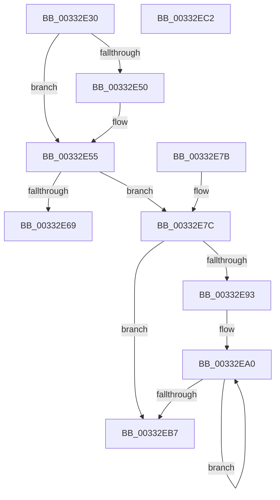

# MiFinalizePageAttribute

- RVA: `0x00332E30`–`0x00332EC3` (길이 `147` bytes)
- VA: `0x0000000140332E30`
- 실행 섹션: `.text`
- PDB 이름 있음: `예`; PDB Function 태그: `아니요`
- unwind 정보 RVA: `0x000766F0`
- 디코드: `44`개 명령, `147/147` bytes 표시
- 미해석 바이트: `0` (있으면 어셈블리에 `.byte`로 보존)

> 이 문서는 커널 이미지의 기계어와 PDB 기호를 분석해 생성했습니다. 4번과 5번은 함수 원형과 자료형을 바이너리 사용 방식에서 추정한 C 해석이며 원본 소스 복구 결과는 아닙니다.

## 1. Dependencies

- 직접 호출 지점: **1**; 고유 호출 대상: **1**
- 직접 호출자로 확인된 함수: **15**
- RIP 상대 이미지 참조: **0**

### Outgoing calls
- `0x00332E50` → [MiChangePageAttribute](MiChangePageAttribute_function_00332ECC.md) (function, `0x00332ECC`)

### Direct callers
- [MiCombineInitialInstance](../22/MiCombineInitialInstance_function_0022BC0C.md) at `0x0022C141`
- [MiHandleForkTransitionPte](../22/MiHandleForkTransitionPte_function_0022D34C.md) at `0x0022D8C9`
- [MiBuildForkPte](../22/MiBuildForkPte_function_0022E32C.md) at `0x0022EB48`
- [MiMigratePfn](../28/MiMigratePfn_function_0028DBB0.md) at `0x0028DDF3`
- [MiSwapStackPage](../29/MiSwapStackPage_function_0029FDE0.md) at `0x002A012C`
- [MiAllocateKernelStackPages](../2A/MiAllocateKernelStackPages_function_002A1BEC.md) at `0x002A20FA`
- [MiInitializeTransitionPfn](../2A/MiInitializeTransitionPfn_function_002AC2E8.md) at `0x002AC3C6`
- [MiCopyDataPageToImagePage](../2A/MiCopyDataPageToImagePage_function_002AE818.md) at `0x002AE886`
- [MiCopyOnWrite](../36/MiCopyOnWrite_function_00362A0C.md) at `0x00362E0F`
- [MiInitializeHardFaultPfn](../36/MiInitializeHardFaultPfn_function_00363DD8.md) at `0x00363EDF`
- [MiTradeActivePage](../37/MiTradeActivePage_function_00374424.md) at `0x00374569`
- [MiSwapNumaStandbyPage](../38/MiSwapNumaStandbyPage_function_00385144.md) at `0x0038532C`
- [MiSplitDirectMapPage](../4D/MiSplitDirectMapPage_function_004DAAA0.md) at `0x004DABD0`
- [sub_006E17A2](../6E/Unknown_function_006E17A2.md) at `0x006E17AF`
- [MiInitializeCacheFlushing](../../init/C6/MiInitializeCacheFlushing_function_00C6ACF8.md) at `0x00C6ADEA`

### Static image references
- 디코드된 RIP-relative 메모리 참조가 없습니다.

## 2. Other-region calls and transfers

- 다른 실행 섹션으로 향하는 call: **0**
- 별도 외부 분기/꼬리 이동을 확인하지 못했습니다.

## 3. Assembly (complete function range)

```asm
00332E30  48 89 5C 24 08                  mov qword ptr [rsp + 8], rbx
00332E35  57                              push rdi
00332E36  48 83 EC 20                     sub rsp, 0x20
00332E3A  8B 41 20                        mov eax, dword ptr [rcx + 0x20]
00332E3D  41 8B F8                        mov edi, r8d
00332E40  C1 E8 10                        shr eax, 0x10
00332E43  48 8B D9                        mov rbx, rcx
00332E46  0F B6 C0                        movzx eax, al
00332E49  C1 E8 06                        shr eax, 6
00332E4C  3B C2                           cmp eax, edx
00332E4E  74 05                           je 0x140332e55
00332E50  E8 77 00 00 00                  call 0x140332ecc
00332E55  48 8B 53 18                     mov rdx, qword ptr [rbx + 0x18]
00332E59  49 B9 FF FF FF FF FF FF FF C7   movabs r9, 0xc7ffffffffffffff
00332E63  40 F6 C7 01                     test dil, 1
00332E67  74 13                           je 0x140332e7c
00332E69  49 23 D1                        and rdx, r9
00332E6C  48 89 53 18                     mov qword ptr [rbx + 0x18], rdx
00332E70  48 8B 5C 24 30                  mov rbx, qword ptr [rsp + 0x30]
00332E75  48 83 C4 20                     add rsp, 0x20
00332E79  5F                              pop rdi
00332E7A  C3                              ret
00332E7B  CC                              int3
00332E7C  48 8B CA                        mov rcx, rdx
00332E7F  48 8B C2                        mov rax, rdx
00332E82  49 23 C9                        and rcx, r9
00332E85  F0 48 0F B1 4B 18               lock cmpxchg qword ptr [rbx + 0x18], rcx
00332E8B  4C 8B C0                        mov r8, rax
00332E8E  48 3B D0                        cmp rdx, rax
00332E91  74 24                           je 0x140332eb7
00332E93  0F 1F 40 00                     nop dword ptr [rax]
00332E97  66 0F 1F 84 00 00 00 00 00      nop word ptr [rax + rax]
00332EA0  49 8B C8                        mov rcx, r8
00332EA3  4D 23 C1                        and r8, r9
00332EA6  48 8B C1                        mov rax, rcx
00332EA9  F0 4C 0F B1 43 18               lock cmpxchg qword ptr [rbx + 0x18], r8
00332EAF  4C 8B C0                        mov r8, rax
00332EB2  48 3B C8                        cmp rcx, rax
00332EB5  75 E9                           jne 0x140332ea0
00332EB7  48 8B 5C 24 30                  mov rbx, qword ptr [rsp + 0x30]
00332EBC  48 83 C4 20                     add rsp, 0x20
00332EC0  5F                              pop rdi
00332EC1  C3                              ret
00332EC2  CC                              int3
```

## 4. C-style interpretation (structured pseudocode)

```c
__int64 __fastcall MiFinalizePageAttribute(__int64 a1, int a2, int a3)
{
    __int64 result;
    __int64 v_rsp;
    unsigned __int64 v_stack_p30;
    unsigned __int64 v_stack_p8;

    v_stack_p8 = v_rbx;
    v_rsp = (v_rsp) - (32);
    result = (unsigned int)(((unsigned int)(*(unsigned int *)(a1 + 32))) >> (16));
    result = (unsigned int)(((unsigned __int8)(result)) >> (6));
    if (((unsigned int)(result)) != a2) {
        result = MiChangePageAttribute(a1, a2, a3, a4);
    }
    if ((((unsigned __int8)((unsigned int)(a3))) & (1)) == 0) goto loc_00332E7C;
    a2 = (*(unsigned __int64 *)(a1 + 24)) & (a4);
    *(unsigned __int64 *)(a1 + 24) = a2;
    v_rsp = (v_rsp) + (32);
    return result;
loc_00332E7C:
    a1 = (a2) & (a4);
    if (a2 == a2) goto loc_00332EB7;
loc_00332EA0:
    a3 = (a2) & (a4);
    if (a2 != a2) goto loc_00332EA0;
loc_00332EB7:
    v_rsp = (v_rsp) + (32);
    return a2;
}
```

## 5. (Beta) C Style

```c
int64_t MiFinalizePageAttribute(void *Arg1, int32_t Arg2, int32_t Arg3)
{
    uint8_t *arg1 = (uint8_t *)Arg1;

    int64_t result;
    int64_t local_rsp;
    uint64_t v_stack_p30;
    uint64_t v_stack_p8;

    v_stack_p8 = local_rbx;
    local_rsp = (local_rsp) - (32);
    result = (uint32_t)(((uint32_t)(*(uint32_t *)(arg1 + 0x20))) >> (16));
    result = (uint32_t)(((uint8_t)(result)) >> (6));
    if (((uint32_t)(result)) != Arg2) {
        result = MiChangePageAttribute(Arg1, Arg2, Arg3, a4);
    }
    if ((((uint8_t)((uint32_t)(Arg3))) & (1)) == 0) goto loc_00332E7C;
    Arg2 = (*(uint64_t *)(arg1 + 0x18)) & (a4);
    *(uint64_t *)(arg1 + 0x18) = Arg2;
    local_rsp = (local_rsp) + (32);
    return result;
loc_00332E7C:
    Arg1 = (Arg2) & (a4);
    if (Arg2 == Arg2) goto loc_00332EB7;
loc_00332EA0:
    Arg3 = (Arg2) & (a4);
    if (Arg2 != Arg2) goto loc_00332EA0;
loc_00332EB7:
    local_rsp = (local_rsp) + (32);
    return Arg2;
}
```

### 관측된 메모리 오프셋

구조체 형식이 확인되지 않은 접근은 인자 기준의 오프셋으로만 기록했습니다.

| 기준 인자 | 오프셋 표현 | 폭 (bit) | 접근 |
|---|---:|---:|---|
| `Arg1` | `+ 0x18` | `64` | `R` |
| `Arg1` | `+ 0x18` | `64` | `W` |
| `Arg1` | `+ 0x20` | `32` | `R` |

## 6. Execution-region graph

[열기: 2D/3D 그래프와 함수 탐색 컨트롤 패널](../../../control-panel.html?section=text&rva=0x00332E30&view=graph)

- 2D 그래프는 위에서 아래로 흐르고, 3D 그래프는 빈 공간을 드래그해 회전합니다. Shift+드래그는 이동, 휠은 확대·축소, 함수 노드 선택은 대상 보고서 이동입니다.

### Static fallback


