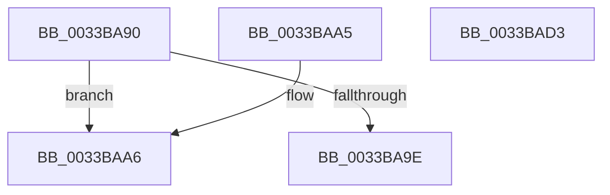

# MiGetPfnChannel

- RVA: `0x0033BA90`–`0x0033BAD4` (길이 `68` bytes)
- VA: `0x000000014033BA90`
- 실행 섹션: `.text`
- PDB 이름 있음: `예`; PDB Function 태그: `아니요`
- unwind 정보 RVA: `0x00076E80`
- 디코드: `17`개 명령, `68/68` bytes 표시
- 미해석 바이트: `0` (있으면 어셈블리에 `.byte`로 보존)

> 이 문서는 커널 이미지의 기계어와 PDB 기호를 분석해 생성했습니다. 4번과 5번은 함수 원형과 자료형을 바이너리 사용 방식에서 추정한 C 해석이며 원본 소스 복구 결과는 아닙니다.

## 1. Dependencies

- 직접 호출 지점: **1**; 고유 호출 대상: **1**
- 직접 호출자로 확인된 함수: **7**
- RIP 상대 이미지 참조: **1**

### Outgoing calls
- `0x0033BAC5` → [MiSearchChannelTable](MiSearchChannelTable_function_0033BE24.md) (function, `0x0033BE24`)

### Direct callers
- [MiGetPage](../28/MiGetPage_function_002884C0.md) at `0x00289725`
- [MiTradeTransitionPage](../28/MiTradeTransitionPage_function_0028B9AC.md) at `0x0028BAB0`
- [MiStealPage](../2B/MiStealPage_function_002B28D0.md) at `0x002B2ABA`
- [MiReplaceLockedPage](../38/MiReplaceLockedPage_function_0038351C.md) at `0x003835C9`
- [MiPruneStandbyPages](../3B/MiPruneStandbyPages_function_003BC0E4.md) at `0x003BC1F2`
- [MiTryUnlinkNodeLargePages](../68/MiTryUnlinkNodeLargePages_function_0068ADA0.md) at `0x0068AE05`
- [MiTryUnlinkNodeLargePages](../68/MiTryUnlinkNodeLargePages_function_0068ADA0.md) at `0x0068AF37`
- [sub_006E4A1A](../6E/Unknown_function_006E4A1A.md) at `0x006E4A5D`

### Static image references
- `0x0033BA94` → RVA `0x00E2DC28` (`.data`; read)

## 2. Other-region calls and transfers

- 다른 실행 섹션으로 향하는 call: **0**
- 별도 외부 분기/꼬리 이동을 확인하지 못했습니다.

## 3. Assembly (complete function range)

```asm
0033BA90  48 83 EC 28                     sub rsp, 0x28
0033BA94  48 83 3D 8C 21 AF 00 00         cmp qword ptr [rip + 0xaf218c], 0
0033BA9C  75 08                           jne 0x14033baa6
0033BA9E  32 C0                           xor al, al
0033BAA0  48 83 C4 28                     add rsp, 0x28
0033BAA4  C3                              ret
0033BAA5  CC                              int3
0033BAA6  48 B8 00 00 00 00 00 DE FF FF   movabs rax, 0xffffde0000000000
0033BAB0  48 2B C8                        sub rcx, rax
0033BAB3  48 B8 AB AA AA AA AA AA AA AA   movabs rax, 0xaaaaaaaaaaaaaaab
0033BABD  48 C1 F9 04                     sar rcx, 4
0033BAC1  48 0F AF C8                     imul rcx, rax
0033BAC5  E8 5A 03 00 00                  call 0x14033be24
0033BACA  0F B6 40 0C                     movzx eax, byte ptr [rax + 0xc]
0033BACE  48 83 C4 28                     add rsp, 0x28
0033BAD2  C3                              ret
0033BAD3  CC                              int3
```

## 4. C-style interpretation (structured pseudocode)

```c
__int64 __fastcall MiGetPfnChannel(__int64 a1)
{
    __int64 result;
    __int64 v_rsp;

    v_rsp = (v_rsp) - (40);
    if ((*(unsigned __int64 *)(v_rip + 11477388)) != 0) goto loc_0033BAA6;
    result = 0;
    v_rsp = (v_rsp) + (40);
    return result;
loc_0033BAA6:
    a1 = (a1) - (0);
    a1 = (a1) >> (4);
    a1 = (a1) * (0);
    result = MiSearchChannelTable(a1, a2, a3, a4);
    v_rsp = (v_rsp) + (40);
    return *(unsigned __int8 *)(result + 12);
}
```

## 5. (Beta) C Style

```c
int64_t MiGetPfnChannel(int64_t Arg1)
{
    int64_t result;
    int64_t local_rsp;

    local_rsp = (local_rsp) - (40);
    if ((*(uint64_t *)(v_rip + 0xAF218C)) != 0) goto loc_0033BAA6;
    result = 0;
    local_rsp = (local_rsp) + (40);
    return result;
loc_0033BAA6:
    Arg1 = (Arg1) - (0);
    Arg1 = (Arg1) >> (4);
    Arg1 = (Arg1) * (0);
    result = MiSearchChannelTable(Arg1, a2, a3, a4);
    local_rsp = (local_rsp) + (40);
    return *(uint8_t *)(result + 0xC);
}
```

## 6. Execution-region graph

[열기: 2D/3D 그래프와 함수 탐색 컨트롤 패널](../../../control-panel.html?section=text&rva=0x0033BA90&view=graph)

- 2D 그래프는 위에서 아래로 흐르고, 3D 그래프는 빈 공간을 드래그해 회전합니다. Shift+드래그는 이동, 휠은 확대·축소, 함수 노드 선택은 대상 보고서 이동입니다.

### Static fallback


