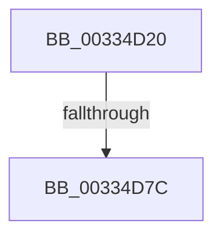

# MiInsertPageInFreeOrZeroedList

- RVA: `0x00334D20`–`0x00334D90` (길이 `112` bytes)
- VA: `0x0000000140334D20`
- 실행 섹션: `.text`
- PDB 이름 있음: `예`; PDB Function 태그: `예`
- unwind 정보 RVA: `0x00076844`
- 디코드: `27`개 명령, `112/112` bytes 표시
- 미해석 바이트: `0` (있으면 어셈블리에 `.byte`로 보존)

> 이 문서는 커널 이미지의 기계어와 PDB 기호를 분석해 생성했습니다. 4번과 5번은 함수 원형과 자료형을 바이너리 사용 방식에서 추정한 C 해석이며 원본 소스 복구 결과는 아닙니다.

## 1. Dependencies

- 직접 호출 지점: **0**; 고유 호출 대상: **0**
- 직접 호출자로 확인된 함수: **51**
- RIP 상대 이미지 참조: **0**

### Outgoing calls
- 직접 디코드된 call 명령이 없습니다.

### Direct callers
- [sub_00245E7F](../24/Unknown_function_00245E7F.md) at `0x00245ED3`
- [sub_002466D9](../24/Unknown_function_002466D9.md) at `0x0024672D`
- [MiWsleFree](../28/MiWsleFree_function_00284600.md) at `0x002849F9`
- [MiWsleFree](../28/MiWsleFree_function_00284600.md) at `0x00284C63`
- [MiWsleFree](../28/MiWsleFree_function_00284600.md) at `0x00284E72`
- [MiMigratePfn](../28/MiMigratePfn_function_0028DBB0.md) at `0x0028DFB7`
- [MiRelinkStandbyPage](../2B/MiRelinkStandbyPage_function_002B9D30.md) at `0x002B9E21`
- [MiPfnReferenceCountIsZero](../2B/MiPfnReferenceCountIsZero_function_002B9E40.md) at `0x002B9F9C`
- [MiInsertPageInList](../2B/MiInsertPageInList_function_002BA000.md) at `0x002BA779`
- [sub_002F6E32](../2F/Unknown_function_002F6E32.md) at `0x002F73D8`
- [MiReturnPhysicalPoolPages](../32/MiReturnPhysicalPoolPages_function_00328568.md) at `0x0032867A`
- [MiPfnShareCountIsZero](MiPfnShareCountIsZero_function_00330930.md) at `0x00330B0E`
- [MiCompletePrivateZeroFault](MiCompletePrivateZeroFault_function_00330CC0.md) at `0x00331538`
- [sub_00333F9C](Unknown_function_00333F9C.md) at `0x003341A5`
- [MiPurgePartitionStandby](MiPurgePartitionStandby_function_00334460.md) at `0x00334529`
- [MiReturnFreeZeroPage](MiReturnFreeZeroPage_function_00334BD0.md) at `0x00334CE8`
- [MiCoalesceFreeSmallPages](MiCoalesceFreeSmallPages_function_00336340.md) at `0x00336974`
- [MiPageFreeToZero](MiPageFreeToZero_function_00337A30.md) at `0x00337B94`
- [MiDeleteClusterPage](../34/MiDeleteClusterPage_function_00346CB0.md) at `0x00346F9E`
- [MiZeroCfgSystemWideBitmapWorker](../36/MiZeroCfgSystemWideBitmapWorker_function_00367060.md) at `0x003672C2`
- [MiDeleteEnclavePage](../36/MiDeleteEnclavePage_function_00368CCC.md) at `0x00368DF1`
- [sub_003708A6](../37/Unknown_function_003708A6.md) at `0x00370AE8`
- [sub_00371C01](../37/Unknown_function_00371C01.md) at `0x00371D97`
- [MiWriteCompletePfn](../37/MiWriteCompletePfn_function_003737C4.md) at `0x003739E2`
- [MiDeleteSectionCluster](../37/MiDeleteSectionCluster_function_00373DF0.md) at `0x003742DA`
- [MiDiscardTransitionPteEx](../37/MiDiscardTransitionPteEx_function_00375954.md) at `0x003759CB`
- [MiFreeSmallPageFromMdl](../37/MiFreeSmallPageFromMdl_function_00375D58.md) at `0x00375F20`
- [MiFinishLargePageFree](../37/MiFinishLargePageFree_function_00377B94.md) at `0x00377CBA`
- [MiLargePagePromote](../37/MiLargePagePromote_function_0037915C.md) at `0x003793C1`
- [MiRebuildLargePage](../3B/MiRebuildLargePage_function_003BBAEC.md) at `0x003BBDE1`
- [MiPruneStandbyPages](../3B/MiPruneStandbyPages_function_003BC0E4.md) at `0x003BC21F`
- [MiPruneStandbyPages](../3B/MiPruneStandbyPages_function_003BC0E4.md) at `0x003BC380`
- [MiInsertDemotedPages](../43/MiInsertDemotedPages_function_004354B8.md) at `0x00435685`
- [MiDrainZeroLookasides](../44/MiDrainZeroLookasides_function_0044D818.md) at `0x0044DA33`
- [MiLockAndInsertPageInFreeList](../47/MiLockAndInsertPageInFreeList_function_00470FA8.md) at `0x00470FFA`
- [MiMakePageBad](../48/MiMakePageBad_function_00486F04.md) at `0x00486F7B`
- [MiDeleteShadowStackPtes](../49/MiDeleteShadowStackPtes_function_00493AE4.md) at `0x00493D3E`
- [MiFreePageFileHashPfn](../4B/MiFreePageFileHashPfn_function_004B2A78.md) at `0x004B2AC0`
- [MiPurgeZeroListHead](../4C/MiPurgeZeroListHead_function_004CE464.md) at `0x004CE560`
- [MiDeleteSubsectionLargePages](../4D/MiDeleteSubsectionLargePages_function_004D51E0.md) at `0x004D539F`
- [MiReturnEnclavePage](../4D/MiReturnEnclavePage_function_004DEEF8.md) at `0x004DEF46`
- [MiFlushFileOnlyDeleteChain](../4F/MiFlushFileOnlyDeleteChain_function_004F5534.md) at `0x004F563B`
- [MiEnableNewPfns](../67/MiEnableNewPfns_function_00671DD0.md) at `0x00671EE2`
- [MiEnableNewPfns](../67/MiEnableNewPfns_function_00671DD0.md) at `0x00671FB4`
- [MiUnlinkBadPages](../67/MiUnlinkBadPages_function_0067A6FC.md) at `0x0067A83F`
- [MiReturnPfnList](../67/MiReturnPfnList_function_0067FBEC.md) at `0x0067FC69`
- [MiInsertPossiblyBadPage](../68/MiInsertPossiblyBadPage_function_00689DF0.md) at `0x00689E8D`
- [MiInsertPossiblyBadPage](../68/MiInsertPossiblyBadPage_function_00689DF0.md) at `0x00689F2D`
- [MiTransferPartitionPageRun](../69/MiTransferPartitionPageRun_function_00691DCC.md) at `0x0069204B`
- [MiScrubLargePage](../69/MiScrubLargePage_function_006942E8.md) at `0x006944A9`
- [sub_006DA4DA](../6D/Unknown_function_006DA4DA.md) at `0x006DA527`
- [sub_006E3E8A](../6E/Unknown_function_006E3E8A.md) at `0x006E3EB4`
- [sub_006E7436](../6E/Unknown_function_006E7436.md) at `0x006E74D4`
- [sub_006E798E](../6E/Unknown_function_006E798E.md) at `0x006E79E0`
- [sub_006FA666](../6F/Unknown_function_006FA666.md) at `0x006FA6EE`
- [MxInsertFreePages](../../init/C6/MxInsertFreePages_function_00C63AD0.md) at `0x00C63C79`

### Static image references
- 디코드된 RIP-relative 메모리 참조가 없습니다.

## 2. Other-region calls and transfers

- 다른 실행 섹션으로 향하는 call: **0**
- call이 아닌 외부 분기/꼬리 이동: **1**
  - `0x00334D76` → [sub_003352E8](Unknown_function_003352E8.md) (`tail-transfer`)

## 3. Assembly (complete function range)

```asm
00334D20  89 54 24 10                     mov dword ptr [rsp + 0x10], edx
00334D24  48 89 4C 24 08                  mov qword ptr [rsp + 8], rcx
00334D29  55                              push rbp
00334D2A  56                              push rsi
00334D2B  57                              push rdi
00334D2C  41 55                           push r13
00334D2E  41 56                           push r14
00334D30  41 57                           push r15
00334D32  48 8D 6C 24 C8                  lea rbp, [rsp - 0x38]
00334D37  48 81 EC 38 01 00 00            sub rsp, 0x138
00334D3E  48 8D 3C 49                     lea rdi, [rcx + rcx*2]
00334D42  48 BE 00 00 00 00 00 DE FF FF   movabs rsi, 0xffffde0000000000
00334D4C  48 C1 E7 04                     shl rdi, 4
00334D50  44 8B D2                        mov r10d, edx
00334D53  4C 8B F9                        mov r15, rcx
00334D56  48 8B C6                        mov rax, rsi
00334D59  4C 8D 34 07                     lea r14, [rdi + rax]
00334D5D  49 B9 00 00 00 00 00 01 00 00   movabs r9, 0x10000000000
00334D67  49 8B 46 28                     mov rax, qword ptr [r14 + 0x28]
00334D6B  49 8B 46 28                     mov rax, qword ptr [r14 + 0x28]
00334D6F  4C 89 75 90                     mov qword ptr [rbp - 0x70], r14
00334D73  49 85 C1                        test r9, rax
00334D76  0F 85 6C 05 00 00               jne 0x1403352e8
00334D7C  41 BD 03 00 00 00               mov r13d, 3
00334D82  49 8B 46 28                     mov rax, qword ptr [r14 + 0x28]
00334D86  48 0F BA E0 35                  bt rax, 0x35
00334D8B  44 89 6C 24 30                  mov dword ptr [rsp + 0x30], r13d
```

## 4. C-style interpretation (structured pseudocode)

```c
__int64 __fastcall MiInsertPageInFreeOrZeroedList(__int64 a1, int a2)
{
    __int64 v_rdi;
    __int64 v_rsp;
    unsigned int v_stack_m138;
    unsigned __int64 v_stack_m68;
    unsigned __int64 v_stack_mD8;
    unsigned int v_stack_p10;
    unsigned __int64 v_stack_p8;

    v_stack_p10 = a2;
    v_stack_p8 = a1;
    v_rsp = (v_rsp) - (312);
    v_rdi = (a1 + a1 * 2) << (4);
    v_stack_mD8 = v_rdi + v_rsi * 1;
    v_stack_m138 = 3;
    return *(unsigned __int64 *)(v_rdi + v_rsi * 1 + 40);
}
```

## 5. (Beta) C Style

```c
int64_t MiInsertPageInFreeOrZeroedList(void *Arg1, int32_t Arg2)
{
    uint8_t *arg1 = (uint8_t *)Arg1;

    int64_t local_rdi;
    int64_t local_rsp;
    uint32_t v_stack_m138;
    uint64_t v_stack_m68;
    uint64_t v_stack_mD8;
    uint32_t v_stack_p10;
    uint64_t v_stack_p8;

    v_stack_p10 = Arg2;
    v_stack_p8 = Arg1;
    local_rsp = (local_rsp) - (312);
    local_rdi = (Arg1 + Arg1 * 2) << (4);
    v_stack_mD8 = local_rdi + local_rsi * 1;
    v_stack_m138 = 3;
    return *(uint64_t *)(local_rdi + local_rsi * 1 + 0x28);
}
```

### 관측된 메모리 오프셋

구조체 형식이 확인되지 않은 접근은 인자 기준의 오프셋으로만 기록했습니다.

| 기준 인자 | 오프셋 표현 | 폭 (bit) | 접근 |
|---|---:|---:|---|
| `Arg1` | `+ 0x0 + rcx*2` | `64` | `R` |

## 6. Execution-region graph

[열기: 2D/3D 그래프와 함수 탐색 컨트롤 패널](../../../control-panel.html?section=text&rva=0x00334D20&view=graph)

- 2D 그래프는 위에서 아래로 흐르고, 3D 그래프는 빈 공간을 드래그해 회전합니다. Shift+드래그는 이동, 휠은 확대·축소, 함수 노드 선택은 대상 보고서 이동입니다.

### Static fallback


