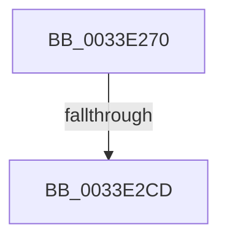

# MiInsertPagesInList

- RVA: `0x0033E270`–`0x0033E2D1` (길이 `97` bytes)
- VA: `0x000000014033E270`
- 실행 섹션: `.text`
- PDB 이름 있음: `예`; PDB Function 태그: `아니요`
- unwind 정보 RVA: `0x00077224`
- 디코드: `26`개 명령, `97/97` bytes 표시
- 미해석 바이트: `0` (있으면 어셈블리에 `.byte`로 보존)

> 이 문서는 커널 이미지의 기계어와 PDB 기호를 분석해 생성했습니다. 4번과 5번은 함수 원형과 자료형을 바이너리 사용 방식에서 추정한 C 해석이며 원본 소스 복구 결과는 아닙니다.

## 1. Dependencies

- 직접 호출 지점: **0**; 고유 호출 대상: **0**
- 직접 호출자로 확인된 함수: **6**
- RIP 상대 이미지 참조: **1**

### Outgoing calls
- 직접 디코드된 call 명령이 없습니다.

### Direct callers
- [MiUnlockMdlWritePages](../24/MiUnlockMdlWritePages_function_0024A7C0.md) at `0x0024A89F`
- [MiUnlockMdlWritePages](../24/MiUnlockMdlWritePages_function_0024A7C0.md) at `0x0024A8FD`
- [MiAddPageToInsertList](../24/MiAddPageToInsertList_function_0024A950.md) at `0x0024AB24`
- [MiAddPageToInsertList](../24/MiAddPageToInsertList_function_0024A950.md) at `0x0024AC35`
- [sub_0024B335](../24/Unknown_function_0024B335.md) at `0x0024B455`
- [sub_00293C9B](../29/Unknown_function_00293C9B.md) at `0x00293E94`
- [MiFinishHardFault](../2B/MiFinishHardFault_function_002B6F10.md) at `0x002B7193`
- [MiInsertProtectedStandbyPage](../45/MiInsertProtectedStandbyPage_function_004527D8.md) at `0x004528DA`

### Static image references
- `0x0033E282` → RVA `0x00E0A740` (`.data`; read)

## 2. Other-region calls and transfers

- 다른 실행 섹션으로 향하는 call: **0**
- call이 아닌 외부 분기/꼬리 이동: **1**
  - `0x0033E2C7` → [sub_0033E820](Unknown_function_0033E820.md) (`tail-transfer`)

## 3. Assembly (complete function range)

```asm
0033E270  4C 8B DC                        mov r11, rsp
0033E273  55                              push rbp
0033E274  57                              push rdi
0033E275  41 54                           push r12
0033E277  49 8D 6B B8                     lea rbp, [r11 - 0x48]
0033E27B  48 81 EC 30 01 00 00            sub rsp, 0x130
0033E282  48 8B 05 B7 C4 AC 00            mov rax, qword ptr [rip + 0xacc4b7]
0033E289  48 33 C4                        xor rax, rsp
0033E28C  48 89 45 10                     mov qword ptr [rbp + 0x10], rax
0033E290  4C 8B 21                        mov r12, qword ptr [rcx]
0033E293  0F 57 C0                        xorps xmm0, xmm0
0033E296  33 C0                           xor eax, eax
0033E298  89 54 24 60                     mov dword ptr [rsp + 0x60], edx
0033E29C  48 89 4C 24 68                  mov qword ptr [rsp + 0x68], rcx
0033E2A1  48 8B F9                        mov rdi, rcx
0033E2A4  48 89 45 00                     mov qword ptr [rbp], rax
0033E2A8  4C 89 65 88                     mov qword ptr [rbp - 0x78], r12
0033E2AC  0F 11 45 A0                     movups xmmword ptr [rbp - 0x60], xmm0
0033E2B0  0F 11 45 B0                     movups xmmword ptr [rbp - 0x50], xmm0
0033E2B4  0F 11 45 C0                     movups xmmword ptr [rbp - 0x40], xmm0
0033E2B8  0F 11 45 D0                     movups xmmword ptr [rbp - 0x30], xmm0
0033E2BC  0F 11 45 E0                     movups xmmword ptr [rbp - 0x20], xmm0
0033E2C0  0F 11 45 F0                     movups xmmword ptr [rbp - 0x10], xmm0
0033E2C4  4D 85 E4                        test r12, r12
0033E2C7  0F 84 53 05 00 00               je 0x14033e820
0033E2CD  48 8B 41 58                     mov rax, qword ptr [rcx + 0x58]
```

## 4. C-style interpretation (structured pseudocode)

```c
__int64 __fastcall MiInsertPagesInList(__int64 a1, int a2)
{
    __int64 result;
    __int64 v_rsp;
    unsigned __int64 v_stack_mE0;
    unsigned int v_stack_mE8;

    v_rsp = (v_rsp) - (304);
    result = (*(unsigned __int64 *)(v_rip + 11322551)) ^ (v_rsp);
    *(unsigned __int64 *)(v_rsp - 72 + 16) = result;
    result = 0;
    v_stack_mE8 = a2;
    v_stack_mE0 = a1;
    *(unsigned __int64 *)(v_rsp - 72) = 0;
    *(unsigned __int64 *)(v_rsp - 72 - 120) = *(unsigned __int64 *)(a1);
    *(unsigned __int64 *)(v_rsp - 72 - 96) = v_xmm0;
    *(unsigned __int64 *)(v_rsp - 72 - 80) = v_xmm0;
    *(unsigned __int64 *)(v_rsp - 72 - 64) = v_xmm0;
    *(unsigned __int64 *)(v_rsp - 72 - 48) = v_xmm0;
    *(unsigned __int64 *)(v_rsp - 72 - 32) = v_xmm0;
    *(unsigned __int64 *)(v_rsp - 72 - 16) = v_xmm0;
    return *(unsigned __int64 *)(a1 + 88);
}
```

## 5. (Beta) C Style

```c
int64_t MiInsertPagesInList(void *Arg1, int32_t Arg2)
{
    uint8_t *arg1 = (uint8_t *)Arg1;

    int64_t result;
    int64_t local_rsp;
    uint64_t v_stack_mE0;
    uint32_t v_stack_mE8;

    local_rsp = (local_rsp) - (304);
    result = (*(uint64_t *)(v_rip + 0xACC4B7)) ^ (local_rsp);
    *(uint64_t *)(local_rsp - 0x48 + 0x10) = result;
    result = 0;
    v_stack_mE8 = Arg2;
    v_stack_mE0 = Arg1;
    *(uint64_t *)(local_rsp - 0x48) = 0;
    *(uint64_t *)(local_rsp - 0x48 - 0x78) = *(uint64_t *)(arg1);
    *(uint64_t *)(local_rsp - 0x48 - 0x60) = v_xmm0;
    *(uint64_t *)(local_rsp - 0x48 - 0x50) = v_xmm0;
    *(uint64_t *)(local_rsp - 0x48 - 0x40) = v_xmm0;
    *(uint64_t *)(local_rsp - 0x48 - 0x30) = v_xmm0;
    *(uint64_t *)(local_rsp - 0x48 - 0x20) = v_xmm0;
    *(uint64_t *)(local_rsp - 0x48 - 0x10) = v_xmm0;
    return *(uint64_t *)(arg1 + 0x58);
}
```

### 관측된 메모리 오프셋

구조체 형식이 확인되지 않은 접근은 인자 기준의 오프셋으로만 기록했습니다.

| 기준 인자 | 오프셋 표현 | 폭 (bit) | 접근 |
|---|---:|---:|---|
| `Arg1` | `+ 0x0` | `64` | `R` |
| `Arg1` | `+ 0x58` | `64` | `R` |

## 6. Execution-region graph

[열기: 2D/3D 그래프와 함수 탐색 컨트롤 패널](../../../control-panel.html?section=text&rva=0x0033E270&view=graph)

- 2D 그래프는 위에서 아래로 흐르고, 3D 그래프는 빈 공간을 드래그해 회전합니다. Shift+드래그는 이동, 휠은 확대·축소, 함수 노드 선택은 대상 보고서 이동입니다.

### Static fallback


