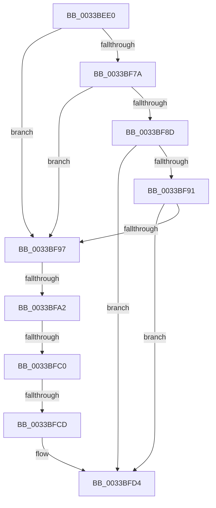

# MiInsertSecondaryListStandbyPage

- RVA: `0x0033BEE0`–`0x0033BFE6` (길이 `262` bytes)
- VA: `0x000000014033BEE0`
- 실행 섹션: `.text`
- PDB 이름 있음: `예`; PDB Function 태그: `아니요`
- unwind 정보 RVA: `0x00076F34`
- 디코드: `64`개 명령, `262/262` bytes 표시
- 미해석 바이트: `0` (있으면 어셈블리에 `.byte`로 보존)

> 이 문서는 커널 이미지의 기계어와 PDB 기호를 분석해 생성했습니다. 4번과 5번은 함수 원형과 자료형을 바이너리 사용 방식에서 추정한 C 해석이며 원본 소스 복구 결과는 아닙니다.

## 1. Dependencies

- 직접 호출 지점: **0**; 고유 호출 대상: **0**
- 직접 호출자로 확인된 함수: **3**
- RIP 상대 이미지 참조: **5**

### Outgoing calls
- 직접 디코드된 call 명령이 없습니다.

### Direct callers
- [sub_002B99FA](../2B/Unknown_function_002B99FA.md) at `0x002B9ACB`
- [MiInsertPageInList](../2B/MiInsertPageInList_function_002BA000.md) at `0x002BA5EF`
- [MiInsertPageInList](../2B/MiInsertPageInList_function_002BA000.md) at `0x002BA7F3`
- [MiSwapNumaStandbyPage](../38/MiSwapNumaStandbyPage_function_00385144.md) at `0x00385356`

### Static image references
- `0x0033BF4B` → RVA `0x00E30088` (`.data`; read)
- `0x0033BF69` → RVA `0x00E2DBC0` (`.data`; read)
- `0x0033BF70` → RVA `0x00E2DBC4` (`.data`; read)
- `0x0033BF81` → RVA `0x00E2DC20` (`.data`; read)
- `0x0033BFCD` → RVA `0x00E2DBC0` (`.data`; write)

## 2. Other-region calls and transfers

- 다른 실행 섹션으로 향하는 call: **0**
- call이 아닌 외부 분기/꼬리 이동: **3**
  - `0x0033BF9C` → [sub_0033C2ED + 0x1](Unknown_function_0033C2ED.md) (`tail-transfer`)
  - `0x0033BFBA` → [sub_0033C41D](Unknown_function_0033C41D.md) (`tail-transfer`)
  - `0x0033BFC7` → [sub_0033C371](Unknown_function_0033C371.md) (`tail-transfer`)

## 3. Assembly (complete function range)

```asm
0033BEE0  48 89 5C 24 18                  mov qword ptr [rsp + 0x18], rbx
0033BEE5  57                              push rdi
0033BEE6  41 54                           push r12
0033BEE8  41 55                           push r13
0033BEEA  41 56                           push r14
0033BEEC  41 57                           push r15
0033BEEE  48 81 EC 20 01 00 00            sub rsp, 0x120
0033BEF5  0F 57 C0                        xorps xmm0, xmm0
0033BEF8  4C 63 E2                        movsxd r12, edx
0033BEFB  0F 57 C9                        xorps xmm1, xmm1
0033BEFE  49 BA 00 00 00 00 00 DE FF FF   movabs r10, 0xffffde0000000000
0033BF08  F3 0F 7F 44 24 40               movdqu xmmword ptr [rsp + 0x40], xmm0
0033BF0E  4D 8B F0                        mov r14, r8
0033BF11  48 8B F9                        mov rdi, rcx
0033BF14  F3 0F 7F 4C 24 50               movdqu xmmword ptr [rsp + 0x50], xmm1
0033BF1A  49 8B C2                        mov rax, r10
0033BF1D  48 8B D9                        mov rbx, rcx
0033BF20  49 BB AB AA AA AA AA AA AA AA   movabs r11, 0xaaaaaaaaaaaaaaab
0033BF2A  48 2B D8                        sub rbx, rax
0033BF2D  48 C1 FB 04                     sar rbx, 4
0033BF31  49 0F AF DB                     imul rbx, r11
0033BF35  4C 8D 0C 5B                     lea r9, [rbx + rbx*2]
0033BF39  49 C1 E1 04                     shl r9, 4
0033BF3D  49 8B C2                        mov rax, r10
0033BF40  4D 8D 3C 01                     lea r15, [r9 + rax]
0033BF44  45 33 ED                        xor r13d, r13d
0033BF47  49 8B 47 28                     mov rax, qword ptr [r15 + 0x28]
0033BF4B  48 8B 0D 36 41 AF 00            mov rcx, qword ptr [rip + 0xaf4136]
0033BF52  48 C1 E8 2B                     shr rax, 0x2b
0033BF56  25 FF 03 00 00                  and eax, 0x3ff
0033BF5B  4C 89 7C 24 38                  mov qword ptr [rsp + 0x38], r15
0033BF60  48 8B 14 C1                     mov rdx, qword ptr [rcx + rax*8]
0033BF64  48 89 54 24 30                  mov qword ptr [rsp + 0x30], rdx
0033BF69  48 63 15 50 1C AF 00            movsxd rdx, dword ptr [rip + 0xaf1c50]
0033BF70  8B 0D 4E 1C AF 00               mov ecx, dword ptr [rip + 0xaf1c4e]
0033BF76  3B D1                           cmp edx, ecx
0033BF78  77 1D                           ja 0x14033bf97
0033BF7A  48 8B C2                        mov rax, rdx
0033BF7D  48 C1 E0 04                     shl rax, 4
0033BF81  48 03 05 98 1C AF 00            add rax, qword ptr [rip + 0xaf1c98]
0033BF88  48 3B 18                        cmp rbx, qword ptr [rax]
0033BF8B  72 0A                           jb 0x14033bf97
0033BF8D  3B D1                           cmp edx, ecx
0033BF8F  74 43                           je 0x14033bfd4
0033BF91  48 3B 58 10                     cmp rbx, qword ptr [rax + 0x10]
0033BF95  72 3D                           jb 0x14033bfd4
0033BF97  41 8B D5                        mov edx, r13d
0033BF9A  3B CA                           cmp ecx, edx
0033BF9C  0F 8C 4C 03 00 00               jl 0x14033c2ee
0033BFA2  44 8D 04 0A                     lea r8d, [rdx + rcx]
0033BFA6  41 D1 F8                        sar r8d, 1
0033BFA9  49 63 C0                        movsxd rax, r8d
0033BFAC  48 C1 E0 04                     shl rax, 4
0033BFB0  48 03 05 69 1C AF 00            add rax, qword ptr [rip + 0xaf1c69]
0033BFB7  48 3B 18                        cmp rbx, qword ptr [rax]
0033BFBA  0F 82 5D 04 00 00               jb 0x14033c41d
0033BFC0  44 3B 05 FD 1B AF 00            cmp r8d, dword ptr [rip + 0xaf1bfd]
0033BFC7  0F 85 A4 03 00 00               jne 0x14033c371
0033BFCD  44 89 05 EC 1B AF 00            mov dword ptr [rip + 0xaf1bec], r8d
0033BFD4  8B 40 08                        mov eax, dword ptr [rax + 8]
0033BFD7  89 44 24 48                     mov dword ptr [rsp + 0x48], eax
0033BFDB  41 8B 47 20                     mov eax, dword ptr [r15 + 0x20]
0033BFDF  41 8B 4F 20                     mov ecx, dword ptr [r15 + 0x20]
0033BFE3  C1 E9 18                        shr ecx, 0x18
```

## 4. C-style interpretation (structured pseudocode)

```c
__int64 __fastcall MiInsertSecondaryListStandbyPage(__int64 a1, int a2, __int64 a3)
{
    __int64 result;
    __int64 v_r13;
    __int64 v_rbx;
    __int64 v_rsp;
    unsigned int v_stack_m100;
    unsigned __int64 v_stack_m108;
    unsigned __int64 v_stack_m110;
    unsigned __int64 v_stack_m118;
    unsigned __int64 v_stack_mF8;
    unsigned __int64 v_stack_p18;

    v_stack_p18 = v_rbx;
    v_rsp = (v_rsp) - (288);
    v_stack_m108 = v_xmm0;
    v_stack_mF8 = v_xmm1;
    v_rbx = (a1) - (v_r10);
    v_rbx = (v_rbx) >> (4);
    v_rbx = (v_rbx) * (v_r11);
    a4 = (v_rbx + v_rbx * 2) << (4);
    v_r13 = 0;
    result = (*(unsigned __int64 *)(a4 + v_r10 * 1 + 40)) >> (43);
    result = (unsigned int)((result) & (0x3FFULL));
    v_stack_m110 = a4 + v_r10 * 1;
    v_stack_m118 = *(unsigned __int64 *)(*(unsigned __int64 *)(v_rip + 11485494) + result * 8);
    if (((unsigned int)((int)(*(unsigned int *)(v_rip + 11476048)))) > ((unsigned int)((unsigned int)(*(unsigned int *)(v_rip + 11476046))))) goto loc_0033BF97;
    result = ((int)(*(unsigned int *)(v_rip + 11476048))) << (4);
    result = (result) + (*(unsigned __int64 *)(v_rip + 11476120));
    if (v_rbx < (*(unsigned __int64 *)(result))) goto loc_0033BF97;
    if (((unsigned int)((int)(*(unsigned int *)(v_rip + 11476048)))) == ((unsigned int)((unsigned int)(*(unsigned int *)(v_rip + 11476046))))) goto loc_0033BFD4;
    if (v_rbx < (*(unsigned __int64 *)(result + 16))) goto loc_0033BFD4;
loc_0033BF97:
    a3 = (unsigned int)((0 + (unsigned int)(*(unsigned int *)(v_rip + 11476046)) * 1) >> (1));
    result = ((int)((unsigned int)(a3))) << (4);
    result = (result) + (*(unsigned __int64 *)(v_rip + 11476073));
    *(unsigned int *)(v_rip + 11475948) = (unsigned int)(a3);
loc_0033BFD4:
    v_stack_m100 = (unsigned int)((unsigned int)(*(unsigned int *)(result + 8)));
    a1 = (unsigned int)(((unsigned int)(*(unsigned int *)(a4 + v_r10 * 1 + 32))) >> (24));
    return (unsigned int)(*(unsigned int *)(a4 + v_r10 * 1 + 32));
}
```

## 5. (Beta) C Style

```c
int64_t MiInsertSecondaryListStandbyPage(int64_t Arg1, int32_t Arg2, int64_t Arg3)
{
    int64_t result;
    int64_t local_r13;
    int64_t local_rbx;
    int64_t local_rsp;
    uint32_t v_stack_m100;
    uint64_t v_stack_m108;
    uint64_t v_stack_m110;
    uint64_t v_stack_m118;
    uint64_t v_stack_mF8;
    uint64_t v_stack_p18;

    v_stack_p18 = local_rbx;
    local_rsp = (local_rsp) - (288);
    v_stack_m108 = v_xmm0;
    v_stack_mF8 = v_xmm1;
    local_rbx = (Arg1) - (local_r10);
    local_rbx = (local_rbx) >> (4);
    local_rbx = (local_rbx) * (local_r11);
    a4 = (local_rbx + local_rbx * 2) << (4);
    local_r13 = 0;
    result = (*(uint64_t *)(a4 + local_r10 * 1 + 0x28)) >> (43);
    result = (uint32_t)((result) & (0x3FFULL));
    v_stack_m110 = a4 + local_r10 * 1;
    v_stack_m118 = *(uint64_t *)(*(uint64_t *)(v_rip + 0xAF4136) + result * 8);
    if (((uint32_t)((int32_t)(*(uint32_t *)(v_rip + 0xAF1C50)))) > ((uint32_t)((uint32_t)(*(uint32_t *)(v_rip + 0xAF1C4E))))) goto loc_0033BF97;
    result = ((int32_t)(*(uint32_t *)(v_rip + 0xAF1C50))) << (4);
    result = (result) + (*(uint64_t *)(v_rip + 0xAF1C98));
    if (local_rbx < (*(uint64_t *)(result))) goto loc_0033BF97;
    if (((uint32_t)((int32_t)(*(uint32_t *)(v_rip + 0xAF1C50)))) == ((uint32_t)((uint32_t)(*(uint32_t *)(v_rip + 0xAF1C4E))))) goto loc_0033BFD4;
    if (local_rbx < (*(uint64_t *)(result + 0x10))) goto loc_0033BFD4;
loc_0033BF97:
    Arg3 = (uint32_t)((0 + (uint32_t)(*(uint32_t *)(v_rip + 0xAF1C4E)) * 1) >> (1));
    result = ((int32_t)((uint32_t)(Arg3))) << (4);
    result = (result) + (*(uint64_t *)(v_rip + 0xAF1C69));
    *(uint32_t *)(v_rip + 0xAF1BEC) = (uint32_t)(Arg3);
loc_0033BFD4:
    v_stack_m100 = (uint32_t)((uint32_t)(*(uint32_t *)(result + 0x8)));
    Arg1 = (uint32_t)(((uint32_t)(*(uint32_t *)(a4 + local_r10 * 1 + 0x20))) >> (24));
    return (uint32_t)(*(uint32_t *)(a4 + local_r10 * 1 + 0x20));
}
```

## 6. Execution-region graph

[열기: 2D/3D 그래프와 함수 탐색 컨트롤 패널](../../../control-panel.html?section=text&rva=0x0033BEE0&view=graph)

- 2D 그래프는 위에서 아래로 흐르고, 3D 그래프는 빈 공간을 드래그해 회전합니다. Shift+드래그는 이동, 휠은 확대·축소, 함수 노드 선택은 대상 보고서 이동입니다.

### Static fallback


