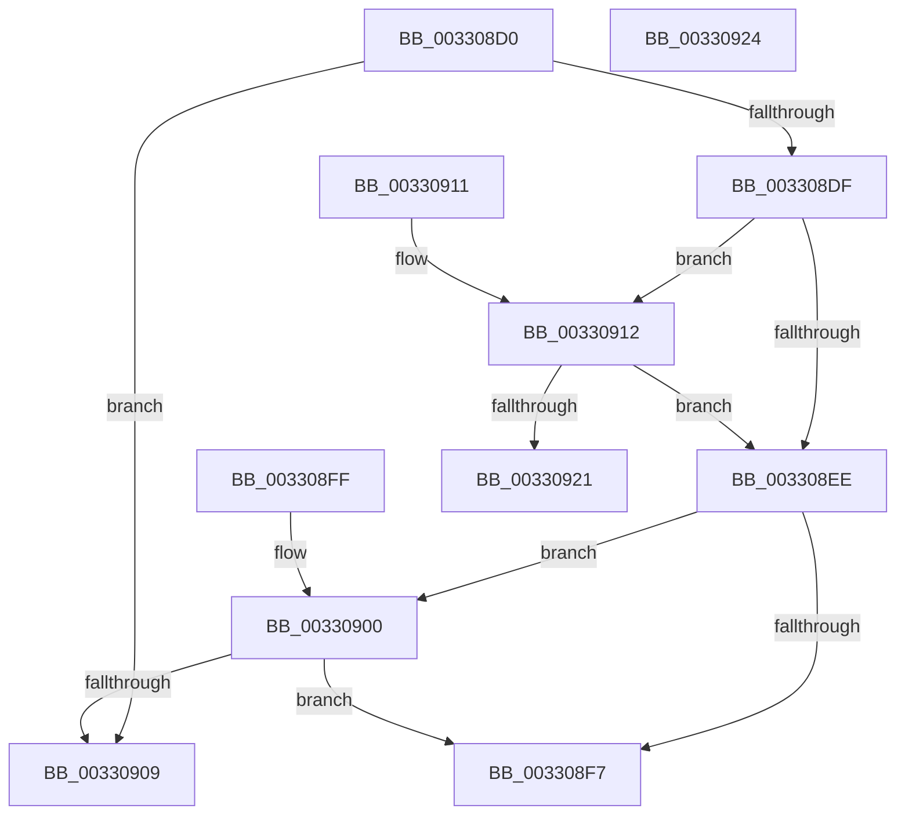

# MiIsAddressGlobal

- RVA: `0x003308D0`–`0x00330925` (길이 `85` bytes)
- VA: `0x00000001403308D0`
- 실행 섹션: `.text`
- PDB 이름 있음: `예`; PDB Function 태그: `아니요`
- unwind 정보 RVA: `0x000DB714`
- 디코드: `22`개 명령, `85/85` bytes 표시
- 미해석 바이트: `0` (있으면 어셈블리에 `.byte`로 보존)

> 이 문서는 커널 이미지의 기계어와 PDB 기호를 분석해 생성했습니다. 4번과 5번은 함수 원형과 자료형을 바이너리 사용 방식에서 추정한 C 해석이며 원본 소스 복구 결과는 아닙니다.

## 1. Dependencies

- 직접 호출 지점: **0**; 고유 호출 대상: **0**
- 직접 호출자로 확인된 함수: **4**
- RIP 상대 이미지 참조: **4**

### Outgoing calls
- 직접 디코드된 call 명령이 없습니다.

### Direct callers
- [MiCompletePrivateZeroFault](MiCompletePrivateZeroFault_function_00330CC0.md) at `0x00330EB2`
- [MiMapPageInHyperSpaceWorker](MiMapPageInHyperSpaceWorker_function_00332B10.md) at `0x00332C11`
- [sub_003451F8](../34/Unknown_function_003451F8.md) at `0x003452FB`
- [MiCompleteProtoPteFault](../34/MiCompleteProtoPteFault_function_00345710.md) at `0x003459B6`

### Static image references
- `0x003308EE` → RVA `0x00E2F380` (`.data`; read)
- `0x003308F7` → RVA `0x00E2EE84` (`.data`; read)
- `0x00330900` → RVA `0x00E2F390` (`.data`; read)
- `0x00330909` → RVA `0x00E2EE85` (`.data`; read)

## 2. Other-region calls and transfers

- 다른 실행 섹션으로 향하는 call: **0**
- 별도 외부 분기/꼬리 이동을 확인하지 못했습니다.

## 3. Assembly (complete function range)

```asm
003308D0  48 B8 00 00 00 00 00 80 FF FF   movabs rax, 0xffff800000000000
003308DA  48 3B C8                        cmp rcx, rax
003308DD  72 2A                           jb 0x140330909
003308DF  48 B8 00 00 00 00 80 F6 FF FF   movabs rax, 0xfffff68000000000
003308E9  48 3B C8                        cmp rcx, rax
003308EC  73 24                           jae 0x140330912
003308EE  48 3B 0D 8B EA AF 00            cmp rcx, qword ptr [rip + 0xafea8b]
003308F5  73 09                           jae 0x140330900
003308F7  0F B6 05 86 E5 AF 00            movzx eax, byte ptr [rip + 0xafe586]
003308FE  C3                              ret
003308FF  CC                              int3
00330900  48 3B 0D 89 EA AF 00            cmp rcx, qword ptr [rip + 0xafea89]
00330907  77 EE                           ja 0x1403308f7
00330909  0F B6 05 75 E5 AF 00            movzx eax, byte ptr [rip + 0xafe575]
00330910  C3                              ret
00330911  CC                              int3
00330912  48 B8 FF FF FF FF FF F6 FF FF   movabs rax, 0xfffff6ffffffffff
0033091C  48 3B C8                        cmp rcx, rax
0033091F  77 CD                           ja 0x1403308ee
00330921  33 C0                           xor eax, eax
00330923  C3                              ret
00330924  CC                              int3
```

## 4. C-style interpretation (structured pseudocode)

```c
__int64 __fastcall MiIsAddressGlobal(__int64 a1)
{
    __int64 result;

    if (a1 < result) goto loc_00330909;
    if (a1 >= result) goto loc_00330912;
loc_003308EE:
    if (a1 >= (*(unsigned __int64 *)(v_rip + 11528843))) goto loc_00330900;
loc_003308F7:
    return *(unsigned __int8 *)(v_rip + 11527558);
loc_00330900:
    if (a1 > (*(unsigned __int64 *)(v_rip + 11528841))) goto loc_003308F7;
loc_00330909:
    return *(unsigned __int8 *)(v_rip + 11527541);
loc_00330912:
    if (a1 > (*(unsigned __int8 *)(v_rip + 11527541))) goto loc_003308EE;
    result = 0;
    return result;
}
```

## 5. (Beta) C Style

```c
int64_t MiIsAddressGlobal(int64_t Arg1)
{
    int64_t result;

    if (Arg1 < result) goto loc_00330909;
    if (Arg1 >= result) goto loc_00330912;
loc_003308EE:
    if (Arg1 >= (*(uint64_t *)(v_rip + 0xAFEA8B))) goto loc_00330900;
loc_003308F7:
    return *(uint8_t *)(v_rip + 0xAFE586);
loc_00330900:
    if (Arg1 > (*(uint64_t *)(v_rip + 0xAFEA89))) goto loc_003308F7;
loc_00330909:
    return *(uint8_t *)(v_rip + 0xAFE575);
loc_00330912:
    if (Arg1 > (*(uint8_t *)(v_rip + 0xAFE575))) goto loc_003308EE;
    result = 0;
    return result;
}
```

## 6. Execution-region graph

[열기: 2D/3D 그래프와 함수 탐색 컨트롤 패널](../../../control-panel.html?section=text&rva=0x003308D0&view=graph)

- 2D 그래프는 위에서 아래로 흐르고, 3D 그래프는 빈 공간을 드래그해 회전합니다. Shift+드래그는 이동, 휠은 확대·축소, 함수 노드 선택은 대상 보고서 이동입니다.

### Static fallback


