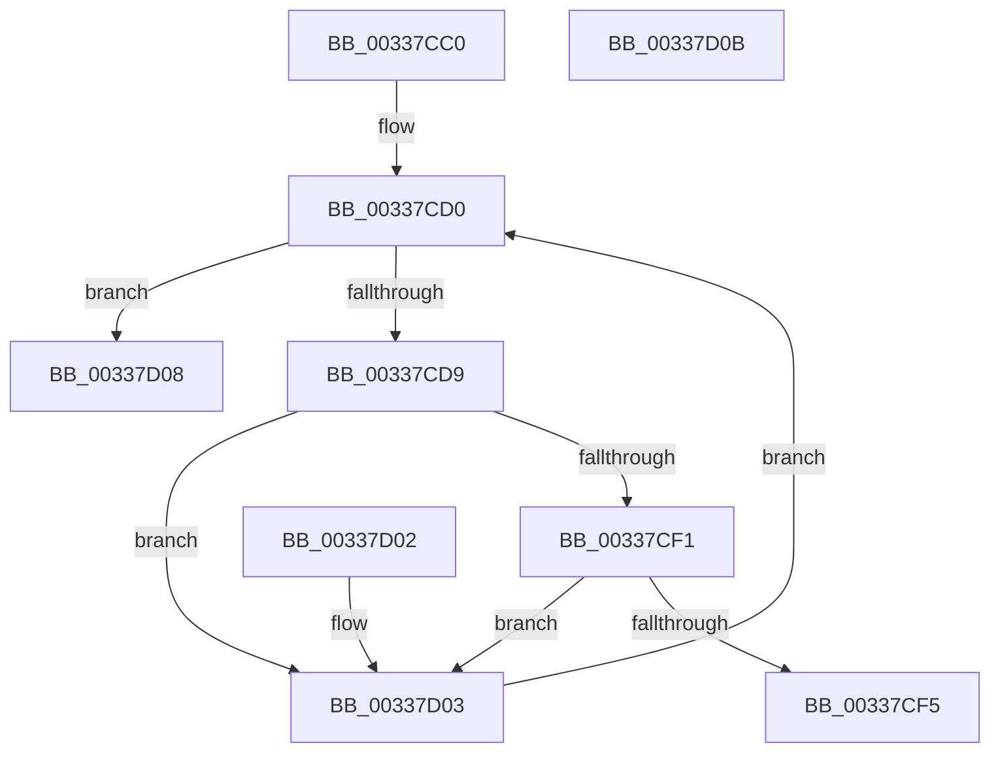

# MiLocatePageCollisionByPfn

- RVA: `0x00337CC0`–`0x00337D0C` (길이 `76` bytes)
- VA: `0x0000000140337CC0`
- 실행 섹션: `.text`
- PDB 이름 있음: `예`; PDB Function 태그: `아니요`
- unwind 정보 RVA: `0x000DB714`
- 디코드: `24`개 명령, `76/76` bytes 표시
- 미해석 바이트: `0` (있으면 어셈블리에 `.byte`로 보존)

> 이 문서는 커널 이미지의 기계어와 PDB 기호를 분석해 생성했습니다. 4번과 5번은 함수 원형과 자료형을 바이너리 사용 방식에서 추정한 C 해석이며 원본 소스 복구 결과는 아닙니다.

## 1. Dependencies

- 직접 호출 지점: **0**; 고유 호출 대상: **0**
- 직접 호출자로 확인된 함수: **3**
- RIP 상대 이미지 참조: **0**

### Outgoing calls
- 직접 디코드된 call 명령이 없습니다.

### Direct callers
- [MiPageFreeToZero](MiPageFreeToZero_function_00337A30.md) at `0x00337B11`
- [MiStopPageAccessor](../43/MiStopPageAccessor_function_00436BB8.md) at `0x00436C52`
- [MiStopHugePageAccessor](../4F/MiStopHugePageAccessor_function_004F6A68.md) at `0x004F6AE6`

### Static image references
- 디코드된 RIP-relative 메모리 참조가 없습니다.

## 2. Other-region calls and transfers

- 다른 실행 섹션으로 향하는 call: **0**
- 별도 외부 분기/꼬리 이동을 확인하지 못했습니다.

## 3. Assembly (complete function range)

```asm
00337CC0  4C 8B D2                        mov r10, rdx
00337CC3  45 33 C0                        xor r8d, r8d
00337CC6  49 BB FF FF FF FF 3F 00 00 00   movabs r11, 0x3fffffffff
00337CD0  44 3B 81 18 01 00 00            cmp r8d, dword ptr [rcx + 0x118]
00337CD7  73 2F                           jae 0x140337d08
00337CD9  4A 8B 44 C1 18                  mov rax, qword ptr [rcx + r8*8 + 0x18]
00337CDE  4E 8D 0C C1                     lea r9, [rcx + r8*8]
00337CE2  48 8B D0                        mov rdx, rax
00337CE5  48 C1 EA 0C                     shr rdx, 0xc
00337CE9  49 23 D3                        and rdx, r11
00337CEC  49 3B D2                        cmp rdx, r10
00337CEF  75 12                           jne 0x140337d03
00337CF1  A8 10                           test al, 0x10
00337CF3  74 0E                           je 0x140337d03
00337CF5  48 83 E0 EF                     and rax, 0xffffffffffffffef
00337CF9  49 89 41 18                     mov qword ptr [r9 + 0x18], rax
00337CFD  49 8D 41 18                     lea rax, [r9 + 0x18]
00337D01  C3                              ret
00337D02  CC                              int3
00337D03  41 FF C0                        inc r8d
00337D06  EB C8                           jmp 0x140337cd0
00337D08  33 C0                           xor eax, eax
00337D0A  C3                              ret
00337D0B  CC                              int3
```

## 4. C-style interpretation (structured pseudocode)

```c
__int64 __fastcall MiLocatePageCollisionByPfn(__int64 a1, __int64 a2, int a3)
{
    __int64 result;

    a3 = 0;
loc_00337CD0:
    if (0 >= (*(unsigned int *)(a1 + 280))) goto loc_00337D08;
    a2 = (*(unsigned __int64 *)(a1 + a3 * 8 + 24)) >> (12);
    a2 = (a2) & (v_r11);
    if (a2 != a2) goto loc_00337D03;
    if ((((unsigned __int8)(*(unsigned __int64 *)(a1 + a3 * 8 + 24))) & (16)) == 0) goto loc_00337D03;
    result = (*(unsigned __int64 *)(a1 + a3 * 8 + 24)) & (-17);
    *(unsigned __int64 *)(a1 + a3 * 8 + 24) = result;
    return a1 + a3 * 8 + 24;
loc_00337D03:
    a3 = (unsigned int)((a3) + 1);
    goto loc_00337CD0;
loc_00337D08:
    result = 0;
    return result;
}
```

## 5. (Beta) C Style

```c
int64_t MiLocatePageCollisionByPfn(void *Arg1, int64_t Arg2, int32_t Arg3)
{
    uint8_t *arg1 = (uint8_t *)Arg1;

    int64_t result;

    Arg3 = 0;
loc_00337CD0:
    if (0 >= (*(uint32_t *)(arg1 + 0x118))) goto loc_00337D08;
    Arg2 = (*(uint64_t *)(arg1 + Arg3 * 8 + 0x18)) >> (12);
    Arg2 = (Arg2) & (local_r11);
    if (Arg2 != Arg2) goto loc_00337D03;
    if ((((uint8_t)(*(uint64_t *)(arg1 + Arg3 * 8 + 0x18))) & (16)) == 0) goto loc_00337D03;
    result = (*(uint64_t *)(arg1 + Arg3 * 8 + 0x18)) & (-17);
    *(uint64_t *)(arg1 + Arg3 * 8 + 0x18) = result;
    return Arg1 + Arg3 * 8 + 24;
loc_00337D03:
    Arg3 = (uint32_t)((Arg3) + 1);
    goto loc_00337CD0;
loc_00337D08:
    result = 0;
    return result;
}
```

### 관측된 메모리 오프셋

구조체 형식이 확인되지 않은 접근은 인자 기준의 오프셋으로만 기록했습니다.

| 기준 인자 | 오프셋 표현 | 폭 (bit) | 접근 |
|---|---:|---:|---|
| `Arg1` | `+ 0x0 + r8*8` | `64` | `R` |
| `Arg1` | `+ 0x18` | `64` | `R` |
| `Arg1` | `+ 0x18` | `64` | `W` |
| `Arg1` | `+ 0x18 + r8*8` | `64` | `R` |
| `Arg1` | `+ 0x118` | `32` | `R` |

## 6. Execution-region graph

[열기: 2D/3D 그래프와 함수 탐색 컨트롤 패널](../../../control-panel.html?section=text&rva=0x00337CC0&view=graph)

- 2D 그래프는 위에서 아래로 흐르고, 3D 그래프는 빈 공간을 드래그해 회전합니다. Shift+드래그는 이동, 휠은 확대·축소, 함수 노드 선택은 대상 보고서 이동입니다.

### Static fallback


