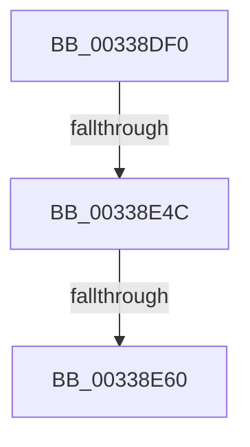

# MiLockStandbyLookasidePage

- RVA: `0x00338DF0`–`0x00338E63` (길이 `115` bytes)
- VA: `0x0000000140338DF0`
- 실행 섹션: `.text`
- PDB 이름 있음: `예`; PDB Function 태그: `아니요`
- unwind 정보 RVA: `0x00076B00`
- 디코드: `28`개 명령, `115/115` bytes 표시
- 미해석 바이트: `0` (있으면 어셈블리에 `.byte`로 보존)

> 이 문서는 커널 이미지의 기계어와 PDB 기호를 분석해 생성했습니다. 4번과 5번은 함수 원형과 자료형을 바이너리 사용 방식에서 추정한 C 해석이며 원본 소스 복구 결과는 아닙니다.

## 1. Dependencies

- 직접 호출 지점: **0**; 고유 호출 대상: **0**
- 직접 호출자로 확인된 함수: **1**
- RIP 상대 이미지 참조: **1**

### Outgoing calls
- 직접 디코드된 call 명령이 없습니다.

### Direct callers
- [MiRemoveLowestPriorityStandbyPage](MiRemoveLowestPriorityStandbyPage_function_00334600.md) at `0x003347CC`

### Static image references
- `0x00338E0F` → RVA `0x00FC6A80` (`ALMOSTRO`; read)

## 2. Other-region calls and transfers

- 다른 실행 섹션으로 향하는 call: **0**
- call이 아닌 외부 분기/꼬리 이동: **2**
  - `0x00338E46` → [sub_00339712](Unknown_function_00339712.md) (`tail-transfer`)
  - `0x00338E5E` → [sub_00338E63](Unknown_function_00338E63.md) (`tail-transfer`)

## 3. Assembly (complete function range)

```asm
00338DF0  48 89 54 24 10                  mov qword ptr [rsp + 0x10], rdx
00338DF5  53                              push rbx
00338DF6  57                              push rdi
00338DF7  41 54                           push r12
00338DF9  41 55                           push r13
00338DFB  41 57                           push r15
00338DFD  48 81 EC D0 00 00 00            sub rsp, 0xd0
00338E04  65 8B 1C 25 A4 01 00 00         mov ebx, dword ptr gs:[0x1a4]
00338E0C  45 33 C9                        xor r9d, r9d
00338E0F  8B 05 6B DC C8 00               mov eax, dword ptr [rip + 0xc8dc6b]
00338E15  45 8B C0                        mov r8d, r8d
00338E18  4D 6B D0 58                     imul r10, r8, 0x58
00338E1C  49 C1 E0 09                     shl r8, 9
00338E20  49 81 C2 C0 0C 00 00            add r10, 0xcc0
00338E27  44 89 8C 24 10 01 00 00         mov dword ptr [rsp + 0x110], r9d
00338E2F  4C 03 D1                        add r10, rcx
00338E32  44 89 8C 24 18 01 00 00         mov dword ptr [rsp + 0x118], r9d
00338E3A  4C 89 54 24 40                  mov qword ptr [rsp + 0x40], r10
00338E3F  4D 8D 3C 08                     lea r15, [r8 + rcx]
00338E43  83 F8 40                        cmp eax, 0x40
00338E46  0F 83 C6 08 00 00               jae 0x140339712
00338E4C  8B 0D 2E DC C8 00               mov ecx, dword ptr [rip + 0xc8dc2e]
00338E52  33 D2                           xor edx, edx
00338E54  B8 40 00 00 00                  mov eax, 0x40
00338E59  F7 F1                           div ecx
00338E5B  83 F8 01                        cmp eax, 1
00338E5E  76 03                           jbe 0x140338e63
00338E60  0F AF D8                        imul ebx, eax
```

## 4. C-style interpretation (structured pseudocode)

```c
__int64 __fastcall MiLockStandbyLookasidePage(__int64 a1, __int64 a2, int a3, int a4)
{
    __int64 v_r10;
    __int64 v_rbx;
    __int64 v_rsp;
    unsigned __int64 v_stack_mB8;
    unsigned __int64 v_stack_p10;
    unsigned int v_stack_p18;
    unsigned int v_stack_p20;

    v_stack_p10 = a2;
    v_rsp = (v_rsp) - (208);
    a4 = 0;
    v_r10 = (v_r10) * ((unsigned int)(a3));
    a3 = ((unsigned int)(a3)) << (9);
    v_r10 = (v_r10) + (0xCC0ULL);
    v_stack_p18 = 0;
    v_r10 = (v_r10) + (a1);
    v_stack_p20 = 0;
    v_stack_mB8 = v_r10;
    a2 = 0;
    v_rbx = (unsigned int)(((unsigned int)(*(unsigned int *)(gs_base + (0 + 420)))) * (64));
    return 64;
}
```

## 5. (Beta) C Style

```c
int64_t MiLockStandbyLookasidePage(int64_t Arg1, int64_t Arg2, int32_t Arg3, int32_t Arg4)
{
    int64_t local_r10;
    int64_t local_rbx;
    int64_t local_rsp;
    uint64_t v_stack_mB8;
    uint64_t v_stack_p10;
    uint32_t v_stack_p18;
    uint32_t v_stack_p20;

    v_stack_p10 = Arg2;
    local_rsp = (local_rsp) - (208);
    Arg4 = 0;
    local_r10 = (local_r10) * ((uint32_t)(Arg3));
    Arg3 = ((uint32_t)(Arg3)) << (9);
    local_r10 = (local_r10) + (0xCC0ULL);
    v_stack_p18 = 0;
    local_r10 = (local_r10) + (Arg1);
    v_stack_p20 = 0;
    v_stack_mB8 = local_r10;
    Arg2 = 0;
    local_rbx = (uint32_t)(((uint32_t)(*(uint32_t *)(gs_base + (0 + 0x1A4)))) * (64));
    return 64;
}
```

## 6. Execution-region graph

[열기: 2D/3D 그래프와 함수 탐색 컨트롤 패널](../../../control-panel.html?section=text&rva=0x00338DF0&view=graph)

- 2D 그래프는 위에서 아래로 흐르고, 3D 그래프는 빈 공간을 드래그해 회전합니다. Shift+드래그는 이동, 휠은 확대·축소, 함수 노드 선택은 대상 보고서 이동입니다.

### Static fallback


