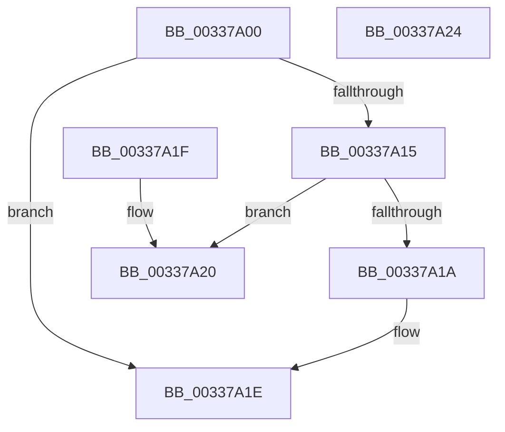

# MiMakeDemandZeroPte

- RVA: `0x00337A00`–`0x00337A25` (길이 `37` bytes)
- VA: `0x0000000140337A00`
- 실행 섹션: `.text`
- PDB 이름 있음: `예`; PDB Function 태그: `아니요`
- unwind 정보 RVA: `0x000DB714`
- 디코드: `14`개 명령, `37/37` bytes 표시
- 미해석 바이트: `0` (있으면 어셈블리에 `.byte`로 보존)

> 이 문서는 커널 이미지의 기계어와 PDB 기호를 분석해 생성했습니다. 4번과 5번은 함수 원형과 자료형을 바이너리 사용 방식에서 추정한 C 해석이며 원본 소스 복구 결과는 아닙니다.

## 1. Dependencies

- 직접 호출 지점: **0**; 고유 호출 대상: **0**
- 직접 호출자로 확인된 함수: **71**
- RIP 상대 이미지 참조: **1**

### Outgoing calls
- 직접 디코드된 call 명령이 없습니다.

### Direct callers
- [MiIsPdeOrAboveAccessible](../22/MiIsPdeOrAboveAccessible_function_00227A10.md) at `0x00227AF7`
- [MiDecommitInitializePacket](../24/MiDecommitInitializePacket_function_00242F30.md) at `0x00243179`
- [MiDecommitInitializePacket](../24/MiDecommitInitializePacket_function_00242F30.md) at `0x002431F0`
- [MiDecommitInitializePacket](../24/MiDecommitInitializePacket_function_00242F30.md) at `0x00243222`
- [sub_00247BC3](../24/Unknown_function_00247BC3.md) at `0x00247C1B`
- [MiClearMappingAndDereferenceIoSpace](../24/MiClearMappingAndDereferenceIoSpace_function_00247DF0.md) at `0x00247E92`
- [sub_002760C1](../27/Unknown_function_002760C1.md) at `0x002761EB`
- [MiMakeHyperRangeAccessible](../27/MiMakeHyperRangeAccessible_function_0027CE10.md) at `0x0027D1D7`
- [MiRevertPfnActivePageTable](../29/MiRevertPfnActivePageTable_function_002938F4.md) at `0x0029392E`
- [MiConvertContiguousPages](../29/MiConvertContiguousPages_function_0029F894.md) at `0x0029F8CB`
- [MiOutPageSingleKernelStack](../2A/MiOutPageSingleKernelStack_function_002A1790.md) at `0x002A1846`
- [MiAllocateKernelStackPages](../2A/MiAllocateKernelStackPages_function_002A1BEC.md) at `0x002A1DCA`
- [MiSplitPrivatePage](../2A/MiSplitPrivatePage_function_002A6210.md) at `0x002A64BB`
- [MiFreeLargePages](../2A/MiFreeLargePages_function_002A99D0.md) at `0x002A9A37`
- [MiUnmapFrameBuffer](../2A/MiUnmapFrameBuffer_function_002AAF14.md) at `0x002AAF9B`
- [MiInitializeReadInProgressPfn](../2B/MiInitializeReadInProgressPfn_function_002B6990.md) at `0x002B6E05`
- [MiProtectPrivateMemory](../2C/MiProtectPrivateMemory_function_002C45B0.md) at `0x002C4E66`
- [MiProtectPrivateMemory](../2C/MiProtectPrivateMemory_function_002C45B0.md) at `0x002C5001`
- [MiUpdatePfnProtection](../2C/MiUpdatePfnProtection_function_002C5AD0.md) at `0x002C5C0E`
- [MiInitializeLargeMdlLeafPfns](../2C/MiInitializeLargeMdlLeafPfns_function_002C8EA4.md) at `0x002C8FB2`
- [MiInitializeMdlBatchPages](../2C/MiInitializeMdlBatchPages_function_002C90E4.md) at `0x002C91A8`
- [MiLinkPoolCommitChain](../31/MiLinkPoolCommitChain_function_00313D20.md) at `0x00313F84`
- [MiLinkPoolCommitChain](../31/MiLinkPoolCommitChain_function_00313D20.md) at `0x00314037`
- [MiResolveProtoPteFault](../32/MiResolveProtoPteFault_function_00321750.md) at `0x00321EC2`
- [MiReturnPhysicalPoolPages](../32/MiReturnPhysicalPoolPages_function_00328568.md) at `0x003285C0`
- [sub_0032DE99](../32/Unknown_function_0032DE99.md) at `0x0032DF4D`
- [MiInitializePfn](MiInitializePfn_function_00331E60.md) at `0x0033251D`
- [MiCoalesceFreeSmallPages](MiCoalesceFreeSmallPages_function_00336340.md) at `0x00336824`
- [MiPageFreeToZero](MiPageFreeToZero_function_00337A30.md) at `0x00337B24`
- [sub_003490AD](../34/Unknown_function_003490AD.md) at `0x003492E2`
- [MiCopyOnWrite](../36/MiCopyOnWrite_function_00362A0C.md) at `0x00362D4D`
- [MiInitializeEnclavePfn](../36/MiInitializeEnclavePfn_function_003682A8.md) at `0x003683BF`
- [MiInPageSingleKernelStack](../36/MiInPageSingleKernelStack_function_0036A3E8.md) at `0x0036A4F2`
- [MiInPageSingleKernelStack](../36/MiInPageSingleKernelStack_function_0036A3E8.md) at `0x0036A50D`
- [MiInPageSingleKernelStack](../36/MiInPageSingleKernelStack_function_0036A3E8.md) at `0x0036A51A`
- [MiPurgeSubsection](../37/MiPurgeSubsection_function_003712F0.md) at `0x00371ABD`
- [MiInitializePfnForOtherProcess](../38/MiInitializePfnForOtherProcess_function_00382A20.md) at `0x00382AB1`
- [MiWriteUselessChildPte](../38/MiWriteUselessChildPte_function_00382CFC.md) at `0x00382D21`
- [MiReservePageFileSpaceForPage](../38/MiReservePageFileSpaceForPage_function_0038377C.md) at `0x00383D4C`
- [MiUnmapMdlCommon](../3E/MiUnmapMdlCommon_function_003E7DF0.md) at `0x003E7EBB`
- [MiInPagePageTable](../3E/MiInPagePageTable_function_003EF8DC.md) at `0x003EFA5B`
- [MiInPagePageTable](../3E/MiInPagePageTable_function_003EF8DC.md) at `0x003EFE83`
- [MiMakeOutswappedPageResident](../43/MiMakeOutswappedPageResident_function_00431AD0.md) at `0x00431E2C`
- [MiStopPageAccessor](../43/MiStopPageAccessor_function_00436BB8.md) at `0x00436C64`
- [MiMakeHyperPteDemandZero](../46/MiMakeHyperPteDemandZero_function_00464624.md) at `0x00464644`
- [MiSetPfnOwnedAndActive](../46/MiSetPfnOwnedAndActive_function_004652AC.md) at `0x00465407`
- [MiDeleteSystemPageTable](../49/MiDeleteSystemPageTable_function_004916B0.md) at `0x0049180E`
- [MiReleaseLargePdeMappings](../49/MiReleaseLargePdeMappings_function_0049D0B0.md) at `0x0049D16F`
- [MiDeletePerSessionProtos](../4A/MiDeletePerSessionProtos_function_004A0840.md) at `0x004A0987`
- [MiBuildForkPageTable](../4A/MiBuildForkPageTable_function_004ACF5C.md) at `0x004ACFCE`
- [MiSwitchToTransition](../4C/MiSwitchToTransition_function_004C0F5C.md) at `0x004C13F8`
- [MiUpdatePrivateDemandZeroView](../4C/MiUpdatePrivateDemandZeroView_function_004CCC2C.md) at `0x004CCE05`
- [MiSplitDirectMapPage](../4D/MiSplitDirectMapPage_function_004DAAA0.md) at `0x004DABF9`
- [MiMakeGlobalSubsectionPte](../4D/MiMakeGlobalSubsectionPte_function_004DFEA8.md) at `0x004DFEBA`
- [MiMakeSystemLeavesNonZero](../4E/MiMakeSystemLeavesNonZero_function_004E26C0.md) at `0x004E271B`
- [MiMakeLargePageTable](../4F/MiMakeLargePageTable_function_004F9198.md) at `0x004F92F8`
- [MiLockDriverPageRange](../67/MiLockDriverPageRange_function_00670160.md) at `0x00670567`
- [MiCreatePfnTemplate](../67/MiCreatePfnTemplate_function_00671824.md) at `0x00671977`
- [MiUpdateLargePageSectionPfns](../67/MiUpdateLargePageSectionPfns_function_00678F8C.md) at `0x00678FE4`
- [MiAddExpansionNonPagedPool](../68/MiAddExpansionNonPagedPool_function_00682B4C.md) at `0x00682B7A`
- [MiClearDriverTablePtes](../68/MiClearDriverTablePtes_function_00683024.md) at `0x0068313B`
- [MiCommitHotPatchTable](../68/MiCommitHotPatchTable_function_00683420.md) at `0x0068349D`
- [MiCommitHotPatchTable](../68/MiCommitHotPatchTable_function_00683420.md) at `0x006834A8`
- [MmMapDriverTablePage](../68/MmMapDriverTablePage_function_00683EAC.md) at `0x0068405A`
- [MiStoreDiscardPoisonedPage](../69/MiStoreDiscardPoisonedPage_function_00692858.md) at `0x006929BB`
- [sub_006EC390](../6E/Unknown_function_006EC390.md) at `0x006EC3FC`
- [sub_006F9FE6](../6F/Unknown_function_006F9FE6.md) at `0x006F9FEC`
- [MiChargeSegmentCommit](../../page/8C/MiChargeSegmentCommit_function_008CEDE4.md) at `0x008CEF29`
- [MiInitializePrototypePtes](../../page/98/MiInitializePrototypePtes_function_009829AC.md) at `0x00982A16`
- [MiInitializePrototypePtes](../../page/98/MiInitializePrototypePtes_function_009829AC.md) at `0x00982A7C`
- [MiBuildImageControlArea](../../page/98/MiBuildImageControlArea_function_009878A4.md) at `0x00987CB4`
- [MiParseImageSectionHeaders](../../page/98/MiParseImageSectionHeaders_function_00987F70.md) at `0x00988150`
- [MiPrefetchDriverPages](../../page/9F/MiPrefetchDriverPages_function_009F6A50.md) at `0x009F6A5F`
- [MmFreeNonCachedMemory](../../page/AB/MmFreeNonCachedMemory_function_00AB4640.md) at `0x00AB4683`
- [MiInitializeSharedUserData](../../init/C5/MiInitializeSharedUserData_function_00C5F098.md) at `0x00C5F21C`
- [MiAllocateDummyPage](../../init/C5/MiAllocateDummyPage_function_00C5F6E8.md) at `0x00C5F7BD`
- [MiInitializeDummyPages](../../init/C6/MiInitializeDummyPages_function_00C605CC.md) at `0x00C605E5`
- [MxCreatePfn](../../init/C6/MxCreatePfn_function_00C63464.md) at `0x00C634B3`
- [MxInsertEnclaveBootPages](../../init/C6/MxInsertEnclaveBootPages_function_00C68CB0.md) at `0x00C68D5B`
- [MiInsertRegistryPageInModifiedList](../../init/C7/MiInsertRegistryPageInModifiedList_function_00C76010.md) at `0x00C7602F`

### Static image references
- `0x00337A02` → RVA `0x00E2DC80` (`.data`; read)

## 2. Other-region calls and transfers

- 다른 실행 섹션으로 향하는 call: **0**
- 별도 외부 분기/꼬리 이동을 확인하지 못했습니다.

## 3. Assembly (complete function range)

```asm
00337A00  8B C1                           mov eax, ecx
00337A02  48 8B 0D 77 62 AF 00            mov rcx, qword ptr [rip + 0xaf6277]
00337A09  83 E0 1F                        and eax, 0x1f
00337A0C  48 C1 E0 05                     shl rax, 5
00337A10  48 85 C9                        test rcx, rcx
00337A13  74 09                           je 0x140337a1e
00337A15  48 85 C8                        test rax, rcx
00337A18  74 06                           je 0x140337a20
00337A1A  48 83 C8 10                     or rax, 0x10
00337A1E  C3                              ret
00337A1F  CC                              int3
00337A20  48 0B C1                        or rax, rcx
00337A23  C3                              ret
00337A24  CC                              int3
```

## 4. C-style interpretation (structured pseudocode)

```c
__int64 __fastcall MiMakeDemandZeroPte(int a1)
{
    __int64 result;

    result = (unsigned int)(((unsigned int)(a1)) & (31));
    result = (result) << (5);
    if (*(unsigned __int64 *)(v_rip + 11494007) == 0) goto loc_00337A1E;
    if (((result) & (*(unsigned __int64 *)(v_rip + 11494007))) == 0) goto loc_00337A20;
    result = (result) | (16);
loc_00337A1E:
    return result;
loc_00337A20:
    result = (result) | (*(unsigned __int64 *)(v_rip + 11494007));
    return result;
}
```

## 5. (Beta) C Style

```c
int64_t MiMakeDemandZeroPte(int32_t Arg1)
{
    int64_t result;

    result = (uint32_t)(((uint32_t)(Arg1)) & (31));
    result = (result) << (5);
    if (*(uint64_t *)(v_rip + 0xAF6277) == 0) goto loc_00337A1E;
    if (((result) & (*(uint64_t *)(v_rip + 0xAF6277))) == 0) goto loc_00337A20;
    result = (result) | (16);
loc_00337A1E:
    return result;
loc_00337A20:
    result = (result) | (*(uint64_t *)(v_rip + 0xAF6277));
    return result;
}
```

## 6. Execution-region graph

[열기: 2D/3D 그래프와 함수 탐색 컨트롤 패널](../../../control-panel.html?section=text&rva=0x00337A00&view=graph)

- 2D 그래프는 위에서 아래로 흐르고, 3D 그래프는 빈 공간을 드래그해 회전합니다. Shift+드래그는 이동, 휠은 확대·축소, 함수 노드 선택은 대상 보고서 이동입니다.

### Static fallback


