# MiMapPageInHyperSpaceWorker

- RVA: `0x00332B10`–`0x00332E20` (길이 `784` bytes)
- VA: `0x0000000140332B10`
- 실행 섹션: `.text`
- PDB 이름 있음: `예`; PDB Function 태그: `아니요`
- unwind 정보 RVA: `0x000766D0`
- 디코드: `182`개 명령, `784/784` bytes 표시
- 미해석 바이트: `0` (있으면 어셈블리에 `.byte`로 보존)

> 이 문서는 커널 이미지의 기계어와 PDB 기호를 분석해 생성했습니다. 4번과 5번은 함수 원형과 자료형을 바이너리 사용 방식에서 추정한 C 해석이며 원본 소스 복구 결과는 아닙니다.

## 1. Dependencies

- 직접 호출 지점: **5**; 고유 호출 대상: **5**
- 직접 호출자로 확인된 함수: **51**
- RIP 상대 이미지 참조: **4**

### Outgoing calls
- `0x00332C11` → [MiIsAddressGlobal](MiIsAddressGlobal_function_003308D0.md) (function, `0x003308D0`)
- `0x00332CA1` → [MiGetUltraMapping](../32/MiGetUltraMapping_function_00323270.md) (function, `0x00323270`)
- `0x00332D5E` → [MiUserPdeOrAbove](../2C/MiUserPdeOrAbove_function_002C57F0.md) (function, `0x002C57F0`)
- `0x00332DD9` → [MiCheckLinearProtectedPteAccessedBit](../29/MiCheckLinearProtectedPteAccessedBit_function_00292D80.md) (function, `0x00292D80`)
- `0x00332DFE` → [KiRaiseIrqlProcessIrqlFlags](../4F/KiRaiseIrqlProcessIrqlFlags_function_004F56FC.md) (function, `0x004F56FC`)

### Direct callers
- [MmStealTopLevelPage](../22/MmStealTopLevelPage_function_002281E0.md) at `0x00228261`
- [MiCopySinglePage](../22/MiCopySinglePage_function_00228FA4.md) at `0x0022904E`
- [MiWsleFree](../28/MiWsleFree_function_00284600.md) at `0x00284876`
- [MiWsleFree](../28/MiWsleFree_function_00284600.md) at `0x00284AE4`
- [MiChangePageAttributeBatch](../2A/MiChangePageAttributeBatch_function_002A06E0.md) at `0x002A0905`
- [MiInitializeImageProtos](../2A/MiInitializeImageProtos_function_002ABDAC.md) at `0x002ABF26`
- [MiReplaceTransitionPage](../2B/MiReplaceTransitionPage_function_002B1120.md) at `0x002B1622`
- [MiFlushCacheForAttributeChange](../30/MiFlushCacheForAttributeChange_function_00308944.md) at `0x00308988`
- [MiPfnShareCountIsZero](MiPfnShareCountIsZero_function_00330930.md) at `0x003309B4`
- [MiCompletePrivateZeroFault](MiCompletePrivateZeroFault_function_00330CC0.md) at `0x003313C0`
- [MiCompletePrivateZeroFault](MiCompletePrivateZeroFault_function_00330CC0.md) at `0x00331603`
- [sub_003326B2](Unknown_function_003326B2.md) at `0x003326E0`
- [sub_00332923](Unknown_function_00332923.md) at `0x0033297A`
- [MiChangePageAttribute](MiChangePageAttribute_function_00332ECC.md) at `0x00333128`
- [sub_00333F9C](Unknown_function_00333F9C.md) at `0x0033404A`
- [MiConfirmPageIsZero](MiConfirmPageIsZero_function_00334380.md) at `0x003343D3`
- [MiRestoreTransitionPte](MiRestoreTransitionPte_function_0033DD90.md) at `0x0033DECA`
- [sub_0033E2D1](Unknown_function_0033E2D1.md) at `0x0033E4CA`
- [MiZeroCfgSystemWideBitmapWorker](../36/MiZeroCfgSystemWideBitmapWorker_function_00367060.md) at `0x003673C0`
- [MiZeroCfgSystemWideBitmapWorker](../36/MiZeroCfgSystemWideBitmapWorker_function_00367060.md) at `0x00367513`
- [MiAddPagesToEnclave](../36/MiAddPagesToEnclave_function_00367EEC.md) at `0x003680E2`
- [sub_003708A6](../37/Unknown_function_003708A6.md) at `0x00370969`
- [MiWaitForInPageComplete](../38/MiWaitForInPageComplete_function_00380AB8.md) at `0x00380E2E`
- [MiComputePageHash](../38/MiComputePageHash_function_00381C20.md) at `0x00381C51`
- [MiRewriteTrimPteAsDemandZero](../38/MiRewriteTrimPteAsDemandZero_function_003823F4.md) at `0x00382513`
- [MiSwapNumaStandbyPage](../38/MiSwapNumaStandbyPage_function_00385144.md) at `0x003853C4`
- [MiCopyToUserVa](../3D/MiCopyToUserVa_function_003D1E68.md) at `0x003D1F81`
- [MiPersistMdl](../40/MiPersistMdl_function_00402B2C.md) at `0x00402BCD`
- [MiBuildMappedCluster](../40/MiBuildMappedCluster_function_00405F1C.md) at `0x00406023`
- [MiBuildMappedCluster](../40/MiBuildMappedCluster_function_00405F1C.md) at `0x0040631C`
- [MiBuildMappedCluster](../40/MiBuildMappedCluster_function_00405F1C.md) at `0x0040642F`
- [MiBuildMappedCluster](../40/MiBuildMappedCluster_function_00405F1C.md) at `0x00406589`
- [MiBuildMappedCluster](../40/MiBuildMappedCluster_function_00405F1C.md) at `0x00406797`
- [MiMakeOutswappedPageResident](../43/MiMakeOutswappedPageResident_function_00431AD0.md) at `0x00431C83`
- [MiMakeOutswappedPageResident](../43/MiMakeOutswappedPageResident_function_00431AD0.md) at `0x00431F5B`
- [MiInitializeSelfmap](../43/MiInitializeSelfmap_function_0043202C.md) at `0x0043205F`
- [MiInitializeImageHeaderPage](../43/MiInitializeImageHeaderPage_function_0043231C.md) at `0x00432347`
- [MiReadWriteAnyLevelShadowPte](../43/MiReadWriteAnyLevelShadowPte_function_00432654.md) at `0x0043272E`
- [MiClearContainingMapping](../46/MiClearContainingMapping_function_00465F84.md) at `0x00466009`
- [MiCopyTopLevelMappings](../46/MiCopyTopLevelMappings_function_0046C54C.md) at `0x0046C58F`
- [MmUpdateUserShadowStackValue](../49/MmUpdateUserShadowStackValue_function_004935D8.md) at `0x00493676`
- [MiPteForProtoPoolMadeDemandFill](../4A/MiPteForProtoPoolMadeDemandFill_function_004A378C.md) at `0x004A37B7`
- [MiWriteRepurposedTransitionPte](../4B/MiWriteRepurposedTransitionPte_function_004B0EC8.md) at `0x004B0EF6`
- [MiFinishLastForkPageTable](../4B/MiFinishLastForkPageTable_function_004B2AD4.md) at `0x004B2C06`
- [MiArePageContentsZero](../4D/MiArePageContentsZero_function_004D4278.md) at `0x004D4335`
- [MiSplitDirectMapPage](../4D/MiSplitDirectMapPage_function_004DAAA0.md) at `0x004DAC8C`
- [MiApplyDebuggerPatches](../4F/MiApplyDebuggerPatches_function_004F7BE4.md) at `0x004F7C85`
- [MiReplaceImportEntry](../67/MiReplaceImportEntry_function_00671440.md) at `0x0067164B`
- [MiStackTheftFreezeProcessors](../67/MiStackTheftFreezeProcessors_function_0067B274.md) at `0x0067B2C1`
- [MiPersistPage](../68/MiPersistPage_function_00681A68.md) at `0x00681A87`
- [MiDemoteValidLargePageOneLevel](../68/MiDemoteValidLargePageOneLevel_function_0068A3F4.md) at `0x0068A652`
- [MiReplicatePteChangeToProcess](../69/MiReplicatePteChangeToProcess_function_00693D24.md) at `0x00693D53`
- [MiComputeCacheAttributeSpeeds](../69/MiComputeCacheAttributeSpeeds_function_006999E8.md) at `0x00699C6C`
- [sub_006DAAE6](../6D/Unknown_function_006DAAE6.md) at `0x006DAB1E`
- [sub_006DBB22](../6D/Unknown_function_006DBB22.md) at `0x006DBB49`
- [sub_006E4818](../6E/Unknown_function_006E4818.md) at `0x006E486F`
- [sub_006E82CE](../6E/Unknown_function_006E82CE.md) at `0x006E83EC`
- [sub_006EC446](../6E/Unknown_function_006EC446.md) at `0x006EC4F7`
- [sub_006F15CE](../6F/Unknown_function_006F15CE.md) at `0x006F1606`

### Static image references
- `0x00332B9F` → RVA `0x00010990` (`.rdata`; read)
- `0x00332C2E` → RVA `0x00E2EE84` (`.data`; read)
- `0x00332CEF` → RVA `0x00FC6A88` (`ALMOSTRO`; read)
- `0x00332D96` → RVA `0x00FC6D20` (`ALMOSTRO`; read)

## 2. Other-region calls and transfers

- 다른 실행 섹션으로 향하는 call: **0**
- 별도 외부 분기/꼬리 이동을 확인하지 못했습니다.

## 3. Assembly (complete function range)

```asm
00332B10  48 89 5C 24 08                  mov qword ptr [rsp + 8], rbx
00332B15  48 89 6C 24 10                  mov qword ptr [rsp + 0x10], rbp
00332B1A  48 89 74 24 20                  mov qword ptr [rsp + 0x20], rsi
00332B1F  57                              push rdi
00332B20  41 54                           push r12
00332B22  41 55                           push r13
00332B24  41 56                           push r14
00332B26  41 57                           push r15
00332B28  48 83 EC 20                     sub rsp, 0x20
00332B2C  41 0F BA E0 1D                  bt r8d, 0x1d
00332B31  41 BC 01 00 00 00               mov r12d, 1
00332B37  41 8B C4                        mov eax, r12d
00332B3A  41 BF 04 00 00 00               mov r15d, 4
00332B40  41 0F 43 C7                     cmovae eax, r15d
00332B44  41 8B F0                        mov esi, r8d
00332B47  48 8B FA                        mov rdi, rdx
00332B4A  4C 8B C9                        mov r9, rcx
00332B4D  41 0F BA E0 1E                  bt r8d, 0x1e
00332B52  0F 82 1B 02 00 00               jb 0x140332d73
00332B58  48 8D 0C 49                     lea rcx, [rcx + rcx*2]
00332B5C  48 03 C9                        add rcx, rcx
00332B5F  48 BA 00 00 00 00 00 DE FF FF   movabs rdx, 0xffffde0000000000
00332B69  8B 4C CA 20                     mov ecx, dword ptr [rdx + rcx*8 + 0x20]
00332B6D  C1 E9 10                        shr ecx, 0x10
00332B70  0F B6 C9                        movzx ecx, cl
00332B73  C1 E9 06                        shr ecx, 6
00332B76  85 C9                           test ecx, ecx
00332B78  0F 84 BF 01 00 00               je 0x140332d3d
00332B7E  83 F9 03                        cmp ecx, 3
00332B81  0F 84 B6 01 00 00               je 0x140332d3d
00332B87  83 F9 02                        cmp ecx, 2
00332B8A  0F 84 F1 01 00 00               je 0x140332d81
00332B90  83 E0 1F                        and eax, 0x1f
00332B93  49 BD 00 00 00 00 80 F6 FF FF   movabs r13, 0xfffff68000000000
00332B9D  8B E8                           mov ebp, eax
00332B9F  48 8D 1D EA DD CD FF            lea rbx, [rip - 0x322216]
00332BA6  48 8B 1C C3                     mov rbx, qword ptr [rbx + rax*8]
00332BAA  48 B8 7F 0E 00 00 00 00 F0 FF   movabs rax, 0xfff0000000000e7f
00332BB4  48 23 D8                        and rbx, rax
00332BB7  48 B8 FF FF FF FF FF 00 00 00   movabs rax, 0xffffffffff
00332BC1  4C 23 C8                        and r9, rax
00332BC4  49 C1 E1 0C                     shl r9, 0xc
00332BC8  49 0B D9                        or rbx, r9
00332BCB  48 83 CB 21                     or rbx, 0x21
00332BCF  49 8B C5                        mov rax, r13
00332BD2  48 85 C0                        test rax, rax
00332BD5  0F 85 6A 01 00 00               jne 0x140332d45
00332BDB  48 B8 00 00 00 40 FB F6 FF FF   movabs rax, 0xfffff6fb40000000
00332BE5  48 85 C0                        test rax, rax
00332BE8  0F 84 61 01 00 00               je 0x140332d4f
00332BEE  49 8B CD                        mov rcx, r13
00332BF1  48 F7 D9                        neg rcx
00332BF4  48 B8 FF FF FE FF FF 7F 00 00   movabs rax, 0x7ffffffeffff
00332BFE  48 C1 E1 19                     shl rcx, 0x19
00332C02  48 C1 F9 10                     sar rcx, 0x10
00332C06  48 3B C8                        cmp rcx, rax
00332C09  77 03                           ja 0x140332c0e
00332C0B  49 0B DF                        or rbx, r15
00332C0E  48 8B D3                        mov rdx, rbx
00332C11  E8 BA DC FF FF                  call 0x1403308d0
00332C16  48 0F BA EB 08                  bts rbx, 8
00332C1B  85 C0                           test eax, eax
00332C1D  48 0F 44 DA                     cmove rbx, rdx
00332C21  40 80 E5 05                     and bpl, 5
00332C25  41 3A EF                        cmp bpl, r15b
00332C28  75 04                           jne 0x140332c2e
00332C2A  48 83 CB 42                     or rbx, 0x42
00332C2E  0F B6 05 4F C2 AF 00            movzx eax, byte ptr [rip + 0xafc24f]
00332C35  48 C1 E0 08                     shl rax, 8
00332C39  48 33 D8                        xor rbx, rax
00332C3C  48 0F BA F3 08                  btr rbx, 8
00332C41  48 33 D8                        xor rbx, rax
00332C44  48 B8 FF FF FF FF FF FF FF FA   movabs rax, 0xfaffffffffffffff
00332C4E  48 23 D8                        and rbx, rax
00332C51  48 B8 00 00 00 00 00 00 00 0A   movabs rax, 0xa00000000000000
00332C5B  48 0B D8                        or rbx, rax
00332C5E  48 85 FF                        test rdi, rdi
00332C61  0F 85 22 01 00 00               jne 0x140332d89
00332C67  8B C6                           mov eax, esi
00332C69  BD 10 00 00 00                  mov ebp, 0x10
00332C6E  25 00 00 00 10                  and eax, 0x10000000
00332C73  45 8B CF                        mov r9d, r15d
00332C76  49 0F 44 EC                     cmove rbp, r12
00332C7A  F7 D8                           neg eax
00332C7C  4C 8B C5                        mov r8, rbp
00332C7F  1B C0                           sbb eax, eax
00332C81  8D 50 03                        lea edx, [rax + 3]
00332C84  65 48 8B 04 25 20 00 00 00      mov rax, qword ptr gs:[0x20]
00332C8D  48 8B B8 38 88 00 00            mov rdi, qword ptr [rax + 0x8838]
00332C94  8B C2                           mov eax, edx
00332C96  48 C1 E0 05                     shl rax, 5
00332C9A  48 8D 4F 08                     lea rcx, [rdi + 8]
00332C9E  48 03 C8                        add rcx, rax
00332CA1  E8 CA 05 FF FF                  call 0x140323270
00332CA6  4C 8B F0                        mov r14, rax
00332CA9  4C 8B F8                        mov r15, rax
00332CAC  49 C1 EE 09                     shr r14, 9
00332CB0  48 B8 F8 FF FF FF 7F 00 00 00   movabs rax, 0x7ffffffff8
00332CBA  4C 23 F0                        and r14, rax
00332CBD  49 8B CD                        mov rcx, r13
00332CC0  4C 03 F1                        add r14, rcx
00332CC3  48 BA 00 00 00 00 40 00 00 00   movabs rdx, 0x4000000000
00332CCD  4C 89 37                        mov qword ptr [rdi], r14
00332CD0  48 B9 00 00 00 00 10 00 00 00   movabs rcx, 0x1000000000
00332CDA  49 BC FF 0F 00 00 00 00 F0 FF   movabs r12, 0xfff0000000000fff
00332CE4  48 8B FB                        mov rdi, rbx
00332CE7  85 F6                           test esi, esi
00332CE9  0F 89 B8 00 00 00               jns 0x140332da7
00332CEF  48 85 0D 92 3D C9 00            test qword ptr [rip + 0xc93d92], rcx
00332CF6  0F 85 09 01 00 00               jne 0x140332e05
00332CFC  49 89 1E                        mov qword ptr [r14], rbx
00332CFF  48 8D 83 00 10 00 00            lea rax, [rbx + 0x1000]
00332D06  48 8B D8                        mov rbx, rax
00332D09  49 83 C6 08                     add r14, 8
00332D0D  48 33 DF                        xor rbx, rdi
00332D10  49 23 DC                        and rbx, r12
00332D13  48 33 D8                        xor rbx, rax
00332D16  48 83 ED 01                     sub rbp, 1
00332D1A  75 C8                           jne 0x140332ce4
00332D1C  48 8B 5C 24 50                  mov rbx, qword ptr [rsp + 0x50]
00332D21  49 8B C7                        mov rax, r15
00332D24  48 8B 6C 24 58                  mov rbp, qword ptr [rsp + 0x58]
00332D29  48 8B 74 24 68                  mov rsi, qword ptr [rsp + 0x68]
00332D2E  48 83 C4 20                     add rsp, 0x20
00332D32  41 5F                           pop r15
00332D34  41 5E                           pop r14
00332D36  41 5D                           pop r13
00332D38  41 5C                           pop r12
00332D3A  5F                              pop rdi
00332D3B  C3                              ret
00332D3C  CC                              int3
00332D3D  83 C8 08                        or eax, 8
00332D40  E9 4B FE FF FF                  jmp 0x140332b90
00332D45  48 0F BA EB 08                  bts rbx, 8
00332D4A  E9 D2 FE FF FF                  jmp 0x140332c21
00332D4F  48 B8 FF FF FF FF FF FF FF 7F   movabs rax, 0x7fffffffffffffff
00332D59  33 C9                           xor ecx, ecx
00332D5B  48 23 D8                        and rbx, rax
00332D5E  E8 8D 2A F9 FF                  call 0x1402c57f0
00332D63  85 C0                           test eax, eax
00332D65  0F 84 83 FE FF FF               je 0x140332bee
00332D6B  49 0B DF                        or rbx, r15
00332D6E  E9 7B FE FF FF                  jmp 0x140332bee
00332D73  8B CE                           mov ecx, esi
00332D75  83 E1 03                        and ecx, 3
00332D78  83 F9 02                        cmp ecx, 2
00332D7B  0F 85 F5 FD FF FF               jne 0x140332b76
00332D81  83 C8 18                        or eax, 0x18
00332D84  E9 07 FE FF FF                  jmp 0x140332b90
00332D89  44 0F 20 C5                     mov rbp, cr8
00332D8D  B8 02 00 00 00                  mov eax, 2
00332D92  44 0F 22 C0                     mov cr8, rax
00332D96  83 3D 83 3F C9 00 00            cmp dword ptr [rip + 0xc93f83], 0
00332D9D  75 58                           jne 0x140332df7
00332D9F  40 88 2F                        mov byte ptr [rdi], bpl
00332DA2  E9 C0 FE FF FF                  jmp 0x140332c67
00332DA7  48 85 0D DA 3C C9 00            test qword ptr [rip + 0xc93cda], rcx
00332DAE  0F 84 48 FF FF FF               je 0x140332cfc
00332DB4  40 F6 C7 20                     test dil, 0x20
00332DB8  0F 85 3E FF FF FF               jne 0x140332cfc
00332DBE  49 8B C5                        mov rax, r13
00332DC1  48 03 C2                        add rax, rdx
00332DC4  4C 3B F0                        cmp r14, rax
00332DC7  0F 82 2F FF FF FF               jb 0x140332cfc
00332DCD  41 B8 80 00 00 00               mov r8d, 0x80
00332DD3  48 8B D3                        mov rdx, rbx
00332DD6  49 8B CE                        mov rcx, r14
00332DD9  E8 A2 FF F5 FF                  call 0x140292d80
00332DDE  48 B9 00 00 00 00 10 00 00 00   movabs rcx, 0x1000000000
00332DE8  48 BA 00 00 00 00 40 00 00 00   movabs rdx, 0x4000000000
00332DF2  E9 05 FF FF FF                  jmp 0x140332cfc
00332DF7  0F B6 D0                        movzx edx, al
00332DFA  40 0F B6 CD                     movzx ecx, bpl
00332DFE  E8 F9 28 1C 00                  call 0x1404f56fc
00332E03  EB 9A                           jmp 0x140332d9f
00332E05  40 F6 C7 20                     test dil, 0x20
00332E09  0F 85 ED FE FF FF               jne 0x140332cfc
00332E0F  49 8B C5                        mov rax, r13
00332E12  48 03 C2                        add rax, rdx
00332E15  4C 3B F0                        cmp r14, rax
00332E18  0F 82 DE FE FF FF               jb 0x140332cfc
00332E1E  EB AD                           jmp 0x140332dcd
```

## 4. C-style interpretation (structured pseudocode)

```c
__int64 __fastcall MiMapPageInHyperSpaceWorker(__int64 a1, __int64 a2, int a3)
{
    __int64 result;
    __int64 v_r14;
    __int64 v_rbp;
    __int64 v_rbx;
    __int64 v_rsp;
    unsigned __int64 v_stack_p10;
    unsigned __int64 v_stack_p20;
    unsigned __int64 v_stack_p8;

    v_stack_p8 = v_rbx;
    v_stack_p10 = v_rbp;
    v_stack_p20 = v_rsi;
    v_rsp = (v_rsp) - (32);
    result = 1;
    if (condition_is_above_or_equal) { result = 4; }
    if (condition_is_below) goto loc_00332D73;
    a1 = (a1 + a1 * 2) + (a1 + a1 * 2);
    a1 = (unsigned int)(((unsigned int)(*(unsigned int *)(a2 + a1 * 8 + 32))) >> (16));
    a1 = (unsigned int)(((unsigned __int8)(a1)) >> (6));
loc_00332B76:
    if ((unsigned int)(a1) == 0) goto loc_00332D3D;
    if (((unsigned int)(a1)) == 3) goto loc_00332D3D;
    if (((unsigned int)(a1)) == 2) goto loc_00332D81;
loc_00332B90:
    result = (unsigned int)((result) & (31));
    v_rbx = (*(unsigned __int64 *)(v_rip - 3285526 + result * 8)) & (result);
    a4 = (a1) & (result);
    a4 = (a4) << (12);
    v_rbx = (v_rbx) | (a4);
    v_rbx = (v_rbx) | (33);
    if (v_r13 != 0) goto loc_00332D45;
    if (v_r13 == 0) goto loc_00332D4F;
loc_00332BEE:
    a1 = -(v_r13);
    a1 = (a1) << (25);
    a1 = (a1) >> (16);
    if (a1 <= v_r13) {
        v_rbx = (v_rbx) | (4);
    }
    result = MiIsAddressGlobal(a1, v_rbx, a3, a4);
    if ((unsigned int)(result) == 0) { v_rbx = v_rbx; }
loc_00332C21:
    v_rbp = (unsigned __int8)(((unsigned int)((unsigned int)(result))) & (5));
    if (((unsigned __int8)(v_rbp)) == 4) {
        v_rbx = (v_rbx) | (66);
    }
    result = (*(unsigned __int8 *)(v_rip + 11518543)) << (8);
    v_rbx = (v_rbx) ^ (result);
    v_rbx = (v_rbx) ^ (result);
    v_rbx = (v_rbx) & (result);
    v_rbx = (v_rbx) | (result);
    if (a2 != 0) goto loc_00332D89;
loc_00332C67:
    result = (unsigned int)(((unsigned int)((unsigned int)((unsigned int)(a3)))) & (0x10000000ULL));
    v_rbp = 16;
    if (condition_is_equal) { v_rbp = 1; }
    result = (unsigned int)(-(result));
    result = ((unsigned int)((unsigned int)(result + 3))) << (5);
    a1 = (*(unsigned __int64 *)(*(unsigned __int64 *)(gs_base + (0 + 32)) + 34872) + 8) + (result);
    result = MiGetUltraMapping(a1, result + 3, v_rbp, 4);
    v_r14 = (result) >> (9);
    v_r14 = (v_r14) & (result);
    v_r14 = (v_r14) + (v_r13);
    *(unsigned __int64 *)(*(unsigned __int64 *)(*(unsigned __int64 *)(gs_base + (0 + 32)) + 34872)) = v_r14;
loc_00332CE4:
    if (!sign_flag) goto loc_00332DA7;
    if (((*(unsigned __int64 *)(v_rip + 13188498)) & (v_r13)) != 0) goto loc_00332E05;
loc_00332CFC:
    *(unsigned __int64 *)(v_r14) = v_rbx;
    v_r14 = (v_r14) + (8);
    v_rbx = (v_rbx + 4096) ^ (v_rbx);
    v_rbx = (v_rbx) & (1);
    v_rbx = (v_rbx) ^ (v_rbx + 4096);
    v_rbp = (v_rbp) - (1);
    if (condition_is_not_equal) goto loc_00332CE4;
    v_rsp = (v_rsp) + (32);
    return result;
loc_00332D3D:
    result = (unsigned int)((result) | (8));
    goto loc_00332B90;
loc_00332D45:
    goto loc_00332C21;
loc_00332D4F:
    a1 = 0;
    v_rbx = (v_stack_p8) & (result);
    result = MiUserPdeOrAbove(a1, result + 3, v_rbp, 4);
    if ((unsigned int)(result) == 0) goto loc_00332BEE;
    v_rbx = (v_rbx) | (result);
    goto loc_00332BEE;
loc_00332D73:
    a1 = (unsigned int)(((unsigned int)((unsigned int)(v_stack_p20))) & (3));
    if (((unsigned int)(a1)) != 2) goto loc_00332B76;
loc_00332D81:
    result = (unsigned int)((result) | (24));
    goto loc_00332B90;
loc_00332D89:
    if ((*(unsigned int *)(v_rip + 13188995)) != 0) goto loc_00332DF7;
loc_00332D9F:
    *(unsigned __int8 *)(v_rbx) = (unsigned __int8)(v_cr8);
    goto loc_00332C67;
loc_00332DA7:
    if (((*(unsigned __int64 *)(v_rip + 13188314)) & (a1)) == 0) goto loc_00332CFC;
    if ((((unsigned __int8)(v_rbx)) & (32)) != 0) goto loc_00332CFC;
    result = (v_r13) + (result + 3);
    if (v_r14 < result) goto loc_00332CFC;
loc_00332DCD:
    result = MiCheckLinearProtectedPteAccessedBit(v_r14, v_rbx, 128, 4);
    goto loc_00332CFC;
loc_00332DF7:
    result = KiRaiseIrqlProcessIrqlFlags((unsigned __int8)(v_cr8), (unsigned __int8)(result), 128, 4);
    goto loc_00332D9F;
loc_00332E05:
    if ((((unsigned __int8)(v_rbx)) & (32)) != 0) goto loc_00332CFC;
    result = (v_r13) + ((unsigned __int8)(result));
    if (v_r14 < result) goto loc_00332CFC;
    goto loc_00332DCD;
}
```

## 5. (Beta) C Style

```c
int64_t MiMapPageInHyperSpaceWorker(void *Arg1, int64_t Arg2, int32_t Arg3)
{
    uint8_t *arg1 = (uint8_t *)Arg1;

    int64_t result;
    int64_t local_r14;
    int64_t local_rbp;
    int64_t local_rbx;
    int64_t local_rsp;
    uint64_t v_stack_p10;
    uint64_t v_stack_p20;
    uint64_t v_stack_p8;

    v_stack_p8 = local_rbx;
    v_stack_p10 = local_rbp;
    v_stack_p20 = local_rsi;
    local_rsp = (local_rsp) - (32);
    result = 1;
    if (condition_is_above_or_equal) { result = 4; }
    if (condition_is_below) goto loc_00332D73;
    Arg1 = (Arg1 + Arg1 * 2) + (Arg1 + Arg1 * 2);
    Arg1 = (uint32_t)(((uint32_t)(*(uint32_t *)(Arg2 + arg1 * 8 + 0x20))) >> (16));
    Arg1 = (uint32_t)(((uint8_t)(Arg1)) >> (6));
loc_00332B76:
    if ((uint32_t)(Arg1) == 0) goto loc_00332D3D;
    if (((uint32_t)(Arg1)) == 3) goto loc_00332D3D;
    if (((uint32_t)(Arg1)) == 2) goto loc_00332D81;
loc_00332B90:
    result = (uint32_t)((result) & (31));
    local_rbx = (*(uint64_t *)(v_rip - 0x322216 + result * 8)) & (result);
    a4 = (Arg1) & (result);
    a4 = (a4) << (12);
    local_rbx = (local_rbx) | (a4);
    local_rbx = (local_rbx) | (33);
    if (local_r13 != 0) goto loc_00332D45;
    if (local_r13 == 0) goto loc_00332D4F;
loc_00332BEE:
    Arg1 = -(local_r13);
    Arg1 = (Arg1) << (25);
    Arg1 = (Arg1) >> (16);
    if (Arg1 <= local_r13) {
        local_rbx = (local_rbx) | (4);
    }
    result = MiIsAddressGlobal(Arg1, local_rbx, Arg3, a4);
    if ((uint32_t)(result) == 0) { local_rbx = local_rbx; }
loc_00332C21:
    local_rbp = (uint8_t)(((uint32_t)((uint32_t)(result))) & (5));
    if (((uint8_t)(local_rbp)) == 4) {
        local_rbx = (local_rbx) | (66);
    }
    result = (*(uint8_t *)(v_rip + 0xAFC24F)) << (8);
    local_rbx = (local_rbx) ^ (result);
    local_rbx = (local_rbx) ^ (result);
    local_rbx = (local_rbx) & (result);
    local_rbx = (local_rbx) | (result);
    if (Arg2 != 0) goto loc_00332D89;
loc_00332C67:
    result = (uint32_t)(((uint32_t)((uint32_t)((uint32_t)(Arg3)))) & (0x10000000ULL));
    local_rbp = 16;
    if (condition_is_equal) { local_rbp = 1; }
    result = (uint32_t)(-(result));
    result = ((uint32_t)((uint32_t)(result + 3))) << (5);
    Arg1 = (*(uint64_t *)(*(uint64_t *)(gs_base + (0 + 0x20)) + 0x8838) + 8) + (result);
    result = MiGetUltraMapping(Arg1, result + 3, local_rbp, 4);
    local_r14 = (result) >> (9);
    local_r14 = (local_r14) & (result);
    local_r14 = (local_r14) + (local_r13);
    *(uint64_t *)(*(uint64_t *)(*(uint64_t *)(gs_base + (0 + 0x20)) + 0x8838)) = local_r14;
loc_00332CE4:
    if (!sign_flag) goto loc_00332DA7;
    if (((*(uint64_t *)(v_rip + 0xC93D92)) & (local_r13)) != 0) goto loc_00332E05;
loc_00332CFC:
    *(uint64_t *)(local_r14) = local_rbx;
    local_r14 = (local_r14) + (8);
    local_rbx = (local_rbx + 4096) ^ (local_rbx);
    local_rbx = (local_rbx) & (1);
    local_rbx = (local_rbx) ^ (local_rbx + 4096);
    local_rbp = (local_rbp) - (1);
    if (condition_is_not_equal) goto loc_00332CE4;
    local_rsp = (local_rsp) + (32);
    return result;
loc_00332D3D:
    result = (uint32_t)((result) | (8));
    goto loc_00332B90;
loc_00332D45:
    goto loc_00332C21;
loc_00332D4F:
    Arg1 = 0;
    local_rbx = (v_stack_p8) & (result);
    result = MiUserPdeOrAbove(Arg1, result + 3, local_rbp, 4);
    if ((uint32_t)(result) == 0) goto loc_00332BEE;
    local_rbx = (local_rbx) | (result);
    goto loc_00332BEE;
loc_00332D73:
    Arg1 = (uint32_t)(((uint32_t)((uint32_t)(v_stack_p20))) & (3));
    if (((uint32_t)(Arg1)) != 2) goto loc_00332B76;
loc_00332D81:
    result = (uint32_t)((result) | (24));
    goto loc_00332B90;
loc_00332D89:
    if ((*(uint32_t *)(v_rip + 0xC93F83)) != 0) goto loc_00332DF7;
loc_00332D9F:
    *(uint8_t *)(local_rbx) = (uint8_t)(v_cr8);
    goto loc_00332C67;
loc_00332DA7:
    if (((*(uint64_t *)(v_rip + 0xC93CDA)) & (Arg1)) == 0) goto loc_00332CFC;
    if ((((uint8_t)(local_rbx)) & (32)) != 0) goto loc_00332CFC;
    result = (local_r13) + (result + 3);
    if (local_r14 < result) goto loc_00332CFC;
loc_00332DCD:
    result = MiCheckLinearProtectedPteAccessedBit(local_r14, local_rbx, 128, 4);
    goto loc_00332CFC;
loc_00332DF7:
    result = KiRaiseIrqlProcessIrqlFlags((uint8_t)(v_cr8), (uint8_t)(result), 128, 4);
    goto loc_00332D9F;
loc_00332E05:
    if ((((uint8_t)(local_rbx)) & (32)) != 0) goto loc_00332CFC;
    result = (local_r13) + ((uint8_t)(result));
    if (local_r14 < result) goto loc_00332CFC;
    goto loc_00332DCD;
}
```

### 관측된 메모리 오프셋

구조체 형식이 확인되지 않은 접근은 인자 기준의 오프셋으로만 기록했습니다.

| 기준 인자 | 오프셋 표현 | 폭 (bit) | 접근 |
|---|---:|---:|---|
| `Arg1` | `+ 0x0 + rcx*2` | `64` | `R` |

## 6. Execution-region graph

[열기: 2D/3D 그래프와 함수 탐색 컨트롤 패널](../../../control-panel.html?section=text&rva=0x00332B10&view=graph)

- 2D 그래프는 위에서 아래로 흐르고, 3D 그래프는 빈 공간을 드래그해 회전합니다. Shift+드래그는 이동, 휠은 확대·축소, 함수 노드 선택은 대상 보고서 이동입니다.

### Static fallback

```mermaid
flowchart TD
  bb_00332B10[BB_00332B10]
  bb_00332B58[BB_00332B58]
  bb_00332B76[BB_00332B76]
  bb_00332B7E[BB_00332B7E]
  bb_00332B87[BB_00332B87]
  bb_00332B90[BB_00332B90]
  bb_00332BDB[BB_00332BDB]
  bb_00332BEE[BB_00332BEE]
  bb_00332C0B[BB_00332C0B]
  bb_00332C0E[BB_00332C0E]
  bb_00332C21[BB_00332C21]
  bb_00332C2A[BB_00332C2A]
  bb_00332C2E[BB_00332C2E]
  bb_00332C67[BB_00332C67]
  bb_00332CE4[BB_00332CE4]
  bb_00332CEF[BB_00332CEF]
  bb_00332CFC[BB_00332CFC]
  bb_00332D1C[BB_00332D1C]
  bb_00332D3C[BB_00332D3C]
  bb_00332D3D[BB_00332D3D]
  bb_00332D45[BB_00332D45]
  bb_00332D4F[BB_00332D4F]
  bb_00332D6B[BB_00332D6B]
  bb_00332D73[BB_00332D73]
  bb_00332D81[BB_00332D81]
  bb_00332D89[BB_00332D89]
  bb_00332D9F[BB_00332D9F]
  bb_00332DA7[BB_00332DA7]
  bb_00332DB4[BB_00332DB4]
  bb_00332DBE[BB_00332DBE]
  bb_00332DCD[BB_00332DCD]
  bb_00332DF7[BB_00332DF7]
  bb_00332E05[BB_00332E05]
  bb_00332E0F[BB_00332E0F]
  bb_00332E1E[BB_00332E1E]
  bb_00332B10 -->|branch| bb_00332D73
  bb_00332B10 -->|fallthrough| bb_00332B58
  bb_00332B58 -->|flow| bb_00332B76
  bb_00332B76 -->|branch| bb_00332D3D
  bb_00332B76 -->|fallthrough| bb_00332B7E
  bb_00332B7E -->|branch| bb_00332D3D
  bb_00332B7E -->|fallthrough| bb_00332B87
  bb_00332B87 -->|branch| bb_00332D81
  bb_00332B87 -->|fallthrough| bb_00332B90
  bb_00332B90 -->|branch| bb_00332D45
  bb_00332B90 -->|fallthrough| bb_00332BDB
  bb_00332BDB -->|branch| bb_00332D4F
  bb_00332BDB -->|fallthrough| bb_00332BEE
  bb_00332BEE -->|branch| bb_00332C0E
  bb_00332BEE -->|fallthrough| bb_00332C0B
  bb_00332C0B -->|flow| bb_00332C0E
  bb_00332C0E -->|flow| bb_00332C21
  bb_00332C21 -->|branch| bb_00332C2E
  bb_00332C21 -->|fallthrough| bb_00332C2A
  bb_00332C2A -->|flow| bb_00332C2E
  bb_00332C2E -->|branch| bb_00332D89
  bb_00332C2E -->|fallthrough| bb_00332C67
  bb_00332C67 -->|flow| bb_00332CE4
  bb_00332CE4 -->|branch| bb_00332DA7
  bb_00332CE4 -->|fallthrough| bb_00332CEF
  bb_00332CEF -->|branch| bb_00332E05
  bb_00332CEF -->|fallthrough| bb_00332CFC
  bb_00332CFC -->|branch| bb_00332CE4
  bb_00332CFC -->|fallthrough| bb_00332D1C
  bb_00332D3C -->|flow| bb_00332D3D
  bb_00332D3D -->|branch| bb_00332B90
  bb_00332D45 -->|branch| bb_00332C21
  bb_00332D4F -->|branch| bb_00332BEE
  bb_00332D4F -->|fallthrough| bb_00332D6B
  bb_00332D6B -->|branch| bb_00332BEE
  bb_00332D73 -->|branch| bb_00332B76
  bb_00332D73 -->|fallthrough| bb_00332D81
  bb_00332D81 -->|branch| bb_00332B90
  bb_00332D89 -->|branch| bb_00332DF7
  bb_00332D89 -->|fallthrough| bb_00332D9F
  bb_00332D9F -->|branch| bb_00332C67
  bb_00332DA7 -->|branch| bb_00332CFC
  bb_00332DA7 -->|fallthrough| bb_00332DB4
  bb_00332DB4 -->|branch| bb_00332CFC
  bb_00332DB4 -->|fallthrough| bb_00332DBE
  bb_00332DBE -->|branch| bb_00332CFC
  bb_00332DBE -->|fallthrough| bb_00332DCD
  bb_00332DCD -->|branch| bb_00332CFC
  bb_00332DF7 -->|branch| bb_00332D9F
  bb_00332E05 -->|branch| bb_00332CFC
  bb_00332E05 -->|fallthrough| bb_00332E0F
  bb_00332E0F -->|branch| bb_00332CFC
  bb_00332E0F -->|fallthrough| bb_00332E1E
  bb_00332E1E -->|branch| bb_00332DCD
```


