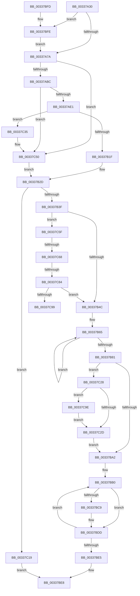

# MiPageFreeToZero

- RVA: `0x00337A30`–`0x00337CAD` (길이 `637` bytes)
- VA: `0x0000000140337A30`
- 실행 섹션: `.text`
- PDB 이름 있음: `예`; PDB Function 태그: `예`
- unwind 정보 RVA: `0x00076A00`
- 디코드: `168`개 명령, `637/637` bytes 표시
- 미해석 바이트: `0` (있으면 어셈블리에 `.byte`로 보존)

> 이 문서는 커널 이미지의 기계어와 PDB 기호를 분석해 생성했습니다. 4번과 5번은 함수 원형과 자료형을 바이너리 사용 방식에서 추정한 C 해석이며 원본 소스 복구 결과는 아닙니다.

## 1. Dependencies

- 직접 호출 지점: **12**; 고유 호출 대상: **12**
- 직접 호출자로 확인된 함수: **1**
- RIP 상대 이미지 참조: **2**

### Outgoing calls
- `0x00337A7D` → [MiPageToNode](MiPageToNode_function_00338CD0.md) (function, `0x00338CD0`)
- `0x00337B11` → [MiLocatePageCollisionByPfn](MiLocatePageCollisionByPfn_function_00337CC0.md) (function, `0x00337CC0`)
- `0x00337B24` → [MiMakeDemandZeroPte](MiMakeDemandZeroPte_function_00337A00.md) (function, `0x00337A00`)
- `0x00337B89` → [MiUnlinkFreeOrZeroedPage](MiUnlinkFreeOrZeroedPage_function_00336C40.md) (function, `0x00336C40`)
- `0x00337B94` → [MiInsertPageInFreeOrZeroedList](MiInsertPageInFreeOrZeroedList_function_00334D20.md) (function, `0x00334D20`)
- `0x00337C1F` → [MiFreeListPageContentsChanged](../3B/MiFreeListPageContentsChanged_function_003BD4BC.md) (function, `0x003BD4BC`)
- `0x00337C4A` → [KeBugCheckEx](../4F/KeBugCheckEx_function_004FD660.md) (function, `0x004FD660`)
- `0x00337C55` → [MiStopHugePageAccessor](../4F/MiStopHugePageAccessor_function_004F6A68.md) (function, `0x004F6A68`)
- `0x00337C6E` → [MI_PAGE_TO_FULL_COLOR](MI_PAGE_TO_FULL_COLOR_function_00337820.md) (function, `0x00337820`)
- `0x00337C77` → [MiColorHasSlists](../28/MiColorHasSlists_function_0028B1D0.md) (function, `0x0028B1D0`)
- `0x00337C8C` → [MiFreeZeroPageSlistSufficient](../43/MiFreeZeroPageSlistSufficient_function_004335F0.md) (function, `0x004335F0`)
- `0x00337CA6` → [MiSetFreeZeroPfnCold](../37/MiSetFreeZeroPfnCold_function_00379428.md) (function, `0x00379428`)

### Direct callers
- [sub_0031FD68](../31/Unknown_function_0031FD68.md) at `0x0031FDD2`

### Static image references
- `0x00337A86` → RVA `0x00E30088` (`.data`; read)
- `0x00337ABC` → RVA `0x00E2DCE0` (`.data`; read)

## 2. Other-region calls and transfers

- 다른 실행 섹션으로 향하는 call: **0**
- call이 아닌 외부 분기/꼬리 이동: **3**
  - `0x00337C62` → [sub_006E1FAC + 0x30](../6E/Unknown_function_006E1FAC.md) (`tail-transfer`)
  - `0x00337C7E` → [sub_006E1FAC](../6E/Unknown_function_006E1FAC.md) (`tail-transfer`)
  - `0x00337C99` → [sub_006E1FAC](../6E/Unknown_function_006E1FAC.md) (`tail-transfer`)

## 3. Assembly (complete function range)

```asm
00337A30  48 89 5C 24 10                  mov qword ptr [rsp + 0x10], rbx
00337A35  55                              push rbp
00337A36  56                              push rsi
00337A37  57                              push rdi
00337A38  41 54                           push r12
00337A3A  41 55                           push r13
00337A3C  41 56                           push r14
00337A3E  41 57                           push r15
00337A40  48 83 EC 30                     sub rsp, 0x30
00337A44  48 8D 1C 49                     lea rbx, [rcx + rcx*2]
00337A48  49 BE 00 00 00 00 00 DE FF FF   movabs r14, 0xffffde0000000000
00337A52  48 C1 E3 04                     shl rbx, 4
00337A56  45 8B E8                        mov r13d, r8d
00337A59  48 8B FA                        mov rdi, rdx
00337A5C  4C 8B F9                        mov r15, rcx
00337A5F  49 8B C6                        mov rax, r14
00337A62  48 8D 34 03                     lea rsi, [rbx + rax]
00337A66  BD 03 00 00 00                  mov ebp, 3
00337A6B  48 8B 46 28                     mov rax, qword ptr [rsi + 0x28]
00337A6F  48 0F BA E0 28                  bt rax, 0x28
00337A74  0F 82 84 01 00 00               jb 0x140337bfe
00337A7A  49 8B CF                        mov rcx, r15
00337A7D  E8 4E 12 00 00                  call 0x140338cd0
00337A82  48 8B 4E 28                     mov rcx, qword ptr [rsi + 0x28]
00337A86  48 8B 15 FB 85 AF 00            mov rdx, qword ptr [rip + 0xaf85fb]
00337A8D  48 C1 E9 2B                     shr rcx, 0x2b
00337A91  81 E1 FF 03 00 00               and ecx, 0x3ff
00337A97  48 8B 14 CA                     mov rdx, qword ptr [rdx + rcx*8]
00337A9B  8B C8                           mov ecx, eax
00337A9D  4C 69 E1 80 DF 00 00            imul r12, rcx, 0xdf80
00337AA4  48 89 94 24 88 00 00 00         mov qword ptr [rsp + 0x88], rdx
00337AAC  4C 03 62 10                     add r12, qword ptr [rdx + 0x10]
00337AB0  49 8B C6                        mov rax, r14
00337AB3  48 3B F0                        cmp rsi, rax
00337AB6  0F 82 94 01 00 00               jb 0x140337c50
00337ABC  48 8B 05 1D 62 AF 00            mov rax, qword ptr [rip + 0xaf621d]
00337AC3  48 8D 0C 40                     lea rcx, [rax + rax*2]
00337AC7  48 C1 E1 04                     shl rcx, 4
00337ACB  48 B8 30 00 00 00 00 DE FF FF   movabs rax, 0xffffde0000000030
00337AD5  48 03 C8                        add rcx, rax
00337AD8  48 3B F1                        cmp rsi, rcx
00337ADB  0F 83 6F 01 00 00               jae 0x140337c50
00337AE1  8B 46 20                        mov eax, dword ptr [rsi + 0x20]
00337AE4  89 44 24 70                     mov dword ptr [rsp + 0x70], eax
00337AE8  C1 E8 10                        shr eax, 0x10
00337AEB  24 F7                           and al, 0xf7
00337AED  48 C1 FB 04                     sar rbx, 4
00337AF1  88 44 24 72                     mov byte ptr [rsp + 0x72], al
00337AF5  8B 44 24 70                     mov eax, dword ptr [rsp + 0x70]
00337AF9  89 46 20                        mov dword ptr [rsi + 0x20], eax
00337AFC  48 B8 AB AA AA AA AA AA AA AA   movabs rax, 0xaaaaaaaaaaaaaaab
00337B06  48 8B 4E 10                     mov rcx, qword ptr [rsi + 0x10]
00337B0A  48 0F AF D8                     imul rbx, rax
00337B0E  48 8B D3                        mov rdx, rbx
00337B11  E8 AA 01 00 00                  call 0x140337cc0
00337B16  48 85 C0                        test rax, rax
00337B19  0F 84 16 01 00 00               je 0x140337c35
00337B1F  B9 04 00 00 00                  mov ecx, 4
00337B24  E8 D7 FE FF FF                  call 0x140337a00
00337B29  48 89 46 10                     mov qword ptr [rsi + 0x10], rax
00337B2D  B8 20 00 00 00                  mov eax, 0x20
00337B32  48 8B CE                        mov rcx, rsi
00337B35  40 F6 C7 02                     test dil, 2
00337B39  0F 85 DA 00 00 00               jne 0x140337c19
00337B3F  44 8D 70 E1                     lea r14d, [rax - 0x1f]
00337B43  45 85 ED                        test r13d, r13d
00337B46  0F 85 13 01 00 00               jne 0x140337c5f
00337B4C  BB 60 3B 00 00                  mov ebx, 0x3b60
00337B51  83 FD 03                        cmp ebp, 3
00337B54  44 8B C3                        mov r8d, ebx
00337B57  41 BD 58 3B 00 00               mov r13d, 0x3b58
00337B5D  45 0F 44 C5                     cmove r8d, r13d
00337B61  4B 8B 04 20                     mov rax, qword ptr [r8 + r12]
00337B65  48 8D 50 01                     lea rdx, [rax + 1]
00337B69  48 8B CA                        mov rcx, rdx
00337B6C  48 33 C8                        xor rcx, rax
00337B6F  48 81 E1 00 00 FF FF            and rcx, 0xffffffffffff0000
00337B76  48 33 CA                        xor rcx, rdx
00337B79  F0 4B 0F B1 0C 20               lock cmpxchg qword ptr [r8 + r12], rcx
00337B7F  75 E4                           jne 0x140337b65
00337B81  45 33 C0                        xor r8d, r8d
00337B84  33 D2                           xor edx, edx
00337B86  49 8B CF                        mov rcx, r15
00337B89  E8 B2 F0 FF FF                  call 0x140336c40
00337B8E  41 8B D6                        mov edx, r14d
00337B91  49 8B CF                        mov rcx, r15
00337B94  E8 87 D1 FF FF                  call 0x140334d20
00337B99  83 FD 03                        cmp ebp, 3
00337B9C  0F 85 86 00 00 00               jne 0x140337c28
00337BA2  49 0F 44 DD                     cmove rbx, r13
00337BA6  4A 8B 04 23                     mov rax, qword ptr [rbx + r12]
00337BAA  66 0F 1F 44 00 00               nop word ptr [rax + rax]
00337BB0  48 8D 50 FF                     lea rdx, [rax - 1]
00337BB4  48 8B CA                        mov rcx, rdx
00337BB7  48 33 C8                        xor rcx, rax
00337BBA  48 81 E1 00 00 FF FF            and rcx, 0xffffffffffff0000
00337BC1  48 33 CA                        xor rcx, rdx
00337BC4  66 85 C9                        test cx, cx
00337BC7  75 14                           jne 0x140337bdd
00337BC9  48 8D 91 00 00 01 00            lea rdx, [rcx + 0x10000]
00337BD0  48 33 D1                        xor rdx, rcx
00337BD3  48 81 E2 00 00 FF FF            and rdx, 0xffffffffffff0000
00337BDA  48 33 CA                        xor rcx, rdx
00337BDD  F0 4A 0F B1 0C 23               lock cmpxchg qword ptr [rbx + r12], rcx
00337BE3  75 CB                           jne 0x140337bb0
00337BE5  41 8B C6                        mov eax, r14d
00337BE8  48 8B 5C 24 78                  mov rbx, qword ptr [rsp + 0x78]
00337BED  48 83 C4 30                     add rsp, 0x30
00337BF1  41 5F                           pop r15
00337BF3  41 5E                           pop r14
00337BF5  41 5D                           pop r13
00337BF7  41 5C                           pop r12
00337BF9  5F                              pop rdi
00337BFA  5E                              pop rsi
00337BFB  5D                              pop rbp
00337BFC  C3                              ret
00337BFD  CC                              int3
00337BFE  8B 46 24                        mov eax, dword ptr [rsi + 0x24]
00337C01  8B CD                           mov ecx, ebp
00337C03  C1 E8 1B                        shr eax, 0x1b
00337C06  83 E0 03                        and eax, 3
00337C09  2B C8                           sub ecx, eax
00337C0B  8B C5                           mov eax, ebp
00337C0D  3B C8                           cmp ecx, eax
00337C0F  8B E9                           mov ebp, ecx
00337C11  0F 44 E8                        cmove ebp, eax
00337C14  E9 61 FE FF FF                  jmp 0x140337a7a
00337C19  49 8B D7                        mov rdx, r15
00337C1C  49 8B CC                        mov rcx, r12
00337C1F  E8 98 58 08 00                  call 0x1403bd4bc
00337C24  33 C0                           xor eax, eax
00337C26  EB C0                           jmp 0x140337be8
00337C28  40 84 FF                        test dil, dil
00337C2B  78 71                           js 0x140337c9e
00337C2D  83 FD 03                        cmp ebp, 3
00337C30  E9 6D FF FF FF                  jmp 0x140337ba2
00337C35  4C 8B C9                        mov r9, rcx
00337C38  48 89 5C 24 20                  mov qword ptr [rsp + 0x20], rbx
00337C3D  B9 1A 00 00 00                  mov ecx, 0x1a
00337C42  4C 8B C6                        mov r8, rsi
00337C45  BA 02 15 00 00                  mov edx, 0x1502
00337C4A  E8 11 5A 1C 00                  call 0x1404fd660
00337C4F  CC                              int3
00337C50  33 D2                           xor edx, edx
00337C52  48 8B CE                        mov rcx, rsi
00337C55  E8 0E EE 1B 00                  call 0x1404f6a68
00337C5A  E9 CE FE FF FF                  jmp 0x140337b2d
00337C5F  83 FD 03                        cmp ebp, 3
00337C62  0F 85 74 A3 3A 00               jne 0x1406e1fdc
00337C68  8B 04 08                        mov eax, dword ptr [rax + rcx]
00337C6B  49 8B CF                        mov rcx, r15
00337C6E  E8 AD FB FF FF                  call 0x140337820
00337C73  8B C8                           mov ecx, eax
00337C75  8B D8                           mov ebx, eax
00337C77  E8 54 35 F5 FF                  call 0x14028b1d0
00337C7C  85 C0                           test eax, eax
00337C7E  0F 84 28 A3 3A 00               je 0x1406e1fac
00337C84  45 33 C0                        xor r8d, r8d
00337C87  8B D3                           mov edx, ebx
00337C89  49 8B CC                        mov rcx, r12
00337C8C  E8 5F B9 0F 00                  call 0x1404335f0
00337C91  85 C0                           test eax, eax
00337C93  0F 84 B3 FE FF FF               je 0x140337b4c
00337C99  E9 0E A3 3A 00                  jmp 0x1406e1fac
00337C9E  BA 01 00 00 00                  mov edx, 1
00337CA3  48 8B CE                        mov rcx, rsi
00337CA6  E8 7D 17 04 00                  call 0x140379428
00337CAB  EB 80                           jmp 0x140337c2d
```

## 4. C-style interpretation (structured pseudocode)

```c
__int64 __fastcall MiPageFreeToZero(__int64 a1, __int64 a2, int a3)
{
    __int64 result;
    __int64 v_r12;
    __int64 v_rbp;
    __int64 v_rbx;
    __int64 v_rsp;
    unsigned __int64 v_stack_p10;
    unsigned __int64 v_stack_p20;
    unsigned int v_stack_p8;
    unsigned __int8 v_stack_pA;

    v_stack_p10 = v_rbx;
    v_rsp = (v_rsp) - (48);
    v_rbx = (a1 + a1 * 2) << (4);
    if (condition_is_below) goto loc_00337BFE;
loc_00337A7A:
    result = MiPageToNode(a1, a2, a3, a4);
    a1 = (*(unsigned __int64 *)(v_rbx + v_r14 * 1 + 40)) >> (43);
    a1 = (unsigned int)((a1) & (0x3FFULL));
    v_r12 = (v_r12) * ((unsigned int)((unsigned int)(result)));
    v_stack_p20 = *(unsigned __int64 *)(*(unsigned __int64 *)(v_rip + 11503099) + a1 * 8);
    v_r12 = (v_r12) + (*(unsigned __int64 *)(*(unsigned __int64 *)(*(unsigned __int64 *)(v_rip + 11503099) + a1 * 8) + 16));
    if ((v_rbx + v_r14 * 1) < v_r14) goto loc_00337C50;
    a1 = (*(unsigned __int64 *)(v_rip + 11493917) + *(unsigned __int64 *)(v_rip + 11493917) * 2) << (4);
    a1 = (a1) + (*(unsigned __int64 *)(v_rip + 11493917));
    if ((v_rbx + v_r14 * 1) >= a1) goto loc_00337C50;
    v_stack_p8 = (unsigned int)((unsigned int)(*(unsigned int *)(v_rbx + v_r14 * 1 + 32)));
    result = (unsigned int)(((unsigned int)(*(unsigned int *)(v_rbx + v_r14 * 1 + 32))) >> (16));
    result = (unsigned __int8)((result) & (247));
    v_rbx = (v_rbx) >> (4);
    v_stack_pA = (unsigned __int8)(result);
    *(unsigned int *)(v_rbx + v_r14 * 1 + 32) = (unsigned int)((unsigned int)(v_stack_p8));
    v_rbx = (v_rbx) * ((unsigned int)(v_stack_p8));
    result = MiLocatePageCollisionByPfn(*(unsigned __int64 *)(v_rbx + v_r14 * 1 + 16), v_rbx, a3, a4);
    if (result == 0) goto loc_00337C35;
    result = MiMakeDemandZeroPte(4, v_rbx, a3, a4);
    *(unsigned __int64 *)(v_rbx + v_r14 * 1 + 16) = result;
loc_00337B2D:
    if ((((unsigned __int8)(a2)) & (2)) != 0) goto loc_00337C19;
    if ((unsigned int)((unsigned int)(a3)) != 0) goto loc_00337C5F;
loc_00337B4C:
    a3 = (unsigned int)((unsigned int)((unsigned int)(0x3B60ULL)));
    if (3 == 3) { a3 = (unsigned int)((unsigned int)(0x3B58ULL)); }
loc_00337B65:
    a1 = (*(unsigned __int64 *)(a3 + v_r12 * 1) + 1) ^ (*(unsigned __int64 *)(a3 + v_r12 * 1));
    a1 = (a1) & (0xFFFFFFFFFFFF0000ULL);
    a1 = (a1) ^ (*(unsigned __int64 *)(a3 + v_r12 * 1) + 1);
    if (condition_is_not_equal) goto loc_00337B65;
    a3 = 0;
    a2 = 0;
    result = MiUnlinkFreeOrZeroedPage(a1, a2, a3, a4);
    result = MiInsertPageInFreeOrZeroedList(a1, (unsigned int)((unsigned int)(32 - 31)), a3, a4);
    if (3 != 3) goto loc_00337C28;
loc_00337BA2:
    v_rbx = (unsigned int)(0x3B60ULL);
    if (3 == 3) { v_rbx = (unsigned int)(0x3B58ULL); }
loc_00337BB0:
    a1 = (*(unsigned __int64 *)(v_rbx + v_r12 * 1) - 1) ^ (*(unsigned __int64 *)(v_rbx + v_r12 * 1));
    a1 = (a1) & (0xFFFFFFFFFFFF0000ULL);
    a1 = (a1) ^ (*(unsigned __int64 *)(v_rbx + v_r12 * 1) - 1);
    if ((unsigned __int16)(a1) == 0) {
        a2 = a1 + 65536;
        a2 = (a2) ^ (a1);
        a2 = (a2) & (0xFFFFFFFFFFFF0000ULL);
        a1 = (a1) ^ (a2);
    }
    if (condition_is_not_equal) goto loc_00337BB0;
loc_00337BE8:
    v_rsp = (v_rsp) + (48);
    return (unsigned int)((unsigned int)(32 - 31));
loc_00337BFE:
    result = (unsigned int)(((unsigned int)(*(unsigned int *)(v_rbx + v_r14 * 1 + 36))) >> (27));
    result = (unsigned int)((result) & (3));
    a1 = (unsigned int)((3) - ((unsigned int)(result)));
    v_rbp = (unsigned int)((unsigned int)(a1));
    if (((unsigned int)(a1)) == 3) { v_rbp = 3; }
    goto loc_00337A7A;
loc_00337C19:
    result = MiFreeListPageContentsChanged(v_r12, a1, a3, a4);
    result = 0;
    goto loc_00337BE8;
loc_00337C28:
    if (sign_flag) goto loc_00337C9E;
loc_00337C2D:
    goto loc_00337BA2;
loc_00337C35:
    v_stack_p20 = v_stack_p10;
    result = KeBugCheckEx(26, (unsigned int)(0x1502ULL), v_rbx + v_r14 * 1, v_r12);
loc_00337C50:
    a2 = 0;
    result = MiStopHugePageAccessor(v_rbx + v_r14 * 1, a2, v_rbx + v_r14 * 1, v_r12);
    goto loc_00337B2D;
loc_00337C5F:
    result = MI_PAGE_TO_FULL_COLOR(a1, a2, v_rbx + v_r14 * 1, v_r12);
    result = MiColorHasSlists((unsigned int)((unsigned int)(result)), a2, v_rbx + v_r14 * 1, v_r12);
    a3 = 0;
    result = MiFreeZeroPageSlistSufficient(v_r12, (unsigned int)((unsigned int)((unsigned int)((unsigned int)(result)))), a3, v_r12);
    if ((unsigned int)(result) == 0) goto loc_00337B4C;
loc_00337C9E:
    result = MiSetFreeZeroPfnCold(v_rbx + v_r14 * 1, 1, a3, v_r12);
    goto loc_00337C2D;
}
```

## 5. (Beta) C Style

```c
int64_t MiPageFreeToZero(void *Arg1, int64_t Arg2, int32_t Arg3)
{
    uint8_t *arg1 = (uint8_t *)Arg1;

    int64_t result;
    int64_t local_r12;
    int64_t local_rbp;
    int64_t local_rbx;
    int64_t local_rsp;
    uint64_t v_stack_p10;
    uint64_t v_stack_p20;
    uint32_t v_stack_p8;
    uint8_t v_stack_pA;

    v_stack_p10 = local_rbx;
    local_rsp = (local_rsp) - (48);
    local_rbx = (Arg1 + Arg1 * 2) << (4);
    if (condition_is_below) goto loc_00337BFE;
loc_00337A7A:
    result = MiPageToNode(Arg1, Arg2, Arg3, a4);
    Arg1 = (*(uint64_t *)(local_rbx + local_r14 * 1 + 0x28)) >> (43);
    Arg1 = (uint32_t)((Arg1) & (0x3FFULL));
    local_r12 = (local_r12) * ((uint32_t)((uint32_t)(result)));
    v_stack_p20 = *(uint64_t *)(*(uint64_t *)(v_rip + 0xAF85FB) + arg1 * 8);
    local_r12 = (local_r12) + (*(uint64_t *)(*(uint64_t *)(*(uint64_t *)(v_rip + 0xAF85FB) + arg1 * 8) + 0x10));
    if ((local_rbx + local_r14 * 1) < local_r14) goto loc_00337C50;
    Arg1 = (*(uint64_t *)(v_rip + 0xAF621D) + *(uint64_t *)(v_rip + 0xAF621D) * 2) << (4);
    Arg1 = (Arg1) + (*(uint64_t *)(v_rip + 0xAF621D));
    if ((local_rbx + local_r14 * 1) >= Arg1) goto loc_00337C50;
    v_stack_p8 = (uint32_t)((uint32_t)(*(uint32_t *)(local_rbx + local_r14 * 1 + 0x20)));
    result = (uint32_t)(((uint32_t)(*(uint32_t *)(local_rbx + local_r14 * 1 + 0x20))) >> (16));
    result = (uint8_t)((result) & (247));
    local_rbx = (local_rbx) >> (4);
    v_stack_pA = (uint8_t)(result);
    *(uint32_t *)(local_rbx + local_r14 * 1 + 0x20) = (uint32_t)((uint32_t)(v_stack_p8));
    local_rbx = (local_rbx) * ((uint32_t)(v_stack_p8));
    result = MiLocatePageCollisionByPfn(*(uint64_t *)(local_rbx + local_r14 * 1 + 0x10), local_rbx, Arg3, a4);
    if (result == 0) goto loc_00337C35;
    result = MiMakeDemandZeroPte(4, local_rbx, Arg3, a4);
    *(uint64_t *)(local_rbx + local_r14 * 1 + 0x10) = result;
loc_00337B2D:
    if ((((uint8_t)(Arg2)) & (2)) != 0) goto loc_00337C19;
    if ((uint32_t)((uint32_t)(Arg3)) != 0) goto loc_00337C5F;
loc_00337B4C:
    Arg3 = (uint32_t)((uint32_t)((uint32_t)(0x3B60ULL)));
    if (3 == 3) { Arg3 = (uint32_t)((uint32_t)(0x3B58ULL)); }
loc_00337B65:
    Arg1 = (*(uint64_t *)(Arg3 + local_r12 * 1) + 1) ^ (*(uint64_t *)(Arg3 + local_r12 * 1));
    Arg1 = (Arg1) & (0xFFFFFFFFFFFF0000ULL);
    Arg1 = (Arg1) ^ (*(uint64_t *)(Arg3 + local_r12 * 1) + 1);
    if (condition_is_not_equal) goto loc_00337B65;
    Arg3 = 0;
    Arg2 = 0;
    result = MiUnlinkFreeOrZeroedPage(Arg1, Arg2, Arg3, a4);
    result = MiInsertPageInFreeOrZeroedList(Arg1, (uint32_t)((uint32_t)(32 - 31)), Arg3, a4);
    if (3 != 3) goto loc_00337C28;
loc_00337BA2:
    local_rbx = (uint32_t)(0x3B60ULL);
    if (3 == 3) { local_rbx = (uint32_t)(0x3B58ULL); }
loc_00337BB0:
    Arg1 = (*(uint64_t *)(local_rbx + local_r12 * 1) - 1) ^ (*(uint64_t *)(local_rbx + local_r12 * 1));
    Arg1 = (Arg1) & (0xFFFFFFFFFFFF0000ULL);
    Arg1 = (Arg1) ^ (*(uint64_t *)(local_rbx + local_r12 * 1) - 1);
    if ((uint16_t)(Arg1) == 0) {
        Arg2 = Arg1 + 65536;
        Arg2 = (Arg2) ^ (Arg1);
        Arg2 = (Arg2) & (0xFFFFFFFFFFFF0000ULL);
        Arg1 = (Arg1) ^ (Arg2);
    }
    if (condition_is_not_equal) goto loc_00337BB0;
loc_00337BE8:
    local_rsp = (local_rsp) + (48);
    return (uint32_t)((uint32_t)(32 - 31));
loc_00337BFE:
    result = (uint32_t)(((uint32_t)(*(uint32_t *)(local_rbx + local_r14 * 1 + 0x24))) >> (27));
    result = (uint32_t)((result) & (3));
    Arg1 = (uint32_t)((3) - ((uint32_t)(result)));
    local_rbp = (uint32_t)((uint32_t)(Arg1));
    if (((uint32_t)(Arg1)) == 3) { local_rbp = 3; }
    goto loc_00337A7A;
loc_00337C19:
    result = MiFreeListPageContentsChanged(local_r12, Arg1, Arg3, a4);
    result = 0;
    goto loc_00337BE8;
loc_00337C28:
    if (sign_flag) goto loc_00337C9E;
loc_00337C2D:
    goto loc_00337BA2;
loc_00337C35:
    v_stack_p20 = v_stack_p10;
    result = KeBugCheckEx(26, (uint32_t)(0x1502ULL), local_rbx + local_r14 * 1, local_r12);
loc_00337C50:
    Arg2 = 0;
    result = MiStopHugePageAccessor(local_rbx + local_r14 * 1, Arg2, local_rbx + local_r14 * 1, local_r12);
    goto loc_00337B2D;
loc_00337C5F:
    result = MI_PAGE_TO_FULL_COLOR(Arg1, Arg2, local_rbx + local_r14 * 1, local_r12);
    result = MiColorHasSlists((uint32_t)((uint32_t)(result)), Arg2, local_rbx + local_r14 * 1, local_r12);
    Arg3 = 0;
    result = MiFreeZeroPageSlistSufficient(local_r12, (uint32_t)((uint32_t)((uint32_t)((uint32_t)(result)))), Arg3, local_r12);
    if ((uint32_t)(result) == 0) goto loc_00337B4C;
loc_00337C9E:
    result = MiSetFreeZeroPfnCold(local_rbx + local_r14 * 1, 1, Arg3, local_r12);
    goto loc_00337C2D;
}
```

### 관측된 메모리 오프셋

구조체 형식이 확인되지 않은 접근은 인자 기준의 오프셋으로만 기록했습니다.

| 기준 인자 | 오프셋 표현 | 폭 (bit) | 접근 |
|---|---:|---:|---|
| `Arg1` | `+ 0x0 + rcx*2` | `64` | `R` |

## 6. Execution-region graph

[열기: 2D/3D 그래프와 함수 탐색 컨트롤 패널](../../../control-panel.html?section=text&rva=0x00337A30&view=graph)

- 2D 그래프는 위에서 아래로 흐르고, 3D 그래프는 빈 공간을 드래그해 회전합니다. Shift+드래그는 이동, 휠은 확대·축소, 함수 노드 선택은 대상 보고서 이동입니다.

### Static fallback


