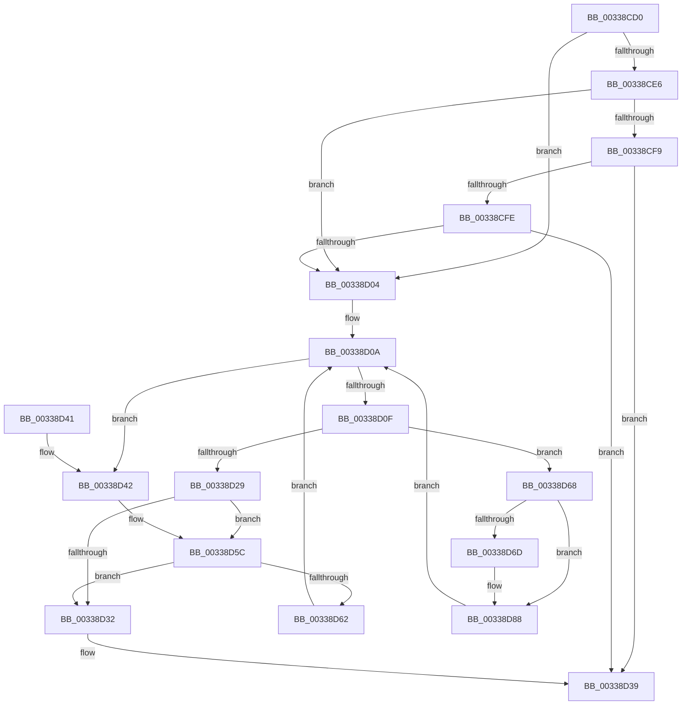

# MiPageToNode

- RVA: `0x00338CD0`–`0x00338D91` (길이 `193` bytes)
- VA: `0x0000000140338CD0`
- 실행 섹션: `.text`
- PDB 이름 있음: `예`; PDB Function 태그: `아니요`
- unwind 정보 RVA: `0x0006D61C`
- 디코드: `54`개 명령, `193/193` bytes 표시
- 미해석 바이트: `0` (있으면 어셈블리에 `.byte`로 보존)

> 이 문서는 커널 이미지의 기계어와 PDB 기호를 분석해 생성했습니다. 4번과 5번은 함수 원형과 자료형을 바이너리 사용 방식에서 추정한 C 해석이며 원본 소스 복구 결과는 아닙니다.

## 1. Dependencies

- 직접 호출 지점: **2**; 고유 호출 대상: **1**
- 직접 호출자로 확인된 함수: **78**
- RIP 상대 이미지 참조: **4**

### Outgoing calls
- `0x00338D56` → [KeBugCheckEx](../4F/KeBugCheckEx_function_004FD660.md) (function, `0x004FD660`)
- `0x00338D82` → [KeBugCheckEx](../4F/KeBugCheckEx_function_004FD660.md) (function, `0x004FD660`)

### Direct callers
- [MiReferenceIoPages](../23/MiReferenceIoPages_function_0023C804.md) at `0x0023CD69`
- [MiGetPage](../28/MiGetPage_function_002884C0.md) at `0x0028965E`
- [MiTradeTransitionPage](../28/MiTradeTransitionPage_function_0028B9AC.md) at `0x0028BABB`
- [MiFindContiguousPagesEx](../28/MiFindContiguousPagesEx_function_0028BDE0.md) at `0x0028C919`
- [MiMigratePfn](../28/MiMigratePfn_function_0028DBB0.md) at `0x0028DD96`
- [MmGrowKernelStackEx](../2A/MmGrowKernelStackEx_function_002A04E0.md) at `0x002A0600`
- [MiFreeLargePages](../2A/MiFreeLargePages_function_002A99D0.md) at `0x002A9AD6`
- [MiFreeLargePages](../2A/MiFreeLargePages_function_002A99D0.md) at `0x002A9B5B`
- [MiGetWorkingSetInfoList](../2A/MiGetWorkingSetInfoList_function_002AF770.md) at `0x002B0370`
- [MiStealPage](../2B/MiStealPage_function_002B28D0.md) at `0x002B2AC5`
- [MiZeroLargePage](../2C/MiZeroLargePage_function_002C6914.md) at `0x002C6A3C`
- [MiInitializeMdlBatchPages](../2C/MiInitializeMdlBatchPages_function_002C90E4.md) at `0x002C9138`
- [MiSharePages](../31/MiSharePages_function_00315110.md) at `0x003154CA`
- [MmSetPfnListInfo](../31/MmSetPfnListInfo_function_0031D61C.md) at `0x0031D899`
- [MiGetPageChain](MiGetPageChain_function_00330130.md) at `0x003307FB`
- [MiPageFreeToZero](MiPageFreeToZero_function_00337A30.md) at `0x00337A7D`
- [MiAddKernelStackToPrcbCache](MiAddKernelStackToPrcbCache_function_00338710.md) at `0x00338AB9`
- [MiAddKernelStackToPrcbCache](MiAddKernelStackToPrcbCache_function_00338710.md) at `0x00338CB1`
- [sub_00338E63](Unknown_function_00338E63.md) at `0x003392E2`
- [MmDeleteKernelStack](MmDeleteKernelStack_function_0033A960.md) at `0x0033AB7C`
- [MiDeleteClusterPage](../34/MiDeleteClusterPage_function_00346CB0.md) at `0x00346D13`
- [MiCheckSlabPage](../34/MiCheckSlabPage_function_00348AC8.md) at `0x00348B23`
- [MiGatherPagefilePages](../37/MiGatherPagefilePages_function_00372B08.md) at `0x00372D0B`
- [MiGatherPagefilePages](../37/MiGatherPagefilePages_function_00372B08.md) at `0x00372D4E`
- [MiFreeLargePageMemory](../37/MiFreeLargePageMemory_function_00377938.md) at `0x00377A2A`
- [MiLargePagePromote](../37/MiLargePagePromote_function_0037915C.md) at `0x00379208`
- [MiUpdateLargePageCandidates](../37/MiUpdateLargePageCandidates_function_003798C0.md) at `0x00379997`
- [MiRecordLargePageCandidate](../37/MiRecordLargePageCandidate_function_0037A624.md) at `0x0037A647`
- [MiCoalesceFreeLargePages](../37/MiCoalesceFreeLargePages_function_0037A7B4.md) at `0x0037A850`
- [MiCoalesceFreeLargePages](../37/MiCoalesceFreeLargePages_function_0037A7B4.md) at `0x0037A8A8`
- [MiReplaceLockedPage](../38/MiReplaceLockedPage_function_0038351C.md) at `0x003835D4`
- [MiSwapNumaStandbyPage](../38/MiSwapNumaStandbyPage_function_00385144.md) at `0x00385183`
- [MiMapContiguousMemoryLarge](../3B/MiMapContiguousMemoryLarge_function_003B44CC.md) at `0x003B4621`
- [MiAllocateMdlPagesByLists](../3B/MiAllocateMdlPagesByLists_function_003B7898.md) at `0x003B7A5B`
- [MiPruneStandbyPages](../3B/MiPruneStandbyPages_function_003BC0E4.md) at `0x003BC1E8`
- [MiFreePagesFromMdl](../3F/MiFreePagesFromMdl_function_003F8300.md) at `0x003F84D1`
- [MiDemoteLargeFreePage](../43/MiDemoteLargeFreePage_function_00435118.md) at `0x004351FF`
- [MiComputeHugeRangeColorHeadAtDpc](../43/MiComputeHugeRangeColorHeadAtDpc_function_00436968.md) at `0x0043699D`
- [MiHugeRangeFreeToZero](../43/MiHugeRangeFreeToZero_function_00436A38.md) at `0x00436A87`
- [MiUnlinkHugeRange](../43/MiUnlinkHugeRange_function_00436EF0.md) at `0x00436F30`
- [MiInsertHugeRangeInList](../43/MiInsertHugeRangeInList_function_004371E8.md) at `0x00437243`
- [MiDemoteSlabEntriesDpc](../44/MiDemoteSlabEntriesDpc_function_0044C3C0.md) at `0x0044C614`
- [MiKernelShadowStackIdealForCaching](../48/MiKernelShadowStackIdealForCaching_function_00484330.md) at `0x004843CB`
- [MiKernelShadowStackIdealForCaching](../48/MiKernelShadowStackIdealForCaching_function_00484330.md) at `0x0048441F`
- [MiGetEnclavePageList](../4A/MiGetEnclavePageList_function_004AEE58.md) at `0x004AEE64`
- [MiIdealClusterPage](../4D/MiIdealClusterPage_function_004DB964.md) at `0x004DBCC0`
- [MiEnableNewPfns](../67/MiEnableNewPfns_function_00671DD0.md) at `0x00671E98`
- [MiEnableNewPfns](../67/MiEnableNewPfns_function_00671DD0.md) at `0x00671F73`
- [MiInitializeDynamicPfns](../67/MiInitializeDynamicPfns_function_00672BD0.md) at `0x00672E2B`
- [MiHotRemoveHugeRange](../67/MiHotRemoveHugeRange_function_00675DD0.md) at `0x00675E49`
- [MiMakeEntireHugePfnGood](../67/MiMakeEntireHugePfnGood_function_00676644.md) at `0x0067668E`
- [MiMarkHugePfnBad](../67/MiMarkHugePfnBad_function_00676744.md) at `0x00676785`
- [MiMarkHugePfnGood](../67/MiMarkHugePfnGood_function_00676BB0.md) at `0x00676BE6`
- [MiMoveBadHugeRangeCrossPartition](../67/MiMoveBadHugeRangeCrossPartition_function_00676DD0.md) at `0x00676E06`
- [MiUpdateHugePageCounts](../67/MiUpdateHugePageCounts_function_00677530.md) at `0x00677555`
- [MiMoveBadPageChargesCrossPartition](../68/MiMoveBadPageChargesCrossPartition_function_00689F60.md) at `0x00689F8F`
- [MiDemoteValidLargePageOneLevel](../68/MiDemoteValidLargePageOneLevel_function_0068A3F4.md) at `0x0068A52E`
- [MiTryUnlinkNodeLargePages](../68/MiTryUnlinkNodeLargePages_function_0068ADA0.md) at `0x0068ADE6`
- [MiTryUnlinkNodeLargePages](../68/MiTryUnlinkNodeLargePages_function_0068ADA0.md) at `0x0068AF2B`
- [MiGroupZeroHugeRange](../68/MiGroupZeroHugeRange_function_0068C384.md) at `0x0068C402`
- [MiHugePageOperation](../68/MiHugePageOperation_function_0068C490.md) at `0x0068C4DE`
- [MiUpdatePartitionChildPageCounts](../69/MiUpdatePartitionChildPageCounts_function_006921D4.md) at `0x00692239`
- [MiCoalesceActivePagesIntoFree](../69/MiCoalesceActivePagesIntoFree_function_00693558.md) at `0x006935D6`
- [MiFreeLargeProcessPagesToCache](../69/MiFreeLargeProcessPagesToCache_function_00698F24.md) at `0x00698F91`
- [MiNextPhysicallyContiguousPfnWorthTrying](../69/MiNextPhysicallyContiguousPfnWorthTrying_function_006993EC.md) at `0x0069948F`
- [sub_006E17A2](../6E/Unknown_function_006E17A2.md) at `0x006E17D4`
- [sub_006E4582](../6E/Unknown_function_006E4582.md) at `0x006E45DA`
- [sub_006E7A2C](../6E/Unknown_function_006E7A2C.md) at `0x006E7A2F`
- [sub_006FA666](../6F/Unknown_function_006FA666.md) at `0x006FA669`
- [MiAddPhysicalMemoryChunks](../../page/7F/MiAddPhysicalMemoryChunks_function_007F98D4.md) at `0x007F9A17`
- [MiDescribePageRun](../../page/7F/MiDescribePageRun_function_007FA38C.md) at `0x007FA3F3`
- [MiMapNewPfns](../../page/7F/MiMapNewPfns_function_007FA63C.md) at `0x007FA743`
- [MiZeroHotAddMemory](../../page/7F/MiZeroHotAddMemory_function_007FB324.md) at `0x007FB3AF`
- [MiAddRuns](../../page/7F/MiAddRuns_function_007FBE1C.md) at `0x007FBEAF`
- [MiCreateFreePfns](../../init/C6/MiCreateFreePfns_function_00C61F8C.md) at `0x00C61FAF`
- [MiHotAddBootDeferredDescriptorsDiscardable](../../init/C6/MiHotAddBootDeferredDescriptorsDiscardable_function_00C624E4.md) at `0x00C62544`
- [MiRemoveLargeFreeLoaderDescriptors](../../init/C6/MiRemoveLargeFreeLoaderDescriptors_function_00C6283C.md) at `0x00C62995`
- [MxComputeFreeNodeDescriptorRequirements](../../init/C6/MxComputeFreeNodeDescriptorRequirements_function_00C62F78.md) at `0x00C6302D`
- [MxInitializeFreeNodeDescriptors](../../init/C6/MxInitializeFreeNodeDescriptors_function_00C6398C.md) at `0x00C639D4`
- [MxInsertFreePages](../../init/C6/MxInsertFreePages_function_00C63AD0.md) at `0x00C63B92`
- [MxMapPfnRange](../../init/C6/MxMapPfnRange_function_00C63CC8.md) at `0x00C63DE5`
- [MxInsertEnclaveBootPages](../../init/C6/MxInsertEnclaveBootPages_function_00C68CB0.md) at `0x00C68D2A`
- [MiCreateKernelHalSlabRange](../../init/C6/MiCreateKernelHalSlabRange_function_00C69C80.md) at `0x00C69DAD`
- [MiCreateKernelHalSlabRange](../../init/C6/MiCreateKernelHalSlabRange_function_00C69C80.md) at `0x00C69DBB`
- [MiCreateSlabAllocationsFromLoaderBlock](../../init/C6/MiCreateSlabAllocationsFromLoaderBlock_function_00C69E3C.md) at `0x00C69F01`
- [MiCreateSlabAllocationsFromLoaderBlock](../../init/C6/MiCreateSlabAllocationsFromLoaderBlock_function_00C69E3C.md) at `0x00C69F0B`
- [MiCreateSlabAllocationsFromLoaderBlock](../../init/C6/MiCreateSlabAllocationsFromLoaderBlock_function_00C69E3C.md) at `0x00C69F26`
- [MiCreateSlabAllocationsFromLoaderBlock](../../init/C6/MiCreateSlabAllocationsFromLoaderBlock_function_00C69E3C.md) at `0x00C69F38`
- [MmUpdateSlabRangeType](../../init/C6/MmUpdateSlabRangeType_function_00C6A10C.md) at `0x00C6A152`

### Static image references
- `0x00338CD4` → RVA `0x00E2DBC0` (`.data`; read)
- `0x00338CDB` → RVA `0x00E2DBC4` (`.data`; read)
- `0x00338CED` → RVA `0x00E2DC20` (`.data`; read)
- `0x00338D32` → RVA `0x00E2DBC0` (`.data`; write)

## 2. Other-region calls and transfers

- 다른 실행 섹션으로 향하는 call: **0**
- 별도 외부 분기/꼬리 이동을 확인하지 못했습니다.

## 3. Assembly (complete function range)

```asm
00338CD0  48 83 EC 38                     sub rsp, 0x38
00338CD4  4C 63 05 E5 4E AF 00            movsxd r8, dword ptr [rip + 0xaf4ee5]
00338CDB  8B 05 E3 4E AF 00               mov eax, dword ptr [rip + 0xaf4ee3]
00338CE1  44 3B C0                        cmp r8d, eax
00338CE4  77 1E                           ja 0x140338d04
00338CE6  49 8B D0                        mov rdx, r8
00338CE9  48 C1 E2 04                     shl rdx, 4
00338CED  48 03 15 2C 4F AF 00            add rdx, qword ptr [rip + 0xaf4f2c]
00338CF4  48 3B 0A                        cmp rcx, qword ptr [rdx]
00338CF7  72 0B                           jb 0x140338d04
00338CF9  44 3B C0                        cmp r8d, eax
00338CFC  74 3B                           je 0x140338d39
00338CFE  48 3B 4A 10                     cmp rcx, qword ptr [rdx + 0x10]
00338D02  72 35                           jb 0x140338d39
00338D04  45 33 D2                        xor r10d, r10d
00338D07  45 8B CA                        mov r9d, r10d
00338D0A  41 3B C1                        cmp eax, r9d
00338D0D  7C 33                           jl 0x140338d42
00338D0F  45 8D 04 01                     lea r8d, [r9 + rax]
00338D13  41 D1 F8                        sar r8d, 1
00338D16  49 63 D0                        movsxd rdx, r8d
00338D19  48 C1 E2 04                     shl rdx, 4
00338D1D  48 03 15 FC 4E AF 00            add rdx, qword ptr [rip + 0xaf4efc]
00338D24  48 3B 0A                        cmp rcx, qword ptr [rdx]
00338D27  72 3F                           jb 0x140338d68
00338D29  44 3B 05 94 4E AF 00            cmp r8d, dword ptr [rip + 0xaf4e94]
00338D30  75 2A                           jne 0x140338d5c
00338D32  44 89 05 87 4E AF 00            mov dword ptr [rip + 0xaf4e87], r8d
00338D39  8B 42 08                        mov eax, dword ptr [rdx + 8]
00338D3C  48 83 C4 38                     add rsp, 0x38
00338D40  C3                              ret
00338D41  CC                              int3
00338D42  45 33 C9                        xor r9d, r9d
00338D45  4C 89 54 24 20                  mov qword ptr [rsp + 0x20], r10
00338D4A  4C 8B C1                        mov r8, rcx
00338D4D  BA 80 51 00 00                  mov edx, 0x5180
00338D52  41 8D 49 1A                     lea ecx, [r9 + 0x1a]
00338D56  E8 05 49 1C 00                  call 0x1404fd660
00338D5B  CC                              int3
00338D5C  48 3B 4A 10                     cmp rcx, qword ptr [rdx + 0x10]
00338D60  72 D0                           jb 0x140338d32
00338D62  45 8D 48 01                     lea r9d, [r8 + 1]
00338D66  EB A2                           jmp 0x140338d0a
00338D68  45 85 C0                        test r8d, r8d
00338D6B  75 1B                           jne 0x140338d88
00338D6D  4C 8B CA                        mov r9, rdx
00338D70  4C 89 54 24 20                  mov qword ptr [rsp + 0x20], r10
00338D75  4C 8B C1                        mov r8, rcx
00338D78  BA 80 51 00 00                  mov edx, 0x5180
00338D7D  B9 1A 00 00 00                  mov ecx, 0x1a
00338D82  E8 D9 48 1C 00                  call 0x1404fd660
00338D87  CC                              int3
00338D88  41 8D 40 FF                     lea eax, [r8 - 1]
00338D8C  E9 79 FF FF FF                  jmp 0x140338d0a
```

## 4. C-style interpretation (structured pseudocode)

```c
__int64 __fastcall MiPageToNode(__int64 a1)
{
    __int64 result;
    __int64 v_r10;
    __int64 v_rsp;
    unsigned __int64 v_stack_p20;

    v_rsp = (v_rsp) - (56);
    if (((unsigned int)((int)(*(unsigned int *)(v_rip + 11488997)))) > ((unsigned int)((unsigned int)(*(unsigned int *)(v_rip + 11488995))))) goto loc_00338D04;
    a2 = ((int)(*(unsigned int *)(v_rip + 11488997))) << (4);
    a2 = (a2) + (*(unsigned __int64 *)(v_rip + 11489068));
    if (a1 < (*(unsigned __int64 *)(a2))) goto loc_00338D04;
    if (((unsigned int)((int)(*(unsigned int *)(v_rip + 11488997)))) == ((unsigned int)((unsigned int)(*(unsigned int *)(v_rip + 11488995))))) goto loc_00338D39;
    if (a1 < (*(unsigned __int64 *)(a2 + 16))) goto loc_00338D39;
loc_00338D04:
    v_r10 = 0;
loc_00338D0A:
    if (((unsigned int)((unsigned int)(*(unsigned int *)(v_rip + 11488995)))) < 0) goto loc_00338D42;
    a3 = (unsigned int)((0 + (unsigned int)(*(unsigned int *)(v_rip + 11488995)) * 1) >> (1));
    a2 = ((int)((unsigned int)(a3))) << (4);
    a2 = (a2) + (*(unsigned __int64 *)(v_rip + 11489020));
    if (a1 < (*(unsigned __int64 *)(a2))) goto loc_00338D68;
    if (((unsigned int)(a3)) != (*(unsigned int *)(v_rip + 11488916))) goto loc_00338D5C;
loc_00338D32:
    *(unsigned int *)(v_rip + 11488903) = (unsigned int)(a3);
loc_00338D39:
    v_rsp = (v_rsp) + (56);
    return (unsigned int)(*(unsigned int *)(a2 + 8));
loc_00338D42:
    a4 = 0;
    v_stack_p20 = 0;
    result = KeBugCheckEx(a4 + 26, (unsigned int)(0x5180ULL), a1, a4);
loc_00338D5C:
    if ((a4 + 26) < (*(unsigned __int64 *)((unsigned int)(0x5180ULL) + 16))) goto loc_00338D32;
    goto loc_00338D0A;
loc_00338D68:
    if ((unsigned int)(a1) == 0) {
        a4 = (unsigned int)(0x5180ULL);
        v_stack_p20 = 0;
        a3 = a4 + 26;
        a2 = 0x5180ULL;
        a1 = 26;
        result = KeBugCheckEx(a1, a2, a3, a4);
    }
    goto loc_00338D0A;
}
```

## 5. (Beta) C Style

```c
int64_t MiPageToNode(int64_t Arg1)
{
    int64_t result;
    int64_t local_r10;
    int64_t local_rsp;
    uint64_t v_stack_p20;

    local_rsp = (local_rsp) - (56);
    if (((uint32_t)((int32_t)(*(uint32_t *)(v_rip + 0xAF4EE5)))) > ((uint32_t)((uint32_t)(*(uint32_t *)(v_rip + 0xAF4EE3))))) goto loc_00338D04;
    a2 = ((int32_t)(*(uint32_t *)(v_rip + 0xAF4EE5))) << (4);
    a2 = (a2) + (*(uint64_t *)(v_rip + 0xAF4F2C));
    if (Arg1 < (*(uint64_t *)(a2))) goto loc_00338D04;
    if (((uint32_t)((int32_t)(*(uint32_t *)(v_rip + 0xAF4EE5)))) == ((uint32_t)((uint32_t)(*(uint32_t *)(v_rip + 0xAF4EE3))))) goto loc_00338D39;
    if (Arg1 < (*(uint64_t *)(a2 + 0x10))) goto loc_00338D39;
loc_00338D04:
    local_r10 = 0;
loc_00338D0A:
    if (((uint32_t)((uint32_t)(*(uint32_t *)(v_rip + 0xAF4EE3)))) < 0) goto loc_00338D42;
    a3 = (uint32_t)((0 + (uint32_t)(*(uint32_t *)(v_rip + 0xAF4EE3)) * 1) >> (1));
    a2 = ((int32_t)((uint32_t)(a3))) << (4);
    a2 = (a2) + (*(uint64_t *)(v_rip + 0xAF4EFC));
    if (Arg1 < (*(uint64_t *)(a2))) goto loc_00338D68;
    if (((uint32_t)(a3)) != (*(uint32_t *)(v_rip + 0xAF4E94))) goto loc_00338D5C;
loc_00338D32:
    *(uint32_t *)(v_rip + 0xAF4E87) = (uint32_t)(a3);
loc_00338D39:
    local_rsp = (local_rsp) + (56);
    return (uint32_t)(*(uint32_t *)(a2 + 0x8));
loc_00338D42:
    a4 = 0;
    v_stack_p20 = 0;
    result = KeBugCheckEx(a4 + 26, (uint32_t)(0x5180ULL), Arg1, a4);
loc_00338D5C:
    if ((a4 + 26) < (*(uint64_t *)((uint32_t)(0x5180ULL) + 0x10))) goto loc_00338D32;
    goto loc_00338D0A;
loc_00338D68:
    if ((uint32_t)(Arg1) == 0) {
        a4 = (uint32_t)(0x5180ULL);
        v_stack_p20 = 0;
        a3 = a4 + 26;
        a2 = 0x5180ULL;
        Arg1 = 26;
        result = KeBugCheckEx(Arg1, a2, a3, a4);
    }
    goto loc_00338D0A;
}
```

## 6. Execution-region graph

[열기: 2D/3D 그래프와 함수 탐색 컨트롤 패널](../../../control-panel.html?section=text&rva=0x00338CD0&view=graph)

- 2D 그래프는 위에서 아래로 흐르고, 3D 그래프는 빈 공간을 드래그해 회전합니다. Shift+드래그는 이동, 휠은 확대·축소, 함수 노드 선택은 대상 보고서 이동입니다.

### Static fallback


