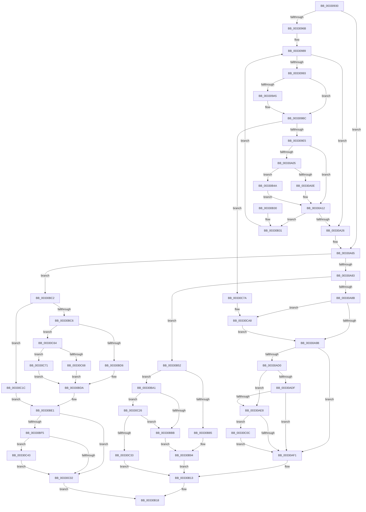

# MiPfnShareCountIsZero

- RVA: `0x00330930`–`0x00330CB6` (길이 `902` bytes)
- VA: `0x0000000140330930`
- 실행 섹션: `.text`
- PDB 이름 있음: `예`; PDB Function 태그: `아니요`
- unwind 정보 RVA: `0x00076558`
- 디코드: `222`개 명령, `902/902` bytes 표시
- 미해석 바이트: `0` (있으면 어셈블리에 `.byte`로 보존)

> 이 문서는 커널 이미지의 기계어와 PDB 기호를 분석해 생성했습니다. 4번과 5번은 함수 원형과 자료형을 바이너리 사용 방식에서 추정한 C 해석이며 원본 소스 복구 결과는 아닙니다.

## 1. Dependencies

- 직접 호출 지점: **9**; 고유 호출 대상: **9**
- 직접 호출자로 확인된 함수: **3**
- RIP 상대 이미지 참조: **3**

### Outgoing calls
- `0x003309B4` → [MiMapPageInHyperSpaceWorker](MiMapPageInHyperSpaceWorker_function_00332B10.md) (function, `0x00332B10`)
- `0x00330B0E` → [MiInsertPageInFreeOrZeroedList](MiInsertPageInFreeOrZeroedList_function_00334D20.md) (function, `0x00334D20`)
- `0x00330B56` → [MI_READ_PTE_LOCK_FREE](../28/MI_READ_PTE_LOCK_FREE_function_002828A0.md) (function, `0x002828A0`)
- `0x00330B97` → [MiInsertPageInList](../2B/MiInsertPageInList_function_002BA000.md) (function, `0x002BA000`)
- `0x00330BF9` → [MiGetPagingFileOffset](../36/MiGetPagingFileOffset_function_0036F530.md) (function, `0x0036F530`)
- `0x00330C12` → [MiReleasePageFileInfo](../28/MiReleasePageFileInfo_function_00283FD0.md) (function, `0x00283FD0`)
- `0x00330C29` → [MiGetPfnPriority](../32/MiGetPfnPriority_function_003226F0.md) (function, `0x003226F0`)
- `0x00330C39` → [MiInsertProtectedStandbyPage](../45/MiInsertProtectedStandbyPage_function_004527D8.md) (function, `0x004527D8`)
- `0x00330CA2` → [KeBugCheckEx](../4F/KeBugCheckEx_function_004FD660.md) (function, `0x004FD660`)

### Direct callers
- [MiWsleFree](../28/MiWsleFree_function_00284600.md) at `0x00284EE8`
- [MiReduceShareCount](../37/MiReduceShareCount_function_00370E90.md) at `0x00370EE5`
- [sub_00408539](../40/Unknown_function_00408539.md) at `0x0040853E`

### Static image references
- `0x003309E5` → RVA `0x00E2DC80` (`.data`; read)
- `0x00330A54` → RVA `0x00010880` (`.rdata`; read)
- `0x00330AA9` → RVA `0x00E30088` (`.data`; read)

## 2. Other-region calls and transfers

- 다른 실행 섹션으로 향하는 call: **0**
- 별도 외부 분기/꼬리 이동을 확인하지 못했습니다.

## 3. Assembly (complete function range)

```asm
00330930  48 89 5C 24 10                  mov qword ptr [rsp + 0x10], rbx
00330935  55                              push rbp
00330936  56                              push rsi
00330937  57                              push rdi
00330938  41 54                           push r12
0033093A  41 55                           push r13
0033093C  41 56                           push r14
0033093E  41 57                           push r15
00330940  48 83 EC 40                     sub rsp, 0x40
00330944  8B 41 20                        mov eax, dword ptr [rcx + 0x20]
00330947  4C 8B FA                        mov r15, rdx
0033094A  89 84 24 80 00 00 00            mov dword ptr [rsp + 0x80], eax
00330951  48 8B D9                        mov rbx, rcx
00330954  48 8B 41 28                     mov rax, qword ptr [rcx + 0x28]
00330958  49 BD 00 00 00 00 00 DE FF FF   movabs r13, 0xffffde0000000000
00330962  48 85 C0                        test rax, rax
00330965  0F 89 FA 00 00 00               jns 0x140330a65
0033096B  48 8B 69 10                     mov rbp, qword ptr [rcx + 0x10]
0033096F  45 33 C9                        xor r9d, r9d
00330972  48 8B 41 28                     mov rax, qword ptr [rcx + 0x28]
00330976  4C 8B F1                        mov r14, rcx
00330979  48 C1 ED 05                     shr rbp, 5
0033097D  49 BC FF FF FF FF FF 00 00 00   movabs r12, 0xffffffffff
00330987  33 F6                           xor esi, esi
00330989  48 83 FE 01                     cmp rsi, 1
0033098D  0F 83 93 00 00 00               jae 0x140330a26
00330993  49 8B 7E 08                     mov rdi, qword ptr [r14 + 8]
00330997  C1 EF 03                        shr edi, 3
0033099A  81 E7 FF 01 00 00               and edi, 0x1ff
003309A0  4D 85 C9                        test r9, r9
003309A3  75 17                           jne 0x1403309bc
003309A5  49 8B 4E 28                     mov rcx, qword ptr [r14 + 0x28]
003309A9  33 D2                           xor edx, edx
003309AB  49 23 CC                        and rcx, r12
003309AE  41 B8 00 00 00 80               mov r8d, 0x80000000
003309B4  E8 57 21 00 00                  call 0x140332b10
003309B9  4C 8B C8                        mov r9, rax
003309BC  49 8B 0C F9                     mov rcx, qword ptr [r9 + rdi*8]
003309C0  4D 8D 14 F9                     lea r10, [r9 + rdi*8]
003309C4  4C 8B C1                        mov r8, rcx
003309C7  49 C1 E8 0C                     shr r8, 0xc
003309CB  4D 23 C4                        and r8, r12
003309CE  4B 8D 14 40                     lea rdx, [r8 + r8*2]
003309D2  48 C1 E2 04                     shl rdx, 4
003309D6  49 8B C5                        mov rax, r13
003309D9  48 03 D0                        add rdx, rax
003309DC  49 3B D6                        cmp rdx, r14
003309DF  0F 85 95 02 00 00               jne 0x140330c7a
003309E5  48 8B 15 94 D2 AF 00            mov rdx, qword ptr [rip + 0xafd294]
003309EC  8B C5                           mov eax, ebp
003309EE  83 E0 1F                        and eax, 0x1f
003309F1  49 C1 E0 07                     shl r8, 7
003309F5  49 0B C0                        or rax, r8
003309F8  48 83 C8 40                     or rax, 0x40
003309FC  48 C1 E0 05                     shl rax, 5
00330A00  48 85 D2                        test rdx, rdx
00330A03  74 0D                           je 0x140330a12
00330A05  48 85 C2                        test rdx, rax
00330A08  0F 84 3C 01 00 00               je 0x140330b4a
00330A0E  48 83 C8 10                     or rax, 0x10
00330A12  49 89 02                        mov qword ptr [r10], rax
00330A15  48 8D 46 01                     lea rax, [rsi + 1]
00330A19  48 8B F0                        mov rsi, rax
00330A1C  48 83 F8 01                     cmp rax, 1
00330A20  0F 85 0B 01 00 00               jne 0x140330b31
00330A26  49 C1 E9 09                     shr r9, 9
00330A2A  48 B8 F8 FF FF FF 7F 00 00 00   movabs rax, 0x7ffffffff8
00330A34  4C 23 C8                        and r9, rax
00330A37  48 B8 00 00 00 00 80 F6 FF FF   movabs rax, 0xfffff68000000000
00330A41  4C 03 C8                        add r9, rax
00330A44  65 48 8B 04 25 20 00 00 00      mov rax, qword ptr gs:[0x20]
00330A4D  48 8B 88 38 88 00 00            mov rcx, qword ptr [rax + 0x8838]
00330A54  48 8B 05 25 FE CD FF            mov rax, qword ptr [rip - 0x3201db]
00330A5B  48 C7 01 00 00 00 00            mov qword ptr [rcx], 0
00330A62  49 89 01                        mov qword ptr [r9], rax
00330A65  48 8B 43 18                     mov rax, qword ptr [rbx + 0x18]
00330A69  B9 FF FF 00 00                  mov ecx, 0xffff
00330A6E  48 C1 E8 3E                     shr rax, 0x3e
00330A72  83 E0 01                        and eax, 1
00330A75  66 01 8C 24 80 00 00 00         add word ptr [rsp + 0x80], cx
00330A7D  0F 85 3F 01 00 00               jne 0x140330bc2
00330A83  85 C0                           test eax, eax
00330A85  0F 84 C7 00 00 00               je 0x140330b52
00330A8B  0F B6 84 24 83 00 00 00         movzx eax, byte ptr [rsp + 0x83]
00330A93  A8 10                           test al, 0x10
00330A95  0F 85 0D 02 00 00               jne 0x140330ca8
00330A9B  8B 84 24 80 00 00 00            mov eax, dword ptr [rsp + 0x80]
00330AA2  89 43 20                        mov dword ptr [rbx + 0x20], eax
00330AA5  48 8B 43 28                     mov rax, qword ptr [rbx + 0x28]
00330AA9  48 8B 0D D8 F5 AF 00            mov rcx, qword ptr [rip + 0xaff5d8]
00330AB0  48 C1 E8 2B                     shr rax, 0x2b
00330AB4  25 FF 03 00 00                  and eax, 0x3ff
00330AB9  48 8B 0C C1                     mov rcx, qword ptr [rcx + rax*8]
00330ABD  48 8B 43 10                     mov rax, qword ptr [rbx + 0x10]
00330AC1  48 89 84 24 90 00 00 00         mov qword ptr [rsp + 0x90], rax
00330AC9  48 0F BA E0 0A                  bt rax, 0xa
00330ACE  72 21                           jb 0x140330af1
00330AD0  48 8B 94 24 90 00 00 00         mov rdx, qword ptr [rsp + 0x90]
00330AD8  C0 E8 02                        shr al, 2
00330ADB  A8 01                           test al, 1
00330ADD  75 09                           jne 0x140330ae8
00330ADF  0F B6 C2                        movzx eax, dl
00330AE2  D0 E8                           shr al, 1
00330AE4  A8 01                           test al, 1
00330AE6  74 09                           je 0x140330af1
00330AE8  48 85 D2                        test rdx, rdx
00330AEB  0F 85 1B 01 00 00               jne 0x140330c0c
00330AF1  49 8B C5                        mov rax, r13
00330AF4  48 2B D8                        sub rbx, rax
00330AF7  48 B9 AB AA AA AA AA AA AA AA   movabs rcx, 0xaaaaaaaaaaaaaaab
00330B01  48 C1 FB 04                     sar rbx, 4
00330B05  BA 02 00 00 00                  mov edx, 2
00330B0A  48 0F AF CB                     imul rcx, rbx
00330B0E  E8 0D 42 00 00                  call 0x140334d20
00330B13  B8 04 00 00 00                  mov eax, 4
00330B18  48 8B 9C 24 88 00 00 00         mov rbx, qword ptr [rsp + 0x88]
00330B20  48 83 C4 40                     add rsp, 0x40
00330B24  41 5F                           pop r15
00330B26  41 5E                           pop r14
00330B28  41 5D                           pop r13
00330B2A  41 5C                           pop r12
00330B2C  5F                              pop rdi
00330B2D  5E                              pop rsi
00330B2E  5D                              pop rbp
00330B2F  C3                              ret
00330B30  CC                              int3
00330B31  49 8B 06                        mov rax, qword ptr [r14]
00330B34  49 23 C4                        and rax, r12
00330B37  4C 8D 34 40                     lea r14, [rax + rax*2]
00330B3B  49 C1 E6 04                     shl r14, 4
00330B3F  49 8B C5                        mov rax, r13
00330B42  4C 03 F0                        add r14, rax
00330B45  E9 3F FE FF FF                  jmp 0x140330989
00330B4A  48 0B C2                        or rax, rdx
00330B4D  E9 C0 FE FF FF                  jmp 0x140330a12
00330B52  48 8D 4B 10                     lea rcx, [rbx + 0x10]
00330B56  E8 45 1D F5 FF                  call 0x1402828a0
00330B5B  48 0F BA E0 0A                  bt rax, 0xa
00330B60  48 C7 C1 F7 FF FF FF            mov rcx, 0xfffffffffffffff7
00330B67  48 C7 C2 FF F7 FF FF            mov rdx, 0xfffffffffffff7ff
00330B6E  48 0F 42 CA                     cmovb rcx, rdx
00330B72  48 23 C8                        and rcx, rax
00330B75  0F B6 84 24 82 00 00 00         movzx eax, byte ptr [rsp + 0x82]
00330B7D  48 89 4B 10                     mov qword ptr [rbx + 0x10], rcx
00330B81  A8 10                           test al, 0x10
00330B83  74 1C                           je 0x140330ba1
00330B85  8B 84 24 80 00 00 00            mov eax, dword ptr [rsp + 0x80]
00330B8C  BA 08 00 00 00                  mov edx, 8
00330B91  89 43 20                        mov dword ptr [rbx + 0x20], eax
00330B94  48 8B CB                        mov rcx, rbx
00330B97  E8 64 94 F8 FF                  call 0x1402ba000
00330B9C  E9 72 FF FF FF                  jmp 0x140330b13
00330BA1  24 FA                           and al, 0xfa
00330BA3  0C 02                           or al, 2
00330BA5  88 84 24 82 00 00 00            mov byte ptr [rsp + 0x82], al
00330BAC  8B 84 24 80 00 00 00            mov eax, dword ptr [rsp + 0x80]
00330BB3  89 43 20                        mov dword ptr [rbx + 0x20], eax
00330BB6  4D 85 FF                        test r15, r15
00330BB9  75 6B                           jne 0x140330c26
00330BBB  BA 04 00 00 00                  mov edx, 4
00330BC0  EB D2                           jmp 0x140330b94
00330BC2  85 C0                           test eax, eax
00330BC4  75 56                           jne 0x140330c1c
00330BC6  0F B6 84 24 82 00 00 00         movzx eax, byte ptr [rsp + 0x82]
00330BCE  A8 10                           test al, 0x10
00330BD0  0F 84 8E 00 00 00               je 0x140330c64
00330BD6  24 FB                           and al, 0xfb
00330BD8  0C 03                           or al, 3
00330BDA  88 84 24 82 00 00 00            mov byte ptr [rsp + 0x82], al
00330BE1  8B 84 24 80 00 00 00            mov eax, dword ptr [rsp + 0x80]
00330BE8  89 43 20                        mov dword ptr [rbx + 0x20], eax
00330BEB  8B 43 10                        mov eax, dword ptr [rbx + 0x10]
00330BEE  48 0F BA E0 0A                  bt rax, 0xa
00330BF3  72 0D                           jb 0x140330c02
00330BF5  48 8B 4B 10                     mov rcx, qword ptr [rbx + 0x10]
00330BF9  E8 32 E9 03 00                  call 0x14036f530
00330BFE  85 C0                           test eax, eax
00330C00  75 41                           jne 0x140330c43
00330C02  B8 03 00 00 00                  mov eax, 3
00330C07  E9 0C FF FF FF                  jmp 0x140330b18
00330C0C  41 B8 01 00 00 00               mov r8d, 1
00330C12  E8 B9 33 F5 FF                  call 0x140283fd0
00330C17  E9 D5 FE FF FF                  jmp 0x140330af1
00330C1C  80 8C 24 82 00 00 00 07         or byte ptr [rsp + 0x82], 7
00330C24  EB BB                           jmp 0x140330be1
00330C26  48 8B CB                        mov rcx, rbx
00330C29  E8 C2 1A FF FF                  call 0x1403226f0
00330C2E  83 F8 05                        cmp eax, 5
00330C31  73 88                           jae 0x140330bbb
00330C33  48 8B D3                        mov rdx, rbx
00330C36  49 8B CF                        mov rcx, r15
00330C39  E8 9A 1B 12 00                  call 0x1404527d8
00330C3E  E9 D0 FE FF FF                  jmp 0x140330b13
00330C43  48 8B 43 28                     mov rax, qword ptr [rbx + 0x28]
00330C47  48 8B 0D 3A F4 AF 00            mov rcx, qword ptr [rip + 0xaff43a]
00330C4E  48 C1 E8 2B                     shr rax, 0x2b
00330C52  25 FF 03 00 00                  and eax, 0x3ff
00330C57  48 8B 14 C1                     mov rdx, qword ptr [rcx + rax*8]
00330C5B  C6 82 D3 02 00 00 01            mov byte ptr [rdx + 0x2d3], 1
00330C62  EB 9E                           jmp 0x140330c02
00330C64  A8 08                           test al, 8
00330C66  75 09                           jne 0x140330c71
00330C68  24 FA                           and al, 0xfa
00330C6A  0C 02                           or al, 2
00330C6C  E9 69 FF FF FF                  jmp 0x140330bda
00330C71  24 FB                           and al, 0xfb
00330C73  0C 03                           or al, 3
00330C75  E9 60 FF FF FF                  jmp 0x140330bda
00330C7A  49 8B C5                        mov rax, r13
00330C7D  4C 2B F0                        sub r14, rax
00330C80  48 89 4C 24 20                  mov qword ptr [rsp + 0x20], rcx
00330C85  49 C1 FE 04                     sar r14, 4
00330C89  BA 06 00 00 00                  mov edx, 6
00330C8E  49 B8 AB AA AA AA AA AA AA AA   movabs r8, 0xaaaaaaaaaaaaaaab
00330C98  4D 8B CA                        mov r9, r10
00330C9B  4D 0F AF C6                     imul r8, r14
00330C9F  8D 4A 48                        lea ecx, [rdx + 0x48]
00330CA2  E8 B9 C9 1C 00                  call 0x1404fd660
00330CA7  CC                              int3
00330CA8  24 EF                           and al, 0xef
00330CAA  88 84 24 83 00 00 00            mov byte ptr [rsp + 0x83], al
00330CB1  E9 E5 FD FF FF                  jmp 0x140330a9b
```

## 4. C-style interpretation (structured pseudocode)

```c
__int64 __fastcall MiPfnShareCountIsZero(__int64 a1, __int64 a2, __int64 a3, int a4)
{
    __int64 result;
    __int64 v_r14;
    __int64 v_rbp;
    __int64 v_rbx;
    __int64 v_rdi;
    __int64 v_rsi;
    __int64 v_rsp;
    unsigned __int64 v_stack_p10;
    unsigned __int64 v_stack_p18;
    unsigned __int64 v_stack_p20;
    unsigned int v_stack_p8;
    unsigned int v_stack_p80;
    unsigned __int8 v_stack_p82;
    unsigned __int8 v_stack_p83;
    unsigned __int8 v_stack_pB;

    v_stack_p10 = v_rbx;
    v_rsp = (v_rsp) - (64);
    v_stack_p8 = (unsigned int)((unsigned int)(*(unsigned int *)(a1 + 32)));
    if (!sign_flag) goto loc_00330A65;
    a4 = 0;
    v_rbp = (*(unsigned __int64 *)(a1 + 16)) >> (5);
    v_rsi = 0;
loc_00330989:
    if (0 >= 1) goto loc_00330A26;
    v_rdi = (unsigned int)((*(unsigned __int64 *)(a1 + 8)) >> (3));
    v_rdi = (unsigned int)((v_rdi) & (511));
    result = *(unsigned __int64 *)(a1 + 40);
    if (0 == 0) {
        a1 = *(unsigned __int64 *)(a1 + 40);
        a2 = 0;
        a1 = (a1) & (v_r12);
        a3 = 0x80000000ULL;
        result = MiMapPageInHyperSpaceWorker(a1, a2, a3, a4);
        a4 = result;
    }
    a3 = (*(unsigned __int64 *)(a4 + v_rdi * 8)) >> (12);
    a3 = (a3) & (v_r12);
    a2 = (a3 + a3 * 2) << (4);
    a2 = (a2) + (v_r13);
    if (a2 != a1) goto loc_00330C7A;
    result = (unsigned int)(((unsigned int)((unsigned int)(v_rbp))) & (31));
    a3 = (a3) << (7);
    result = (result) | (a3);
    result = (result) | (64);
    result = (result) << (5);
    if (*(unsigned __int64 *)(v_rip + 11522708) == 0) goto loc_00330A12;
    if (((*(unsigned __int64 *)(v_rip + 11522708)) & (result)) == 0) goto loc_00330B4A;
    result = (result) | (16);
loc_00330A12:
    *(unsigned __int64 *)(a4 + v_rdi * 8) = result;
    if ((v_rsi + 1) != 1) goto loc_00330B31;
loc_00330A26:
    a4 = (a4) >> (9);
    a4 = (a4) & (v_rsi + 1);
    a4 = (a4) + (v_rsi + 1);
    *(unsigned __int64 *)(*(unsigned __int64 *)(*(unsigned __int64 *)(gs_base + (0 + 32)) + 34872)) = 0;
    *(unsigned __int64 *)(a4) = *(unsigned __int64 *)(v_rip - 3277275);
loc_00330A65:
    result = (*(unsigned __int64 *)(a1 + 24)) >> (62);
    result = (unsigned int)((result) & (1));
    if (condition_is_not_equal) goto loc_00330BC2;
    if ((unsigned int)(result) == 0) goto loc_00330B52;
    if ((((unsigned __int8)(v_stack_pB)) & (16)) != 0) goto loc_00330CA8;
loc_00330A9B:
    *(unsigned int *)(a1 + 32) = (unsigned int)((unsigned int)(v_stack_p8));
    result = (*(unsigned __int64 *)(a1 + 40)) >> (43);
    result = (unsigned int)((result) & (0x3FFULL));
    v_stack_p18 = *(unsigned __int64 *)(a1 + 16);
    if (condition_is_below) goto loc_00330AF1;
    result = (unsigned __int8)((*(unsigned __int64 *)(a1 + 16)) >> (2));
    if ((((unsigned __int8)(result)) & (1)) != 0) goto loc_00330AE8;
    result = (unsigned __int8)(((unsigned __int8)(v_stack_p18)) >> (1));
    if ((((unsigned __int8)(result)) & (1)) == 0) goto loc_00330AF1;
loc_00330AE8:
    if (v_stack_p18 != 0) goto loc_00330C0C;
loc_00330AF1:
    v_rbx = (a1) - (v_r13);
    v_rbx = (v_rbx) >> (4);
    a1 = (*(unsigned __int64 *)(*(unsigned __int64 *)(v_rip + 11531736) + result * 8)) * (v_rbx);
    result = MiInsertPageInFreeOrZeroedList(a1, 2, a3, a4);
loc_00330B13:
loc_00330B18:
    v_rsp = (v_rsp) + (64);
    return 4;
loc_00330B31:
    result = (*(unsigned __int64 *)(a1)) & (v_r12);
    v_r14 = (result + result * 2) << (4);
    v_r14 = (v_r14) + (v_r13);
    goto loc_00330989;
loc_00330B4A:
    result = (v_r13) | (2);
    goto loc_00330A12;
loc_00330B52:
    result = MI_READ_PTE_LOCK_FREE(v_stack_p10 + 16, 2, a3, a4);
    a1 = -9;
    if (condition_is_below) { a1 = 0xFFFFFFFFFFFFF7FFULL; }
    a1 = (a1) & (result);
    *(unsigned __int64 *)(v_stack_p10 + 16) = a1;
    if ((((unsigned __int8)(v_stack_p82)) & (16)) == 0) goto loc_00330BA1;
    *(unsigned int *)(v_stack_p10 + 32) = (unsigned int)((unsigned int)(v_stack_p80));
loc_00330B94:
    result = MiInsertPageInList(v_stack_p10, 8, a3, a4);
    goto loc_00330B13;
loc_00330BA1:
    result = (unsigned __int8)((result) & (250));
    result = (unsigned __int8)((result) | (2));
    v_stack_p82 = (unsigned __int8)(result);
    *(unsigned int *)(v_stack_p10 + 32) = (unsigned int)((unsigned int)(v_stack_p80));
    if (a2 != 0) goto loc_00330C26;
loc_00330BBB:
    goto loc_00330B94;
loc_00330BC2:
    if ((unsigned int)((unsigned int)(v_stack_p80)) != 0) goto loc_00330C1C;
    if ((((unsigned __int8)(v_stack_p82)) & (16)) == 0) goto loc_00330C64;
    result = (unsigned __int8)((v_stack_p82) & (251));
    result = (unsigned __int8)((result) | (3));
loc_00330BDA:
    v_stack_p82 = (unsigned __int8)(result);
loc_00330BE1:
    *(unsigned int *)(v_stack_p10 + 32) = (unsigned int)((unsigned int)(v_stack_p80));
    if (condition_is_below) goto loc_00330C02;
    result = MiGetPagingFileOffset(*(unsigned __int64 *)(v_stack_p10 + 16), 4, a3, a4);
    if ((unsigned int)(result) != 0) goto loc_00330C43;
loc_00330C02:
    goto loc_00330B18;
loc_00330C0C:
    result = MiReleasePageFileInfo(*(unsigned __int64 *)(v_stack_p10 + 16), 4, 1, a4);
    goto loc_00330AF1;
loc_00330C1C:
    goto loc_00330BE1;
loc_00330C26:
    result = MiGetPfnPriority(v_stack_p10, 4, 1, a4);
    if (((unsigned int)(result)) >= 5) goto loc_00330BBB;
    result = MiInsertProtectedStandbyPage(a2, v_stack_p10, 1, a4);
    goto loc_00330B13;
loc_00330C43:
    result = (*(unsigned __int64 *)(v_stack_p10 + 40)) >> (43);
    result = (unsigned int)((result) & (0x3FFULL));
    *(unsigned __int8 *)(*(unsigned __int64 *)(*(unsigned __int64 *)(v_rip + 11531322) + result * 8) + 723) = 1;
    goto loc_00330C02;
loc_00330C64:
    if ((((unsigned __int8)(result)) & (8)) != 0) goto loc_00330C71;
    result = (unsigned __int8)((result) & (250));
    result = (unsigned __int8)((result) | (2));
    goto loc_00330BDA;
loc_00330C71:
    result = (unsigned __int8)((result) & (251));
    result = (unsigned __int8)((result) | (3));
    goto loc_00330BDA;
loc_00330C7A:
    v_r14 = (v_r14) - (v_r13);
    v_stack_p20 = *(unsigned __int64 *)(v_rip + 11531322);
    v_r14 = (v_r14) >> (4);
    a3 = (1) * (v_r14);
    result = KeBugCheckEx(6 + 72, 6, a3, a4 + v_rdi * 8);
loc_00330CA8:
    result = (unsigned __int8)((result) & (239));
    v_stack_p83 = (unsigned __int8)(result);
    goto loc_00330A9B;
}
```

## 5. (Beta) C Style

```c
int64_t MiPfnShareCountIsZero(void *Arg1, int64_t Arg2, int64_t Arg3, int32_t Arg4)
{
    uint8_t *arg1 = (uint8_t *)Arg1;

    int64_t result;
    int64_t local_r14;
    int64_t local_rbp;
    int64_t local_rbx;
    int64_t local_rdi;
    int64_t local_rsi;
    int64_t local_rsp;
    uint64_t v_stack_p10;
    uint64_t v_stack_p18;
    uint64_t v_stack_p20;
    uint32_t v_stack_p8;
    uint32_t v_stack_p80;
    uint8_t v_stack_p82;
    uint8_t v_stack_p83;
    uint8_t v_stack_pB;

    v_stack_p10 = local_rbx;
    local_rsp = (local_rsp) - (64);
    v_stack_p8 = (uint32_t)((uint32_t)(*(uint32_t *)(arg1 + 0x20)));
    if (!sign_flag) goto loc_00330A65;
    Arg4 = 0;
    local_rbp = (*(uint64_t *)(arg1 + 0x10)) >> (5);
    local_rsi = 0;
loc_00330989:
    if (0 >= 1) goto loc_00330A26;
    local_rdi = (uint32_t)((*(uint64_t *)(arg1 + 0x8)) >> (3));
    local_rdi = (uint32_t)((local_rdi) & (511));
    result = *(uint64_t *)(arg1 + 0x28);
    if (0 == 0) {
        Arg1 = *(uint64_t *)(arg1 + 0x28);
        Arg2 = 0;
        Arg1 = (Arg1) & (local_r12);
        Arg3 = 0x80000000ULL;
        result = MiMapPageInHyperSpaceWorker(Arg1, Arg2, Arg3, Arg4);
        Arg4 = result;
    }
    Arg3 = (*(uint64_t *)(Arg4 + local_rdi * 8)) >> (12);
    Arg3 = (Arg3) & (local_r12);
    Arg2 = (Arg3 + Arg3 * 2) << (4);
    Arg2 = (Arg2) + (local_r13);
    if (Arg2 != Arg1) goto loc_00330C7A;
    result = (uint32_t)(((uint32_t)((uint32_t)(local_rbp))) & (31));
    Arg3 = (Arg3) << (7);
    result = (result) | (Arg3);
    result = (result) | (64);
    result = (result) << (5);
    if (*(uint64_t *)(v_rip + 0xAFD294) == 0) goto loc_00330A12;
    if (((*(uint64_t *)(v_rip + 0xAFD294)) & (result)) == 0) goto loc_00330B4A;
    result = (result) | (16);
loc_00330A12:
    *(uint64_t *)(Arg4 + local_rdi * 8) = result;
    if ((local_rsi + 1) != 1) goto loc_00330B31;
loc_00330A26:
    Arg4 = (Arg4) >> (9);
    Arg4 = (Arg4) & (local_rsi + 1);
    Arg4 = (Arg4) + (local_rsi + 1);
    *(uint64_t *)(*(uint64_t *)(*(uint64_t *)(gs_base + (0 + 0x20)) + 0x8838)) = 0;
    *(uint64_t *)(Arg4) = *(uint64_t *)(v_rip - 0x3201DB);
loc_00330A65:
    result = (*(uint64_t *)(arg1 + 0x18)) >> (62);
    result = (uint32_t)((result) & (1));
    if (condition_is_not_equal) goto loc_00330BC2;
    if ((uint32_t)(result) == 0) goto loc_00330B52;
    if ((((uint8_t)(v_stack_pB)) & (16)) != 0) goto loc_00330CA8;
loc_00330A9B:
    *(uint32_t *)(arg1 + 0x20) = (uint32_t)((uint32_t)(v_stack_p8));
    result = (*(uint64_t *)(arg1 + 0x28)) >> (43);
    result = (uint32_t)((result) & (0x3FFULL));
    v_stack_p18 = *(uint64_t *)(arg1 + 0x10);
    if (condition_is_below) goto loc_00330AF1;
    result = (uint8_t)((*(uint64_t *)(arg1 + 0x10)) >> (2));
    if ((((uint8_t)(result)) & (1)) != 0) goto loc_00330AE8;
    result = (uint8_t)(((uint8_t)(v_stack_p18)) >> (1));
    if ((((uint8_t)(result)) & (1)) == 0) goto loc_00330AF1;
loc_00330AE8:
    if (v_stack_p18 != 0) goto loc_00330C0C;
loc_00330AF1:
    local_rbx = (Arg1) - (local_r13);
    local_rbx = (local_rbx) >> (4);
    Arg1 = (*(uint64_t *)(*(uint64_t *)(v_rip + 0xAFF5D8) + result * 8)) * (local_rbx);
    result = MiInsertPageInFreeOrZeroedList(Arg1, 2, Arg3, Arg4);
loc_00330B13:
loc_00330B18:
    local_rsp = (local_rsp) + (64);
    return 4;
loc_00330B31:
    result = (*(uint64_t *)(arg1)) & (local_r12);
    local_r14 = (result + result * 2) << (4);
    local_r14 = (local_r14) + (local_r13);
    goto loc_00330989;
loc_00330B4A:
    result = (local_r13) | (2);
    goto loc_00330A12;
loc_00330B52:
    result = MI_READ_PTE_LOCK_FREE(v_stack_p10 + 16, 2, Arg3, Arg4);
    Arg1 = -9;
    if (condition_is_below) { Arg1 = 0xFFFFFFFFFFFFF7FFULL; }
    Arg1 = (Arg1) & (result);
    *(void **)(v_stack_p10 + 0x10) = Arg1;
    if ((((uint8_t)(v_stack_p82)) & (16)) == 0) goto loc_00330BA1;
    *(uint32_t *)(v_stack_p10 + 0x20) = (uint32_t)((uint32_t)(v_stack_p80));
loc_00330B94:
    result = MiInsertPageInList(v_stack_p10, 8, Arg3, Arg4);
    goto loc_00330B13;
loc_00330BA1:
    result = (uint8_t)((result) & (250));
    result = (uint8_t)((result) | (2));
    v_stack_p82 = (uint8_t)(result);
    *(uint32_t *)(v_stack_p10 + 0x20) = (uint32_t)((uint32_t)(v_stack_p80));
    if (Arg2 != 0) goto loc_00330C26;
loc_00330BBB:
    goto loc_00330B94;
loc_00330BC2:
    if ((uint32_t)((uint32_t)(v_stack_p80)) != 0) goto loc_00330C1C;
    if ((((uint8_t)(v_stack_p82)) & (16)) == 0) goto loc_00330C64;
    result = (uint8_t)((v_stack_p82) & (251));
    result = (uint8_t)((result) | (3));
loc_00330BDA:
    v_stack_p82 = (uint8_t)(result);
loc_00330BE1:
    *(uint32_t *)(v_stack_p10 + 0x20) = (uint32_t)((uint32_t)(v_stack_p80));
    if (condition_is_below) goto loc_00330C02;
    result = MiGetPagingFileOffset(*(uint64_t *)(v_stack_p10 + 0x10), 4, Arg3, Arg4);
    if ((uint32_t)(result) != 0) goto loc_00330C43;
loc_00330C02:
    goto loc_00330B18;
loc_00330C0C:
    result = MiReleasePageFileInfo(*(uint64_t *)(v_stack_p10 + 0x10), 4, 1, Arg4);
    goto loc_00330AF1;
loc_00330C1C:
    goto loc_00330BE1;
loc_00330C26:
    result = MiGetPfnPriority(v_stack_p10, 4, 1, Arg4);
    if (((uint32_t)(result)) >= 5) goto loc_00330BBB;
    result = MiInsertProtectedStandbyPage(Arg2, v_stack_p10, 1, Arg4);
    goto loc_00330B13;
loc_00330C43:
    result = (*(uint64_t *)(v_stack_p10 + 0x28)) >> (43);
    result = (uint32_t)((result) & (0x3FFULL));
    *(uint8_t *)(*(uint64_t *)(*(uint64_t *)(v_rip + 0xAFF43A) + result * 8) + 0x2D3) = 1;
    goto loc_00330C02;
loc_00330C64:
    if ((((uint8_t)(result)) & (8)) != 0) goto loc_00330C71;
    result = (uint8_t)((result) & (250));
    result = (uint8_t)((result) | (2));
    goto loc_00330BDA;
loc_00330C71:
    result = (uint8_t)((result) & (251));
    result = (uint8_t)((result) | (3));
    goto loc_00330BDA;
loc_00330C7A:
    local_r14 = (local_r14) - (local_r13);
    v_stack_p20 = *(uint64_t *)(v_rip + 0xAFF43A);
    local_r14 = (local_r14) >> (4);
    Arg3 = (1) * (local_r14);
    result = KeBugCheckEx(6 + 72, 6, Arg3, Arg4 + local_rdi * 8);
loc_00330CA8:
    result = (uint8_t)((result) & (239));
    v_stack_p83 = (uint8_t)(result);
    goto loc_00330A9B;
}
```

### 관측된 메모리 오프셋

구조체 형식이 확인되지 않은 접근은 인자 기준의 오프셋으로만 기록했습니다.

| 기준 인자 | 오프셋 표현 | 폭 (bit) | 접근 |
|---|---:|---:|---|
| `Arg1` | `+ 0x10` | `32` | `R` |
| `Arg1` | `+ 0x10` | `64` | `R` |
| `Arg1` | `+ 0x10` | `64` | `W` |
| `Arg1` | `+ 0x18` | `64` | `R` |
| `Arg1` | `+ 0x20` | `32` | `R` |
| `Arg1` | `+ 0x20` | `32` | `W` |
| `Arg1` | `+ 0x28` | `64` | `R` |

## 6. Execution-region graph

[열기: 2D/3D 그래프와 함수 탐색 컨트롤 패널](../../../control-panel.html?section=text&rva=0x00330930&view=graph)

- 2D 그래프는 위에서 아래로 흐르고, 3D 그래프는 빈 공간을 드래그해 회전합니다. Shift+드래그는 이동, 휠은 확대·축소, 함수 노드 선택은 대상 보고서 이동입니다.

### Static fallback


