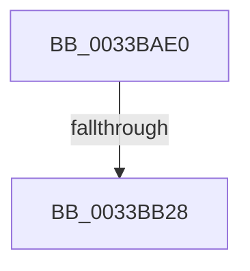

# MiPfnToStandbyLookaside

- RVA: `0x0033BAE0`–`0x0033BB42` (길이 `98` bytes)
- VA: `0x000000014033BAE0`
- 실행 섹션: `.text`
- PDB 이름 있음: `예`; PDB Function 태그: `아니요`
- unwind 정보 RVA: `0x00076E90`
- 디코드: `23`개 명령, `98/98` bytes 표시
- 미해석 바이트: `0` (있으면 어셈블리에 `.byte`로 보존)

> 이 문서는 커널 이미지의 기계어와 PDB 기호를 분석해 생성했습니다. 4번과 5번은 함수 원형과 자료형을 바이너리 사용 방식에서 추정한 C 해석이며 원본 소스 복구 결과는 아닙니다.

## 1. Dependencies

- 직접 호출 지점: **0**; 고유 호출 대상: **0**
- 직접 호출자로 확인된 함수: **2**
- RIP 상대 이미지 참조: **1**

### Outgoing calls
- 직접 디코드된 call 명령이 없습니다.

### Direct callers
- [MiRebuildStandbyLookasideList](../3D/MiRebuildStandbyLookasideList_function_003D50E0.md) at `0x003D512D`
- [MiExclusiveInsertPfnChainInList](../44/MiExclusiveInsertPfnChainInList_function_00445C48.md) at `0x00445E43`

### Static image references
- `0x0033BB32` → RVA `0x00E30088` (`.data`; read)

## 2. Other-region calls and transfers

- 다른 실행 섹션으로 향하는 call: **0**
- call이 아닌 외부 분기/꼬리 이동: **1**
  - `0x0033BB22` → [sub_0033BC63](Unknown_function_0033BC63.md) (`tail-transfer`)

## 3. Assembly (complete function range)

```asm
0033BAE0  48 89 5C 24 10                  mov qword ptr [rsp + 0x10], rbx
0033BAE5  48 89 74 24 18                  mov qword ptr [rsp + 0x18], rsi
0033BAEA  57                              push rdi
0033BAEB  41 54                           push r12
0033BAED  41 57                           push r15
0033BAEF  48 83 EC 30                     sub rsp, 0x30
0033BAF3  4C 8D 14 49                     lea r10, [rcx + rcx*2]
0033BAF7  49 BF 00 00 00 00 00 DE FF FF   movabs r15, 0xffffde0000000000
0033BB01  4D 8B D8                        mov r11, r8
0033BB04  49 C1 E2 04                     shl r10, 4
0033BB08  49 8B D9                        mov rbx, r9
0033BB0B  4C 8B C1                        mov r8, rcx
0033BB0E  49 8B C7                        mov rax, r15
0033BB11  49 8D 3C 02                     lea rdi, [r10 + rax]
0033BB15  49 BC AB AA AA AA AA AA AA AA   movabs r12, 0xaaaaaaaaaaaaaaab
0033BB1F  48 85 D2                        test rdx, rdx
0033BB22  0F 84 3B 01 00 00               je 0x14033bc63
0033BB28  8B 32                           mov esi, dword ptr [rdx]
0033BB2A  49 89 79 08                     mov qword ptr [r9 + 8], rdi
0033BB2E  48 8B 47 28                     mov rax, qword ptr [rdi + 0x28]
0033BB32  48 8B 0D 4F 45 AF 00            mov rcx, qword ptr [rip + 0xaf454f]
0033BB39  48 C1 E8 2B                     shr rax, 0x2b
0033BB3D  25 FF 03 00 00                  and eax, 0x3ff
```

## 4. C-style interpretation (structured pseudocode)

```c
__int64 __fastcall MiPfnToStandbyLookaside(__int64 a1, __int64 a2, __int64 a3, __int64 a4)
{
    __int64 result;
    __int64 v_r10;
    __int64 v_rsp;
    unsigned __int64 v_stack_p10;
    unsigned __int64 v_stack_p18;

    v_stack_p10 = v_rbx;
    v_stack_p18 = v_rsi;
    v_rsp = (v_rsp) - (48);
    v_r10 = (a1 + a1 * 2) << (4);
    *(unsigned __int64 *)(a4 + 8) = v_r10 + v_r15 * 1;
    result = (*(unsigned __int64 *)(v_r10 + v_r15 * 1 + 40)) >> (43);
    result = (unsigned int)((result) & (0x3FFULL));
    return result;
}
```

## 5. (Beta) C Style

```c
int64_t MiPfnToStandbyLookaside(void *Arg1, int64_t Arg2, int64_t Arg3, void *Arg4)
{
    uint8_t *arg1 = (uint8_t *)Arg1;
    uint8_t *arg4 = (uint8_t *)Arg4;

    int64_t result;
    int64_t local_r10;
    int64_t local_rsp;
    uint64_t v_stack_p10;
    uint64_t v_stack_p18;

    v_stack_p10 = local_rbx;
    v_stack_p18 = local_rsi;
    local_rsp = (local_rsp) - (48);
    local_r10 = (Arg1 + Arg1 * 2) << (4);
    *(uint64_t *)(arg4 + 0x8) = local_r10 + local_r15 * 1;
    result = (*(uint64_t *)(local_r10 + local_r15 * 1 + 0x28)) >> (43);
    result = (uint32_t)((result) & (0x3FFULL));
    return result;
}
```

### 관측된 메모리 오프셋

구조체 형식이 확인되지 않은 접근은 인자 기준의 오프셋으로만 기록했습니다.

| 기준 인자 | 오프셋 표현 | 폭 (bit) | 접근 |
|---|---:|---:|---|
| `Arg1` | `+ 0x0 + rcx*2` | `64` | `R` |
| `Arg4` | `+ 0x8` | `64` | `W` |

## 6. Execution-region graph

[열기: 2D/3D 그래프와 함수 탐색 컨트롤 패널](../../../control-panel.html?section=text&rva=0x0033BAE0&view=graph)

- 2D 그래프는 위에서 아래로 흐르고, 3D 그래프는 빈 공간을 드래그해 회전합니다. Shift+드래그는 이동, 휠은 확대·축소, 함수 노드 선택은 대상 보고서 이동입니다.

### Static fallback


