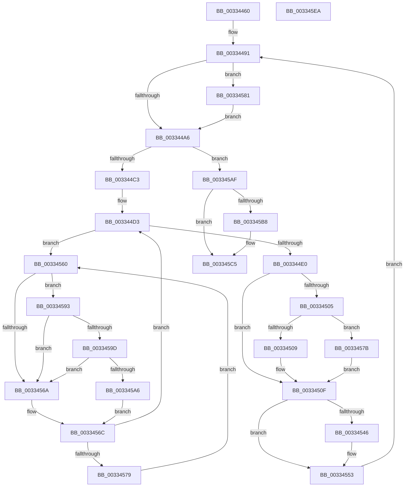

# MiPurgePartitionStandby

- RVA: `0x00334460`–`0x003345EB` (길이 `395` bytes)
- VA: `0x0000000140334460`
- 실행 섹션: `.text`
- PDB 이름 있음: `예`; PDB Function 태그: `아니요`
- unwind 정보 RVA: `0x00075C18`
- 디코드: `102`개 명령, `395/395` bytes 표시
- 미해석 바이트: `0` (있으면 어셈블리에 `.byte`로 보존)

> 이 문서는 커널 이미지의 기계어와 PDB 기호를 분석해 생성했습니다. 4번과 5번은 함수 원형과 자료형을 바이너리 사용 방식에서 추정한 C 해석이며 원본 소스 복구 결과는 아닙니다.

## 1. Dependencies

- 직접 호출 지점: **7**; 고유 호출 대상: **6**
- 직접 호출자로 확인된 함수: **3**
- RIP 상대 이미지 참조: **4**

### Outgoing calls
- `0x003344B1` → [MiRemoveLowestPriorityStandbyPage](MiRemoveLowestPriorityStandbyPage_function_00334600.md) (function, `0x00334600`)
- `0x00334529` → [MiInsertPageInFreeOrZeroedList](MiInsertPageInFreeOrZeroedList_function_00334D20.md) (function, `0x00334D20`)
- `0x0033454E` → [KiLowerIrqlProcessIrqlFlags](../4F/KiLowerIrqlProcessIrqlFlags_function_004F5698.md) (function, `0x004F5698`)
- `0x00334589` → [KiRaiseIrqlProcessIrqlFlags](../4F/KiRaiseIrqlProcessIrqlFlags_function_004F56FC.md) (function, `0x004F56FC`)
- `0x0033459D` → [KiCheckVpBackingLongSpinWaitHypercall](../30/KiCheckVpBackingLongSpinWaitHypercall_function_0030F490.md) (function, `0x0030F490`)
- `0x003345A8` → [HvlNotifyLongSpinWait](../30/HvlNotifyLongSpinWait_function_0030F460.md) (function, `0x0030F460`)
- `0x003345C0` → [KiLowerIrqlProcessIrqlFlags](../4F/KiLowerIrqlProcessIrqlFlags_function_004F5698.md) (function, `0x004F5698`)

### Direct callers
- [MiMirrorPurgePartitionPages](../4B/MiMirrorPurgePartitionPages_function_004BEFA0.md) at `0x004BEFBD`
- [MiTrimAllSystemPagableMemory](../67/MiTrimAllSystemPagableMemory_function_0067EDF0.md) at `0x0067EED0`
- [MmPerformMemoryListCommand](../../pagelk/B7/MmPerformMemoryListCommand_function_00B7D730.md) at `0x00B7D782`

### Static image references
- `0x00334499` → RVA `0x00FC6D20` (`ALMOSTRO`; read)
- `0x003344F9` → RVA `0x00E2DC80` (`.data`; read)
- `0x00334562` → RVA `0x00FC52AC` (`ALMOSTRO`; reference)
- `0x00334593` → RVA `0x00FC6AB8` (`ALMOSTRO`; read)

## 2. Other-region calls and transfers

- 다른 실행 섹션으로 향하는 call: **0**
- 별도 외부 분기/꼬리 이동을 확인하지 못했습니다.

## 3. Assembly (complete function range)

```asm
00334460  48 89 5C 24 08                  mov qword ptr [rsp + 8], rbx
00334465  48 89 6C 24 10                  mov qword ptr [rsp + 0x10], rbp
0033446A  48 89 74 24 18                  mov qword ptr [rsp + 0x18], rsi
0033446F  57                              push rdi
00334470  41 54                           push r12
00334472  41 55                           push r13
00334474  41 56                           push r14
00334476  41 57                           push r15
00334478  48 83 EC 20                     sub rsp, 0x20
0033447C  8B EA                           mov ebp, edx
0033447E  49 BD 00 00 00 00 00 DE FF FF   movabs r13, 0xffffde0000000000
00334488  4C 8B F9                        mov r15, rcx
0033448B  41 BC 02 00 00 00               mov r12d, 2
00334491  44 0F 20 C6                     mov rsi, cr8
00334495  45 0F 22 C4                     mov cr8, r12
00334499  83 3D 80 28 C9 00 00            cmp dword ptr [rip + 0xc92880], 0
003344A0  0F 85 DB 00 00 00               jne 0x140334581
003344A6  41 B8 00 02 00 00               mov r8d, 0x200
003344AC  8B D5                           mov edx, ebp
003344AE  49 8B CF                        mov rcx, r15
003344B1  E8 4A 01 00 00                  call 0x140334600
003344B6  4C 8B F0                        mov r14, rax
003344B9  48 83 F8 FF                     cmp rax, -1
003344BD  0F 84 EC 00 00 00               je 0x1403345af
003344C3  48 8D 1C 40                     lea rbx, [rax + rax*2]
003344C7  48 C1 E3 04                     shl rbx, 4
003344CB  49 8B CD                        mov rcx, r13
003344CE  48 03 D9                        add rbx, rcx
003344D1  33 FF                           xor edi, edi
003344D3  F0 48 0F BA 6B 18 3F            lock bts qword ptr [rbx + 0x18], 0x3f
003344DA  0F 82 80 00 00 00               jb 0x140334560
003344E0  48 8B 43 18                     mov rax, qword ptr [rbx + 0x18]
003344E4  48 B9 00 00 00 00 00 00 00 40   movabs rcx, 0x4000000000000000
003344EE  48 0B C1                        or rax, rcx
003344F1  48 89 43 18                     mov qword ptr [rbx + 0x18], rax
003344F5  48 8B 43 10                     mov rax, qword ptr [rbx + 0x10]
003344F9  48 8B 0D 80 97 AF 00            mov rcx, qword ptr [rip + 0xaf9780]
00334500  48 85 C9                        test rcx, rcx
00334503  74 0A                           je 0x14033450f
00334505  A8 10                           test al, 0x10
00334507  75 72                           jne 0x14033457b
00334509  48 F7 D1                        not rcx
0033450C  48 23 C1                        and rax, rcx
0033450F  48 C1 E8 20                     shr rax, 0x20
00334513  B9 FD FF FF FF                  mov ecx, 0xfffffffd
00334518  48 3B C1                        cmp rax, rcx
0033451B  41 8B D4                        mov edx, r12d
0033451E  B8 02 04 00 00                  mov eax, 0x402
00334523  49 8B CE                        mov rcx, r14
00334526  0F 44 D0                        cmove edx, eax
00334529  E8 F2 07 00 00                  call 0x140334d20
0033452E  48 B8 FF FF FF FF FF FF FF 7F   movabs rax, 0x7fffffffffffffff
00334538  F0 48 21 43 18                  lock and qword ptr [rbx + 0x18], rax
0033453D  83 3D DC 27 C9 00 00            cmp dword ptr [rip + 0xc927dc], 0
00334544  74 0D                           je 0x140334553
00334546  44 0F 20 C1                     mov rcx, cr8
0033454A  40 0F B6 D6                     movzx edx, sil
0033454E  E8 45 11 1C 00                  call 0x1404f5698
00334553  40 0F B6 C6                     movzx eax, sil
00334557  44 0F 22 C0                     mov cr8, rax
0033455B  E9 31 FF FF FF                  jmp 0x140334491
00334560  FF C7                           inc edi
00334562  85 3D 44 0D C9 00               test dword ptr [rip + 0xc90d44], edi
00334568  74 29                           je 0x140334593
0033456A  F3 90                           pause
0033456C  48 8B 43 18                     mov rax, qword ptr [rbx + 0x18]
00334570  48 85 C0                        test rax, rax
00334573  0F 89 5A FF FF FF               jns 0x1403344d3
00334579  EB E5                           jmp 0x140334560
0033457B  48 83 E0 EF                     and rax, 0xffffffffffffffef
0033457F  EB 8E                           jmp 0x14033450f
00334581  41 0F B6 D4                     movzx edx, r12b
00334585  40 0F B6 CE                     movzx ecx, sil
00334589  E8 6E 11 1C 00                  call 0x1404f56fc
0033458E  E9 13 FF FF FF                  jmp 0x1403344a6
00334593  8B 05 1F 25 C9 00               mov eax, dword ptr [rip + 0xc9251f]
00334599  A8 40                           test al, 0x40
0033459B  74 CD                           je 0x14033456a
0033459D  E8 EE AE FD FF                  call 0x14030f490
003345A2  84 C0                           test al, al
003345A4  74 C4                           je 0x14033456a
003345A6  8B CF                           mov ecx, edi
003345A8  E8 B3 AE FD FF                  call 0x14030f460
003345AD  EB BD                           jmp 0x14033456c
003345AF  83 3D 6A 27 C9 00 00            cmp dword ptr [rip + 0xc9276a], 0
003345B6  74 0D                           je 0x1403345c5
003345B8  44 0F 20 C1                     mov rcx, cr8
003345BC  40 0F B6 D6                     movzx edx, sil
003345C0  E8 D3 10 1C 00                  call 0x1404f5698
003345C5  40 0F B6 C6                     movzx eax, sil
003345C9  44 0F 22 C0                     mov cr8, rax
003345CD  48 8B 5C 24 50                  mov rbx, qword ptr [rsp + 0x50]
003345D2  48 8B 6C 24 58                  mov rbp, qword ptr [rsp + 0x58]
003345D7  48 8B 74 24 60                  mov rsi, qword ptr [rsp + 0x60]
003345DC  48 83 C4 20                     add rsp, 0x20
003345E0  41 5F                           pop r15
003345E2  41 5E                           pop r14
003345E4  41 5D                           pop r13
003345E6  41 5C                           pop r12
003345E8  5F                              pop rdi
003345E9  C3                              ret
003345EA  CC                              int3
```

## 4. C-style interpretation (structured pseudocode)

```c
__int64 __fastcall MiPurgePartitionStandby(__int64 a1, int a2)
{
    __int64 result;
    __int64 v_rbx;
    __int64 v_rdi;
    __int64 v_rsp;
    unsigned __int64 v_stack_p10;
    unsigned __int64 v_stack_p18;
    unsigned __int64 v_stack_p8;

    v_stack_p8 = v_rbx;
    v_stack_p10 = v_rbp;
    v_stack_p18 = v_rsi;
    v_rsp = (v_rsp) - (32);
loc_00334491:
    if ((*(unsigned int *)(v_rip + 13183104)) != 0) goto loc_00334581;
loc_003344A6:
    result = MiRemoveLowestPriorityStandbyPage(a1, (unsigned int)((unsigned int)((unsigned int)(a2))), 512, a4);
    if (result == -1) goto loc_003345AF;
    v_rbx = (result + result * 2) << (4);
    v_rbx = (v_rbx) + (v_r13);
    v_rdi = 0;
loc_003344D3:
    if (condition_is_below) goto loc_00334560;
    result = (*(unsigned __int64 *)(v_rbx + 24)) | (v_r13);
    *(unsigned __int64 *)(v_rbx + 24) = result;
    if (*(unsigned __int64 *)(v_rip + 11507584) == 0) goto loc_0033450F;
    if ((((unsigned __int8)(*(unsigned __int64 *)(v_rbx + 16))) & (16)) != 0) goto loc_0033457B;
    a1 = ~(*(unsigned __int64 *)(v_rip + 11507584));
    result = (*(unsigned __int64 *)(v_rbx + 16)) & (a1);
loc_0033450F:
    result = (result) >> (32);
    a2 = 2;
    if (result == ((unsigned int)(0xFFFFFFFDULL))) { a2 = (unsigned int)((unsigned int)(0x402ULL)); }
    result = MiInsertPageInFreeOrZeroedList(result, a2, 512, a4);
    if ((*(unsigned int *)(v_rip + 13182940)) != 0) {
        a1 = 2;
        a2 = (unsigned __int8)(v_cr8);
        result = KiLowerIrqlProcessIrqlFlags(a1, a2, 512, a4);
    }
    goto loc_00334491;
loc_00334560:
    v_rdi = (unsigned int)((v_rdi) + 1);
    if (((*(unsigned int *)(v_rip + 13176132)) & ((unsigned int)(v_rdi))) == 0) goto loc_00334593;
loc_0033456A:
loc_0033456C:
    if (!sign_flag) goto loc_003344D3;
    goto loc_00334560;
loc_0033457B:
    result = (*(unsigned __int64 *)(v_rbx + 24)) & (-17);
    goto loc_0033450F;
loc_00334581:
    result = KiRaiseIrqlProcessIrqlFlags((unsigned __int8)(v_cr8), 2, 512, a4);
    goto loc_003344A6;
loc_00334593:
    if ((((unsigned __int8)((unsigned int)(*(unsigned int *)(v_rip + 13182239)))) & (64)) == 0) goto loc_0033456A;
    result = KiCheckVpBackingLongSpinWaitHypercall((unsigned __int8)(v_cr8), 2, 512, a4);
    if ((unsigned __int8)(result) == 0) goto loc_0033456A;
    result = HvlNotifyLongSpinWait((unsigned int)((unsigned int)(v_rdi)), 2, 512, a4);
    goto loc_0033456C;
loc_003345AF:
    if ((*(unsigned int *)(v_rip + 13182826)) != 0) {
        a1 = (unsigned __int8)(v_cr8);
        a2 = (unsigned __int8)(v_cr8);
        result = KiLowerIrqlProcessIrqlFlags(a1, a2, 512, a4);
    }
    v_rsp = (v_rsp) + (32);
    return (unsigned __int8)(v_cr8);
}
```

## 5. (Beta) C Style

```c
int64_t MiPurgePartitionStandby(int64_t Arg1, int32_t Arg2)
{
    int64_t result;
    int64_t local_rbx;
    int64_t local_rdi;
    int64_t local_rsp;
    uint64_t v_stack_p10;
    uint64_t v_stack_p18;
    uint64_t v_stack_p8;

    v_stack_p8 = local_rbx;
    v_stack_p10 = local_rbp;
    v_stack_p18 = local_rsi;
    local_rsp = (local_rsp) - (32);
loc_00334491:
    if ((*(uint32_t *)(v_rip + 0xC92880)) != 0) goto loc_00334581;
loc_003344A6:
    result = MiRemoveLowestPriorityStandbyPage(Arg1, (uint32_t)((uint32_t)((uint32_t)(Arg2))), 512, a4);
    if (result == -1) goto loc_003345AF;
    local_rbx = (result + result * 2) << (4);
    local_rbx = (local_rbx) + (local_r13);
    local_rdi = 0;
loc_003344D3:
    if (condition_is_below) goto loc_00334560;
    result = (*(uint64_t *)(local_rbx + 0x18)) | (local_r13);
    *(uint64_t *)(local_rbx + 0x18) = result;
    if (*(uint64_t *)(v_rip + 0xAF9780) == 0) goto loc_0033450F;
    if ((((uint8_t)(*(uint64_t *)(local_rbx + 0x10))) & (16)) != 0) goto loc_0033457B;
    Arg1 = ~(*(uint64_t *)(v_rip + 0xAF9780));
    result = (*(uint64_t *)(local_rbx + 0x10)) & (Arg1);
loc_0033450F:
    result = (result) >> (32);
    Arg2 = 2;
    if (result == ((uint32_t)(0xFFFFFFFDULL))) { Arg2 = (uint32_t)((uint32_t)(0x402ULL)); }
    result = MiInsertPageInFreeOrZeroedList(result, Arg2, 512, a4);
    if ((*(uint32_t *)(v_rip + 0xC927DC)) != 0) {
        Arg1 = 2;
        Arg2 = (uint8_t)(v_cr8);
        result = KiLowerIrqlProcessIrqlFlags(Arg1, Arg2, 512, a4);
    }
    goto loc_00334491;
loc_00334560:
    local_rdi = (uint32_t)((local_rdi) + 1);
    if (((*(uint32_t *)(v_rip + 0xC90D44)) & ((uint32_t)(local_rdi))) == 0) goto loc_00334593;
loc_0033456A:
loc_0033456C:
    if (!sign_flag) goto loc_003344D3;
    goto loc_00334560;
loc_0033457B:
    result = (*(uint64_t *)(local_rbx + 0x18)) & (-17);
    goto loc_0033450F;
loc_00334581:
    result = KiRaiseIrqlProcessIrqlFlags((uint8_t)(v_cr8), 2, 512, a4);
    goto loc_003344A6;
loc_00334593:
    if ((((uint8_t)((uint32_t)(*(uint32_t *)(v_rip + 0xC9251F)))) & (64)) == 0) goto loc_0033456A;
    result = KiCheckVpBackingLongSpinWaitHypercall((uint8_t)(v_cr8), 2, 512, a4);
    if ((uint8_t)(result) == 0) goto loc_0033456A;
    result = HvlNotifyLongSpinWait((uint32_t)((uint32_t)(local_rdi)), 2, 512, a4);
    goto loc_0033456C;
loc_003345AF:
    if ((*(uint32_t *)(v_rip + 0xC9276A)) != 0) {
        Arg1 = (uint8_t)(v_cr8);
        Arg2 = (uint8_t)(v_cr8);
        result = KiLowerIrqlProcessIrqlFlags(Arg1, Arg2, 512, a4);
    }
    local_rsp = (local_rsp) + (32);
    return (uint8_t)(v_cr8);
}
```

## 6. Execution-region graph

[열기: 2D/3D 그래프와 함수 탐색 컨트롤 패널](../../../control-panel.html?section=text&rva=0x00334460&view=graph)

- 2D 그래프는 위에서 아래로 흐르고, 3D 그래프는 빈 공간을 드래그해 회전합니다. Shift+드래그는 이동, 휠은 확대·축소, 함수 노드 선택은 대상 보고서 이동입니다.

### Static fallback


