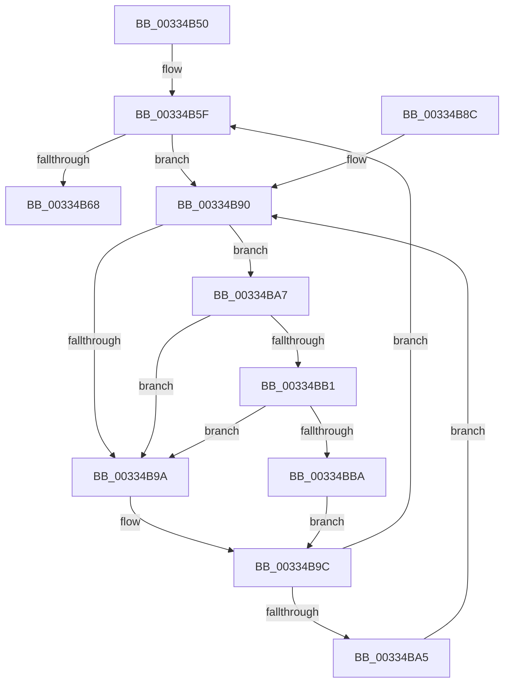

# MiReleaseFreshPageAtDpc

- RVA: `0x00334B50`–`0x00334BC3` (길이 `115` bytes)
- VA: `0x0000000140334B50`
- 실행 섹션: `.text`
- PDB 이름 있음: `예`; PDB Function 태그: `아니요`
- unwind 정보 RVA: `0x00076828`
- 디코드: `35`개 명령, `115/115` bytes 표시
- 미해석 바이트: `0` (있으면 어셈블리에 `.byte`로 보존)

> 이 문서는 커널 이미지의 기계어와 PDB 기호를 분석해 생성했습니다. 4번과 5번은 함수 원형과 자료형을 바이너리 사용 방식에서 추정한 C 해석이며 원본 소스 복구 결과는 아닙니다.

## 1. Dependencies

- 직접 호출 지점: **3**; 고유 호출 대상: **3**
- 직접 호출자로 확인된 함수: **19**
- RIP 상대 이미지 참조: **2**

### Outgoing calls
- `0x00334B6D` → [MiReturnFreeZeroPage](MiReturnFreeZeroPage_function_00334BD0.md) (function, `0x00334BD0`)
- `0x00334BB1` → [KiCheckVpBackingLongSpinWaitHypercall](../30/KiCheckVpBackingLongSpinWaitHypercall_function_0030F490.md) (function, `0x0030F490`)
- `0x00334BBC` → [HvlNotifyLongSpinWait](../30/HvlNotifyLongSpinWait_function_0030F460.md) (function, `0x0030F460`)

### Direct callers
- [MiFinishHardFault](../2B/MiFinishHardFault_function_002B6F10.md) at `0x002B77A7`
- [MiDeleteUltraMapContext](../2D/MiDeleteUltraMapContext_function_002DC9A4.md) at `0x002DCADD`
- [MiManageUltraSpacePageTable](../2D/MiManageUltraSpacePageTable_function_002DCAF0.md) at `0x002DCE96`
- [sub_002F6E32](../2F/Unknown_function_002F6E32.md) at `0x002F762D`
- [sub_00322E07](../32/Unknown_function_00322E07.md) at `0x00322E5E`
- [sub_00322E07](../32/Unknown_function_00322E07.md) at `0x00322E91`
- [MiReleaseFreshPage](MiReleaseFreshPage_function_00334AE0.md) at `0x00334B06`
- [MiPrivateFixup](../36/MiPrivateFixup_function_003693E8.md) at `0x00369A58`
- [MiResolvePageFileFault](../36/MiResolvePageFileFault_function_0036D968.md) at `0x0036ECE5`
- [MiLockCode](../36/MiLockCode_function_0036F91C.md) at `0x0036FED1`
- [MiLockCode](../36/MiLockCode_function_0036F91C.md) at `0x003700EF`
- [MiReplaceLockedPage](../38/MiReplaceLockedPage_function_0038351C.md) at `0x003836AC`
- [MiMakeDriverPagesPrivate](../38/MiMakeDriverPagesPrivate_function_00384C60.md) at `0x00384EEB`
- [MiSwapNumaStandbyPage](../38/MiSwapNumaStandbyPage_function_00385144.md) at `0x00385666`
- [MiHandleSpecialPurposeMemoryCachedFault](../44/MiHandleSpecialPurposeMemoryCachedFault_function_0044C740.md) at `0x0044CA68`
- [MiCompleteSecureProcessFault](../46/MiCompleteSecureProcessFault_function_0046710C.md) at `0x0046732D`
- [MiCompleteSecureProcessFault](../46/MiCompleteSecureProcessFault_function_0046710C.md) at `0x00467378`
- [MiFinalizeImageHeaderPage](../4A/MiFinalizeImageHeaderPage_function_004A89A8.md) at `0x004A8AC9`
- [MiSplitDirectMapPage](../4D/MiSplitDirectMapPage_function_004DAAA0.md) at `0x004DAD75`
- [MiIdealClusterPage](../4D/MiIdealClusterPage_function_004DB964.md) at `0x004DBEAE`
- [MiIdealClusterPage](../4D/MiIdealClusterPage_function_004DB964.md) at `0x004DC079`
- [MiMakeVaRangePhysicallyContiguous](../69/MiMakeVaRangePhysicallyContiguous_function_006936E0.md) at `0x00693966`
- [MiInitializeCacheFlushing](../../init/C6/MiInitializeCacheFlushing_function_00C6ACF8.md) at `0x00C6AFC6`

### Static image references
- `0x00334B92` → RVA `0x00FC52AC` (`ALMOSTRO`; reference)
- `0x00334BA7` → RVA `0x00FC6AB8` (`ALMOSTRO`; read)

## 2. Other-region calls and transfers

- 다른 실행 섹션으로 향하는 call: **0**
- 별도 외부 분기/꼬리 이동을 확인하지 못했습니다.

## 3. Assembly (complete function range)

```asm
00334B50  48 89 5C 24 08                  mov qword ptr [rsp + 8], rbx
00334B55  57                              push rdi
00334B56  48 83 EC 20                     sub rsp, 0x20
00334B5A  48 8B D9                        mov rbx, rcx
00334B5D  33 FF                           xor edi, edi
00334B5F  F0 48 0F BA 6B 18 3F            lock bts qword ptr [rbx + 0x18], 0x3f
00334B66  72 28                           jb 0x140334b90
00334B68  33 D2                           xor edx, edx
00334B6A  48 8B CB                        mov rcx, rbx
00334B6D  E8 5E 00 00 00                  call 0x140334bd0
00334B72  48 B8 FF FF FF FF FF FF FF 7F   movabs rax, 0x7fffffffffffffff
00334B7C  F0 48 21 43 18                  lock and qword ptr [rbx + 0x18], rax
00334B81  48 8B 5C 24 30                  mov rbx, qword ptr [rsp + 0x30]
00334B86  48 83 C4 20                     add rsp, 0x20
00334B8A  5F                              pop rdi
00334B8B  C3                              ret
00334B8C  CC                              int3
00334B8D  0F 1F 00                        nop dword ptr [rax]
00334B90  FF C7                           inc edi
00334B92  85 3D 14 07 C9 00               test dword ptr [rip + 0xc90714], edi
00334B98  74 0D                           je 0x140334ba7
00334B9A  F3 90                           pause
00334B9C  48 8B 43 18                     mov rax, qword ptr [rbx + 0x18]
00334BA0  48 85 C0                        test rax, rax
00334BA3  79 BA                           jns 0x140334b5f
00334BA5  EB E9                           jmp 0x140334b90
00334BA7  8B 05 0B 1F C9 00               mov eax, dword ptr [rip + 0xc91f0b]
00334BAD  A8 40                           test al, 0x40
00334BAF  74 E9                           je 0x140334b9a
00334BB1  E8 DA A8 FD FF                  call 0x14030f490
00334BB6  84 C0                           test al, al
00334BB8  74 E0                           je 0x140334b9a
00334BBA  8B CF                           mov ecx, edi
00334BBC  E8 9F A8 FD FF                  call 0x14030f460
00334BC1  EB D9                           jmp 0x140334b9c
```

## 4. C-style interpretation (structured pseudocode)

```c
__int64 __fastcall MiReleaseFreshPageAtDpc(__int64 a1, int a2)
{
    __int64 result;
    __int64 v_rdi;
    __int64 v_rsp;
    unsigned __int64 v_stack_p8;

    v_stack_p8 = v_rbx;
    v_rsp = (v_rsp) - (32);
    v_rdi = 0;
loc_00334B5F:
    if (condition_is_below) goto loc_00334B90;
    a2 = 0;
    result = MiReturnFreeZeroPage(a1, a2, a3, a4);
    v_rsp = (v_rsp) + (32);
    return result;
loc_00334B90:
    v_rdi = (unsigned int)((v_rdi) + 1);
    if (((*(unsigned int *)(v_rip + 13174548)) & ((unsigned int)(v_rdi))) == 0) goto loc_00334BA7;
loc_00334B9A:
loc_00334B9C:
    if (!sign_flag) goto loc_00334B5F;
    goto loc_00334B90;
loc_00334BA7:
    if ((((unsigned __int8)((unsigned int)(*(unsigned int *)(v_rip + 13180683)))) & (64)) == 0) goto loc_00334B9A;
    result = KiCheckVpBackingLongSpinWaitHypercall(a1, a2, a3, a4);
    if ((unsigned __int8)(result) == 0) goto loc_00334B9A;
    result = HvlNotifyLongSpinWait((unsigned int)((unsigned int)(v_rdi)), a2, a3, a4);
    goto loc_00334B9C;
}
```

## 5. (Beta) C Style

```c
int64_t MiReleaseFreshPageAtDpc(void *Arg1, int32_t Arg2)
{
    uint8_t *arg1 = (uint8_t *)Arg1;

    int64_t result;
    int64_t local_rdi;
    int64_t local_rsp;
    uint64_t v_stack_p8;

    v_stack_p8 = local_rbx;
    local_rsp = (local_rsp) - (32);
    local_rdi = 0;
loc_00334B5F:
    if (condition_is_below) goto loc_00334B90;
    Arg2 = 0;
    result = MiReturnFreeZeroPage(Arg1, Arg2, a3, a4);
    local_rsp = (local_rsp) + (32);
    return result;
loc_00334B90:
    local_rdi = (uint32_t)((local_rdi) + 1);
    if (((*(uint32_t *)(v_rip + 0xC90714)) & ((uint32_t)(local_rdi))) == 0) goto loc_00334BA7;
loc_00334B9A:
loc_00334B9C:
    if (!sign_flag) goto loc_00334B5F;
    goto loc_00334B90;
loc_00334BA7:
    if ((((uint8_t)((uint32_t)(*(uint32_t *)(v_rip + 0xC91F0B)))) & (64)) == 0) goto loc_00334B9A;
    result = KiCheckVpBackingLongSpinWaitHypercall(Arg1, Arg2, a3, a4);
    if ((uint8_t)(result) == 0) goto loc_00334B9A;
    result = HvlNotifyLongSpinWait((uint32_t)((uint32_t)(local_rdi)), Arg2, a3, a4);
    goto loc_00334B9C;
}
```

### 관측된 메모리 오프셋

구조체 형식이 확인되지 않은 접근은 인자 기준의 오프셋으로만 기록했습니다.

| 기준 인자 | 오프셋 표현 | 폭 (bit) | 접근 |
|---|---:|---:|---|
| `Arg1` | `+ 0x18` | `64` | `R` |
| `Arg1` | `+ 0x18` | `64` | `R/W` |

## 6. Execution-region graph

[열기: 2D/3D 그래프와 함수 탐색 컨트롤 패널](../../../control-panel.html?section=text&rva=0x00334B50&view=graph)

- 2D 그래프는 위에서 아래로 흐르고, 3D 그래프는 빈 공간을 드래그해 회전합니다. Shift+드래그는 이동, 휠은 확대·축소, 함수 노드 선택은 대상 보고서 이동입니다.

### Static fallback


