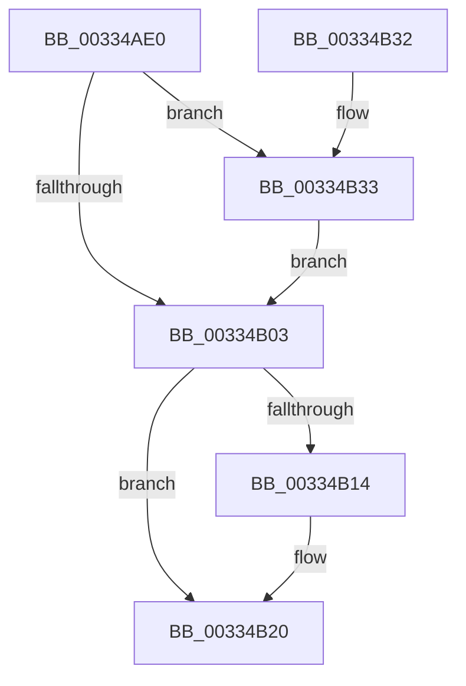

# MiReleaseFreshPage

- RVA: `0x00334AE0`–`0x00334B40` (길이 `96` bytes)
- VA: `0x0000000140334AE0`
- 실행 섹션: `.text`
- PDB 이름 있음: `예`; PDB Function 태그: `아니요`
- unwind 정보 RVA: `0x00076818`
- 디코드: `27`개 명령, `96/96` bytes 표시
- 미해석 바이트: `0` (있으면 어셈블리에 `.byte`로 보존)

> 이 문서는 커널 이미지의 기계어와 PDB 기호를 분석해 생성했습니다. 4번과 5번은 함수 원형과 자료형을 바이너리 사용 방식에서 추정한 C 해석이며 원본 소스 복구 결과는 아닙니다.

## 1. Dependencies

- 직접 호출 지점: **3**; 고유 호출 대상: **3**
- 직접 호출자로 확인된 함수: **31**
- RIP 상대 이미지 참조: **1**

### Outgoing calls
- `0x00334B06` → [MiReleaseFreshPageAtDpc](MiReleaseFreshPageAtDpc_function_00334B50.md) (function, `0x00334B50`)
- `0x00334B1B` → [KiLowerIrqlProcessIrqlFlags](../4F/KiLowerIrqlProcessIrqlFlags_function_004F5698.md) (function, `0x004F5698`)
- `0x00334B39` → [KiRaiseIrqlProcessIrqlFlags](../4F/KiRaiseIrqlProcessIrqlFlags_function_004F56FC.md) (function, `0x004F56FC`)

### Direct callers
- [MiCreateUltraThreadContext](../28/MiCreateUltraThreadContext_function_00288200.md) at `0x002883AF`
- [MiGetPage](../28/MiGetPage_function_002884C0.md) at `0x0028966F`
- [MiTradeTransitionPage](../28/MiTradeTransitionPage_function_0028B9AC.md) at `0x0028BD15`
- [MiFindContiguousPagesEx](../28/MiFindContiguousPagesEx_function_0028BDE0.md) at `0x0028C421`
- [MiClaimPhysicalRun](../28/MiClaimPhysicalRun_function_0028CF00.md) at `0x0028D0BB`
- [MiAllocateKernelStackPages](../2A/MiAllocateKernelStackPages_function_002A1BEC.md) at `0x002A2270`
- [MiStealPage](../2B/MiStealPage_function_002B28D0.md) at `0x002B3ECA`
- [MiMakePageAvoidRead](../2B/MiMakePageAvoidRead_function_002B7DE0.md) at `0x002B843A`
- [MiCreateUltraThreadContextHelper](../2C/MiCreateUltraThreadContextHelper_function_002CB380.md) at `0x002CB4D3`
- [MiReplenishUltraPageTables](../2C/MiReplenishUltraPageTables_function_002CB4EC.md) at `0x002CB679`
- [MiDeleteUltraMapContext](../2D/MiDeleteUltraMapContext_function_002DC9A4.md) at `0x002DCA50`
- [MiManageUltraSpacePageTable](../2D/MiManageUltraSpacePageTable_function_002DCAF0.md) at `0x002DCE51`
- [MiSharePages](../31/MiSharePages_function_00315110.md) at `0x00315A15`
- [sub_00322C9B](../32/Unknown_function_00322C9B.md) at `0x00322D53`
- [sub_00322C9B](../32/Unknown_function_00322C9B.md) at `0x00322DA5`
- [MiCompletePrivateZeroFault](MiCompletePrivateZeroFault_function_00330CC0.md) at `0x00331599`
- [MiRemoveLowestPriorityStandbyPage](MiRemoveLowestPriorityStandbyPage_function_00334600.md) at `0x00334A55`
- [MiWalkEntireImage](../36/MiWalkEntireImage_function_00365D70.md) at `0x003665EB`
- [MiWalkEntireImage](../36/MiWalkEntireImage_function_00365D70.md) at `0x00366667`
- [MiResolvePageFileFault](../36/MiResolvePageFileFault_function_0036D968.md) at `0x0036E187`
- [MiLockCode](../36/MiLockCode_function_0036F91C.md) at `0x00370187`
- [MiAllocateMostlyContiguousPagesForMdl](../37/MiAllocateMostlyContiguousPagesForMdl_function_003769B0.md) at `0x00376BD5`
- [MiFreePageChain](../37/MiFreePageChain_function_00377D9C.md) at `0x00377DBF`
- [MiReplaceLockedPage](../38/MiReplaceLockedPage_function_0038351C.md) at `0x003836E4`
- [MiMakeDriverPagesPrivate](../38/MiMakeDriverPagesPrivate_function_00384C60.md) at `0x00385134`
- [MiFreeLargeZeroPages](../3B/MiFreeLargeZeroPages_function_003B5F0C.md) at `0x003B5FB2`
- [MiAllocateMdlPagesByLists](../3B/MiAllocateMdlPagesByLists_function_003B7898.md) at `0x003B7B20`
- [MiAllocateMdlPagesByLists](../3B/MiAllocateMdlPagesByLists_function_003B7898.md) at `0x003B7B2E`
- [MiSwitchToTransition](../4C/MiSwitchToTransition_function_004C0F5C.md) at `0x004C1611`
- [MiProtectDriverSectionPte](../67/MiProtectDriverSectionPte_function_006706C0.md) at `0x0067098D`
- [MiEstablishDefragSlabEntries](../68/MiEstablishDefragSlabEntries_function_0068E0EC.md) at `0x0068E3C7`
- [sub_006DAAE6](../6D/Unknown_function_006DAAE6.md) at `0x006DAD57`
- [sub_006DBADA](../6D/Unknown_function_006DBADA.md) at `0x006DBB0A`
- [MiFreeReadListPages](../../page/93/MiFreeReadListPages_function_0093D600.md) at `0x0093D65E`
- [MiFreeReadListPages](../../page/93/MiFreeReadListPages_function_0093D600.md) at `0x0093D6B9`

### Static image references
- `0x00334AFA` → RVA `0x00FC6D20` (`ALMOSTRO`; read)

## 2. Other-region calls and transfers

- 다른 실행 섹션으로 향하는 call: **0**
- 별도 외부 분기/꼬리 이동을 확인하지 못했습니다.

## 3. Assembly (complete function range)

```asm
00334AE0  48 89 5C 24 08                  mov qword ptr [rsp + 8], rbx
00334AE5  57                              push rdi
00334AE6  48 83 EC 20                     sub rsp, 0x20
00334AEA  48 8B F9                        mov rdi, rcx
00334AED  44 0F 20 C3                     mov rbx, cr8
00334AF1  B8 02 00 00 00                  mov eax, 2
00334AF6  44 0F 22 C0                     mov cr8, rax
00334AFA  83 3D 1F 22 C9 00 00            cmp dword ptr [rip + 0xc9221f], 0
00334B01  75 30                           jne 0x140334b33
00334B03  48 8B CF                        mov rcx, rdi
00334B06  E8 45 00 00 00                  call 0x140334b50
00334B0B  83 3D 0E 22 C9 00 00            cmp dword ptr [rip + 0xc9220e], 0
00334B12  74 0C                           je 0x140334b20
00334B14  44 0F 20 C1                     mov rcx, cr8
00334B18  0F B6 D3                        movzx edx, bl
00334B1B  E8 78 0B 1C 00                  call 0x1404f5698
00334B20  0F B6 C3                        movzx eax, bl
00334B23  44 0F 22 C0                     mov cr8, rax
00334B27  48 8B 5C 24 30                  mov rbx, qword ptr [rsp + 0x30]
00334B2C  48 83 C4 20                     add rsp, 0x20
00334B30  5F                              pop rdi
00334B31  C3                              ret
00334B32  CC                              int3
00334B33  0F B6 D0                        movzx edx, al
00334B36  0F B6 CB                        movzx ecx, bl
00334B39  E8 BE 0B 1C 00                  call 0x1404f56fc
00334B3E  EB C3                           jmp 0x140334b03
```

## 4. C-style interpretation (structured pseudocode)

```c
__int64 __fastcall MiReleaseFreshPage(__int64 a1)
{
    __int64 result;
    __int64 v_rsp;
    unsigned __int64 v_stack_p8;

    v_stack_p8 = v_rbx;
    v_rsp = (v_rsp) - (32);
    if ((*(unsigned int *)(v_rip + 13181471)) != 0) goto loc_00334B33;
loc_00334B03:
    result = MiReleaseFreshPageAtDpc(a1, a2, a3, a4);
    if ((*(unsigned int *)(v_rip + 13181454)) != 0) {
        a1 = 2;
        a2 = (unsigned __int8)(v_cr8);
        result = KiLowerIrqlProcessIrqlFlags(a1, a2, a3, a4);
    }
    v_rsp = (v_rsp) + (32);
    return (unsigned __int8)(v_cr8);
loc_00334B33:
    result = KiRaiseIrqlProcessIrqlFlags((unsigned __int8)(v_stack_p8), (unsigned __int8)((unsigned __int8)(v_cr8)), a3, a4);
    goto loc_00334B03;
}
```

## 5. (Beta) C Style

```c
int64_t MiReleaseFreshPage(int64_t Arg1)
{
    int64_t result;
    int64_t local_rsp;
    uint64_t v_stack_p8;

    v_stack_p8 = local_rbx;
    local_rsp = (local_rsp) - (32);
    if ((*(uint32_t *)(v_rip + 0xC9221F)) != 0) goto loc_00334B33;
loc_00334B03:
    result = MiReleaseFreshPageAtDpc(Arg1, a2, a3, a4);
    if ((*(uint32_t *)(v_rip + 0xC9220E)) != 0) {
        Arg1 = 2;
        a2 = (uint8_t)(v_cr8);
        result = KiLowerIrqlProcessIrqlFlags(Arg1, a2, a3, a4);
    }
    local_rsp = (local_rsp) + (32);
    return (uint8_t)(v_cr8);
loc_00334B33:
    result = KiRaiseIrqlProcessIrqlFlags((uint8_t)(v_stack_p8), (uint8_t)((uint8_t)(v_cr8)), a3, a4);
    goto loc_00334B03;
}
```

## 6. Execution-region graph

[열기: 2D/3D 그래프와 함수 탐색 컨트롤 패널](../../../control-panel.html?section=text&rva=0x00334AE0&view=graph)

- 2D 그래프는 위에서 아래로 흐르고, 3D 그래프는 빈 공간을 드래그해 회전합니다. Shift+드래그는 이동, 휠은 확대·축소, 함수 노드 선택은 대상 보고서 이동입니다.

### Static fallback


