# MiRemoveLowestPriorityStandbyPage

- RVA: `0x00334600`–`0x00334ADA` (길이 `1,242` bytes)
- VA: `0x0000000140334600`
- 실행 섹션: `.text`
- PDB 이름 있음: `예`; PDB Function 태그: `아니요`
- unwind 정보 RVA: `0x000767F0`
- 디코드: `298`개 명령, `1,242/1,242` bytes 표시
- 미해석 바이트: `0` (있으면 어셈블리에 `.byte`로 보존)

> 이 문서는 커널 이미지의 기계어와 PDB 기호를 분석해 생성했습니다. 4번과 5번은 함수 원형과 자료형을 바이너리 사용 방식에서 추정한 C 해석이며 원본 소스 복구 결과는 아닙니다.

## 1. Dependencies

- 직접 호출 지점: **24**; 고유 호출 대상: **23**
- 직접 호출자로 확인된 함수: **4**
- RIP 상대 이미지 참조: **4**

### Outgoing calls
- `0x00334645` → [memset](../6C/memset_function_006C6C40.md) (function, `0x006C6C40`)
- `0x003346B8` → [memset](../6C/memset_function_006C6C40.md) (function, `0x006C6C40`)
- `0x0033473E` → [MiGetAvailablePagesBelowPriority](../34/MiGetAvailablePagesBelowPriority_function_0034D340.md) (function, `0x0034D340`)
- `0x0033476D` → [MiInitializePageColorBase](../32/MiInitializePageColorBase_function_00320410.md) (function, `0x00320410`)
- `0x003347AE` → [MiGetPage](../28/MiGetPage_function_002884C0.md) (function, `0x002884C0`)
- `0x003347CC` → [MiLockStandbyLookasidePage](MiLockStandbyLookasidePage_function_00338DF0.md) (function, `0x00338DF0`)
- `0x003347F9` → [MiGetPfnSlabType](../28/MiGetPfnSlabType_function_0028E2D0.md) (function, `0x0028E2D0`)
- `0x00334825` → [MiGetPagePrivilege](../28/MiGetPagePrivilege_function_00285420.md) (function, `0x00285420`)
- `0x00334859` → [MiUnlinkStandbyPage](MiUnlinkStandbyPage_function_0033D480.md) (function, `0x0033D480`)
- `0x0033489A` → [MiClearPfnReuseFields](../37/MiClearPfnReuseFields_function_003759F0.md) (function, `0x003759F0`)
- `0x003348CD` → [MiSetOriginalPtePfnFromFreeList](../28/MiSetOriginalPtePfnFromFreeList_function_0028A99C.md) (function, `0x0028A99C`)
- `0x00334927` → [KiLowerIrqlProcessIrqlFlags](../4F/KiLowerIrqlProcessIrqlFlags_function_004F5698.md) (function, `0x004F5698`)
- `0x0033493F` → [_security_check_cookie](../6A/_security_check_cookie_function_006AC640.md) (function, `0x006AC640`)
- `0x00334975` → [KiRaiseIrqlProcessIrqlFlags](../4F/KiRaiseIrqlProcessIrqlFlags_function_004F56FC.md) (function, `0x004F56FC`)
- `0x0033498A` → [MiLockStandbyOldestPage](../3D/MiLockStandbyOldestPage_function_003D4EA4.md) (function, `0x003D4EA4`)
- `0x003349CA` → [MiReleasePageListLock](../2B/MiReleasePageListLock_function_002B1050.md) (function, `0x002B1050`)
- `0x003349D4` → [MiUnlinkPageFromListEx](../28/MiUnlinkPageFromListEx_function_00287590.md) (function, `0x00287590`)
- `0x003349FC` → [MiInsertPageInList](../2B/MiInsertPageInList_function_002BA000.md) (function, `0x002BA000`)
- `0x00334A33` → [MiDiscardTransitionPteEx](../37/MiDiscardTransitionPteEx_function_00375954.md) (function, `0x00375954`)
- `0x00334A3D` → [MiReleaseFreshPageLocked](../44/MiReleaseFreshPageLocked_function_0044CDD8.md) (function, `0x0044CDD8`)
- `0x00334A55` → [MiReleaseFreshPage](MiReleaseFreshPage_function_00334AE0.md) (function, `0x00334AE0`)
- `0x00334A74` → [MiIsPteInStore](../36/MiIsPteInStore_function_00362460.md) (function, `0x00362460`)
- `0x00334AB8` → [MiRepointPteAtExtendedStandby](../68/MiRepointPteAtExtendedStandby_function_0068B6F4.md) (function, `0x0068B6F4`)
- `0x00334AD0` → [MiSetFreeZeroPfnCold](../37/MiSetFreeZeroPfnCold_function_00379428.md) (function, `0x00379428`)

### Direct callers
- [MiGetPage](../28/MiGetPage_function_002884C0.md) at `0x00289081`
- [MiPurgePartitionStandby](MiPurgePartitionStandby_function_00334460.md) at `0x003344B1`
- [MiPruneStandbyPages](../3B/MiPruneStandbyPages_function_003BC0E4.md) at `0x003BC26E`
- [MiDeletePartitionResources](../../page/80/MiDeletePartitionResources_function_0080D074.md) at `0x0080D18A`

### Static image references
- `0x0033461C` → RVA `0x00E0A740` (`.data`; read)
- `0x003346D0` → RVA `0x00FC6D20` (`ALMOSTRO`; read)
- `0x00334788` → RVA `0x00E2DCC0` (`.data`; read)
- `0x003348C3` → RVA `0x00010880` (`.rdata`; read)

## 2. Other-region calls and transfers

- 다른 실행 섹션으로 향하는 call: **0**
- 별도 외부 분기/꼬리 이동을 확인하지 못했습니다.

## 3. Assembly (complete function range)

```asm
00334600  48 89 5C 24 10                  mov qword ptr [rsp + 0x10], rbx
00334605  55                              push rbp
00334606  56                              push rsi
00334607  57                              push rdi
00334608  41 54                           push r12
0033460A  41 55                           push r13
0033460C  41 56                           push r14
0033460E  41 57                           push r15
00334610  48 8D 6C 24 D9                  lea rbp, [rsp - 0x27]
00334615  48 81 EC F0 00 00 00            sub rsp, 0xf0
0033461C  48 8B 05 1D 61 AD 00            mov rax, qword ptr [rip + 0xad611d]
00334623  48 33 C4                        xor rax, rsp
00334626  48 89 45 17                     mov qword ptr [rbp + 0x17], rax
0033462A  45 33 F6                        xor r14d, r14d
0033462D  89 55 87                        mov dword ptr [rbp - 0x79], edx
00334630  41 8B D8                        mov ebx, r8d
00334633  44 89 74 24 38                  mov dword ptr [rsp + 0x38], r14d
00334638  4C 8B E9                        mov r13, rcx
0033463B  33 D2                           xor edx, edx
0033463D  48 8D 4D A8                     lea rcx, [rbp - 0x58]
00334641  45 8D 46 67                     lea r8d, [r14 + 0x67]
00334645  E8 F6 25 39 00                  call 0x1406c6c40
0033464A  49 C7 C4 FF FF FF FF            mov r12, 0xffffffffffffffff
00334651  4C 89 74 24 40                  mov qword ptr [rsp + 0x40], r14
00334656  41 8B F6                        mov esi, r14d
00334659  4C 89 64 24 48                  mov qword ptr [rsp + 0x48], r12
0033465E  40 88 75 A7                     mov byte ptr [rbp - 0x59], sil
00334662  41 8B FE                        mov edi, r14d
00334665  4C 89 65 8F                     mov qword ptr [rbp - 0x71], r12
00334669  41 B7 11                        mov r15b, 0x11
0033466C  44 89 74 24 30                  mov dword ptr [rsp + 0x30], r14d
00334671  48 BA FF FF FF FF 3F 00 00 00   movabs rdx, 0x3fffffffff
0033467B  49 B8 00 00 00 00 00 DE FF FF   movabs r8, 0xffffde0000000000
00334685  44 3B 75 87                     cmp r14d, dword ptr [rbp - 0x79]
00334689  0F 83 97 03 00 00               jae 0x140334a26
0033468F  41 8B C6                        mov eax, r14d
00334692  48 6B F0 58                     imul rsi, rax, 0x58
00334696  48 81 C6 C0 0C 00 00            add rsi, 0xcc0
0033469D  49 03 F5                        add rsi, r13
003346A0  48 8B 46 10                     mov rax, qword ptr [rsi + 0x10]
003346A4  48 3B C2                        cmp rax, rdx
003346A7  75 05                           jne 0x1403346ae
003346A9  41 FF C6                        inc r14d
003346AC  EB D7                           jmp 0x140334685
003346AE  33 D2                           xor edx, edx
003346B0  48 8D 4D A7                     lea rcx, [rbp - 0x59]
003346B4  44 8D 42 68                     lea r8d, [rdx + 0x68]
003346B8  E8 83 25 39 00                  call 0x1406c6c40
003346BD  41 80 FF 11                     cmp r15b, 0x11
003346C1  75 1A                           jne 0x1403346dd
003346C3  45 0F 20 C7                     mov r15, cr8
003346C7  B8 02 00 00 00                  mov eax, 2
003346CC  44 0F 22 C0                     mov cr8, rax
003346D0  83 3D 49 26 C9 00 00            cmp dword ptr [rip + 0xc92649], 0
003346D7  0F 85 91 02 00 00               jne 0x14033496e
003346DD  4C 8B 64 24 40                  mov r12, qword ptr [rsp + 0x40]
003346E2  4D 85 E4                        test r12, r12
003346E5  75 32                           jne 0x140334719
003346E7  41 8B 45 04                     mov eax, dword ptr [r13 + 4]
003346EB  84 C0                           test al, al
003346ED  0F 88 6D 02 00 00               js 0x140334960
003346F3  49 8D 85 E8 44 00 00            lea rax, [r13 + 0x44e8]
003346FA  4C 8B 20                        mov r12, qword ptr [rax]
003346FD  4C 3B E0                        cmp r12, rax
00334700  0F 84 5A 02 00 00               je 0x140334960
00334706  4D 8B 64 24 F8                  mov r12, qword ptr [r12 - 8]
0033470B  4D 85 E4                        test r12, r12
0033470E  0F 84 4C 02 00 00               je 0x140334960
00334714  4C 89 64 24 40                  mov qword ptr [rsp + 0x40], r12
00334719  49 83 FC 01                     cmp r12, 1
0033471D  0F 86 9F 00 00 00               jbe 0x1403347c2
00334723  48 83 7C 24 48 FF               cmp qword ptr [rsp + 0x48], -1
00334729  0F 85 93 00 00 00               jne 0x1403347c2
0033472F  0F BA E3 09                     bt ebx, 9
00334733  0F 82 89 00 00 00               jb 0x1403347c2
00334739  33 D2                           xor edx, edx
0033473B  49 8B CC                        mov rcx, r12
0033473E  E8 FD 8B 01 00                  call 0x14034d340
00334743  48 3D 00 01 00 00               cmp rax, 0x100
00334749  73 0E                           jae 0x140334759
0033474B  49 81 BC 24 00 49 00 00 00 40 00 00  cmp qword ptr [r12 + 0x4900], 0x4000
00334757  72 69                           jb 0x1403347c2
00334759  45 33 C0                        xor r8d, r8d
0033475C  4C 8D 4D 97                     lea r9, [rbp - 0x69]
00334760  0F 57 C0                        xorps xmm0, xmm0
00334763  33 C9                           xor ecx, ecx
00334765  0F 11 45 97                     movups xmmword ptr [rbp - 0x69], xmm0
00334769  41 8D 50 03                     lea edx, [r8 + 3]
0033476D  E8 9E BC FE FF                  call 0x140320410
00334772  4C 8B 4D 97                     mov r9, qword ptr [rbp - 0x69]
00334776  41 BA 01 00 00 00               mov r10d, 1
0033477C  41 8B C2                        mov eax, r10d
0033477F  F0 41 0F C1 01                  lock xadd dword ptr [r9], eax
00334784  4C 8B 45 9F                     mov r8, qword ptr [rbp - 0x61]
00334788  4C 8D 0D 31 95 AF 00            lea r9, [rip + 0xaf9531]
0033478F  33 D2                           xor edx, edx
00334791  49 8B C8                        mov rcx, r8
00334794  48 C1 E9 10                     shr rcx, 0x10
00334798  83 E1 03                        and ecx, 3
0033479B  41 F7 34 89                     div dword ptr [r9 + rcx*4]
0033479F  49 8B CC                        mov rcx, r12
003347A2  41 33 D0                        xor edx, r8d
003347A5  0F B6 D2                        movzx edx, dl
003347A8  41 33 D0                        xor edx, r8d
003347AB  45 8B C2                        mov r8d, r10d
003347AE  E8 0D 3D F5 FF                  call 0x1402884c0
003347B3  48 83 F8 FF                     cmp rax, -1
003347B7  0F 84 A2 02 00 00               je 0x140334a5f
003347BD  48 89 44 24 48                  mov qword ptr [rsp + 0x48], rax
003347C2  45 8B C6                        mov r8d, r14d
003347C5  48 8D 55 A7                     lea rdx, [rbp - 0x59]
003347C9  49 8B CD                        mov rcx, r13
003347CC  E8 1F 46 00 00                  call 0x140338df0
003347D1  4C 8B E0                        mov r12, rax
003347D4  48 83 F8 FF                     cmp rax, -1
003347D8  0F 84 A1 01 00 00               je 0x14033497f
003347DE  4B 8D 3C 64                     lea rdi, [r12 + r12*2]
003347E2  48 B8 00 00 00 00 00 DE FF FF   movabs rax, 0xffffde0000000000
003347EC  48 C1 E7 04                     shl rdi, 4
003347F0  48 8B C0                        mov rax, rax
003347F3  48 03 F8                        add rdi, rax
003347F6  48 8B CF                        mov rcx, rdi
003347F9  E8 D2 9A F5 FF                  call 0x14028e2d0
003347FE  83 F8 09                        cmp eax, 9
00334801  0F 85 BC 01 00 00               jne 0x1403349c3
00334807  48 83 7C 24 48 FF               cmp qword ptr [rsp + 0x48], -1
0033480D  74 39                           je 0x140334848
0033480F  8B 47 20                        mov eax, dword ptr [rdi + 0x20]
00334812  C1 E8 10                        shr eax, 0x10
00334815  24 C0                           and al, 0xc0
00334817  3C 40                           cmp al, 0x40
00334819  75 2D                           jne 0x140334848
0033481B  45 33 C0                        xor r8d, r8d
0033481E  48 8B CF                        mov rcx, rdi
00334821  41 8D 50 01                     lea edx, [r8 + 1]
00334825  E8 F6 0B F5 FF                  call 0x140285420
0033482A  85 C0                           test eax, eax
0033482C  75 1A                           jne 0x140334848
0033482E  48 8B 47 10                     mov rax, qword ptr [rdi + 0x10]
00334832  48 0F BA E0 0A                  bt rax, 0xa
00334837  0F 82 65 02 00 00               jb 0x140334aa2
0033483D  C0 E8 02                        shr al, 2
00334840  A8 01                           test al, 1
00334842  0F 85 25 02 00 00               jne 0x140334a6d
00334848  4D 8B CC                        mov r9, r12
0033484B  89 5C 24 20                     mov dword ptr [rsp + 0x20], ebx
0033484F  4C 8B C6                        mov r8, rsi
00334852  48 8D 55 A7                     lea rdx, [rbp - 0x59]
00334856  49 8B CD                        mov rcx, r13
00334859  E8 22 8C 00 00                  call 0x14033d480
0033485E  44 8B 4C 24 30                  mov r9d, dword ptr [rsp + 0x30]
00334863  44 8B D8                        mov r11d, eax
00334866  48 8B 47 10                     mov rax, qword ptr [rdi + 0x10]
0033486A  4C 8B C0                        mov r8, rax
0033486D  48 8B C8                        mov rcx, rax
00334870  48 C1 E8 03                     shr rax, 3
00334874  41 81 E0 00 04 00 00            and r8d, 0x400
0033487B  48 C1 E9 0B                     shr rcx, 0xb
0033487F  0F B6 D0                        movzx edx, al
00334882  4D 85 C0                        test r8, r8
00334885  0F B6 C1                        movzx eax, cl
00334888  0F 45 D0                        cmovne edx, eax
0033488B  B8 01 00 00 00                  mov eax, 1
00334890  F6 C2 01                        test dl, 1
00334893  44 0F 45 C8                     cmovne r9d, eax
00334897  48 8B CF                        mov rcx, rdi
0033489A  E8 51 11 04 00                  call 0x1403759f0
0033489F  48 C7 07 00 00 00 00            mov qword ptr [rdi], 0
003348A6  48 8D 4F 10                     lea rcx, [rdi + 0x10]
003348AA  8B 47 20                        mov eax, dword ptr [rdi + 0x20]
003348AD  89 44 24 30                     mov dword ptr [rsp + 0x30], eax
003348B1  C1 E8 10                        shr eax, 0x10
003348B4  24 FD                           and al, 0xfd
003348B6  0C 05                           or al, 5
003348B8  88 44 24 32                     mov byte ptr [rsp + 0x32], al
003348BC  8B 44 24 30                     mov eax, dword ptr [rsp + 0x30]
003348C0  89 47 20                        mov dword ptr [rdi + 0x20], eax
003348C3  48 8B 05 B6 BF CD FF            mov rax, qword ptr [rip - 0x32404a]
003348CA  48 89 01                        mov qword ptr [rcx], rax
003348CD  E8 CA 60 F5 FF                  call 0x14028a99c
003348D2  45 85 C9                        test r9d, r9d
003348D5  0F 85 EF 01 00 00               jne 0x140334aca
003348DB  45 85 DB                        test r11d, r11d
003348DE  0F 84 56 01 00 00               je 0x140334a3a
003348E4  4C 89 65 8F                     mov qword ptr [rbp - 0x71], r12
003348E8  48 B8 FF FF FF FF FF FF FF 7F   movabs rax, 0x7fffffffffffffff
003348F2  F0 48 21 47 18                  lock and qword ptr [rdi + 0x18], rax
003348F7  49 B8 00 00 00 00 00 DE FF FF   movabs r8, 0xffffde0000000000
00334901  48 8B 44 24 48                  mov rax, qword ptr [rsp + 0x48]
00334906  48 83 F8 FF                     cmp rax, -1
0033490A  0F 85 37 01 00 00               jne 0x140334a47
00334910  41 80 FF 11                     cmp r15b, 0x11
00334914  74 1E                           je 0x140334934
00334916  83 3D 03 24 C9 00 00            cmp dword ptr [rip + 0xc92403], 0
0033491D  74 0D                           je 0x14033492c
0033491F  44 0F 20 C1                     mov rcx, cr8
00334923  41 0F B6 D7                     movzx edx, r15b
00334927  E8 6C 0D 1C 00                  call 0x1404f5698
0033492C  41 0F B6 CF                     movzx ecx, r15b
00334930  44 0F 22 C1                     mov cr8, rcx
00334934  48 8B 45 8F                     mov rax, qword ptr [rbp - 0x71]
00334938  48 8B 4D 17                     mov rcx, qword ptr [rbp + 0x17]
0033493C  48 33 CC                        xor rcx, rsp
0033493F  E8 FC 7C 37 00                  call 0x1406ac640
00334944  48 8B 9C 24 38 01 00 00         mov rbx, qword ptr [rsp + 0x138]
0033494C  48 81 C4 F0 00 00 00            add rsp, 0xf0
00334953  41 5F                           pop r15
00334955  41 5E                           pop r14
00334957  41 5D                           pop r13
00334959  41 5C                           pop r12
0033495B  5F                              pop rdi
0033495C  5E                              pop rsi
0033495D  5D                              pop rbp
0033495E  C3                              ret
0033495F  CC                              int3
00334960  48 C7 44 24 40 01 00 00 00      mov qword ptr [rsp + 0x40], 1
00334969  E9 54 FE FF FF                  jmp 0x1403347c2
0033496E  0F B6 D0                        movzx edx, al
00334971  41 0F B6 CF                     movzx ecx, r15b
00334975  E8 82 0D 1C 00                  call 0x1404f56fc
0033497A  E9 5E FD FF FF                  jmp 0x1403346dd
0033497F  4C 8D 4C 24 38                  lea r9, [rsp + 0x38]
00334984  45 8B C6                        mov r8d, r14d
00334987  49 8B CD                        mov rcx, r13
0033498A  E8 15 05 0A 00                  call 0x1403d4ea4
0033498F  4C 8B E0                        mov r12, rax
00334992  48 83 F8 FF                     cmp rax, -1
00334996  0F 85 42 FE FF FF               jne 0x1403347de
0033499C  83 7C 24 38 00                  cmp dword ptr [rsp + 0x38], 0
003349A1  48 BA FF FF FF FF 3F 00 00 00   movabs rdx, 0x3fffffffff
003349AB  49 B8 00 00 00 00 00 DE FF FF   movabs r8, 0xffffde0000000000
003349B5  0F 84 EE FC FF FF               je 0x1403346a9
003349BB  41 FF CE                        dec r14d
003349BE  E9 E6 FC FF FF                  jmp 0x1403346a9
003349C3  48 8D 55 A7                     lea rdx, [rbp - 0x59]
003349C7  48 8B CE                        mov rcx, rsi
003349CA  E8 81 C6 F7 FF                  call 0x1402b1050
003349CF  33 D2                           xor edx, edx
003349D1  48 8B CF                        mov rcx, rdi
003349D4  E8 B7 2B F5 FF                  call 0x140287590
003349D9  48 8B CF                        mov rcx, rdi
003349DC  A8 03                           test al, 3
003349DE  75 51                           jne 0x140334a31
003349E0  8B 47 20                        mov eax, dword ptr [rdi + 0x20]
003349E3  BA 00 08 00 00                  mov edx, 0x800
003349E8  89 44 24 3C                     mov dword ptr [rsp + 0x3c], eax
003349EC  C1 E8 18                        shr eax, 0x18
003349EF  24 F8                           and al, 0xf8
003349F1  88 44 24 3F                     mov byte ptr [rsp + 0x3f], al
003349F5  8B 44 24 3C                     mov eax, dword ptr [rsp + 0x3c]
003349F9  89 47 20                        mov dword ptr [rdi + 0x20], eax
003349FC  E8 FF 55 F8 FF                  call 0x1402ba000
00334A01  48 B8 FF FF FF FF FF FF FF 7F   movabs rax, 0x7fffffffffffffff
00334A0B  F0 48 21 47 18                  lock and qword ptr [rdi + 0x18], rax
00334A10  48 BA FF FF FF FF 3F 00 00 00   movabs rdx, 0x3fffffffff
00334A1A  49 B8 00 00 00 00 00 DE FF FF   movabs r8, 0xffffde0000000000
00334A24  EB 95                           jmp 0x1403349bb
00334A26  0F 85 DB FD FF FF               jne 0x140334807
00334A2C  E9 D0 FE FF FF                  jmp 0x140334901
00334A31  33 D2                           xor edx, edx
00334A33  E8 1C 0F 04 00                  call 0x140375954
00334A38  EB C7                           jmp 0x140334a01
00334A3A  48 8B CF                        mov rcx, rdi
00334A3D  E8 96 83 11 00                  call 0x14044cdd8
00334A42  E9 A1 FE FF FF                  jmp 0x1403348e8
00334A47  48 8D 0C 40                     lea rcx, [rax + rax*2]
00334A4B  48 C1 E1 04                     shl rcx, 4
00334A4F  49 8B C0                        mov rax, r8
00334A52  48 03 C8                        add rcx, rax
00334A55  E8 86 00 00 00                  call 0x140334ae0
00334A5A  E9 B1 FE FF FF                  jmp 0x140334910
00334A5F  48 C7 44 24 40 01 00 00 00      mov qword ptr [rsp + 0x40], 1
00334A68  E9 50 FD FF FF                  jmp 0x1403347bd
00334A6D  48 8B 57 10                     mov rdx, qword ptr [rdi + 0x10]
00334A71  49 8B CD                        mov rcx, r13
00334A74  E8 E7 D9 02 00                  call 0x140362460
00334A79  85 C0                           test eax, eax
00334A7B  0F 85 C7 FD FF FF               jne 0x140334848
00334A81  8B 47 10                        mov eax, dword ptr [rdi + 0x10]
00334A84  48 C1 E8 0C                     shr rax, 0xc
00334A88  83 E0 0F                        and eax, 0xf
00334A8B  49 8B 84 C5 60 48 00 00         mov rax, qword ptr [r13 + rax*8 + 0x4860]
00334A93  66 0F BA A0 AC 00 00 00 0B      bt word ptr [rax + 0xac], 0xb
00334A9C  0F 82 A6 FD FF FF               jb 0x140334848
00334AA2  48 8D 44 24 40                  lea rax, [rsp + 0x40]
00334AA7  4C 8B C6                        mov r8, rsi
00334AAA  4C 8D 4D A7                     lea r9, [rbp - 0x59]
00334AAE  48 89 44 24 20                  mov qword ptr [rsp + 0x20], rax
00334AB3  8B D3                           mov edx, ebx
00334AB5  48 8B CF                        mov rcx, rdi
00334AB8  E8 37 6C 35 00                  call 0x14068b6f4
00334ABD  44 8B 4C 24 30                  mov r9d, dword ptr [rsp + 0x30]
00334AC2  44 8B D8                        mov r11d, eax
00334AC5  E9 CD FD FF FF                  jmp 0x140334897
00334ACA  41 8B D1                        mov edx, r9d
00334ACD  48 8B CF                        mov rcx, rdi
00334AD0  E8 53 49 04 00                  call 0x140379428
00334AD5  E9 01 FE FF FF                  jmp 0x1403348db
```

## 4. C-style interpretation (structured pseudocode)

```c
__int64 __fastcall MiRemoveLowestPriorityStandbyPage(__int64 a1, int a2, int a3)
{
    __int64 result;
    __int64 v_r14;
    __int64 v_rdi;
    __int64 v_rsi;
    __int64 v_rsp;
    unsigned int v_stack_m108;
    unsigned __int64 v_stack_m48;
    unsigned __int64 v_stack_m5F;
    unsigned __int64 v_stack_mB7;
    unsigned __int8 v_stack_mB8;
    unsigned __int64 v_stack_mC0;
    unsigned __int64 v_stack_mC8;
    unsigned __int64 v_stack_mD0;
    unsigned int v_stack_mD8;
    unsigned __int64 v_stack_mE0;
    unsigned __int64 v_stack_mE8;
    unsigned int v_stack_mF0;
    unsigned __int8 v_stack_mF6;
    unsigned int v_stack_mF8;
    unsigned __int64 v_stack_p10;
    unsigned __int64 v_stack_p20;
    unsigned int v_stack_p30;
    unsigned __int64 v_stack_p38;
    unsigned int v_stack_p3C;
    unsigned __int8 v_stack_p3F;
    unsigned __int64 v_stack_p40;

    v_stack_p10 = v_rbx;
    v_rsp = (v_rsp) - (240);
    result = (*(unsigned __int64 *)(v_rip + 11362589)) ^ (v_rsp);
    v_stack_m48 = result;
    v_r14 = 0;
    v_stack_mD8 = a2;
    v_stack_mF0 = 0;
    a2 = 0;
    result = memset(v_stack_mB7, a2, v_r14 + 103, a4);
    v_stack_mE8 = 0;
    v_stack_mE0 = -1;
    v_stack_mB8 = 0;
    v_stack_mD0 = -1;
    v_stack_mF8 = 0;
loc_00334685:
    if (0 >= v_stack_mD8) goto loc_00334A26;
    v_rsi = (0) * (0);
    v_rsi = (v_rsi) + (0xCC0ULL);
    v_rsi = (v_rsi) + (a1);
    if ((*(unsigned __int64 *)(v_rsi + 16)) != 0) goto loc_003346AE;
loc_003346A9:
    v_r14 = (unsigned int)((v_r14) + 1);
    goto loc_00334685;
loc_003346AE:
    a2 = 0;
    result = memset(v_stack_mB8, a2, a2 + 104, a4);
    if (17 != 17) goto loc_003346DD;
    if ((*(unsigned int *)(v_rip + 13182537)) != 0) goto loc_0033496E;
loc_003346DD:
    if (v_stack_mE8 != 0) goto loc_00334719;
    if (sign_flag) goto loc_00334960;
    if ((*(unsigned __int64 *)(a1 + 17640)) == (a1 + 17640)) goto loc_00334960;
    if (*(unsigned __int64 *)(*(unsigned __int64 *)(a1 + 17640) - 8) == 0) goto loc_00334960;
    v_stack_mE8 = *(unsigned __int64 *)(*(unsigned __int64 *)(a1 + 17640) - 8);
loc_00334719:
    if ((*(unsigned __int64 *)(*(unsigned __int64 *)(a1 + 17640) - 8)) <= 1) goto loc_003347C2;
    if (v_stack_mE0 != -1) goto loc_003347C2;
    if (v_stack_mE0 < -1) goto loc_003347C2;
    a2 = 0;
    result = MiGetAvailablePagesBelowPriority(*(unsigned __int64 *)(*(unsigned __int64 *)(a1 + 17640) - 8), a2, a2 + 104, a4);
    if (result >= 256) goto loc_00334759;
    if ((*(unsigned __int64 *)(*(unsigned __int64 *)(*(unsigned __int64 *)(a1 + 17640) - 8) + 18688)) < 0x4000ULL) goto loc_003347C2;
loc_00334759:
    a3 = 0;
    a1 = 0;
    v_stack_mC8 = v_xmm0;
    result = MiInitializePageColorBase(a1, a3 + 3, a3, v_stack_mC8);
    a2 = 0;
    a1 = (v_stack_mC0) >> (16);
    a1 = (unsigned int)((a1) & (3));
    a2 = (unsigned int)((a2) ^ ((unsigned int)(v_stack_mC0)));
    a2 = (unsigned int)(((unsigned __int8)(a2)) ^ ((unsigned int)(v_stack_mC0)));
    result = MiGetPage(*(unsigned __int64 *)(*(unsigned __int64 *)(a1 + 17640) - 8), a2, 1, v_rip + 11506993);
    if (result == -1) goto loc_00334A5F;
loc_003347BD:
    v_stack_mE0 = result;
loc_003347C2:
    result = MiLockStandbyLookasidePage(a1, v_stack_mB8, (unsigned int)((unsigned int)(v_r14)), v_rip + 11506993);
    if (result == -1) goto loc_0033497F;
loc_003347DE:
    v_rdi = (result + result * 2) << (4);
    v_rdi = (v_rdi) + (result);
    result = MiGetPfnSlabType(v_rdi, v_stack_mB8, (unsigned int)((unsigned int)(v_r14)), v_rip + 11506993);
    if (((unsigned int)(result)) != 9) goto loc_003349C3;
loc_00334807:
    if (v_stack_mE0 == -1) goto loc_00334848;
    result = (unsigned int)(((unsigned int)(*(unsigned int *)(v_rdi + 32))) >> (16));
    result = (unsigned __int8)((result) & (192));
    if (((unsigned __int8)(result)) != 64) goto loc_00334848;
    a3 = 0;
    result = MiGetPagePrivilege(v_rdi, a3 + 1, a3, v_rip + 11506993);
    if ((unsigned int)(result) != 0) goto loc_00334848;
    if (condition_is_below) goto loc_00334AA2;
    result = (unsigned __int8)((*(unsigned __int64 *)(v_rdi + 16)) >> (2));
    if ((((unsigned __int8)(result)) & (1)) != 0) goto loc_00334A6D;
loc_00334848:
    v_stack_m108 = (unsigned int)((unsigned int)(a3));
    result = MiUnlinkStandbyPage(a1, v_stack_mB8, v_rsi, result);
    result = (*(unsigned __int64 *)(v_rdi + 16)) >> (3);
    a3 = (unsigned int)((*(unsigned __int64 *)(v_rdi + 16)) & (0x400ULL));
    a1 = (*(unsigned __int64 *)(v_rdi + 16)) >> (11);
    a2 = (unsigned __int8)(result);
    if (a3 != 0) { a2 = (unsigned int)((unsigned __int8)(a1)); }
    a4 = (unsigned int)(v_stack_mF8);
    if ((((unsigned __int8)(a2)) & (1)) != 0) { a4 = 1; }
loc_00334897:
    result = MiClearPfnReuseFields(v_rdi, a2, a3, a4);
    *(unsigned __int64 *)(v_rdi) = 0;
    v_stack_mF8 = (unsigned int)((unsigned int)(*(unsigned int *)(v_rdi + 32)));
    result = (unsigned int)(((unsigned int)(*(unsigned int *)(v_rdi + 32))) >> (16));
    result = (unsigned __int8)((result) & (253));
    result = (unsigned __int8)((result) | (5));
    v_stack_mF6 = (unsigned __int8)(result);
    *(unsigned int *)(v_rdi + 32) = (unsigned int)((unsigned int)(v_stack_mF8));
    *(unsigned __int64 *)(v_rdi + 16) = *(unsigned __int64 *)(v_rip - 3293258);
    result = MiSetOriginalPtePfnFromFreeList(v_rdi + 16, a2, a3, a4);
    if ((unsigned int)(a4) != 0) goto loc_00334ACA;
loc_003348DB:
    if ((unsigned int)((unsigned int)((unsigned int)(result))) == 0) goto loc_00334A3A;
    v_stack_mD0 = result;
loc_003348E8:
loc_00334901:
    if (v_stack_mE0 != -1) goto loc_00334A47;
loc_00334910:
    if (((unsigned __int8)(v_cr8)) == 17) goto loc_00334934;
    result = v_stack_mE0;
    if ((*(unsigned int *)(v_rip + 13181955)) != 0) {
        a1 = 2;
        a2 = (unsigned __int8)(v_cr8);
        result = KiLowerIrqlProcessIrqlFlags(a1, a2, a3, a4);
    }
loc_00334934:
    a1 = (v_stack_m48) ^ (v_rsp);
    result = _security_check_cookie(a1, a2, a3, a4);
    v_rsp = (v_rsp) + (240);
    return result;
loc_00334960:
    v_stack_p40 = 1;
    goto loc_003347C2;
loc_0033496E:
    result = KiRaiseIrqlProcessIrqlFlags((unsigned __int8)(v_cr8), (unsigned __int8)(result), a3, a4);
    goto loc_003346DD;
loc_0033497F:
    result = MiLockStandbyOldestPage(a1, (unsigned __int8)(result), (unsigned int)((unsigned int)(v_r14)), v_stack_p38);
    if (result != -1) goto loc_003347DE;
    if (v_stack_p38 == 0) goto loc_003346A9;
loc_003349BB:
    v_r14 = (unsigned int)((v_r14) - 1);
    goto loc_003346A9;
loc_003349C3:
    result = MiReleasePageListLock(v_rsi, v_stack_mB8, (unsigned int)((unsigned int)(v_r14)), v_stack_p38);
    a2 = 0;
    result = MiUnlinkPageFromListEx(v_rdi, a2, (unsigned int)((unsigned int)(v_r14)), v_stack_p38);
    if ((((unsigned __int8)(result)) & (3)) != 0) goto loc_00334A31;
    v_stack_p3C = (unsigned int)((unsigned int)(*(unsigned int *)(v_rdi + 32)));
    result = (unsigned int)(((unsigned int)(*(unsigned int *)(v_rdi + 32))) >> (24));
    result = (unsigned __int8)((result) & (248));
    v_stack_p3F = (unsigned __int8)(result);
    *(unsigned int *)(v_rdi + 32) = (unsigned int)((unsigned int)(v_stack_p3C));
    result = MiInsertPageInList(v_rdi, (unsigned int)(0x800ULL), (unsigned int)((unsigned int)(v_r14)), v_stack_p38);
loc_00334A01:
    goto loc_003349BB;
loc_00334A26:
    if (condition_is_not_equal) goto loc_00334807;
    goto loc_00334901;
loc_00334A31:
    a2 = 0;
    result = MiDiscardTransitionPteEx(v_rdi, a2, (unsigned int)((unsigned int)(v_r14)), v_stack_p38);
    goto loc_00334A01;
loc_00334A3A:
    result = MiReleaseFreshPageLocked(v_rdi, a2, (unsigned int)((unsigned int)(v_r14)), v_stack_p38);
    goto loc_003348E8;
loc_00334A47:
    a1 = (result + result * 2) << (4);
    a1 = (a1) + ((unsigned int)((unsigned int)(v_r14)));
    result = MiReleaseFreshPage(a1, a2, (unsigned int)((unsigned int)(v_r14)), v_stack_p38);
    goto loc_00334910;
loc_00334A5F:
    v_stack_p40 = 1;
    goto loc_003347BD;
loc_00334A6D:
    result = MiIsPteInStore(a1, *(unsigned __int64 *)(v_rdi + 16), (unsigned int)((unsigned int)(v_r14)), v_stack_p38);
    if ((unsigned int)(result) != 0) goto loc_00334848;
    result = ((unsigned int)(*(unsigned int *)(v_rdi + 16))) >> (12);
    result = (unsigned int)((result) & (15));
    if (condition_is_below) goto loc_00334848;
loc_00334AA2:
    v_stack_p20 = v_stack_p40;
    result = MiRepointPteAtExtendedStandby(v_rdi, (unsigned int)((unsigned int)(v_stack_p10)), v_rsi, v_stack_mB8);
    goto loc_00334897;
loc_00334ACA:
    result = MiSetFreeZeroPfnCold(v_rdi, (unsigned int)((unsigned int)((unsigned int)(v_stack_p30))), v_rsi, (unsigned int)(v_stack_p30));
    goto loc_003348DB;
}
```

## 5. (Beta) C Style

```c
int64_t MiRemoveLowestPriorityStandbyPage(void *Arg1, int32_t Arg2, int32_t Arg3)
{
    uint8_t *arg1 = (uint8_t *)Arg1;

    int64_t result;
    int64_t local_r14;
    int64_t local_rdi;
    int64_t local_rsi;
    int64_t local_rsp;
    uint32_t v_stack_m108;
    uint64_t v_stack_m48;
    uint64_t v_stack_m5F;
    uint64_t v_stack_mB7;
    uint8_t v_stack_mB8;
    uint64_t v_stack_mC0;
    uint64_t v_stack_mC8;
    uint64_t v_stack_mD0;
    uint32_t v_stack_mD8;
    uint64_t v_stack_mE0;
    uint64_t v_stack_mE8;
    uint32_t v_stack_mF0;
    uint8_t v_stack_mF6;
    uint32_t v_stack_mF8;
    uint64_t v_stack_p10;
    uint64_t v_stack_p20;
    uint32_t v_stack_p30;
    uint64_t v_stack_p38;
    uint32_t v_stack_p3C;
    uint8_t v_stack_p3F;
    uint64_t v_stack_p40;

    v_stack_p10 = local_rbx;
    local_rsp = (local_rsp) - (240);
    result = (*(uint64_t *)(v_rip + 0xAD611D)) ^ (local_rsp);
    v_stack_m48 = result;
    local_r14 = 0;
    v_stack_mD8 = Arg2;
    v_stack_mF0 = 0;
    Arg2 = 0;
    result = memset(v_stack_mB7, Arg2, local_r14 + 103, a4);
    v_stack_mE8 = 0;
    v_stack_mE0 = -1;
    v_stack_mB8 = 0;
    v_stack_mD0 = -1;
    v_stack_mF8 = 0;
loc_00334685:
    if (0 >= v_stack_mD8) goto loc_00334A26;
    local_rsi = (0) * (0);
    local_rsi = (local_rsi) + (0xCC0ULL);
    local_rsi = (local_rsi) + (Arg1);
    if ((*(uint64_t *)(local_rsi + 0x10)) != 0) goto loc_003346AE;
loc_003346A9:
    local_r14 = (uint32_t)((local_r14) + 1);
    goto loc_00334685;
loc_003346AE:
    Arg2 = 0;
    result = memset(v_stack_mB8, Arg2, Arg2 + 104, a4);
    if (17 != 17) goto loc_003346DD;
    if ((*(uint32_t *)(v_rip + 0xC92649)) != 0) goto loc_0033496E;
loc_003346DD:
    if (v_stack_mE8 != 0) goto loc_00334719;
    if (sign_flag) goto loc_00334960;
    if ((*(uint64_t *)(arg1 + 0x44E8)) == (Arg1 + 17640)) goto loc_00334960;
    if (*(uint64_t *)(*(uint64_t *)(arg1 + 0x44E8) - 0x8) == 0) goto loc_00334960;
    v_stack_mE8 = *(uint64_t *)(*(uint64_t *)(arg1 + 0x44E8) - 0x8);
loc_00334719:
    if ((*(uint64_t *)(*(uint64_t *)(arg1 + 0x44E8) - 0x8)) <= 1) goto loc_003347C2;
    if (v_stack_mE0 != -1) goto loc_003347C2;
    if (v_stack_mE0 < -1) goto loc_003347C2;
    Arg2 = 0;
    result = MiGetAvailablePagesBelowPriority(*(uint64_t *)(*(uint64_t *)(arg1 + 0x44E8) - 0x8), Arg2, Arg2 + 104, a4);
    if (result >= 256) goto loc_00334759;
    if ((*(uint64_t *)(*(uint64_t *)(*(uint64_t *)(arg1 + 0x44E8) - 0x8) + 0x4900)) < 0x4000ULL) goto loc_003347C2;
loc_00334759:
    Arg3 = 0;
    Arg1 = 0;
    v_stack_mC8 = v_xmm0;
    result = MiInitializePageColorBase(Arg1, Arg3 + 3, Arg3, v_stack_mC8);
    Arg2 = 0;
    Arg1 = (v_stack_mC0) >> (16);
    Arg1 = (uint32_t)((Arg1) & (3));
    Arg2 = (uint32_t)((Arg2) ^ ((uint32_t)(v_stack_mC0)));
    Arg2 = (uint32_t)(((uint8_t)(Arg2)) ^ ((uint32_t)(v_stack_mC0)));
    result = MiGetPage(*(uint64_t *)(*(uint64_t *)(arg1 + 0x44E8) - 0x8), Arg2, 1, v_rip + 11506993);
    if (result == -1) goto loc_00334A5F;
loc_003347BD:
    v_stack_mE0 = result;
loc_003347C2:
    result = MiLockStandbyLookasidePage(Arg1, v_stack_mB8, (uint32_t)((uint32_t)(local_r14)), v_rip + 11506993);
    if (result == -1) goto loc_0033497F;
loc_003347DE:
    local_rdi = (result + result * 2) << (4);
    local_rdi = (local_rdi) + (result);
    result = MiGetPfnSlabType(local_rdi, v_stack_mB8, (uint32_t)((uint32_t)(local_r14)), v_rip + 11506993);
    if (((uint32_t)(result)) != 9) goto loc_003349C3;
loc_00334807:
    if (v_stack_mE0 == -1) goto loc_00334848;
    result = (uint32_t)(((uint32_t)(*(uint32_t *)(local_rdi + 0x20))) >> (16));
    result = (uint8_t)((result) & (192));
    if (((uint8_t)(result)) != 64) goto loc_00334848;
    Arg3 = 0;
    result = MiGetPagePrivilege(local_rdi, Arg3 + 1, Arg3, v_rip + 11506993);
    if ((uint32_t)(result) != 0) goto loc_00334848;
    if (condition_is_below) goto loc_00334AA2;
    result = (uint8_t)((*(uint64_t *)(local_rdi + 0x10)) >> (2));
    if ((((uint8_t)(result)) & (1)) != 0) goto loc_00334A6D;
loc_00334848:
    v_stack_m108 = (uint32_t)((uint32_t)(Arg3));
    result = MiUnlinkStandbyPage(Arg1, v_stack_mB8, local_rsi, result);
    result = (*(uint64_t *)(local_rdi + 0x10)) >> (3);
    Arg3 = (uint32_t)((*(uint64_t *)(local_rdi + 0x10)) & (0x400ULL));
    Arg1 = (*(uint64_t *)(local_rdi + 0x10)) >> (11);
    Arg2 = (uint8_t)(result);
    if (Arg3 != 0) { Arg2 = (uint32_t)((uint8_t)(Arg1)); }
    a4 = (uint32_t)(v_stack_mF8);
    if ((((uint8_t)(Arg2)) & (1)) != 0) { a4 = 1; }
loc_00334897:
    result = MiClearPfnReuseFields(local_rdi, Arg2, Arg3, a4);
    *(uint64_t *)(local_rdi) = 0;
    v_stack_mF8 = (uint32_t)((uint32_t)(*(uint32_t *)(local_rdi + 0x20)));
    result = (uint32_t)(((uint32_t)(*(uint32_t *)(local_rdi + 0x20))) >> (16));
    result = (uint8_t)((result) & (253));
    result = (uint8_t)((result) | (5));
    v_stack_mF6 = (uint8_t)(result);
    *(uint32_t *)(local_rdi + 0x20) = (uint32_t)((uint32_t)(v_stack_mF8));
    *(uint64_t *)(local_rdi + 0x10) = *(uint64_t *)(v_rip - 0x32404A);
    result = MiSetOriginalPtePfnFromFreeList(local_rdi + 16, Arg2, Arg3, a4);
    if ((uint32_t)(a4) != 0) goto loc_00334ACA;
loc_003348DB:
    if ((uint32_t)((uint32_t)((uint32_t)(result))) == 0) goto loc_00334A3A;
    v_stack_mD0 = result;
loc_003348E8:
loc_00334901:
    if (v_stack_mE0 != -1) goto loc_00334A47;
loc_00334910:
    if (((uint8_t)(v_cr8)) == 17) goto loc_00334934;
    result = v_stack_mE0;
    if ((*(uint32_t *)(v_rip + 0xC92403)) != 0) {
        Arg1 = 2;
        Arg2 = (uint8_t)(v_cr8);
        result = KiLowerIrqlProcessIrqlFlags(Arg1, Arg2, Arg3, a4);
    }
loc_00334934:
    Arg1 = (v_stack_m48) ^ (local_rsp);
    result = _security_check_cookie(Arg1, Arg2, Arg3, a4);
    local_rsp = (local_rsp) + (240);
    return result;
loc_00334960:
    v_stack_p40 = 1;
    goto loc_003347C2;
loc_0033496E:
    result = KiRaiseIrqlProcessIrqlFlags((uint8_t)(v_cr8), (uint8_t)(result), Arg3, a4);
    goto loc_003346DD;
loc_0033497F:
    result = MiLockStandbyOldestPage(Arg1, (uint8_t)(result), (uint32_t)((uint32_t)(local_r14)), v_stack_p38);
    if (result != -1) goto loc_003347DE;
    if (v_stack_p38 == 0) goto loc_003346A9;
loc_003349BB:
    local_r14 = (uint32_t)((local_r14) - 1);
    goto loc_003346A9;
loc_003349C3:
    result = MiReleasePageListLock(local_rsi, v_stack_mB8, (uint32_t)((uint32_t)(local_r14)), v_stack_p38);
    Arg2 = 0;
    result = MiUnlinkPageFromListEx(local_rdi, Arg2, (uint32_t)((uint32_t)(local_r14)), v_stack_p38);
    if ((((uint8_t)(result)) & (3)) != 0) goto loc_00334A31;
    v_stack_p3C = (uint32_t)((uint32_t)(*(uint32_t *)(local_rdi + 0x20)));
    result = (uint32_t)(((uint32_t)(*(uint32_t *)(local_rdi + 0x20))) >> (24));
    result = (uint8_t)((result) & (248));
    v_stack_p3F = (uint8_t)(result);
    *(uint32_t *)(local_rdi + 0x20) = (uint32_t)((uint32_t)(v_stack_p3C));
    result = MiInsertPageInList(local_rdi, (uint32_t)(0x800ULL), (uint32_t)((uint32_t)(local_r14)), v_stack_p38);
loc_00334A01:
    goto loc_003349BB;
loc_00334A26:
    if (condition_is_not_equal) goto loc_00334807;
    goto loc_00334901;
loc_00334A31:
    Arg2 = 0;
    result = MiDiscardTransitionPteEx(local_rdi, Arg2, (uint32_t)((uint32_t)(local_r14)), v_stack_p38);
    goto loc_00334A01;
loc_00334A3A:
    result = MiReleaseFreshPageLocked(local_rdi, Arg2, (uint32_t)((uint32_t)(local_r14)), v_stack_p38);
    goto loc_003348E8;
loc_00334A47:
    Arg1 = (result + result * 2) << (4);
    Arg1 = (Arg1) + ((uint32_t)((uint32_t)(local_r14)));
    result = MiReleaseFreshPage(Arg1, Arg2, (uint32_t)((uint32_t)(local_r14)), v_stack_p38);
    goto loc_00334910;
loc_00334A5F:
    v_stack_p40 = 1;
    goto loc_003347BD;
loc_00334A6D:
    result = MiIsPteInStore(Arg1, *(uint64_t *)(local_rdi + 0x10), (uint32_t)((uint32_t)(local_r14)), v_stack_p38);
    if ((uint32_t)(result) != 0) goto loc_00334848;
    result = ((uint32_t)(*(uint32_t *)(local_rdi + 0x10))) >> (12);
    result = (uint32_t)((result) & (15));
    if (condition_is_below) goto loc_00334848;
loc_00334AA2:
    v_stack_p20 = v_stack_p40;
    result = MiRepointPteAtExtendedStandby(local_rdi, (uint32_t)((uint32_t)(v_stack_p10)), local_rsi, v_stack_mB8);
    goto loc_00334897;
loc_00334ACA:
    result = MiSetFreeZeroPfnCold(local_rdi, (uint32_t)((uint32_t)((uint32_t)(v_stack_p30))), local_rsi, (uint32_t)(v_stack_p30));
    goto loc_003348DB;
}
```

### 관측된 메모리 오프셋

구조체 형식이 확인되지 않은 접근은 인자 기준의 오프셋으로만 기록했습니다.

| 기준 인자 | 오프셋 표현 | 폭 (bit) | 접근 |
|---|---:|---:|---|
| `Arg1` | `+ 0x0` | `64` | `R` |
| `Arg1` | `+ 0x4` | `32` | `R` |
| `Arg1` | `+ 0x44E8` | `64` | `R` |
| `Arg1` | `+ 0x4860 + rax*8` | `64` | `R` |

## 6. Execution-region graph

[열기: 2D/3D 그래프와 함수 탐색 컨트롤 패널](../../../control-panel.html?section=text&rva=0x00334600&view=graph)

- 2D 그래프는 위에서 아래로 흐르고, 3D 그래프는 빈 공간을 드래그해 회전합니다. Shift+드래그는 이동, 휠은 확대·축소, 함수 노드 선택은 대상 보고서 이동입니다.

### Static fallback

```mermaid
flowchart TD
  bb_00334600[BB_00334600]
  bb_00334685[BB_00334685]
  bb_0033468F[BB_0033468F]
  bb_003346A9[BB_003346A9]
  bb_003346AE[BB_003346AE]
  bb_003346C3[BB_003346C3]
  bb_003346DD[BB_003346DD]
  bb_003346E7[BB_003346E7]
  bb_003346F3[BB_003346F3]
  bb_00334706[BB_00334706]
  bb_00334714[BB_00334714]
  bb_00334719[BB_00334719]
  bb_00334723[BB_00334723]
  bb_0033472F[BB_0033472F]
  bb_00334739[BB_00334739]
  bb_0033474B[BB_0033474B]
  bb_00334759[BB_00334759]
  bb_003347BD[BB_003347BD]
  bb_003347C2[BB_003347C2]
  bb_003347DE[BB_003347DE]
  bb_00334807[BB_00334807]
  bb_0033480F[BB_0033480F]
  bb_0033481B[BB_0033481B]
  bb_0033482E[BB_0033482E]
  bb_0033483D[BB_0033483D]
  bb_00334848[BB_00334848]
  bb_00334897[BB_00334897]
  bb_003348DB[BB_003348DB]
  bb_003348E4[BB_003348E4]
  bb_003348E8[BB_003348E8]
  bb_00334901[BB_00334901]
  bb_00334910[BB_00334910]
  bb_00334916[BB_00334916]
  bb_0033491F[BB_0033491F]
  bb_0033492C[BB_0033492C]
  bb_00334934[BB_00334934]
  bb_0033495F[BB_0033495F]
  bb_00334960[BB_00334960]
  bb_0033496E[BB_0033496E]
  bb_0033497F[BB_0033497F]
  bb_0033499C[BB_0033499C]
  bb_003349BB[BB_003349BB]
  bb_003349C3[BB_003349C3]
  bb_003349E0[BB_003349E0]
  bb_00334A01[BB_00334A01]
  bb_00334A26[BB_00334A26]
  bb_00334A2C[BB_00334A2C]
  bb_00334A31[BB_00334A31]
  bb_00334A3A[BB_00334A3A]
  bb_00334A47[BB_00334A47]
  bb_00334A5F[BB_00334A5F]
  bb_00334A6D[BB_00334A6D]
  bb_00334A81[BB_00334A81]
  bb_00334AA2[BB_00334AA2]
  bb_00334ACA[BB_00334ACA]
  bb_00334600 -->|flow| bb_00334685
  bb_00334685 -->|branch| bb_00334A26
  bb_00334685 -->|fallthrough| bb_0033468F
  bb_0033468F -->|branch| bb_003346AE
  bb_0033468F -->|fallthrough| bb_003346A9
  bb_003346A9 -->|branch| bb_00334685
  bb_003346AE -->|branch| bb_003346DD
  bb_003346AE -->|fallthrough| bb_003346C3
  bb_003346C3 -->|branch| bb_0033496E
  bb_003346C3 -->|fallthrough| bb_003346DD
  bb_003346DD -->|branch| bb_00334719
  bb_003346DD -->|fallthrough| bb_003346E7
  bb_003346E7 -->|branch| bb_00334960
  bb_003346E7 -->|fallthrough| bb_003346F3
  bb_003346F3 -->|branch| bb_00334960
  bb_003346F3 -->|fallthrough| bb_00334706
  bb_00334706 -->|branch| bb_00334960
  bb_00334706 -->|fallthrough| bb_00334714
  bb_00334714 -->|flow| bb_00334719
  bb_00334719 -->|branch| bb_003347C2
  bb_00334719 -->|fallthrough| bb_00334723
  bb_00334723 -->|branch| bb_003347C2
  bb_00334723 -->|fallthrough| bb_0033472F
  bb_0033472F -->|branch| bb_003347C2
  bb_0033472F -->|fallthrough| bb_00334739
  bb_00334739 -->|branch| bb_00334759
  bb_00334739 -->|fallthrough| bb_0033474B
  bb_0033474B -->|branch| bb_003347C2
  bb_0033474B -->|fallthrough| bb_00334759
  bb_00334759 -->|branch| bb_00334A5F
  bb_00334759 -->|fallthrough| bb_003347BD
  bb_003347BD -->|flow| bb_003347C2
  bb_003347C2 -->|branch| bb_0033497F
  bb_003347C2 -->|fallthrough| bb_003347DE
  bb_003347DE -->|branch| bb_003349C3
  bb_003347DE -->|fallthrough| bb_00334807
  bb_00334807 -->|branch| bb_00334848
  bb_00334807 -->|fallthrough| bb_0033480F
  bb_0033480F -->|branch| bb_00334848
  bb_0033480F -->|fallthrough| bb_0033481B
  bb_0033481B -->|branch| bb_00334848
  bb_0033481B -->|fallthrough| bb_0033482E
  bb_0033482E -->|branch| bb_00334AA2
  bb_0033482E -->|fallthrough| bb_0033483D
  bb_0033483D -->|branch| bb_00334A6D
  bb_0033483D -->|fallthrough| bb_00334848
  bb_00334848 -->|flow| bb_00334897
  bb_00334897 -->|branch| bb_00334ACA
  bb_00334897 -->|fallthrough| bb_003348DB
  bb_003348DB -->|branch| bb_00334A3A
  bb_003348DB -->|fallthrough| bb_003348E4
  bb_003348E4 -->|flow| bb_003348E8
  bb_003348E8 -->|flow| bb_00334901
  bb_00334901 -->|branch| bb_00334A47
  bb_00334901 -->|fallthrough| bb_00334910
  bb_00334910 -->|branch| bb_00334934
  bb_00334910 -->|fallthrough| bb_00334916
  bb_00334916 -->|branch| bb_0033492C
  bb_00334916 -->|fallthrough| bb_0033491F
  bb_0033491F -->|flow| bb_0033492C
  bb_0033492C -->|flow| bb_00334934
  bb_0033495F -->|flow| bb_00334960
  bb_00334960 -->|branch| bb_003347C2
  bb_0033496E -->|branch| bb_003346DD
  bb_0033497F -->|branch| bb_003347DE
  bb_0033497F -->|fallthrough| bb_0033499C
  bb_0033499C -->|branch| bb_003346A9
  bb_0033499C -->|fallthrough| bb_003349BB
  bb_003349BB -->|branch| bb_003346A9
  bb_003349C3 -->|branch| bb_00334A31
  bb_003349C3 -->|fallthrough| bb_003349E0
  bb_003349E0 -->|flow| bb_00334A01
  bb_00334A01 -->|branch| bb_003349BB
  bb_00334A26 -->|branch| bb_00334807
  bb_00334A26 -->|fallthrough| bb_00334A2C
  bb_00334A2C -->|branch| bb_00334901
  bb_00334A31 -->|branch| bb_00334A01
  bb_00334A3A -->|branch| bb_003348E8
  bb_00334A47 -->|branch| bb_00334910
  bb_00334A5F -->|branch| bb_003347BD
  bb_00334A6D -->|branch| bb_00334848
  bb_00334A6D -->|fallthrough| bb_00334A81
  bb_00334A81 -->|branch| bb_00334848
  bb_00334A81 -->|fallthrough| bb_00334AA2
  bb_00334AA2 -->|branch| bb_00334897
  bb_00334ACA -->|branch| bb_003348DB
```


