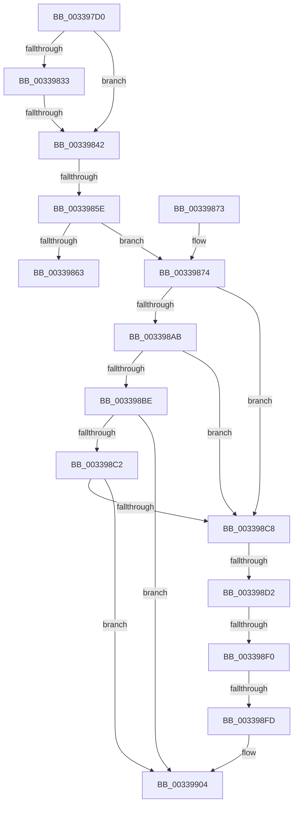

# MiReplaceStandbyLookaside

- RVA: `0x003397D0`–`0x00339916` (길이 `326` bytes)
- VA: `0x00000001403397D0`
- 실행 섹션: `.text`
- PDB 이름 있음: `예`; PDB Function 태그: `아니요`
- unwind 정보 RVA: `0x00076B58`
- 디코드: `82`개 명령, `326/326` bytes 표시
- 미해석 바이트: `0` (있으면 어셈블리에 `.byte`로 보존)

> 이 문서는 커널 이미지의 기계어와 PDB 기호를 분석해 생성했습니다. 4번과 5번은 함수 원형과 자료형을 바이너리 사용 방식에서 추정한 C 해석이며 원본 소스 복구 결과는 아닙니다.

## 1. Dependencies

- 직접 호출 지점: **0**; 고유 호출 대상: **0**
- 직접 호출자로 확인된 함수: **4**
- RIP 상대 이미지 참조: **6**

### Outgoing calls
- 직접 디코드된 call 명령이 없습니다.

### Direct callers
- [sub_00287607](../28/Unknown_function_00287607.md) at `0x002877B0`
- [MiReplaceTransitionPage](../2B/MiReplaceTransitionPage_function_002B1120.md) at `0x002B13B6`
- [MiReplaceTransitionPage](../2B/MiReplaceTransitionPage_function_002B1120.md) at `0x002B1A3C`
- [MiSwapNumaStandbyPage](../38/MiSwapNumaStandbyPage_function_00385144.md) at `0x0038533E`
- [MiLockStandbyOldestPage](../3D/MiLockStandbyOldestPage_function_003D4EA4.md) at `0x003D4FB1`
- [MiLockStandbyOldestPage](../3D/MiLockStandbyOldestPage_function_003D4EA4.md) at `0x003D5091`

### Static image references
- `0x00339822` → RVA `0x00E35C00` (`.data`; read)
- `0x0033987C` → RVA `0x00E30088` (`.data`; read)
- `0x0033989A` → RVA `0x00E2DBC0` (`.data`; read)
- `0x003398A1` → RVA `0x00E2DBC4` (`.data`; read)
- `0x003398B2` → RVA `0x00E2DC20` (`.data`; read)
- `0x003398FD` → RVA `0x00E2DBC0` (`.data`; write)

## 2. Other-region calls and transfers

- 다른 실행 섹션으로 향하는 call: **0**
- call이 아닌 외부 분기/꼬리 이동: **5**
  - `0x0033983C` → [sub_0033A084](Unknown_function_0033A084.md) (`tail-transfer`)
  - `0x00339858` → [sub_00339D19 + 0x1E](Unknown_function_00339D19.md) (`tail-transfer`)
  - `0x003398CC` → [sub_00339D19](Unknown_function_00339D19.md) (`tail-transfer`)
  - `0x003398EA` → [sub_00339F40](Unknown_function_00339F40.md) (`tail-transfer`)
  - `0x003398F7` → [sub_00339DCF](Unknown_function_00339DCF.md) (`tail-transfer`)

## 3. Assembly (complete function range)

```asm
003397D0  44 89 4C 24 20                  mov dword ptr [rsp + 0x20], r9d
003397D5  44 89 44 24 18                  mov dword ptr [rsp + 0x18], r8d
003397DA  48 89 54 24 10                  mov qword ptr [rsp + 0x10], rdx
003397DF  56                              push rsi
003397E0  57                              push rdi
003397E1  41 54                           push r12
003397E3  41 55                           push r13
003397E5  41 57                           push r15
003397E7  48 81 EC D0 00 00 00            sub rsp, 0xd0
003397EE  0F 57 C0                        xorps xmm0, xmm0
003397F1  4D 63 E8                        movsxd r13, r8d
003397F4  0F 57 C9                        xorps xmm1, xmm1
003397F7  48 BE 00 00 00 00 00 DE FF FF   movabs rsi, 0xffffde0000000000
00339801  4C 8D 14 49                     lea r10, [rcx + rcx*2]
00339805  4C 8B FA                        mov r15, rdx
00339808  F3 0F 7F 44 24 60               movdqu xmmword ptr [rsp + 0x60], xmm0
0033980E  49 C1 E2 04                     shl r10, 4
00339812  48 8B F9                        mov rdi, rcx
00339815  F3 0F 7F 4C 24 70               movdqu xmmword ptr [rsp + 0x70], xmm1
0033981B  48 8B C6                        mov rax, rsi
0033981E  4D 8D 0C 02                     lea r9, [r10 + rax]
00339822  48 8B 05 D7 C3 AF 00            mov rax, qword ptr [rip + 0xafc3d7]
00339829  4C 89 4C 24 30                  mov qword ptr [rsp + 0x30], r9
0033982E  48 3B C8                        cmp rcx, rax
00339831  72 0F                           jb 0x140339842
00339833  48 05 00 08 00 00               add rax, 0x800
00339839  48 3B C8                        cmp rcx, rax
0033983C  0F 82 42 08 00 00               jb 0x14033a084
00339842  49 BC 10 00 00 00 00 DE FF FF   movabs r12, 0xffffde0000000010
0033984C  49 8B C4                        mov rax, r12
0033984F  49 8B 0C 02                     mov rcx, qword ptr [r10 + rax]
00339853  48 0F BA E1 0A                  bt rcx, 0xa
00339858  0F 83 D9 04 00 00               jae 0x140339d37
0033985E  F6 C1 08                        test cl, 8
00339861  75 11                           jne 0x140339874
00339863  48 81 C4 D0 00 00 00            add rsp, 0xd0
0033986A  41 5F                           pop r15
0033986C  41 5D                           pop r13
0033986E  41 5C                           pop r12
00339870  5F                              pop rdi
00339871  5E                              pop rsi
00339872  C3                              ret
00339873  CC                              int3
00339874  49 8B 41 28                     mov rax, qword ptr [r9 + 0x28]
00339878  49 8B 41 28                     mov rax, qword ptr [r9 + 0x28]
0033987C  48 8B 0D 05 68 AF 00            mov rcx, qword ptr [rip + 0xaf6805]
00339883  48 C1 E8 2B                     shr rax, 0x2b
00339887  25 FF 03 00 00                  and eax, 0x3ff
0033988C  4C 89 4C 24 58                  mov qword ptr [rsp + 0x58], r9
00339891  48 8B 14 C1                     mov rdx, qword ptr [rcx + rax*8]
00339895  48 89 54 24 50                  mov qword ptr [rsp + 0x50], rdx
0033989A  48 63 15 1F 43 AF 00            movsxd rdx, dword ptr [rip + 0xaf431f]
003398A1  8B 0D 1D 43 AF 00               mov ecx, dword ptr [rip + 0xaf431d]
003398A7  3B D1                           cmp edx, ecx
003398A9  77 1D                           ja 0x1403398c8
003398AB  48 8B C2                        mov rax, rdx
003398AE  48 C1 E0 04                     shl rax, 4
003398B2  48 03 05 67 43 AF 00            add rax, qword ptr [rip + 0xaf4367]
003398B9  48 3B 38                        cmp rdi, qword ptr [rax]
003398BC  72 0A                           jb 0x1403398c8
003398BE  3B D1                           cmp edx, ecx
003398C0  74 42                           je 0x140339904
003398C2  48 3B 78 10                     cmp rdi, qword ptr [rax + 0x10]
003398C6  72 3C                           jb 0x140339904
003398C8  33 D2                           xor edx, edx
003398CA  3B CA                           cmp ecx, edx
003398CC  0F 8C 47 04 00 00               jl 0x140339d19
003398D2  44 8D 04 0A                     lea r8d, [rdx + rcx]
003398D6  41 D1 F8                        sar r8d, 1
003398D9  49 63 C0                        movsxd rax, r8d
003398DC  48 C1 E0 04                     shl rax, 4
003398E0  48 03 05 39 43 AF 00            add rax, qword ptr [rip + 0xaf4339]
003398E7  48 3B 38                        cmp rdi, qword ptr [rax]
003398EA  0F 82 50 06 00 00               jb 0x140339f40
003398F0  44 3B 05 CD 42 AF 00            cmp r8d, dword ptr [rip + 0xaf42cd]
003398F7  0F 85 D2 04 00 00               jne 0x140339dcf
003398FD  44 89 05 BC 42 AF 00            mov dword ptr [rip + 0xaf42bc], r8d
00339904  8B 40 08                        mov eax, dword ptr [rax + 8]
00339907  89 44 24 68                     mov dword ptr [rsp + 0x68], eax
0033990B  41 8B 41 20                     mov eax, dword ptr [r9 + 0x20]
0033990F  41 8B 49 20                     mov ecx, dword ptr [r9 + 0x20]
00339913  C1 E9 18                        shr ecx, 0x18
```

## 4. C-style interpretation (structured pseudocode)

```c
__int64 __fastcall MiReplaceStandbyLookaside(__int64 a1, __int64 a2, int a3, int a4)
{
    __int64 result;
    __int64 v_r10;
    __int64 v_rsp;
    unsigned __int64 v_stack_m88;
    unsigned __int64 v_stack_m98;
    unsigned __int64 v_stack_mC8;
    unsigned __int64 v_stack_p10;
    unsigned int v_stack_p18;
    unsigned int v_stack_p20;
    unsigned __int64 v_stack_p50;
    unsigned __int64 v_stack_p58;
    unsigned int v_stack_p68;

    v_stack_p20 = a4;
    v_stack_p18 = a3;
    v_stack_p10 = a2;
    v_rsp = (v_rsp) - (208);
    v_stack_m98 = v_xmm0;
    v_r10 = (a1 + a1 * 2) << (4);
    v_stack_m88 = v_xmm1;
    v_stack_mC8 = v_r10 + v_rsi * 1;
    if (a1 < (*(unsigned __int64 *)(v_rip + 11518935))) goto loc_00339842;
    result = (*(unsigned __int64 *)(v_rip + 11518935)) + (0x800ULL);
loc_00339842:
    if ((((unsigned __int8)(*(unsigned __int64 *)(v_r10 + v_r12 * 1))) & (8)) != 0) goto loc_00339874;
    v_rsp = (v_rsp) + (208);
    return v_r12;
loc_00339874:
    result = (*(unsigned __int64 *)(v_r10 + v_rsi * 1 + 40)) >> (43);
    result = (unsigned int)((result) & (0x3FFULL));
    v_stack_p58 = v_r10 + v_rsi * 1;
    v_stack_p50 = *(unsigned __int64 *)(*(unsigned __int64 *)(v_rip + 11495429) + result * 8);
    if (((unsigned int)((int)(*(unsigned int *)(v_rip + 11485983)))) > ((unsigned int)((unsigned int)(*(unsigned int *)(v_rip + 11485981))))) goto loc_003398C8;
    result = ((int)(*(unsigned int *)(v_rip + 11485983))) << (4);
    result = (result) + (*(unsigned __int64 *)(v_rip + 11486055));
    if (a1 < (*(unsigned __int64 *)(result))) goto loc_003398C8;
    if (((unsigned int)((int)(*(unsigned int *)(v_rip + 11485983)))) == ((unsigned int)((unsigned int)(*(unsigned int *)(v_rip + 11485981))))) goto loc_00339904;
    if (a1 < (*(unsigned __int64 *)(result + 16))) goto loc_00339904;
loc_003398C8:
    a2 = 0;
    a3 = (unsigned int)((a2 + (unsigned int)(*(unsigned int *)(v_rip + 11485981)) * 1) >> (1));
    result = ((int)(a3)) << (4);
    result = (result) + (*(unsigned __int64 *)(v_rip + 11486009));
    *(unsigned int *)(v_rip + 11485884) = a3;
loc_00339904:
    v_stack_p68 = (unsigned int)((unsigned int)(*(unsigned int *)(result + 8)));
    a1 = (unsigned int)(((unsigned int)(*(unsigned int *)(v_r10 + v_rsi * 1 + 32))) >> (24));
    return (unsigned int)(*(unsigned int *)(v_r10 + v_rsi * 1 + 32));
}
```

## 5. (Beta) C Style

```c
int64_t MiReplaceStandbyLookaside(void *Arg1, int64_t Arg2, int32_t Arg3, int32_t Arg4)
{
    uint8_t *arg1 = (uint8_t *)Arg1;

    int64_t result;
    int64_t local_r10;
    int64_t local_rsp;
    uint64_t v_stack_m88;
    uint64_t v_stack_m98;
    uint64_t v_stack_mC8;
    uint64_t v_stack_p10;
    uint32_t v_stack_p18;
    uint32_t v_stack_p20;
    uint64_t v_stack_p50;
    uint64_t v_stack_p58;
    uint32_t v_stack_p68;

    v_stack_p20 = Arg4;
    v_stack_p18 = Arg3;
    v_stack_p10 = Arg2;
    local_rsp = (local_rsp) - (208);
    v_stack_m98 = v_xmm0;
    local_r10 = (Arg1 + Arg1 * 2) << (4);
    v_stack_m88 = v_xmm1;
    v_stack_mC8 = local_r10 + local_rsi * 1;
    if (Arg1 < (*(uint64_t *)(v_rip + 0xAFC3D7))) goto loc_00339842;
    result = (*(uint64_t *)(v_rip + 0xAFC3D7)) + (0x800ULL);
loc_00339842:
    if ((((uint8_t)(*(uint64_t *)(local_r10 + local_r12 * 1))) & (8)) != 0) goto loc_00339874;
    local_rsp = (local_rsp) + (208);
    return local_r12;
loc_00339874:
    result = (*(uint64_t *)(local_r10 + local_rsi * 1 + 0x28)) >> (43);
    result = (uint32_t)((result) & (0x3FFULL));
    v_stack_p58 = local_r10 + local_rsi * 1;
    v_stack_p50 = *(uint64_t *)(*(uint64_t *)(v_rip + 0xAF6805) + result * 8);
    if (((uint32_t)((int32_t)(*(uint32_t *)(v_rip + 0xAF431F)))) > ((uint32_t)((uint32_t)(*(uint32_t *)(v_rip + 0xAF431D))))) goto loc_003398C8;
    result = ((int32_t)(*(uint32_t *)(v_rip + 0xAF431F))) << (4);
    result = (result) + (*(uint64_t *)(v_rip + 0xAF4367));
    if (Arg1 < (*(uint64_t *)(result))) goto loc_003398C8;
    if (((uint32_t)((int32_t)(*(uint32_t *)(v_rip + 0xAF431F)))) == ((uint32_t)((uint32_t)(*(uint32_t *)(v_rip + 0xAF431D))))) goto loc_00339904;
    if (Arg1 < (*(uint64_t *)(result + 0x10))) goto loc_00339904;
loc_003398C8:
    Arg2 = 0;
    Arg3 = (uint32_t)((Arg2 + (uint32_t)(*(uint32_t *)(v_rip + 0xAF431D)) * 1) >> (1));
    result = ((int32_t)(Arg3)) << (4);
    result = (result) + (*(uint64_t *)(v_rip + 0xAF4339));
    *(uint32_t *)(v_rip + 0xAF42BC) = Arg3;
loc_00339904:
    v_stack_p68 = (uint32_t)((uint32_t)(*(uint32_t *)(result + 0x8)));
    Arg1 = (uint32_t)(((uint32_t)(*(uint32_t *)(local_r10 + local_rsi * 1 + 0x20))) >> (24));
    return (uint32_t)(*(uint32_t *)(local_r10 + local_rsi * 1 + 0x20));
}
```

### 관측된 메모리 오프셋

구조체 형식이 확인되지 않은 접근은 인자 기준의 오프셋으로만 기록했습니다.

| 기준 인자 | 오프셋 표현 | 폭 (bit) | 접근 |
|---|---:|---:|---|
| `Arg1` | `+ 0x0 + rcx*2` | `64` | `R` |

## 6. Execution-region graph

[열기: 2D/3D 그래프와 함수 탐색 컨트롤 패널](../../../control-panel.html?section=text&rva=0x003397D0&view=graph)

- 2D 그래프는 위에서 아래로 흐르고, 3D 그래프는 빈 공간을 드래그해 회전합니다. Shift+드래그는 이동, 휠은 확대·축소, 함수 노드 선택은 대상 보고서 이동입니다.

### Static fallback


