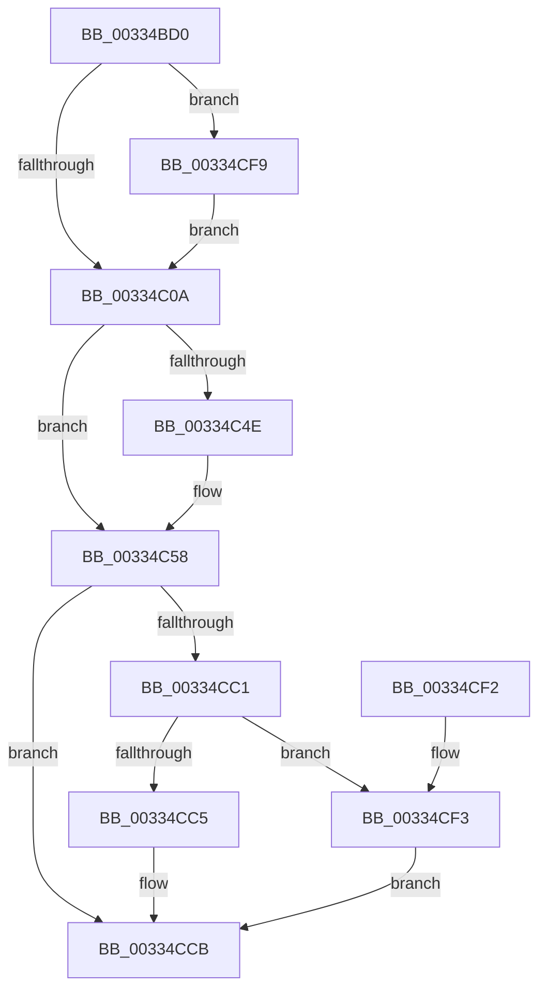

# MiReturnFreeZeroPage

- RVA: `0x00334BD0`–`0x00334D17` (길이 `327` bytes)
- VA: `0x0000000140334BD0`
- 실행 섹션: `.text`
- PDB 이름 있음: `예`; PDB Function 태그: `아니요`
- unwind 정보 RVA: `0x00076838`
- 디코드: `84`개 명령, `327/327` bytes 표시
- 미해석 바이트: `0` (있으면 어셈블리에 `.byte`로 보존)

> 이 문서는 커널 이미지의 기계어와 PDB 기호를 분석해 생성했습니다. 4번과 5번은 함수 원형과 자료형을 바이너리 사용 방식에서 추정한 C 해석이며 원본 소스 복구 결과는 아닙니다.

## 1. Dependencies

- 직접 호출 지점: **1**; 고유 호출 대상: **1**
- 직접 호출자로 확인된 함수: **6**
- RIP 상대 이미지 참조: **1**

### Outgoing calls
- `0x00334CE8` → [MiInsertPageInFreeOrZeroedList](MiInsertPageInFreeOrZeroedList_function_00334D20.md) (function, `0x00334D20`)

### Direct callers
- [MiMigratePfn](../28/MiMigratePfn_function_0028DBB0.md) at `0x0028E27D`
- [MiReleaseFreshPageAtDpc](MiReleaseFreshPageAtDpc_function_00334B50.md) at `0x00334B6D`
- [MiCoalesceFreeSmallPages](MiCoalesceFreeSmallPages_function_00336340.md) at `0x00336A2A`
- [MiReleaseFreshPageLocked](../44/MiReleaseFreshPageLocked_function_0044CDD8.md) at `0x0044CDDE`
- [MiMakeVaRangePhysicallyContiguous](../69/MiMakeVaRangePhysicallyContiguous_function_006936E0.md) at `0x006938E0`
- [sub_006DB77C](../6D/Unknown_function_006DB77C.md) at `0x006DB937`

### Static image references
- `0x00334CAE` → RVA `0x00E2DC80` (`.data`; read)

## 2. Other-region calls and transfers

- 다른 실행 섹션으로 향하는 call: **0**
- 별도 외부 분기/꼬리 이동을 확인하지 못했습니다.

## 3. Assembly (complete function range)

```asm
00334BD0  48 83 EC 28                     sub rsp, 0x28
00334BD4  44 8B DA                        mov r11d, edx
00334BD7  4C 8B C1                        mov r8, rcx
00334BDA  48 B8 00 00 00 00 00 DE FF FF   movabs rax, 0xffffde0000000000
00334BE4  4C 8B C9                        mov r9, rcx
00334BE7  4C 2B C8                        sub r9, rax
00334BEA  48 B8 AB AA AA AA AA AA AA AA   movabs rax, 0xaaaaaaaaaaaaaaab
00334BF4  49 C1 F9 04                     sar r9, 4
00334BF8  4C 0F AF C8                     imul r9, rax
00334BFC  0F B6 41 22                     movzx eax, byte ptr [rcx + 0x22]
00334C00  24 07                           and al, 7
00334C02  3C 06                           cmp al, 6
00334C04  0F 84 EF 00 00 00               je 0x140334cf9
00334C0A  8B 49 20                        mov ecx, dword ptr [rcx + 0x20]
00334C0D  45 33 D2                        xor r10d, r10d
00334C10  49 8B 40 28                     mov rax, qword ptr [r8 + 0x28]
00334C14  48 BA FF FF FF FF FF FF FF 7F   movabs rdx, 0x7fffffffffffffff
00334C1E  89 4C 24 38                     mov dword ptr [rsp + 0x38], ecx
00334C22  48 23 C2                        and rax, rdx
00334C25  80 64 24 3B D7                  and byte ptr [rsp + 0x3b], 0xd7
00334C2A  C1 E9 10                        shr ecx, 0x10
00334C2D  80 E1 C7                        and cl, 0xc7
00334C30  49 89 40 28                     mov qword ptr [r8 + 0x28], rax
00334C34  88 4C 24 3A                     mov byte ptr [rsp + 0x3a], cl
00334C38  41 8B CA                        mov ecx, r10d
00334C3B  8B 44 24 38                     mov eax, dword ptr [rsp + 0x38]
00334C3F  41 89 40 20                     mov dword ptr [r8 + 0x20], eax
00334C43  49 8B 40 28                     mov rax, qword ptr [r8 + 0x28]
00334C47  48 0F BA E0 28                  bt rax, 0x28
00334C4C  73 0A                           jae 0x140334c58
00334C4E  41 8B 48 24                     mov ecx, dword ptr [r8 + 0x24]
00334C52  81 E1 00 00 00 18               and ecx, 0x18000000
00334C58  41 89 48 24                     mov dword ptr [r8 + 0x24], ecx
00334C5C  48 B9 00 00 00 00 00 00 00 C0   movabs rcx, 0xc000000000000000
00334C66  41 8B 40 20                     mov eax, dword ptr [r8 + 0x20]
00334C6A  89 44 24 38                     mov dword ptr [rsp + 0x38], eax
00334C6E  C1 E8 18                        shr eax, 0x18
00334C71  24 EF                           and al, 0xef
00334C73  88 44 24 3B                     mov byte ptr [rsp + 0x3b], al
00334C77  8B 44 24 38                     mov eax, dword ptr [rsp + 0x38]
00334C7B  41 89 40 20                     mov dword ptr [r8 + 0x20], eax
00334C7F  49 8B 40 18                     mov rax, qword ptr [r8 + 0x18]
00334C83  48 23 C1                        and rax, rcx
00334C86  49 89 40 18                     mov qword ptr [r8 + 0x18], rax
00334C8A  41 8B 40 20                     mov eax, dword ptr [r8 + 0x20]
00334C8E  89 44 24 38                     mov dword ptr [rsp + 0x38], eax
00334C92  66 44 89 54 24 38               mov word ptr [rsp + 0x38], r10w
00334C98  8B 44 24 38                     mov eax, dword ptr [rsp + 0x38]
00334C9C  41 89 40 20                     mov dword ptr [r8 + 0x20], eax
00334CA0  49 8B 40 10                     mov rax, qword ptr [r8 + 0x10]
00334CA4  48 A9 E0 03 00 00               test rax, 0x3e0
00334CAA  49 8B 40 10                     mov rax, qword ptr [r8 + 0x10]
00334CAE  48 8B 0D CB 8F AF 00            mov rcx, qword ptr [rip + 0xaf8fcb]
00334CB5  41 0F 95 C2                     setne r10b
00334CB9  41 FF C2                        inc r10d
00334CBC  48 85 C9                        test rcx, rcx
00334CBF  74 0A                           je 0x140334ccb
00334CC1  A8 10                           test al, 0x10
00334CC3  75 2E                           jne 0x140334cf3
00334CC5  48 F7 D1                        not rcx
00334CC8  48 23 C1                        and rax, rcx
00334CCB  41 8B D2                        mov edx, r10d
00334CCE  48 C1 E8 20                     shr rax, 0x20
00334CD2  0F BA EA 0A                     bts edx, 0xa
00334CD6  B9 FD FF FF FF                  mov ecx, 0xfffffffd
00334CDB  48 3B C1                        cmp rax, rcx
00334CDE  49 8B C9                        mov rcx, r9
00334CE1  41 0F 45 D2                     cmovne edx, r10d
00334CE5  41 0B D3                        or edx, r11d
00334CE8  E8 33 00 00 00                  call 0x140334d20
00334CED  48 83 C4 28                     add rsp, 0x28
00334CF1  C3                              ret
00334CF2  CC                              int3
00334CF3  48 83 E0 EF                     and rax, 0xffffffffffffffef
00334CF7  EB D2                           jmp 0x140334ccb
00334CF9  8B 41 20                        mov eax, dword ptr [rcx + 0x20]
00334CFC  89 44 24 38                     mov dword ptr [rsp + 0x38], eax
00334D00  C1 E8 10                        shr eax, 0x10
00334D03  24 FD                           and al, 0xfd
00334D05  0C 05                           or al, 5
00334D07  88 44 24 3A                     mov byte ptr [rsp + 0x3a], al
00334D0B  8B 44 24 38                     mov eax, dword ptr [rsp + 0x38]
00334D0F  89 41 20                        mov dword ptr [rcx + 0x20], eax
00334D12  E9 F3 FE FF FF                  jmp 0x140334c0a
```

## 4. C-style interpretation (structured pseudocode)

```c
__int64 __fastcall MiReturnFreeZeroPage(__int64 a1, int a2)
{
    __int64 result;
    __int64 v_r10;
    __int64 v_rsp;
    unsigned int v_stack_p10;
    unsigned __int8 v_stack_p12;
    unsigned __int8 v_stack_p13;
    unsigned int v_stack_p38;
    unsigned __int8 v_stack_p3A;

    v_rsp = (v_rsp) - (40);
    a4 = (a1) - (result);
    a4 = (a4) >> (4);
    a4 = (a4) * (result);
    result = (unsigned __int8)((*(unsigned __int8 *)(a1 + 34)) & (7));
    if (((unsigned __int8)(result)) == 6) goto loc_00334CF9;
loc_00334C0A:
    v_r10 = 0;
    v_stack_p10 = (unsigned int)((unsigned int)(*(unsigned int *)(a1 + 32)));
    result = (*(unsigned __int64 *)(a1 + 40)) & (a2);
    a1 = (unsigned int)(((unsigned int)(*(unsigned int *)(a1 + 32))) >> (16));
    a1 = (unsigned __int8)((a1) & (199));
    *(unsigned __int64 *)(a1 + 40) = result;
    v_stack_p12 = (unsigned __int8)(a1);
    *(unsigned int *)(a1 + 32) = (unsigned int)((unsigned int)(v_stack_p10));
    if (!(condition_is_above_or_equal)) {
        a1 = *(unsigned int *)(a1 + 36);
        a1 = (unsigned int)((a1) & (0x18000000ULL));
    }
    *(unsigned int *)(a1 + 36) = (unsigned int)(a1);
    v_stack_p10 = (unsigned int)((unsigned int)(*(unsigned int *)(a1 + 32)));
    result = (unsigned int)(((unsigned int)(*(unsigned int *)(a1 + 32))) >> (24));
    result = (unsigned __int8)((result) & (239));
    v_stack_p13 = (unsigned __int8)(result);
    *(unsigned int *)(a1 + 32) = (unsigned int)((unsigned int)(v_stack_p10));
    result = (*(unsigned __int64 *)(a1 + 24)) & (a1);
    *(unsigned __int64 *)(a1 + 24) = result;
    v_stack_p10 = (unsigned int)((unsigned int)(*(unsigned int *)(a1 + 32)));
    v_stack_p10 = 0;
    *(unsigned int *)(a1 + 32) = (unsigned int)((unsigned int)(v_stack_p10));
    v_r10 = (((*(unsigned __int64 *)(a1 + 16)) & (992)) != 0) ? 1 : 0;
    v_r10 = (unsigned int)((v_r10) + 1);
    if (*(unsigned __int64 *)(v_rip + 11505611) == 0) goto loc_00334CCB;
    if ((((unsigned __int8)(*(unsigned __int64 *)(a1 + 16))) & (16)) != 0) goto loc_00334CF3;
    a1 = ~(*(unsigned __int64 *)(v_rip + 11505611));
    result = (*(unsigned __int64 *)(a1 + 16)) & (a1);
loc_00334CCB:
    result = (result) >> (32);
    a2 = (unsigned int)((unsigned int)(v_r10));
    if (result != ((unsigned int)(0xFFFFFFFDULL))) { a2 = (unsigned int)(v_r10); }
    a2 = (unsigned int)((a2) | ((unsigned int)((unsigned int)(a2))));
    result = MiInsertPageInFreeOrZeroedList(a4, a2, a1, a4);
    v_rsp = (v_rsp) + (40);
    return result;
loc_00334CF3:
    result = (result) & (-17);
    goto loc_00334CCB;
loc_00334CF9:
    v_stack_p38 = (unsigned int)((unsigned int)(*(unsigned int *)(a4 + 32)));
    result = (unsigned int)(((unsigned int)(*(unsigned int *)(a4 + 32))) >> (16));
    result = (unsigned __int8)((result) & (253));
    result = (unsigned __int8)((result) | (5));
    v_stack_p3A = (unsigned __int8)(result);
    *(unsigned int *)(a4 + 32) = (unsigned int)((unsigned int)(v_stack_p38));
    goto loc_00334C0A;
}
```

## 5. (Beta) C Style

```c
int64_t MiReturnFreeZeroPage(void *Arg1, int32_t Arg2)
{
    uint8_t *arg1 = (uint8_t *)Arg1;

    int64_t result;
    int64_t local_r10;
    int64_t local_rsp;
    uint32_t v_stack_p10;
    uint8_t v_stack_p12;
    uint8_t v_stack_p13;
    uint32_t v_stack_p38;
    uint8_t v_stack_p3A;

    local_rsp = (local_rsp) - (40);
    a4 = (Arg1) - (result);
    a4 = (a4) >> (4);
    a4 = (a4) * (result);
    result = (uint8_t)((*(uint8_t *)(arg1 + 0x22)) & (7));
    if (((uint8_t)(result)) == 6) goto loc_00334CF9;
loc_00334C0A:
    local_r10 = 0;
    v_stack_p10 = (uint32_t)((uint32_t)(*(uint32_t *)(arg1 + 0x20)));
    result = (*(uint64_t *)(arg1 + 0x28)) & (Arg2);
    Arg1 = (uint32_t)(((uint32_t)(*(uint32_t *)(arg1 + 0x20))) >> (16));
    Arg1 = (uint8_t)((Arg1) & (199));
    *(uint64_t *)(arg1 + 0x28) = result;
    v_stack_p12 = (uint8_t)(Arg1);
    *(uint32_t *)(arg1 + 0x20) = (uint32_t)((uint32_t)(v_stack_p10));
    if (!(condition_is_above_or_equal)) {
        Arg1 = *(uint32_t *)(arg1 + 0x24);
        Arg1 = (uint32_t)((Arg1) & (0x18000000ULL));
    }
    *(uint32_t *)(arg1 + 0x24) = (uint32_t)(Arg1);
    v_stack_p10 = (uint32_t)((uint32_t)(*(uint32_t *)(arg1 + 0x20)));
    result = (uint32_t)(((uint32_t)(*(uint32_t *)(arg1 + 0x20))) >> (24));
    result = (uint8_t)((result) & (239));
    v_stack_p13 = (uint8_t)(result);
    *(uint32_t *)(arg1 + 0x20) = (uint32_t)((uint32_t)(v_stack_p10));
    result = (*(uint64_t *)(arg1 + 0x18)) & (Arg1);
    *(uint64_t *)(arg1 + 0x18) = result;
    v_stack_p10 = (uint32_t)((uint32_t)(*(uint32_t *)(arg1 + 0x20)));
    v_stack_p10 = 0;
    *(uint32_t *)(arg1 + 0x20) = (uint32_t)((uint32_t)(v_stack_p10));
    local_r10 = (((*(uint64_t *)(arg1 + 0x10)) & (992)) != 0) ? 1 : 0;
    local_r10 = (uint32_t)((local_r10) + 1);
    if (*(uint64_t *)(v_rip + 0xAF8FCB) == 0) goto loc_00334CCB;
    if ((((uint8_t)(*(uint64_t *)(arg1 + 0x10))) & (16)) != 0) goto loc_00334CF3;
    Arg1 = ~(*(uint64_t *)(v_rip + 0xAF8FCB));
    result = (*(uint64_t *)(arg1 + 0x10)) & (Arg1);
loc_00334CCB:
    result = (result) >> (32);
    Arg2 = (uint32_t)((uint32_t)(local_r10));
    if (result != ((uint32_t)(0xFFFFFFFDULL))) { Arg2 = (uint32_t)(local_r10); }
    Arg2 = (uint32_t)((Arg2) | ((uint32_t)((uint32_t)(Arg2))));
    result = MiInsertPageInFreeOrZeroedList(a4, Arg2, Arg1, a4);
    local_rsp = (local_rsp) + (40);
    return result;
loc_00334CF3:
    result = (result) & (-17);
    goto loc_00334CCB;
loc_00334CF9:
    v_stack_p38 = (uint32_t)((uint32_t)(*(uint32_t *)(a4 + 0x20)));
    result = (uint32_t)(((uint32_t)(*(uint32_t *)(a4 + 0x20))) >> (16));
    result = (uint8_t)((result) & (253));
    result = (uint8_t)((result) | (5));
    v_stack_p3A = (uint8_t)(result);
    *(uint32_t *)(a4 + 0x20) = (uint32_t)((uint32_t)(v_stack_p38));
    goto loc_00334C0A;
}
```

### 관측된 메모리 오프셋

구조체 형식이 확인되지 않은 접근은 인자 기준의 오프셋으로만 기록했습니다.

| 기준 인자 | 오프셋 표현 | 폭 (bit) | 접근 |
|---|---:|---:|---|
| `Arg1` | `+ 0x10` | `64` | `R` |
| `Arg1` | `+ 0x18` | `64` | `R` |
| `Arg1` | `+ 0x18` | `64` | `W` |
| `Arg1` | `+ 0x20` | `32` | `R` |
| `Arg1` | `+ 0x20` | `32` | `W` |
| `Arg1` | `+ 0x22` | `8` | `R` |
| `Arg1` | `+ 0x24` | `32` | `R` |
| `Arg1` | `+ 0x24` | `32` | `W` |
| `Arg1` | `+ 0x28` | `64` | `R` |
| `Arg1` | `+ 0x28` | `64` | `W` |

## 6. Execution-region graph

[열기: 2D/3D 그래프와 함수 탐색 컨트롤 패널](../../../control-panel.html?section=text&rva=0x00334BD0&view=graph)

- 2D 그래프는 위에서 아래로 흐르고, 3D 그래프는 빈 공간을 드래그해 회전합니다. Shift+드래그는 이동, 휠은 확대·축소, 함수 노드 선택은 대상 보고서 이동입니다.

### Static fallback


