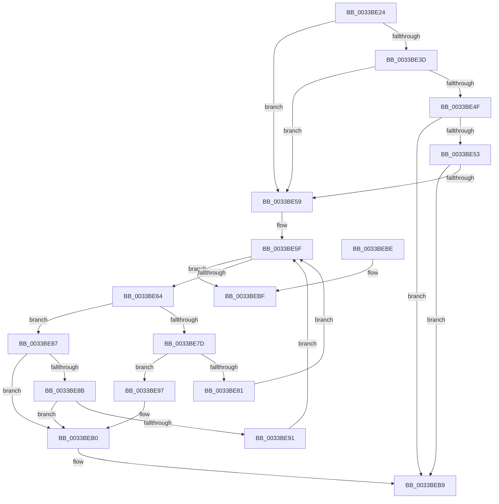

# MiSearchChannelTable

- RVA: `0x0033BE24`–`0x0033BED7` (길이 `179` bytes)
- VA: `0x000000014033BE24`
- 실행 섹션: `.text`
- PDB 이름 있음: `예`; PDB Function 태그: `아니요`
- unwind 정보 RVA: `0x00076F28`
- 디코드: `53`개 명령, `179/179` bytes 표시
- 미해석 바이트: `0` (있으면 어셈블리에 `.byte`로 보존)

> 이 문서는 커널 이미지의 기계어와 PDB 기호를 분석해 생성했습니다. 4번과 5번은 함수 원형과 자료형을 바이너리 사용 방식에서 추정한 C 해석이며 원본 소스 복구 결과는 아닙니다.

## 1. Dependencies

- 직접 호출 지점: **2**; 고유 호출 대상: **1**
- 직접 호출자로 확인된 함수: **14**
- RIP 상대 이미지 참조: **4**

### Outgoing calls
- `0x0033BEAA` → [KeBugCheckEx](../4F/KeBugCheckEx_function_004FD660.md) (function, `0x004FD660`)
- `0x0033BED1` → [KeBugCheckEx](../4F/KeBugCheckEx_function_004FD660.md) (function, `0x004FD660`)

### Direct callers
- [MiAcquirePageListLock](../27/MiAcquirePageListLock_function_0027C450.md) at `0x0027C9CC`
- [MiPageToChannel](../2B/MiPageToChannel_function_002B9B48.md) at `0x002B9B5E`
- [MiCoalesceFreeSmallPages](MiCoalesceFreeSmallPages_function_00336340.md) at `0x00336BAF`
- [MI_PAGE_TO_FULL_COLOR](MI_PAGE_TO_FULL_COLOR_function_00337820.md) at `0x003379A4`
- [sub_00339DE2](Unknown_function_00339DE2.md) at `0x00339DFD`
- [sub_00339DE2](Unknown_function_00339DE2.md) at `0x00339E21`
- [MiFindSuitableLookasideReplacement](MiFindSuitableLookasideReplacement_function_0033A0C0.md) at `0x0033A72D`
- [sub_0033B3D4](Unknown_function_0033B3D4.md) at `0x0033B3DF`
- [sub_0033B8D8](Unknown_function_0033B8D8.md) at `0x0033B8E3`
- [MiGetPfnChannel](MiGetPfnChannel_function_0033BA90.md) at `0x0033BAC5`
- [sub_0033BCB7](Unknown_function_0033BCB7.md) at `0x0033BCE7`
- [sub_0033C384](Unknown_function_0033C384.md) at `0x0033C38F`
- [sub_0033DA89](Unknown_function_0033DA89.md) at `0x0033DB37`
- [MiRestrictRangeToNode](../40/MiRestrictRangeToNode_function_0040199C.md) at `0x004019EF`
- [MxPageAlwaysHot](../../init/C6/MxPageAlwaysHot_function_00C68920.md) at `0x00C68931`

### Static image references
- `0x0033BE28` → RVA `0x00E2DBCB` (`.data`; read)
- `0x0033BE32` → RVA `0x00E2DBCA` (`.data`; read)
- `0x0033BE43` → RVA `0x00E2DC28` (`.data`; read)
- `0x0033BEB0` → RVA `0x00E2DBCA` (`.data`; write)

## 2. Other-region calls and transfers

- 다른 실행 섹션으로 향하는 call: **0**
- 별도 외부 분기/꼬리 이동을 확인하지 못했습니다.

## 3. Assembly (complete function range)

```asm
0033BE24  48 83 EC 38                     sub rsp, 0x38
0033BE28  0F B6 15 9C 1D AF 00            movzx edx, byte ptr [rip + 0xaf1d9c]
0033BE2F  4C 8B C1                        mov r8, rcx
0033BE32  0F B6 0D 91 1D AF 00            movzx ecx, byte ptr [rip + 0xaf1d91]
0033BE39  3B CA                           cmp ecx, edx
0033BE3B  77 1C                           ja 0x14033be59
0033BE3D  8B C1                           mov eax, ecx
0033BE3F  48 C1 E0 04                     shl rax, 4
0033BE43  48 03 05 DE 1D AF 00            add rax, qword ptr [rip + 0xaf1dde]
0033BE4A  4C 3B 00                        cmp r8, qword ptr [rax]
0033BE4D  72 0A                           jb 0x14033be59
0033BE4F  3B CA                           cmp ecx, edx
0033BE51  74 66                           je 0x14033beb9
0033BE53  4C 3B 40 10                     cmp r8, qword ptr [rax + 0x10]
0033BE57  72 60                           jb 0x14033beb9
0033BE59  45 33 C9                        xor r9d, r9d
0033BE5C  44 8B D2                        mov r10d, edx
0033BE5F  45 3B D1                        cmp r10d, r9d
0033BE62  7C 5B                           jl 0x14033bebf
0033BE64  43 8D 04 11                     lea eax, [r9 + r10]
0033BE68  D1 F8                           sar eax, 1
0033BE6A  48 63 C8                        movsxd rcx, eax
0033BE6D  48 C1 E1 04                     shl rcx, 4
0033BE71  48 03 0D B0 1D AF 00            add rcx, qword ptr [rip + 0xaf1db0]
0033BE78  4C 3B 01                        cmp r8, qword ptr [rcx]
0033BE7B  73 0A                           jae 0x14033be87
0033BE7D  85 C0                           test eax, eax
0033BE7F  74 16                           je 0x14033be97
0033BE81  44 8D 50 FF                     lea r10d, [rax - 1]
0033BE85  EB D8                           jmp 0x14033be5f
0033BE87  3B C2                           cmp eax, edx
0033BE89  74 25                           je 0x14033beb0
0033BE8B  4C 3B 41 10                     cmp r8, qword ptr [rcx + 0x10]
0033BE8F  72 1F                           jb 0x14033beb0
0033BE91  44 8D 48 01                     lea r9d, [rax + 1]
0033BE95  EB C8                           jmp 0x14033be5f
0033BE97  48 83 64 24 20 00               and qword ptr [rsp + 0x20], 0
0033BE9D  4C 8B C9                        mov r9, rcx
0033BEA0  B9 1A 00 00 00                  mov ecx, 0x1a
0033BEA5  BA 81 51 00 00                  mov edx, 0x5181
0033BEAA  E8 B1 17 1C 00                  call 0x1404fd660
0033BEAF  CC                              int3
0033BEB0  88 05 14 1D AF 00               mov byte ptr [rip + 0xaf1d14], al
0033BEB6  48 8B C1                        mov rax, rcx
0033BEB9  48 83 C4 38                     add rsp, 0x38
0033BEBD  C3                              ret
0033BEBE  CC                              int3
0033BEBF  48 83 64 24 20 00               and qword ptr [rsp + 0x20], 0
0033BEC5  45 33 C9                        xor r9d, r9d
0033BEC8  BA 81 51 00 00                  mov edx, 0x5181
0033BECD  41 8D 49 1A                     lea ecx, [r9 + 0x1a]
0033BED1  E8 8A 17 1C 00                  call 0x1404fd660
0033BED6  CC                              int3
```

## 4. C-style interpretation (structured pseudocode)

```c
__int64 __fastcall MiSearchChannelTable(__int64 a1, __int64 a2, __int64 a3, int a4)
{
    __int64 result;
    __int64 v_rsp;
    unsigned __int64 v_stack_m18;
    unsigned __int64 v_stack_p20;

    v_rsp = (v_rsp) - (56);
    if (((unsigned int)(*(unsigned __int8 *)(v_rip + 11476369))) > ((unsigned int)(*(unsigned __int8 *)(v_rip + 11476380)))) goto loc_0033BE59;
    result = ((unsigned int)((unsigned int)(*(unsigned __int8 *)(v_rip + 11476369)))) << (4);
    result = (result) + (*(unsigned __int64 *)(v_rip + 11476446));
    if (a1 < (*(unsigned __int64 *)(result))) goto loc_0033BE59;
    if (((unsigned int)(*(unsigned __int8 *)(v_rip + 11476369))) == ((unsigned int)(*(unsigned __int8 *)(v_rip + 11476380)))) goto loc_0033BEB9;
    if (a1 < (*(unsigned __int64 *)(result + 16))) goto loc_0033BEB9;
loc_0033BE59:
    a4 = 0;
loc_0033BE5F:
    if (((unsigned int)((unsigned int)((unsigned int)(*(unsigned __int8 *)(v_rip + 11476380))))) < 0) goto loc_0033BEBF;
    result = (unsigned int)((a4 + (unsigned int)((unsigned int)(*(unsigned __int8 *)(v_rip + 11476380))) * 1) >> (1));
    a1 = ((int)((unsigned int)(result))) << (4);
    a1 = (a1) + (*(unsigned __int64 *)(v_rip + 11476400));
    if (a1 >= (*(unsigned __int64 *)(a1))) goto loc_0033BE87;
    if ((unsigned int)(result) == 0) goto loc_0033BE97;
    goto loc_0033BE5F;
loc_0033BE87:
    if (((unsigned int)(result)) == ((unsigned int)(*(unsigned __int8 *)(v_rip + 11476380)))) goto loc_0033BEB0;
    if (a1 < (*(unsigned __int64 *)(a1 + 16))) goto loc_0033BEB0;
    goto loc_0033BE5F;
loc_0033BE97:
    result = KeBugCheckEx(26, (unsigned int)(0x5181ULL), a1, a1);
loc_0033BEB0:
    *(unsigned __int8 *)(v_rip + 11476244) = (unsigned __int8)(result);
loc_0033BEB9:
    v_rsp = (v_rsp) + (56);
    return 26;
loc_0033BEBF:
    a4 = 0;
    result = KeBugCheckEx(a4 + 26, (unsigned int)(0x5181ULL), a1, a4);
    return result;
}
```

## 5. (Beta) C Style

```c
int64_t MiSearchChannelTable(int64_t Arg1, int64_t Arg2, int64_t Arg3, int32_t Arg4)
{
    int64_t result;
    int64_t local_rsp;
    uint64_t v_stack_m18;
    uint64_t v_stack_p20;

    local_rsp = (local_rsp) - (56);
    if (((uint32_t)(*(uint8_t *)(v_rip + 0xAF1D91))) > ((uint32_t)(*(uint8_t *)(v_rip + 0xAF1D9C)))) goto loc_0033BE59;
    result = ((uint32_t)((uint32_t)(*(uint8_t *)(v_rip + 0xAF1D91)))) << (4);
    result = (result) + (*(uint64_t *)(v_rip + 0xAF1DDE));
    if (Arg1 < (*(uint64_t *)(result))) goto loc_0033BE59;
    if (((uint32_t)(*(uint8_t *)(v_rip + 0xAF1D91))) == ((uint32_t)(*(uint8_t *)(v_rip + 0xAF1D9C)))) goto loc_0033BEB9;
    if (Arg1 < (*(uint64_t *)(result + 0x10))) goto loc_0033BEB9;
loc_0033BE59:
    Arg4 = 0;
loc_0033BE5F:
    if (((uint32_t)((uint32_t)((uint32_t)(*(uint8_t *)(v_rip + 0xAF1D9C))))) < 0) goto loc_0033BEBF;
    result = (uint32_t)((Arg4 + (uint32_t)((uint32_t)(*(uint8_t *)(v_rip + 0xAF1D9C))) * 1) >> (1));
    Arg1 = ((int32_t)((uint32_t)(result))) << (4);
    Arg1 = (Arg1) + (*(uint64_t *)(v_rip + 0xAF1DB0));
    if (Arg1 >= (*(uint64_t *)(Arg1))) goto loc_0033BE87;
    if ((uint32_t)(result) == 0) goto loc_0033BE97;
    goto loc_0033BE5F;
loc_0033BE87:
    if (((uint32_t)(result)) == ((uint32_t)(*(uint8_t *)(v_rip + 0xAF1D9C)))) goto loc_0033BEB0;
    if (Arg1 < (*(uint64_t *)(Arg1 + 0x10))) goto loc_0033BEB0;
    goto loc_0033BE5F;
loc_0033BE97:
    result = KeBugCheckEx(26, (uint32_t)(0x5181ULL), Arg1, Arg1);
loc_0033BEB0:
    *(uint8_t *)(v_rip + 0xAF1D14) = (uint8_t)(result);
loc_0033BEB9:
    local_rsp = (local_rsp) + (56);
    return 26;
loc_0033BEBF:
    Arg4 = 0;
    result = KeBugCheckEx(Arg4 + 26, (uint32_t)(0x5181ULL), Arg1, Arg4);
    return result;
}
```

## 6. Execution-region graph

[열기: 2D/3D 그래프와 함수 탐색 컨트롤 패널](../../../control-panel.html?section=text&rva=0x0033BE24&view=graph)

- 2D 그래프는 위에서 아래로 흐르고, 3D 그래프는 빈 공간을 드래그해 회전합니다. Shift+드래그는 이동, 휠은 확대·축소, 함수 노드 선택은 대상 보고서 이동입니다.

### Static fallback


