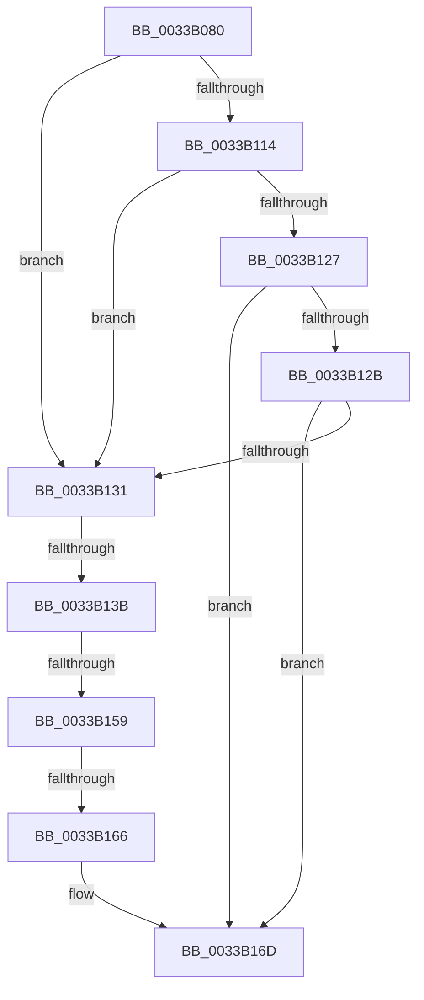

# MiUnlinkSecondaryListStandbyPage

- RVA: `0x0033B080`–`0x0033B174` (길이 `244` bytes)
- VA: `0x000000014033B080`
- 실행 섹션: `.text`
- PDB 이름 있음: `예`; PDB Function 태그: `아니요`
- unwind 정보 RVA: `0x00076C84`
- 디코드: `58`개 명령, `244/244` bytes 표시
- 미해석 바이트: `0` (있으면 어셈블리에 `.byte`로 보존)

> 이 문서는 커널 이미지의 기계어와 PDB 기호를 분석해 생성했습니다. 4번과 5번은 함수 원형과 자료형을 바이너리 사용 방식에서 추정한 C 해석이며 원본 소스 복구 결과는 아닙니다.

## 1. Dependencies

- 직접 호출 지점: **0**; 고유 호출 대상: **0**
- 직접 호출자로 확인된 함수: **3**
- RIP 상대 이미지 참조: **5**

### Outgoing calls
- 직접 디코드된 call 명령이 없습니다.

### Direct callers
- [sub_00287A62](../28/Unknown_function_00287A62.md) at `0x00287BFF`
- [sub_002B99FA](../2B/Unknown_function_002B99FA.md) at `0x002B9AA8`
- [MiSwapNumaStandbyPage](../38/MiSwapNumaStandbyPage_function_00385144.md) at `0x00385315`

### Static image references
- `0x0033B0E5` → RVA `0x00E30088` (`.data`; read)
- `0x0033B103` → RVA `0x00E2DBC0` (`.data`; read)
- `0x0033B10A` → RVA `0x00E2DBC4` (`.data`; read)
- `0x0033B11B` → RVA `0x00E2DC20` (`.data`; read)
- `0x0033B166` → RVA `0x00E2DBC0` (`.data`; write)

## 2. Other-region calls and transfers

- 다른 실행 섹션으로 향하는 call: **0**
- call이 아닌 외부 분기/꼬리 이동: **3**
  - `0x0033B135` → [sub_0033B2B6 + 0xBF](Unknown_function_0033B2B6.md) (`tail-transfer`)
  - `0x0033B153` → [sub_0033B472](Unknown_function_0033B472.md) (`tail-transfer`)
  - `0x0033B160` → [sub_0033B3C1](Unknown_function_0033B3C1.md) (`tail-transfer`)

## 3. Assembly (complete function range)

```asm
0033B080  48 89 74 24 10                  mov qword ptr [rsp + 0x10], rsi
0033B085  48 89 7C 24 18                  mov qword ptr [rsp + 0x18], rdi
0033B08A  41 54                           push r12
0033B08C  41 56                           push r14
0033B08E  41 57                           push r15
0033B090  48 83 EC 60                     sub rsp, 0x60
0033B094  0F 57 C0                        xorps xmm0, xmm0
0033B097  4C 63 F2                        movsxd r14, edx
0033B09A  0F 57 C9                        xorps xmm1, xmm1
0033B09D  49 BF 00 00 00 00 00 DE FF FF   movabs r15, 0xffffde0000000000
0033B0A7  F3 0F 7F 44 24 40               movdqu xmmword ptr [rsp + 0x40], xmm0
0033B0AD  48 8B F9                        mov rdi, rcx
0033B0B0  F3 0F 7F 4C 24 50               movdqu xmmword ptr [rsp + 0x50], xmm1
0033B0B6  49 8B C7                        mov rax, r15
0033B0B9  4C 8B C1                        mov r8, rcx
0033B0BC  49 BC AB AA AA AA AA AA AA AA   movabs r12, 0xaaaaaaaaaaaaaaab
0033B0C6  4C 2B C0                        sub r8, rax
0033B0C9  49 C1 F8 04                     sar r8, 4
0033B0CD  4D 0F AF C4                     imul r8, r12
0033B0D1  4F 8D 14 40                     lea r10, [r8 + r8*2]
0033B0D5  49 C1 E2 04                     shl r10, 4
0033B0D9  49 8B C7                        mov rax, r15
0033B0DC  49 8D 34 02                     lea rsi, [r10 + rax]
0033B0E0  49 8B 44 02 28                  mov rax, qword ptr [r10 + rax + 0x28]
0033B0E5  48 8B 0D 9C 4F AF 00            mov rcx, qword ptr [rip + 0xaf4f9c]
0033B0EC  48 C1 E8 2B                     shr rax, 0x2b
0033B0F0  25 FF 03 00 00                  and eax, 0x3ff
0033B0F5  48 89 74 24 38                  mov qword ptr [rsp + 0x38], rsi
0033B0FA  48 8B 14 C1                     mov rdx, qword ptr [rcx + rax*8]
0033B0FE  48 89 54 24 30                  mov qword ptr [rsp + 0x30], rdx
0033B103  48 63 15 B6 2A AF 00            movsxd rdx, dword ptr [rip + 0xaf2ab6]
0033B10A  8B 0D B4 2A AF 00               mov ecx, dword ptr [rip + 0xaf2ab4]
0033B110  3B D1                           cmp edx, ecx
0033B112  77 1D                           ja 0x14033b131
0033B114  48 8B C2                        mov rax, rdx
0033B117  48 C1 E0 04                     shl rax, 4
0033B11B  48 03 05 FE 2A AF 00            add rax, qword ptr [rip + 0xaf2afe]
0033B122  4C 3B 00                        cmp r8, qword ptr [rax]
0033B125  72 0A                           jb 0x14033b131
0033B127  3B D1                           cmp edx, ecx
0033B129  74 42                           je 0x14033b16d
0033B12B  4C 3B 40 10                     cmp r8, qword ptr [rax + 0x10]
0033B12F  72 3C                           jb 0x14033b16d
0033B131  33 D2                           xor edx, edx
0033B133  3B CA                           cmp ecx, edx
0033B135  0F 8C 3A 02 00 00               jl 0x14033b375
0033B13B  44 8D 0C 0A                     lea r9d, [rdx + rcx]
0033B13F  41 D1 F9                        sar r9d, 1
0033B142  49 63 C1                        movsxd rax, r9d
0033B145  48 C1 E0 04                     shl rax, 4
0033B149  48 03 05 D0 2A AF 00            add rax, qword ptr [rip + 0xaf2ad0]
0033B150  4C 3B 00                        cmp r8, qword ptr [rax]
0033B153  0F 82 19 03 00 00               jb 0x14033b472
0033B159  44 3B 0D 64 2A AF 00            cmp r9d, dword ptr [rip + 0xaf2a64]
0033B160  0F 85 5B 02 00 00               jne 0x14033b3c1
0033B166  44 89 0D 53 2A AF 00            mov dword ptr [rip + 0xaf2a53], r9d
0033B16D  8B 40 08                        mov eax, dword ptr [rax + 8]
0033B170  89 44 24 48                     mov dword ptr [rsp + 0x48], eax
```

## 4. C-style interpretation (structured pseudocode)

```c
__int64 __fastcall MiUnlinkSecondaryListStandbyPage(__int64 a1, int a2)
{
    __int64 result;
    __int64 v_r10;
    __int64 v_rsp;
    unsigned __int64 v_stack_m28;
    unsigned int v_stack_m30;
    unsigned __int64 v_stack_m38;
    unsigned __int64 v_stack_m40;
    unsigned __int64 v_stack_m48;
    unsigned __int64 v_stack_p10;
    unsigned __int64 v_stack_p18;

    v_stack_p10 = v_rsi;
    v_stack_p18 = v_rdi;
    v_rsp = (v_rsp) - (96);
    v_stack_m38 = v_xmm0;
    v_stack_m28 = v_xmm1;
    a3 = (a1) - (v_r15);
    a3 = (a3) >> (4);
    a3 = (a3) * (v_r12);
    v_r10 = (a3 + a3 * 2) << (4);
    result = (*(unsigned __int64 *)(v_r10 + v_r15 * 1 + 40)) >> (43);
    result = (unsigned int)((result) & (0x3FFULL));
    v_stack_m40 = v_r10 + v_r15 * 1;
    v_stack_m48 = *(unsigned __int64 *)(*(unsigned __int64 *)(v_rip + 11489180) + result * 8);
    if (((unsigned int)((int)(*(unsigned int *)(v_rip + 11479734)))) > ((unsigned int)((unsigned int)(*(unsigned int *)(v_rip + 11479732))))) goto loc_0033B131;
    result = ((int)(*(unsigned int *)(v_rip + 11479734))) << (4);
    result = (result) + (*(unsigned __int64 *)(v_rip + 11479806));
    if (a3 < (*(unsigned __int64 *)(result))) goto loc_0033B131;
    if (((unsigned int)((int)(*(unsigned int *)(v_rip + 11479734)))) == ((unsigned int)((unsigned int)(*(unsigned int *)(v_rip + 11479732))))) goto loc_0033B16D;
    if (a3 < (*(unsigned __int64 *)(result + 16))) goto loc_0033B16D;
loc_0033B131:
    a2 = 0;
    a4 = (unsigned int)((a2 + (unsigned int)(*(unsigned int *)(v_rip + 11479732)) * 1) >> (1));
    result = ((int)((unsigned int)(a4))) << (4);
    result = (result) + (*(unsigned __int64 *)(v_rip + 11479760));
    *(unsigned int *)(v_rip + 11479635) = (unsigned int)(a4);
loc_0033B16D:
    v_stack_m30 = (unsigned int)((unsigned int)(*(unsigned int *)(result + 8)));
    return (unsigned int)(*(unsigned int *)(result + 8));
}
```

## 5. (Beta) C Style

```c
int64_t MiUnlinkSecondaryListStandbyPage(int64_t Arg1, int32_t Arg2)
{
    int64_t result;
    int64_t local_r10;
    int64_t local_rsp;
    uint64_t v_stack_m28;
    uint32_t v_stack_m30;
    uint64_t v_stack_m38;
    uint64_t v_stack_m40;
    uint64_t v_stack_m48;
    uint64_t v_stack_p10;
    uint64_t v_stack_p18;

    v_stack_p10 = local_rsi;
    v_stack_p18 = local_rdi;
    local_rsp = (local_rsp) - (96);
    v_stack_m38 = v_xmm0;
    v_stack_m28 = v_xmm1;
    a3 = (Arg1) - (local_r15);
    a3 = (a3) >> (4);
    a3 = (a3) * (local_r12);
    local_r10 = (a3 + a3 * 2) << (4);
    result = (*(uint64_t *)(local_r10 + local_r15 * 1 + 0x28)) >> (43);
    result = (uint32_t)((result) & (0x3FFULL));
    v_stack_m40 = local_r10 + local_r15 * 1;
    v_stack_m48 = *(uint64_t *)(*(uint64_t *)(v_rip + 0xAF4F9C) + result * 8);
    if (((uint32_t)((int32_t)(*(uint32_t *)(v_rip + 0xAF2AB6)))) > ((uint32_t)((uint32_t)(*(uint32_t *)(v_rip + 0xAF2AB4))))) goto loc_0033B131;
    result = ((int32_t)(*(uint32_t *)(v_rip + 0xAF2AB6))) << (4);
    result = (result) + (*(uint64_t *)(v_rip + 0xAF2AFE));
    if (a3 < (*(uint64_t *)(result))) goto loc_0033B131;
    if (((uint32_t)((int32_t)(*(uint32_t *)(v_rip + 0xAF2AB6)))) == ((uint32_t)((uint32_t)(*(uint32_t *)(v_rip + 0xAF2AB4))))) goto loc_0033B16D;
    if (a3 < (*(uint64_t *)(result + 0x10))) goto loc_0033B16D;
loc_0033B131:
    Arg2 = 0;
    a4 = (uint32_t)((Arg2 + (uint32_t)(*(uint32_t *)(v_rip + 0xAF2AB4)) * 1) >> (1));
    result = ((int32_t)((uint32_t)(a4))) << (4);
    result = (result) + (*(uint64_t *)(v_rip + 0xAF2AD0));
    *(uint32_t *)(v_rip + 0xAF2A53) = (uint32_t)(a4);
loc_0033B16D:
    v_stack_m30 = (uint32_t)((uint32_t)(*(uint32_t *)(result + 0x8)));
    return (uint32_t)(*(uint32_t *)(result + 0x8));
}
```

## 6. Execution-region graph

[열기: 2D/3D 그래프와 함수 탐색 컨트롤 패널](../../../control-panel.html?section=text&rva=0x0033B080&view=graph)

- 2D 그래프는 위에서 아래로 흐르고, 3D 그래프는 빈 공간을 드래그해 회전합니다. Shift+드래그는 이동, 휠은 확대·축소, 함수 노드 선택은 대상 보고서 이동입니다.

### Static fallback


