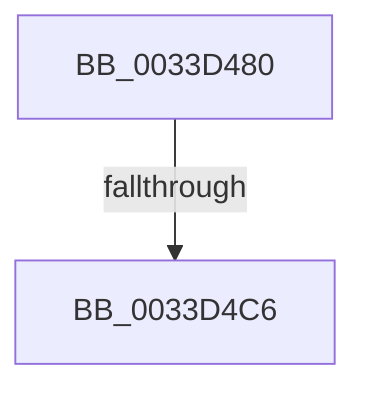

# MiUnlinkStandbyPage

- RVA: `0x0033D480`–`0x0033D4D7` (길이 `87` bytes)
- VA: `0x000000014033D480`
- 실행 섹션: `.text`
- PDB 이름 있음: `예`; PDB Function 태그: `아니요`
- unwind 정보 RVA: `0x00077190`
- 디코드: `22`개 명령, `87/87` bytes 표시
- 미해석 바이트: `0` (있으면 어셈블리에 `.byte`로 보존)

> 이 문서는 커널 이미지의 기계어와 PDB 기호를 분석해 생성했습니다. 4번과 5번은 함수 원형과 자료형을 바이너리 사용 방식에서 추정한 C 해석이며 원본 소스 복구 결과는 아닙니다.

## 1. Dependencies

- 직접 호출 지점: **0**; 고유 호출 대상: **0**
- 직접 호출자로 확인된 함수: **1**
- RIP 상대 이미지 참조: **1**

### Outgoing calls
- 직접 디코드된 call 명령이 없습니다.

### Direct callers
- [MiRemoveLowestPriorityStandbyPage](MiRemoveLowestPriorityStandbyPage_function_00334600.md) at `0x00334859`

### Static image references
- `0x0033D4D0` → RVA `0x00E3014C` (`.data`; read)

## 2. Other-region calls and transfers

- 다른 실행 섹션으로 향하는 call: **0**
- call이 아닌 외부 분기/꼬리 이동: **1**
  - `0x0033D4C0` → [sub_0033DD64](Unknown_function_0033DD64.md) (`tail-transfer`)

## 3. Assembly (complete function range)

```asm
0033D480  48 89 5C 24 10                  mov qword ptr [rsp + 0x10], rbx
0033D485  56                              push rsi
0033D486  41 54                           push r12
0033D488  41 55                           push r13
0033D48A  41 56                           push r14
0033D48C  41 57                           push r15
0033D48E  48 81 EC C0 00 00 00            sub rsp, 0xc0
0033D495  4F 8D 34 49                     lea r14, [r9 + r9*2]
0033D499  48 B8 00 00 00 00 00 DE FF FF   movabs rax, 0xffffde0000000000
0033D4A3  49 C1 E6 04                     shl r14, 4
0033D4A7  4D 8B E1                        mov r12, r9
0033D4AA  4D 8B E8                        mov r13, r8
0033D4AD  48 8B DA                        mov rbx, rdx
0033D4B0  4C 8B F9                        mov r15, rcx
0033D4B3  48 8B C0                        mov rax, rax
0033D4B6  49 8D 34 06                     lea rsi, [r14 + rax]
0033D4BA  49 8B 00                        mov rax, qword ptr [r8]
0033D4BD  48 85 C0                        test rax, rax
0033D4C0  0F 84 9E 08 00 00               je 0x14033dd64
0033D4C6  F0 49 FF 08                     lock dec qword ptr [r8]
0033D4CA  41 BA 01 00 00 00               mov r10d, 1
0033D4D0  44 39 15 75 2C AF 00            cmp dword ptr [rip + 0xaf2c75], r10d
```

## 4. C-style interpretation (structured pseudocode)

```c
__int64 __fastcall MiUnlinkStandbyPage(__int64 a1, __int64 a2, __int64 a3, __int64 a4)
{
    __int64 v_r14;
    __int64 v_rsp;
    unsigned __int64 v_stack_p10;

    v_stack_p10 = v_rbx;
    v_rsp = (v_rsp) - (192);
    v_r14 = (a4 + a4 * 2) << (4);
    return *(unsigned __int64 *)(a3);
}
```

## 5. (Beta) C Style

```c
int64_t MiUnlinkStandbyPage(int64_t Arg1, int64_t Arg2, void *Arg3, void *Arg4)
{
    uint8_t *arg3 = (uint8_t *)Arg3;
    uint8_t *arg4 = (uint8_t *)Arg4;

    int64_t local_r14;
    int64_t local_rsp;
    uint64_t v_stack_p10;

    v_stack_p10 = local_rbx;
    local_rsp = (local_rsp) - (192);
    local_r14 = (Arg4 + Arg4 * 2) << (4);
    return *(uint64_t *)(arg3);
}
```

### 관측된 메모리 오프셋

구조체 형식이 확인되지 않은 접근은 인자 기준의 오프셋으로만 기록했습니다.

| 기준 인자 | 오프셋 표현 | 폭 (bit) | 접근 |
|---|---:|---:|---|
| `Arg3` | `+ 0x0` | `64` | `R` |
| `Arg3` | `+ 0x0` | `64` | `R/W` |
| `Arg4` | `+ 0x0 + r9*2` | `64` | `R` |

## 6. Execution-region graph

[열기: 2D/3D 그래프와 함수 탐색 컨트롤 패널](../../../control-panel.html?section=text&rva=0x0033D480&view=graph)

- 2D 그래프는 위에서 아래로 흐르고, 3D 그래프는 빈 공간을 드래그해 회전합니다. Shift+드래그는 이동, 휠은 확대·축소, 함수 노드 선택은 대상 보고서 이동입니다.

### Static fallback


