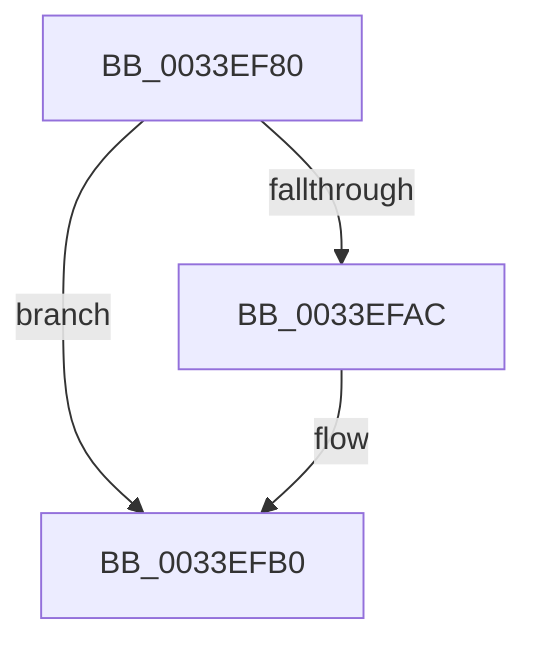

# MiUpdateLargePageCandidateValue

- RVA: `0x0033EF80`–`0x0033EFBD` (길이 `61` bytes)
- VA: `0x000000014033EF80`
- 실행 섹션: `.text`
- PDB 이름 있음: `예`; PDB Function 태그: `아니요`
- unwind 정보 RVA: `0x00077320`
- 디코드: `17`개 명령, `61/61` bytes 표시
- 미해석 바이트: `0` (있으면 어셈블리에 `.byte`로 보존)

> 이 문서는 커널 이미지의 기계어와 PDB 기호를 분석해 생성했습니다. 4번과 5번은 함수 원형과 자료형을 바이너리 사용 방식에서 추정한 C 해석이며 원본 소스 복구 결과는 아닙니다.

## 1. Dependencies

- 직접 호출 지점: **0**; 고유 호출 대상: **0**
- 직접 호출자로 확인된 함수: **13**
- RIP 상대 이미지 참조: **0**

### Outgoing calls
- 직접 디코드된 call 명령이 없습니다.

### Direct callers
- [sub_00287A62](../28/Unknown_function_00287A62.md) at `0x00287A95`
- [MiReplaceTransitionPage](../2B/MiReplaceTransitionPage_function_002B1120.md) at `0x002B1550`
- [MiReplaceTransitionPage](../2B/MiReplaceTransitionPage_function_002B1120.md) at `0x002B1573`
- [MiInsertPageInList](../2B/MiInsertPageInList_function_002BA000.md) at `0x002BA439`
- [sub_003354FB](Unknown_function_003354FB.md) at `0x003355EB`
- [sub_003354FB](Unknown_function_003354FB.md) at `0x003357CF`
- [sub_003354FB](Unknown_function_003354FB.md) at `0x00335EA1`
- [sub_003354FB](Unknown_function_003354FB.md) at `0x00335FAA`
- [MiUnlinkFreeOrZeroedPage](MiUnlinkFreeOrZeroedPage_function_00336C40.md) at `0x00337045`
- [MiUnlinkFreeOrZeroedPage](MiUnlinkFreeOrZeroedPage_function_00336C40.md) at `0x00337326`
- [MiUnlinkFreeOrZeroedPage](MiUnlinkFreeOrZeroedPage_function_00336C40.md) at `0x0033760C`
- [MiUnlinkFreeOrZeroedPage](MiUnlinkFreeOrZeroedPage_function_00336C40.md) at `0x00337741`
- [sub_0033D4D7](Unknown_function_0033D4D7.md) at `0x0033D9DC`
- [sub_0033E2D1](Unknown_function_0033E2D1.md) at `0x0033E61E`
- [MiUpdateLargePageCandidates](../37/MiUpdateLargePageCandidates_function_003798C0.md) at `0x0037993A`
- [MiUpdateLargePageCandidates](../37/MiUpdateLargePageCandidates_function_003798C0.md) at `0x0037997C`
- [MiUpdateLargePageCandidates](../37/MiUpdateLargePageCandidates_function_003798C0.md) at `0x003799D0`
- [MiUpdateLargePageCandidates](../37/MiUpdateLargePageCandidates_function_003798C0.md) at `0x00379A22`
- [MiUpdateLargePageCandidates](../37/MiUpdateLargePageCandidates_function_003798C0.md) at `0x00379A9A`
- [MiSwapNumaStandbyPage](../38/MiSwapNumaStandbyPage_function_00385144.md) at `0x003854A4`
- [MiSwapNumaStandbyPage](../38/MiSwapNumaStandbyPage_function_00385144.md) at `0x003854BB`
- [MiWalkPagesOnLists](../3B/MiWalkPagesOnLists_function_003B6AA4.md) at `0x003B6D05`
- [MiWalkPagesOnLists](../3B/MiWalkPagesOnLists_function_003B6AA4.md) at `0x003B6D23`
- [MiWalkPagesOnLists](../3B/MiWalkPagesOnLists_function_003B6AA4.md) at `0x003B6ED6`
- [MiReplenishPageSlist](../3B/MiReplenishPageSlist_function_003BADE0.md) at `0x003BB252`
- [sub_006E753C](../6E/Unknown_function_006E753C.md) at `0x006E7588`
- [sub_006F3CFE](../6F/Unknown_function_006F3CFE.md) at `0x006F3D24`

### Static image references
- 디코드된 RIP-relative 메모리 참조가 없습니다.

## 2. Other-region calls and transfers

- 다른 실행 섹션으로 향하는 call: **0**
- call이 아닌 외부 분기/꼬리 이동: **1**
  - `0x0033EFB7` → [sub_0033F16C](Unknown_function_0033F16C.md) (`tail-transfer`)

## 3. Assembly (complete function range)

```asm
0033EF80  48 89 6C 24 10                  mov qword ptr [rsp + 0x10], rbp
0033EF85  48 89 74 24 18                  mov qword ptr [rsp + 0x18], rsi
0033EF8A  57                              push rdi
0033EF8B  41 56                           push r14
0033EF8D  41 57                           push r15
0033EF8F  48 83 EC 30                     sub rsp, 0x30
0033EF93  4C 8B 74 24 70                  mov r14, qword ptr [rsp + 0x70]
0033EF98  45 8B F9                        mov r15d, r9d
0033EF9B  45 33 C9                        xor r9d, r9d
0033EF9E  41 8B E8                        mov ebp, r8d
0033EFA1  48 8B FA                        mov rdi, rdx
0033EFA4  48 8B F1                        mov rsi, rcx
0033EFA7  4D 85 F6                        test r14, r14
0033EFAA  74 04                           je 0x14033efb0
0033EFAC  66 45 89 0E                     mov word ptr [r14], r9w
0033EFB0  44 38 89 E6 3E 00 00            cmp byte ptr [rcx + 0x3ee6], r9b
0033EFB7  0F 84 AF 01 00 00               je 0x14033f16c
```

## 4. C-style interpretation (structured pseudocode)

```c
void __fastcall MiUpdateLargePageCandidateValue(__int64 a1, __int64 a2, int a3, int a4, __int64 a5)
{
    __int64 v_rsp;
    unsigned __int64 v_stack_p10;
    unsigned __int64 v_stack_p18;

    v_stack_p10 = v_rbp;
    v_stack_p18 = v_rsi;
    v_rsp = (v_rsp) - (48);
    a4 = 0;
    if (a5 != 0) {
        *(unsigned __int16 *)(a5) = 0;
    }
}
```

## 5. (Beta) C Style

```c
void MiUpdateLargePageCandidateValue(void *Arg1, int64_t Arg2, int32_t Arg3, int32_t Arg4, int64_t Arg5)
{
    uint8_t *arg1 = (uint8_t *)Arg1;

    int64_t local_rsp;
    uint64_t v_stack_p10;
    uint64_t v_stack_p18;

    v_stack_p10 = local_rbp;
    v_stack_p18 = local_rsi;
    local_rsp = (local_rsp) - (48);
    Arg4 = 0;
    if (Arg5 != 0) {
        *(uint16_t *)(Arg5) = 0;
    }
}
```

### 관측된 메모리 오프셋

구조체 형식이 확인되지 않은 접근은 인자 기준의 오프셋으로만 기록했습니다.

| 기준 인자 | 오프셋 표현 | 폭 (bit) | 접근 |
|---|---:|---:|---|
| `Arg1` | `+ 0x3EE6` | `8` | `R` |

## 6. Execution-region graph

[열기: 2D/3D 그래프와 함수 탐색 컨트롤 패널](../../../control-panel.html?section=text&rva=0x0033EF80&view=graph)

- 2D 그래프는 위에서 아래로 흐르고, 3D 그래프는 빈 공간을 드래그해 회전합니다. Shift+드래그는 이동, 휠은 확대·축소, 함수 노드 선택은 대상 보고서 이동입니다.

### Static fallback


