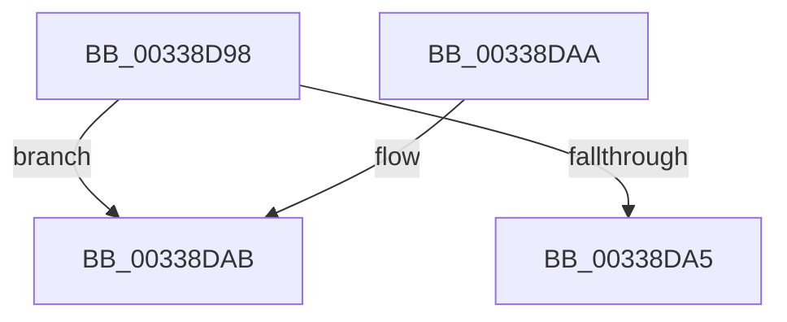

# MiValidateKernelShadowStackPage

- RVA: `0x00338D98`–`0x00338DE6` (길이 `78` bytes)
- VA: `0x0000000140338D98`
- 실행 섹션: `.text`
- PDB 이름 있음: `예`; PDB Function 태그: `아니요`
- unwind 정보 RVA: `0x00076AF4`
- 디코드: `19`개 명령, `78/78` bytes 표시
- 미해석 바이트: `0` (있으면 어셈블리에 `.byte`로 보존)

> 이 문서는 커널 이미지의 기계어와 PDB 기호를 분석해 생성했습니다. 4번과 5번은 함수 원형과 자료형을 바이너리 사용 방식에서 추정한 C 해석이며 원본 소스 복구 결과는 아닙니다.

## 1. Dependencies

- 직접 호출 지점: **1**; 고유 호출 대상: **1**
- 직접 호출자로 확인된 함수: **5**
- RIP 상대 이미지 참조: **0**

### Outgoing calls
- `0x00338DE0` → [KeBugCheckEx](../4F/KeBugCheckEx_function_004FD660.md) (function, `0x004FD660`)

### Direct callers
- [sub_0033800D](Unknown_function_0033800D.md) at `0x0033818E`
- [MiAddKernelStackToPrcbCache](MiAddKernelStackToPrcbCache_function_00338710.md) at `0x00338AA8`
- [MiUpdateKernelShadowStackOwnerData](../48/MiUpdateKernelShadowStackOwnerData_function_004837D4.md) at `0x0048382D`
- [MiKernelShadowStackIdealForCaching](../48/MiKernelShadowStackIdealForCaching_function_00484330.md) at `0x004843BE`
- [MiDeleteShadowStackPtes](../49/MiDeleteShadowStackPtes_function_00493AE4.md) at `0x00493BCA`

### Static image references
- 디코드된 RIP-relative 메모리 참조가 없습니다.

## 2. Other-region calls and transfers

- 다른 실행 섹션으로 향하는 call: **0**
- 별도 외부 분기/꼬리 이동을 확인하지 못했습니다.

## 3. Assembly (complete function range)

```asm
00338D98  48 83 EC 38                     sub rsp, 0x38
00338D9C  8B 42 20                        mov eax, dword ptr [rdx + 0x20]
00338D9F  66 83 F8 02                     cmp ax, 2
00338DA3  75 06                           jne 0x140338dab
00338DA5  48 83 C4 38                     add rsp, 0x38
00338DA9  C3                              ret
00338DAA  CC                              int3
00338DAB  44 0F B7 C0                     movzx r8d, ax
00338DAF  48 B8 00 00 00 00 00 DE FF FF   movabs rax, 0xffffde0000000000
00338DB9  48 2B D0                        sub rdx, rax
00338DBC  4C 89 44 24 20                  mov qword ptr [rsp + 0x20], r8
00338DC1  48 C1 FA 04                     sar rdx, 4
00338DC5  4C 8B C1                        mov r8, rcx
00338DC8  49 B9 AB AA AA AA AA AA AA AA   movabs r9, 0xaaaaaaaaaaaaaaab
00338DD2  B9 1A 00 00 00                  mov ecx, 0x1a
00338DD7  4C 0F AF CA                     imul r9, rdx
00338DDB  BA 05 34 00 00                  mov edx, 0x3405
00338DE0  E8 7B 48 1C 00                  call 0x1404fd660
00338DE5  CC                              int3
```

## 4. C-style interpretation (structured pseudocode)

```c
__int64 __fastcall MiValidateKernelShadowStackPage(__int64 a1, __int64 a2)
{
    __int64 result;
    __int64 v_rsp;
    unsigned __int64 v_stack_p20;

    v_rsp = (v_rsp) - (56);
    if (((unsigned __int16)((unsigned int)(*(unsigned int *)(a2 + 32)))) != 2) goto loc_00338DAB;
    v_rsp = (v_rsp) + (56);
    return (unsigned int)(*(unsigned int *)(a2 + 32));
loc_00338DAB:
    a2 = (a2) - ((unsigned int)(*(unsigned int *)(a2 + 32)));
    v_stack_p20 = (unsigned __int16)((unsigned int)(*(unsigned int *)(a2 + 32)));
    a2 = (a2) >> (4);
    a4 = (a4) * (a2);
    result = KeBugCheckEx(26, (unsigned int)(0x3405ULL), a1, a4);
    return result;
}
```

## 5. (Beta) C Style

```c
int64_t MiValidateKernelShadowStackPage(int64_t Arg1, void *Arg2)
{
    uint8_t *arg2 = (uint8_t *)Arg2;

    int64_t result;
    int64_t local_rsp;
    uint64_t v_stack_p20;

    local_rsp = (local_rsp) - (56);
    if (((uint16_t)((uint32_t)(*(uint32_t *)(arg2 + 0x20)))) != 2) goto loc_00338DAB;
    local_rsp = (local_rsp) + (56);
    return (uint32_t)(*(uint32_t *)(arg2 + 0x20));
loc_00338DAB:
    Arg2 = (Arg2) - ((uint32_t)(*(uint32_t *)(arg2 + 0x20)));
    v_stack_p20 = (uint16_t)((uint32_t)(*(uint32_t *)(arg2 + 0x20)));
    Arg2 = (Arg2) >> (4);
    a4 = (a4) * (Arg2);
    result = KeBugCheckEx(26, (uint32_t)(0x3405ULL), Arg1, a4);
    return result;
}
```

### 관측된 메모리 오프셋

구조체 형식이 확인되지 않은 접근은 인자 기준의 오프셋으로만 기록했습니다.

| 기준 인자 | 오프셋 표현 | 폭 (bit) | 접근 |
|---|---:|---:|---|
| `Arg2` | `+ 0x20` | `32` | `R` |

## 6. Execution-region graph

[열기: 2D/3D 그래프와 함수 탐색 컨트롤 패널](../../../control-panel.html?section=text&rva=0x00338D98&view=graph)

- 2D 그래프는 위에서 아래로 흐르고, 3D 그래프는 빈 공간을 드래그해 회전합니다. Shift+드래그는 이동, 휠은 확대·축소, 함수 노드 선택은 대상 보고서 이동입니다.

### Static fallback


