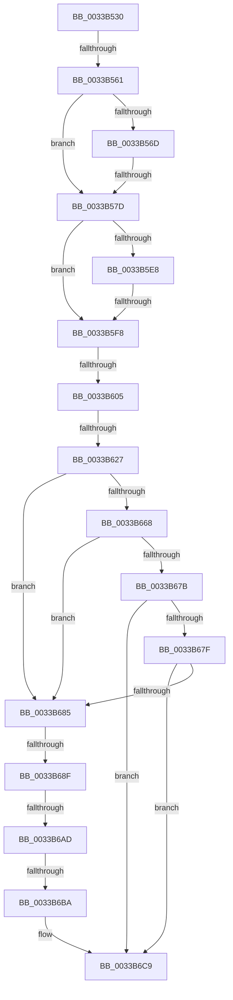

# MiWriteStandbyLookasideEntry

- RVA: `0x0033B530`–`0x0033B6CC` (길이 `412` bytes)
- VA: `0x000000014033B530`
- 실행 섹션: `.text`
- PDB 이름 있음: `예`; PDB Function 태그: `아니요`
- unwind 정보 RVA: `0x00076D50`
- 디코드: `89`개 명령, `412/412` bytes 표시
- 미해석 바이트: `0` (있으면 어셈블리에 `.byte`로 보존)

> 이 문서는 커널 이미지의 기계어와 PDB 기호를 분석해 생성했습니다. 4번과 5번은 함수 원형과 자료형을 바이너리 사용 방식에서 추정한 C 해석이며 원본 소스 복구 결과는 아닙니다.

## 1. Dependencies

- 직접 호출 지점: **0**; 고유 호출 대상: **0**
- 직접 호출자로 확인된 함수: **3**
- RIP 상대 이미지 참조: **8**

### Outgoing calls
- 직접 디코드된 call 명령이 없습니다.

### Direct callers
- [sub_003D5182](../3D/Unknown_function_003D5182.md) at `0x003D5253`
- [MiClearEntireStandbyLookasideList](../3D/MiClearEntireStandbyLookasideList_function_003D56C8.md) at `0x003D5751`
- [sub_006DBD20](../6D/Unknown_function_006DBD20.md) at `0x006DBEBC`

### Static image references
- `0x0033B561` → RVA `0x00E35C00` (`.data`; read)
- `0x0033B5F8` → RVA `0x00E3CBE6` (`.data`; read)
- `0x0033B605` → RVA `0x00E3D240` (`.data`; read)
- `0x0033B631` → RVA `0x00E30088` (`.data`; read)
- `0x0033B657` → RVA `0x00E2DBC0` (`.data`; read)
- `0x0033B65E` → RVA `0x00E2DBC4` (`.data`; read)
- `0x0033B66F` → RVA `0x00E2DC20` (`.data`; read)
- `0x0033B6BA` → RVA `0x00E2DBC0` (`.data`; write)

## 2. Other-region calls and transfers

- 다른 실행 섹션으로 향하는 call: **0**
- call이 아닌 외부 분기/꼬리 이동: **8**
  - `0x0033B55B` → [sub_0033B833](Unknown_function_0033B833.md) (`tail-transfer`)
  - `0x0033B577` → [sub_0033B833](Unknown_function_0033B833.md) (`tail-transfer`)
  - `0x0033B5F2` → [sub_0033BA23 + 0x9](Unknown_function_0033BA23.md) (`tail-transfer`)
  - `0x0033B5FF` → [sub_0033BA68](Unknown_function_0033BA68.md) (`tail-transfer`)
  - `0x0033B621` → [sub_0033BA23](Unknown_function_0033BA23.md) (`tail-transfer`)
  - `0x0033B689` → [sub_0033B833 + 0x13](Unknown_function_0033B833.md) (`tail-transfer`)
  - `0x0033B6A7` → [sub_0033B98C](Unknown_function_0033B98C.md) (`tail-transfer`)
  - `0x0033B6B4` → [sub_0033B8C5](Unknown_function_0033B8C5.md) (`tail-transfer`)

## 3. Assembly (complete function range)

```asm
0033B530  44 89 4C 24 20                  mov dword ptr [rsp + 0x20], r9d
0033B535  89 54 24 10                     mov dword ptr [rsp + 0x10], edx
0033B539  53                              push rbx
0033B53A  56                              push rsi
0033B53B  41 56                           push r14
0033B53D  48 81 EC 80 00 00 00            sub rsp, 0x80
0033B544  48 8B 19                        mov rbx, qword ptr [rcx]
0033B547  4D 8B F0                        mov r14, r8
0033B54A  4C 89 01                        mov qword ptr [rcx], r8
0033B54D  49 BA 10 00 00 00 00 DE FF FF   movabs r10, 0xffffde0000000010
0033B557  48 83 FB FF                     cmp rbx, -1
0033B55B  0F 84 D2 02 00 00               je 0x14033b833
0033B561  4C 8B 0D 98 A6 AF 00            mov r9, qword ptr [rip + 0xafa698]
0033B568  49 3B D9                        cmp rbx, r9
0033B56B  72 10                           jb 0x14033b57d
0033B56D  49 8D 81 00 08 00 00            lea rax, [r9 + 0x800]
0033B574  48 3B D8                        cmp rbx, rax
0033B577  0F 82 B6 02 00 00               jb 0x14033b833
0033B57D  4C 8D 04 5B                     lea r8, [rbx + rbx*2]
0033B581  0F 57 C0                        xorps xmm0, xmm0
0033B584  49 C1 E0 04                     shl r8, 4
0033B588  0F 57 C9                        xorps xmm1, xmm1
0033B58B  4C 89 84 24 A0 00 00 00         mov qword ptr [rsp + 0xa0], r8
0033B593  F3 0F 7F 44 24 40               movdqu xmmword ptr [rsp + 0x40], xmm0
0033B599  F3 0F 7F 4C 24 50               movdqu xmmword ptr [rsp + 0x50], xmm1
0033B59F  49 8B C2                        mov rax, r10
0033B5A2  49 8B 0C 00                     mov rcx, qword ptr [r8 + rax]
0033B5A6  48 C7 C2 FF FF FF F7            mov rdx, 0xfffffffff7ffffff
0033B5AD  48 0F BA E1 0A                  bt rcx, 0xa
0033B5B2  49 BB 00 00 00 00 00 DE FF FF   movabs r11, 0xffffde0000000000
0033B5BC  48 C7 C0 F7 FF FF FF            mov rax, 0xfffffffffffffff7
0033B5C3  48 0F 43 C2                     cmovae rax, rdx
0033B5C7  48 23 C1                        and rax, rcx
0033B5CA  48 89 84 24 B0 00 00 00         mov qword ptr [rsp + 0xb0], rax
0033B5D2  49 8B C3                        mov rax, r11
0033B5D5  49 8D 34 00                     lea rsi, [r8 + rax]
0033B5D9  49 BA AB AA AA AA AA AA AA AA   movabs r10, 0xaaaaaaaaaaaaaaab
0033B5E3  49 3B D9                        cmp rbx, r9
0033B5E6  72 10                           jb 0x14033b5f8
0033B5E8  49 8D 81 00 08 00 00            lea rax, [r9 + 0x800]
0033B5EF  48 3B D8                        cmp rbx, rax
0033B5F2  0F 82 34 04 00 00               jb 0x14033ba2c
0033B5F8  80 3D E7 15 B0 00 00            cmp byte ptr [rip + 0xb015e7], 0
0033B5FF  0F 84 63 04 00 00               je 0x14033ba68
0033B605  48 8B 05 34 1C B0 00            mov rax, qword ptr [rip + 0xb01c34]
0033B60C  49 8B C8                        mov rcx, r8
0033B60F  48 C1 F9 04                     sar rcx, 4
0033B613  49 0F AF CA                     imul rcx, r10
0033B617  48 C1 E9 09                     shr rcx, 9
0033B61B  0F B6 14 48                     movzx edx, byte ptr [rax + rcx*2]
0033B61F  85 D2                           test edx, edx
0033B621  0F 85 FC 03 00 00               jne 0x14033ba23
0033B627  41 B9 09 00 00 00               mov r9d, 9
0033B62D  48 8B 46 28                     mov rax, qword ptr [rsi + 0x28]
0033B631  48 8B 0D 50 4A AF 00            mov rcx, qword ptr [rip + 0xaf4a50]
0033B638  48 C1 E8 2B                     shr rax, 0x2b
0033B63C  25 FF 03 00 00                  and eax, 0x3ff
0033B641  44 89 8C 24 B8 00 00 00         mov dword ptr [rsp + 0xb8], r9d
0033B649  48 89 74 24 38                  mov qword ptr [rsp + 0x38], rsi
0033B64E  48 8B 14 C1                     mov rdx, qword ptr [rcx + rax*8]
0033B652  48 89 54 24 30                  mov qword ptr [rsp + 0x30], rdx
0033B657  48 63 15 62 25 AF 00            movsxd rdx, dword ptr [rip + 0xaf2562]
0033B65E  8B 0D 60 25 AF 00               mov ecx, dword ptr [rip + 0xaf2560]
0033B664  3B D1                           cmp edx, ecx
0033B666  77 1D                           ja 0x14033b685
0033B668  48 8B C2                        mov rax, rdx
0033B66B  48 C1 E0 04                     shl rax, 4
0033B66F  48 03 05 AA 25 AF 00            add rax, qword ptr [rip + 0xaf25aa]
0033B676  48 3B 18                        cmp rbx, qword ptr [rax]
0033B679  72 0A                           jb 0x14033b685
0033B67B  3B D1                           cmp edx, ecx
0033B67D  74 4A                           je 0x14033b6c9
0033B67F  48 3B 58 10                     cmp rbx, qword ptr [rax + 0x10]
0033B683  72 44                           jb 0x14033b6c9
0033B685  33 D2                           xor edx, edx
0033B687  3B CA                           cmp ecx, edx
0033B689  0F 8C B7 01 00 00               jl 0x14033b846
0033B68F  44 8D 04 0A                     lea r8d, [rdx + rcx]
0033B693  41 D1 F8                        sar r8d, 1
0033B696  49 63 C0                        movsxd rax, r8d
0033B699  48 C1 E0 04                     shl rax, 4
0033B69D  48 03 05 7C 25 AF 00            add rax, qword ptr [rip + 0xaf257c]
0033B6A4  48 3B 18                        cmp rbx, qword ptr [rax]
0033B6A7  0F 82 DF 02 00 00               jb 0x14033b98c
0033B6AD  44 3B 05 10 25 AF 00            cmp r8d, dword ptr [rip + 0xaf2510]
0033B6B4  0F 85 0B 02 00 00               jne 0x14033b8c5
0033B6BA  44 89 05 FF 24 AF 00            mov dword ptr [rip + 0xaf24ff], r8d
0033B6C1  4C 8B 84 24 A0 00 00 00         mov r8, qword ptr [rsp + 0xa0]
0033B6C9  8B 40 08                        mov eax, dword ptr [rax + 8]
```

## 4. C-style interpretation (structured pseudocode)

```c
__int64 __fastcall MiWriteStandbyLookasideEntry(__int64 a1, int a2, __int64 a3, int a4)
{
    __int64 result;
    __int64 v_rsp;
    unsigned __int64 v_stack_m48;
    unsigned __int64 v_stack_m58;
    unsigned __int64 v_stack_m60;
    unsigned __int64 v_stack_m68;
    unsigned int v_stack_p10;
    unsigned __int64 v_stack_p18;
    unsigned int v_stack_p20;
    unsigned __int64 v_stack_p8;

    v_stack_p20 = a4;
    v_stack_p10 = a2;
    v_rsp = (v_rsp) - (128);
    *(unsigned __int64 *)(a1) = a3;
    if ((*(unsigned __int64 *)(a1)) < (*(unsigned __int64 *)(v_rip + 11511448))) goto loc_0033B57D;
loc_0033B57D:
    a3 = (*(unsigned __int64 *)(a1) + *(unsigned __int64 *)(a1) * 2) << (4);
    v_stack_p8 = a3;
    v_stack_m58 = v_xmm0;
    v_stack_m48 = v_xmm1;
    result = -9;
    if (condition_is_above_or_equal) { result = 0xFFFFFFFFF7FFFFFFULL; }
    result = (result) & (*(unsigned __int64 *)(a3 + v_r10 * 1));
    v_stack_p18 = result;
    if ((*(unsigned __int64 *)(a1)) < (*(unsigned __int64 *)(v_rip + 11511448))) goto loc_0033B5F8;
loc_0033B5F8:
    a1 = (a3) >> (4);
    a1 = (a1) * (v_r10);
    a1 = (a1) >> (9);
    result = (*(unsigned __int64 *)(a3 + v_r11 * 1 + 40)) >> (43);
    result = (unsigned int)((result) & (0x3FFULL));
    v_stack_p20 = 9;
    v_stack_m60 = a3 + v_r11 * 1;
    v_stack_m68 = *(unsigned __int64 *)(*(unsigned __int64 *)(v_rip + 11487824) + result * 8);
    if (((unsigned int)((int)(*(unsigned int *)(v_rip + 11478370)))) > ((unsigned int)((unsigned int)(*(unsigned int *)(v_rip + 11478368))))) goto loc_0033B685;
    result = ((int)(*(unsigned int *)(v_rip + 11478370))) << (4);
    result = (result) + (*(unsigned __int64 *)(v_rip + 11478442));
    if ((*(unsigned __int64 *)(a1)) < (*(unsigned __int64 *)(result))) goto loc_0033B685;
    if (((unsigned int)((int)(*(unsigned int *)(v_rip + 11478370)))) == ((unsigned int)((unsigned int)(*(unsigned int *)(v_rip + 11478368))))) goto loc_0033B6C9;
    if ((*(unsigned __int64 *)(a1)) < (*(unsigned __int64 *)(result + 16))) goto loc_0033B6C9;
loc_0033B685:
    a2 = 0;
    a3 = (unsigned int)((a2 + (unsigned int)(*(unsigned int *)(v_rip + 11478368)) * 1) >> (1));
    result = ((int)((unsigned int)(a3))) << (4);
    result = (result) + (*(unsigned __int64 *)(v_rip + 11478396));
    *(unsigned int *)(v_rip + 11478271) = (unsigned int)(a3);
loc_0033B6C9:
    return (unsigned int)(*(unsigned int *)(result + 8));
}
```

## 5. (Beta) C Style

```c
int64_t MiWriteStandbyLookasideEntry(void *Arg1, int32_t Arg2, int64_t Arg3, int32_t Arg4)
{
    uint8_t *arg1 = (uint8_t *)Arg1;

    int64_t result;
    int64_t local_rsp;
    uint64_t v_stack_m48;
    uint64_t v_stack_m58;
    uint64_t v_stack_m60;
    uint64_t v_stack_m68;
    uint32_t v_stack_p10;
    uint64_t v_stack_p18;
    uint32_t v_stack_p20;
    uint64_t v_stack_p8;

    v_stack_p20 = Arg4;
    v_stack_p10 = Arg2;
    local_rsp = (local_rsp) - (128);
    *(uint64_t *)(arg1) = Arg3;
    if ((*(uint64_t *)(arg1)) < (*(uint64_t *)(v_rip + 0xAFA698))) goto loc_0033B57D;
loc_0033B57D:
    Arg3 = (*(uint64_t *)(arg1) + *(uint64_t *)(arg1) * 2) << (4);
    v_stack_p8 = Arg3;
    v_stack_m58 = v_xmm0;
    v_stack_m48 = v_xmm1;
    result = -9;
    if (condition_is_above_or_equal) { result = 0xFFFFFFFFF7FFFFFFULL; }
    result = (result) & (*(uint64_t *)(Arg3 + local_r10 * 1));
    v_stack_p18 = result;
    if ((*(uint64_t *)(arg1)) < (*(uint64_t *)(v_rip + 0xAFA698))) goto loc_0033B5F8;
loc_0033B5F8:
    Arg1 = (Arg3) >> (4);
    Arg1 = (Arg1) * (local_r10);
    Arg1 = (Arg1) >> (9);
    result = (*(uint64_t *)(Arg3 + local_r11 * 1 + 0x28)) >> (43);
    result = (uint32_t)((result) & (0x3FFULL));
    v_stack_p20 = 9;
    v_stack_m60 = Arg3 + local_r11 * 1;
    v_stack_m68 = *(uint64_t *)(*(uint64_t *)(v_rip + 0xAF4A50) + result * 8);
    if (((uint32_t)((int32_t)(*(uint32_t *)(v_rip + 0xAF2562)))) > ((uint32_t)((uint32_t)(*(uint32_t *)(v_rip + 0xAF2560))))) goto loc_0033B685;
    result = ((int32_t)(*(uint32_t *)(v_rip + 0xAF2562))) << (4);
    result = (result) + (*(uint64_t *)(v_rip + 0xAF25AA));
    if ((*(uint64_t *)(arg1)) < (*(uint64_t *)(result))) goto loc_0033B685;
    if (((uint32_t)((int32_t)(*(uint32_t *)(v_rip + 0xAF2562)))) == ((uint32_t)((uint32_t)(*(uint32_t *)(v_rip + 0xAF2560))))) goto loc_0033B6C9;
    if ((*(uint64_t *)(arg1)) < (*(uint64_t *)(result + 0x10))) goto loc_0033B6C9;
loc_0033B685:
    Arg2 = 0;
    Arg3 = (uint32_t)((Arg2 + (uint32_t)(*(uint32_t *)(v_rip + 0xAF2560)) * 1) >> (1));
    result = ((int32_t)((uint32_t)(Arg3))) << (4);
    result = (result) + (*(uint64_t *)(v_rip + 0xAF257C));
    *(uint32_t *)(v_rip + 0xAF24FF) = (uint32_t)(Arg3);
loc_0033B6C9:
    return (uint32_t)(*(uint32_t *)(result + 0x8));
}
```

### 관측된 메모리 오프셋

구조체 형식이 확인되지 않은 접근은 인자 기준의 오프셋으로만 기록했습니다.

| 기준 인자 | 오프셋 표현 | 폭 (bit) | 접근 |
|---|---:|---:|---|
| `Arg1` | `+ 0x0` | `64` | `R` |
| `Arg1` | `+ 0x0` | `64` | `W` |

## 6. Execution-region graph

[열기: 2D/3D 그래프와 함수 탐색 컨트롤 패널](../../../control-panel.html?section=text&rva=0x0033B530&view=graph)

- 2D 그래프는 위에서 아래로 흐르고, 3D 그래프는 빈 공간을 드래그해 회전합니다. Shift+드래그는 이동, 휠은 확대·축소, 함수 노드 선택은 대상 보고서 이동입니다.

### Static fallback


