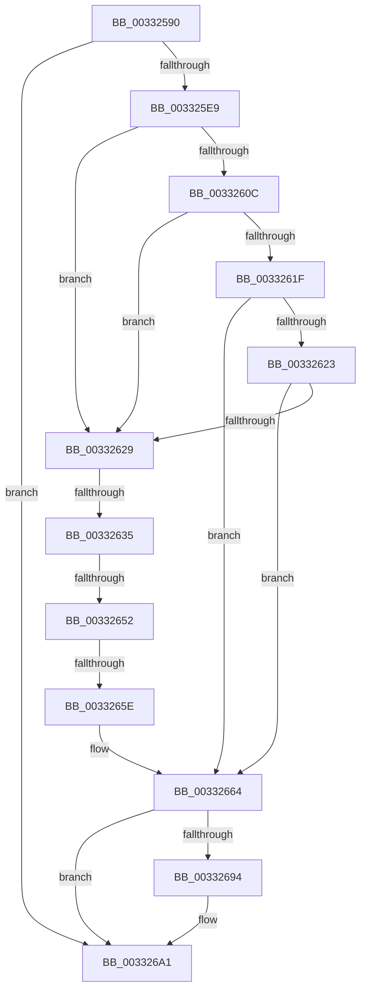

# MiZeroPhysicalPage

- RVA: `0x00332590`–`0x003326B2` (길이 `290` bytes)
- VA: `0x0000000140332590`
- 실행 섹션: `.text`
- PDB 이름 있음: `예`; PDB Function 태그: `아니요`
- unwind 정보 RVA: `0x000765AC`
- 디코드: `73`개 명령, `290/290` bytes 표시
- 미해석 바이트: `0` (있으면 어셈블리에 `.byte`로 보존)

> 이 문서는 커널 이미지의 기계어와 PDB 기호를 분석해 생성했습니다. 4번과 5번은 함수 원형과 자료형을 바이너리 사용 방식에서 추정한 C 해석이며 원본 소스 복구 결과는 아닙니다.

## 1. Dependencies

- 직접 호출 지점: **1**; 고유 호출 대상: **1**
- 직접 호출자로 확인된 함수: **17**
- RIP 상대 이미지 참조: **5**

### Outgoing calls
- `0x0033269C` → [MiChangePageAttribute](MiChangePageAttribute_function_00332ECC.md) (function, `0x00332ECC`)

### Direct callers
- [MiGetPage](../28/MiGetPage_function_002884C0.md) at `0x00288F22`
- [MiFreePageToSlabAllocator](../2A/MiFreePageToSlabAllocator_function_002A0A60.md) at `0x002A0BFA`
- [sub_002B78A5](../2B/Unknown_function_002B78A5.md) at `0x002B78E4`
- [sub_002B79EA](../2B/Unknown_function_002B79EA.md) at `0x002B7A18`
- [MiMakePageAvoidRead](../2B/MiMakePageAvoidRead_function_002B7DE0.md) at `0x002B846F`
- [MiZeroAndConvertPage](../2C/MiZeroAndConvertPage_function_002C8480.md) at `0x002C8541`
- [sub_002F6E32](../2F/Unknown_function_002F6E32.md) at `0x002F76D5`
- [MiGetPageChain](MiGetPageChain_function_00330130.md) at `0x00330339`
- [MiGetPageChain](MiGetPageChain_function_00330130.md) at `0x00330703`
- [MiPfPutPagesInTransition](../36/MiPfPutPagesInTransition_function_003640EC.md) at `0x00364B28`
- [MiZeroAndReleasePages](../37/MiZeroAndReleasePages_function_003748D0.md) at `0x00374B3F`
- [MiGetSlabPage](../37/MiGetSlabPage_function_00376FBC.md) at `0x00377110`
- [MiIssueHardFault](../38/MiIssueHardFault_function_00380074.md) at `0x003804EF`
- [MiWaitForInPageComplete](../38/MiWaitForInPageComplete_function_00380AB8.md) at `0x00380F0D`
- [MiPerformFinalZeroing](../4F/MiPerformFinalZeroing_function_004F9594.md) at `0x004F95FB`
- [sub_006DC750](../6D/Unknown_function_006DC750.md) at `0x006DC767`
- [sub_006DC794](../6D/Unknown_function_006DC794.md) at `0x006DC79C`
- [sub_006DC794](../6D/Unknown_function_006DC794.md) at `0x006DC7C2`
- [MiInitializeCacheFlushing](../../init/C6/MiInitializeCacheFlushing_function_00C6ACF8.md) at `0x00C6AE2D`

### Static image references
- `0x003325E9` → RVA `0x00E2DBC0` (`.data`; read)
- `0x003325FA` → RVA `0x00E2DBC4` (`.data`; read)
- `0x00332613` → RVA `0x00E2DC20` (`.data`; read)
- `0x0033265E` → RVA `0x00E2DBC0` (`.data`; write)
- `0x0033267D` → RVA `0x00E2DBF8` (`.data`; read)

## 2. Other-region calls and transfers

- 다른 실행 섹션으로 향하는 call: **0**
- call이 아닌 외부 분기/꼬리 이동: **3**
  - `0x0033262F` → [sub_0033278A + 0xF](Unknown_function_0033278A.md) (`tail-transfer`)
  - `0x0033264C` → [sub_0033278A + 0x3C](Unknown_function_0033278A.md) (`tail-transfer`)
  - `0x00332658` → [sub_0033278A + 0x29](Unknown_function_0033278A.md) (`tail-transfer`)

## 3. Assembly (complete function range)

```asm
00332590  44 89 4C 24 20                  mov dword ptr [rsp + 0x20], r9d
00332595  48 89 4C 24 08                  mov qword ptr [rsp + 8], rcx
0033259A  53                              push rbx
0033259B  56                              push rsi
0033259C  57                              push rdi
0033259D  41 55                           push r13
0033259F  41 56                           push r14
003325A1  41 57                           push r15
003325A3  48 83 EC 48                     sub rsp, 0x48
003325A7  4C 8D 14 52                     lea r10, [rdx + rdx*2]
003325AB  48 8B DA                        mov rbx, rdx
003325AE  49 C1 E2 04                     shl r10, 4
003325B2  48 B8 00 00 00 00 00 DE FF FF   movabs rax, 0xffffde0000000000
003325BC  4D 8D 2C 02                     lea r13, [r10 + rax]
003325C0  45 8B F8                        mov r15d, r8d
003325C3  41 8B 45 20                     mov eax, dword ptr [r13 + 0x20]
003325C7  41 83 E7 02                     and r15d, 2
003325CB  C1 E8 10                        shr eax, 0x10
003325CE  33 FF                           xor edi, edi
003325D0  44 0F B6 F0                     movzx r14d, al
003325D4  41 C1 EE 06                     shr r14d, 6
003325D8  41 C1 E7 03                     shl r15d, 3
003325DC  41 8B F6                        mov esi, r14d
003325DF  41 F6 C0 01                     test r8b, 1
003325E3  0F 85 B8 00 00 00               jne 0x1403326a1
003325E9  48 63 15 D0 B5 AF 00            movsxd rdx, dword ptr [rip + 0xafb5d0]
003325F0  48 B8 AB AA AA AA AA AA AA AA   movabs rax, 0xaaaaaaaaaaaaaaab
003325FA  8B 0D C4 B5 AF 00               mov ecx, dword ptr [rip + 0xafb5c4]
00332600  49 C1 FA 04                     sar r10, 4
00332604  4C 0F AF D0                     imul r10, rax
00332608  3B D1                           cmp edx, ecx
0033260A  77 1D                           ja 0x140332629
0033260C  48 8B C2                        mov rax, rdx
0033260F  48 C1 E0 04                     shl rax, 4
00332613  48 03 05 06 B6 AF 00            add rax, qword ptr [rip + 0xafb606]
0033261A  4C 3B 10                        cmp r10, qword ptr [rax]
0033261D  72 0A                           jb 0x140332629
0033261F  3B D1                           cmp edx, ecx
00332621  74 41                           je 0x140332664
00332623  4C 3B 50 10                     cmp r10, qword ptr [rax + 0x10]
00332627  72 3B                           jb 0x140332664
00332629  44 8B C7                        mov r8d, edi
0033262C  41 3B C8                        cmp ecx, r8d
0033262F  0F 8C 64 01 00 00               jl 0x140332799
00332635  41 8D 14 08                     lea edx, [r8 + rcx]
00332639  D1 FA                           sar edx, 1
0033263B  48 63 C2                        movsxd rax, edx
0033263E  48 C1 E0 04                     shl rax, 4
00332642  48 03 05 D7 B5 AF 00            add rax, qword ptr [rip + 0xafb5d7]
00332649  4C 3B 10                        cmp r10, qword ptr [rax]
0033264C  0F 82 74 01 00 00               jb 0x1403327c6
00332652  3B 15 6C B5 AF 00               cmp edx, dword ptr [rip + 0xafb56c]
00332658  0F 85 55 01 00 00               jne 0x1403327b3
0033265E  89 15 5C B5 AF 00               mov dword ptr [rip + 0xafb55c], edx
00332664  8B 40 08                        mov eax, dword ptr [rax + 8]
00332667  48 8D 14 40                     lea rdx, [rax + rax*2]
0033266B  41 8B 45 20                     mov eax, dword ptr [r13 + 0x20]
0033266F  C1 E8 10                        shr eax, 0x10
00332672  0F B6 C8                        movzx ecx, al
00332675  48 C1 E9 06                     shr rcx, 6
00332679  48 C1 E2 07                     shl rdx, 7
0033267D  48 03 15 74 B5 AF 00            add rdx, qword ptr [rip + 0xafb574]
00332684  49 63 C1                        movsxd rax, r9d
00332687  48 8D 0C 88                     lea rcx, [rax + rcx*4]
0033268B  8B 74 8A 78                     mov esi, dword ptr [rdx + rcx*4 + 0x78]
0033268F  41 3B F6                        cmp esi, r14d
00332692  74 0D                           je 0x1403326a1
00332694  45 8B C7                        mov r8d, r15d
00332697  8B D6                           mov edx, esi
00332699  49 8B CD                        mov rcx, r13
0033269C  E8 2B 08 00 00                  call 0x140332ecc
003326A1  C6 84 24 90 00 00 00 11         mov byte ptr [rsp + 0x90], 0x11
003326A9  65 48 8B 04 25 20 00 00 00      mov rax, qword ptr gs:[0x20]
```

## 4. C-style interpretation (structured pseudocode)

```c
__int64 __fastcall MiZeroPhysicalPage(__int64 a1, __int64 a2, int a3, int a4)
{
    __int64 result;
    __int64 v_r10;
    __int64 v_r14;
    __int64 v_r15;
    __int64 v_rdi;
    __int64 v_rsp;
    unsigned __int8 v_stack_p18;
    unsigned int v_stack_p20;
    unsigned __int64 v_stack_p8;

    v_stack_p20 = a4;
    v_stack_p8 = a1;
    v_rsp = (v_rsp) - (72);
    v_r10 = (a2 + a2 * 2) << (4);
    v_r15 = (unsigned int)(((unsigned int)(a3)) & (2));
    result = (unsigned int)(((unsigned int)(*(unsigned int *)(v_r10 + result * 1 + 32))) >> (16));
    v_rdi = 0;
    v_r14 = (unsigned int)(((unsigned __int8)(result)) >> (6));
    v_r15 = (unsigned int)((v_r15) << (3));
    if ((((unsigned __int8)(a3)) & (1)) != 0) goto loc_003326A1;
    v_r10 = (v_r10) >> (4);
    v_r10 = (v_r10) * (result);
    if (((unsigned int)((int)(*(unsigned int *)(v_rip + 11515344)))) > ((unsigned int)((unsigned int)(*(unsigned int *)(v_rip + 11515332))))) goto loc_00332629;
    result = ((int)(*(unsigned int *)(v_rip + 11515344))) << (4);
    result = (result) + (*(unsigned __int64 *)(v_rip + 11515398));
    if (v_r10 < (*(unsigned __int64 *)(result))) goto loc_00332629;
    if (((unsigned int)((int)(*(unsigned int *)(v_rip + 11515344)))) == ((unsigned int)((unsigned int)(*(unsigned int *)(v_rip + 11515332))))) goto loc_00332664;
    if (v_r10 < (*(unsigned __int64 *)(result + 16))) goto loc_00332664;
loc_00332629:
    a2 = (unsigned int)((0 + (unsigned int)(*(unsigned int *)(v_rip + 11515332)) * 1) >> (1));
    result = ((int)((unsigned int)(a2))) << (4);
    result = (result) + (*(unsigned __int64 *)(v_rip + 11515351));
    *(unsigned int *)(v_rip + 11515228) = (unsigned int)(a2);
loc_00332664:
    result = (unsigned int)(((unsigned int)(*(unsigned int *)(v_r10 + result * 1 + 32))) >> (16));
    a1 = ((unsigned __int8)(result)) >> (6);
    a2 = ((unsigned int)(*(unsigned int *)(result + 8)) + (unsigned int)(*(unsigned int *)(result + 8)) * 2) << (7);
    a2 = (a2) + (*(unsigned __int64 *)(v_rip + 11515252));
    result = (int)(a4);
    if (((unsigned int)((unsigned int)(*(unsigned int *)(a2 + (int)(a4) + a1 * 4 * 4 + 120)))) != ((unsigned int)(v_r14))) {
        a3 = (unsigned int)(v_r15);
        a2 = (unsigned int)((unsigned int)(*(unsigned int *)(a2 + (int)(a4) + a1 * 4 * 4 + 120)));
        a1 = v_r10 + result * 1;
        result = MiChangePageAttribute(a1, a2, a3, a4);
    }
    v_stack_p18 = 17;
    return *(unsigned __int64 *)(gs_base + (0 + 32));
}
```

## 5. (Beta) C Style

```c
int64_t MiZeroPhysicalPage(int64_t Arg1, void *Arg2, int32_t Arg3, void *Arg4)
{
    uint8_t *arg2 = (uint8_t *)Arg2;
    uint8_t *arg4 = (uint8_t *)Arg4;

    int64_t result;
    int64_t local_r10;
    int64_t local_r14;
    int64_t local_r15;
    int64_t local_rdi;
    int64_t local_rsp;
    uint8_t v_stack_p18;
    uint32_t v_stack_p20;
    uint64_t v_stack_p8;

    v_stack_p20 = Arg4;
    v_stack_p8 = Arg1;
    local_rsp = (local_rsp) - (72);
    local_r10 = (Arg2 + Arg2 * 2) << (4);
    local_r15 = (uint32_t)(((uint32_t)(Arg3)) & (2));
    result = (uint32_t)(((uint32_t)(*(uint32_t *)(local_r10 + result * 1 + 0x20))) >> (16));
    local_rdi = 0;
    local_r14 = (uint32_t)(((uint8_t)(result)) >> (6));
    local_r15 = (uint32_t)((local_r15) << (3));
    if ((((uint8_t)(Arg3)) & (1)) != 0) goto loc_003326A1;
    local_r10 = (local_r10) >> (4);
    local_r10 = (local_r10) * (result);
    if (((uint32_t)((int32_t)(*(uint32_t *)(v_rip + 0xAFB5D0)))) > ((uint32_t)((uint32_t)(*(uint32_t *)(v_rip + 0xAFB5C4))))) goto loc_00332629;
    result = ((int32_t)(*(uint32_t *)(v_rip + 0xAFB5D0))) << (4);
    result = (result) + (*(uint64_t *)(v_rip + 0xAFB606));
    if (local_r10 < (*(uint64_t *)(result))) goto loc_00332629;
    if (((uint32_t)((int32_t)(*(uint32_t *)(v_rip + 0xAFB5D0)))) == ((uint32_t)((uint32_t)(*(uint32_t *)(v_rip + 0xAFB5C4))))) goto loc_00332664;
    if (local_r10 < (*(uint64_t *)(result + 0x10))) goto loc_00332664;
loc_00332629:
    Arg2 = (uint32_t)((0 + (uint32_t)(*(uint32_t *)(v_rip + 0xAFB5C4)) * 1) >> (1));
    result = ((int32_t)((uint32_t)(Arg2))) << (4);
    result = (result) + (*(uint64_t *)(v_rip + 0xAFB5D7));
    *(uint32_t *)(v_rip + 0xAFB55C) = (uint32_t)(Arg2);
loc_00332664:
    result = (uint32_t)(((uint32_t)(*(uint32_t *)(local_r10 + result * 1 + 0x20))) >> (16));
    Arg1 = ((uint8_t)(result)) >> (6);
    Arg2 = ((uint32_t)(*(uint32_t *)(result + 0x8)) + (uint32_t)(*(uint32_t *)(result + 0x8)) * 2) << (7);
    Arg2 = (Arg2) + (*(uint64_t *)(v_rip + 0xAFB574));
    result = (int32_t)(Arg4);
    if (((uint32_t)((uint32_t)(*(uint32_t *)(arg2 + (int32_t)(arg4) + Arg1 * 4 * 4 + 0x78)))) != ((uint32_t)(local_r14))) {
        Arg3 = (uint32_t)(local_r15);
        Arg2 = (uint32_t)((uint32_t)(*(uint32_t *)(arg2 + (int32_t)(arg4) + Arg1 * 4 * 4 + 0x78)));
        Arg1 = local_r10 + result * 1;
        result = MiChangePageAttribute(Arg1, Arg2, Arg3, Arg4);
    }
    v_stack_p18 = 17;
    return *(uint64_t *)(gs_base + (0 + 0x20));
}
```

### 관측된 메모리 오프셋

구조체 형식이 확인되지 않은 접근은 인자 기준의 오프셋으로만 기록했습니다.

| 기준 인자 | 오프셋 표현 | 폭 (bit) | 접근 |
|---|---:|---:|---|
| `Arg2` | `+ 0x0 + rdx*2` | `64` | `R` |
| `Arg4` | `+ 0x0 + rcx*4` | `64` | `R` |

## 6. Execution-region graph

[열기: 2D/3D 그래프와 함수 탐색 컨트롤 패널](../../../control-panel.html?section=text&rva=0x00332590&view=graph)

- 2D 그래프는 위에서 아래로 흐르고, 3D 그래프는 빈 공간을 드래그해 회전합니다. Shift+드래그는 이동, 휠은 확대·축소, 함수 노드 선택은 대상 보고서 이동입니다.

### Static fallback


