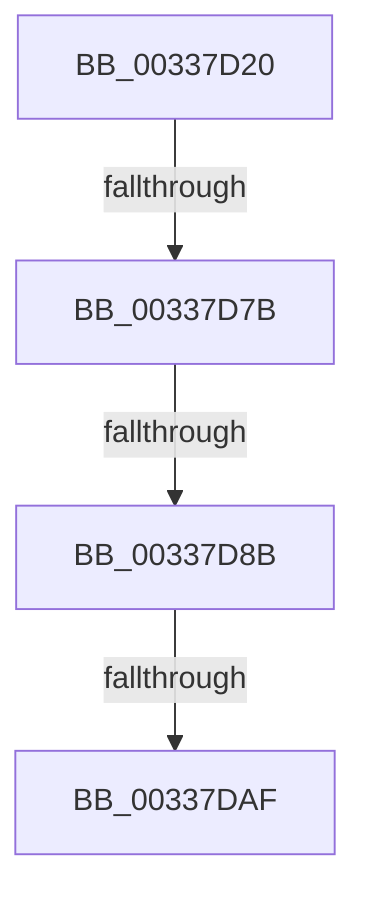

# MmCreateKernelStack

- RVA: `0x00337D20`–`0x00337DD2` (길이 `178` bytes)
- VA: `0x0000000140337D20`
- 실행 섹션: `.text`
- PDB 이름 있음: `예`; PDB Function 태그: `아니요`
- unwind 정보 RVA: `0x00076A2C`
- 디코드: `43`개 명령, `178/178` bytes 표시
- 미해석 바이트: `0` (있으면 어셈블리에 `.byte`로 보존)

> 이 문서는 커널 이미지의 기계어와 PDB 기호를 분석해 생성했습니다. 4번과 5번은 함수 원형과 자료형을 바이너리 사용 방식에서 추정한 C 해석이며 원본 소스 복구 결과는 아닙니다.

## 1. Dependencies

- 직접 호출 지점: **0**; 고유 호출 대상: **0**
- 직접 호출자로 확인된 함수: **10**
- RIP 상대 이미지 참조: **2**

### Outgoing calls
- 직접 디코드된 call 명령이 없습니다.

### Direct callers
- [sub_002F8911](../2F/Unknown_function_002F8911.md) at `0x002F8A33`
- [KiEnableOptionalXStateFeatures](../3D/KiEnableOptionalXStateFeatures_function_003D8BE8.md) at `0x003D8C5E`
- [KiAllocateXStateStack](../4D/KiAllocateXStateStack_function_004DD9F8.md) at `0x004DDA31`
- [KiAllocateProcessorStacks](../5B/KiAllocateProcessorStacks_function_005B6D74.md) at `0x005B6DBA`
- [PspEnableProcessOptionalXStateFeatures](../../page/78/PspEnableProcessOptionalXStateFeatures_function_00781EF0.md) at `0x007820B0`
- [KeUserModeCallback](../../page/8E/KeUserModeCallback_function_008E8A00.md) at `0x008E8AF4`
- [KeUserModeCallback](../../page/8E/KeUserModeCallback_function_008E8A00.md) at `0x008E8EBE`
- [KiCreateKernelShadowStack](../../page/A1/KiCreateKernelShadowStack_function_00A1DD60.md) at `0x00A1DD8B`
- [KeAllocateCalloutStackEx](../../page/A7/KeAllocateCalloutStackEx_function_00A7F030.md) at `0x00A7F114`
- [sub_00B39158](../../page/B3/Unknown_function_00B39158.md) at `0x00B3918F`
- [KeInitThread](../../pagelk/B7/KeInitThread_function_00B78450.md) at `0x00B786C3`

### Static image references
- `0x00337D7B` → RVA `0x00E38D00` (`.data`; read)
- `0x00337D99` → RVA `0x00E30088` (`.data`; read)

## 2. Other-region calls and transfers

- 다른 실행 섹션으로 향하는 call: **0**
- call이 아닌 외부 분기/꼬리 이동: **3**
  - `0x00337D75` → [sub_00338255](Unknown_function_00338255.md) (`tail-transfer`)
  - `0x00337D85` → [sub_00338689](Unknown_function_00338689.md) (`tail-transfer`)
  - `0x00337DA9` → [sub_00337FDF + 0x1](Unknown_function_00337FDF.md) (`tail-transfer`)

## 3. Assembly (complete function range)

```asm
00337D20  4C 8B DC                        mov r11, rsp
00337D23  53                              push rbx
00337D24  55                              push rbp
00337D25  56                              push rsi
00337D26  57                              push rdi
00337D27  41 56                           push r14
00337D29  41 57                           push r15
00337D2B  48 81 EC B8 00 00 00            sub rsp, 0xb8
00337D32  44 8B 41 04                     mov r8d, dword ptr [rcx + 4]
00337D36  0F 57 C0                        xorps xmm0, xmm0
00337D39  8B 29                           mov ebp, dword ptr [rcx]
00337D3B  33 C0                           xor eax, eax
00337D3D  8B 59 08                        mov ebx, dword ptr [rcx + 8]
00337D40  48 8B F9                        mov rdi, rcx
00337D43  48 8B 71 10                     mov rsi, qword ptr [rcx + 0x10]
00337D47  0F 11 44 24 50                  movups xmmword ptr [rsp + 0x50], xmm0
00337D4C  89 AC 24 00 01 00 00            mov dword ptr [rsp + 0x100], ebp
00337D53  0F 11 44 24 60                  movups xmmword ptr [rsp + 0x60], xmm0
00337D58  0F 11 44 24 70                  movups xmmword ptr [rsp + 0x70], xmm0
00337D5D  49 89 43 A8                     mov qword ptr [r11 - 0x58], rax
00337D61  41 0F 11 43 98                  movups xmmword ptr [r11 - 0x68], xmm0
00337D66  45 33 DB                        xor r11d, r11d
00337D69  4C 89 59 18                     mov qword ptr [rcx + 0x18], r11
00337D6D  4C 89 59 20                     mov qword ptr [rcx + 0x20], r11
00337D71  41 83 F8 05                     cmp r8d, 5
00337D75  0F 85 DA 04 00 00               jne 0x140338255
00337D7B  48 8D 05 7E 0F B0 00            lea rax, [rip + 0xb00f7e]
00337D82  48 85 F6                        test rsi, rsi
00337D85  0F 84 FE 08 00 00               je 0x140338689
00337D8B  48 8B 86 20 02 00 00            mov rax, qword ptr [rsi + 0x220]
00337D92  0F B7 88 AE 04 00 00            movzx ecx, word ptr [rax + 0x4ae]
00337D99  48 8B 05 E8 82 AF 00            mov rax, qword ptr [rip + 0xaf82e8]
00337DA0  4C 8B 3C C8                     mov r15, qword ptr [rax + rcx*8]
00337DA4  8B D5                           mov edx, ebp
00337DA6  83 E2 10                        and edx, 0x10
00337DA9  0F 84 31 02 00 00               je 0x140337fe0
00337DAF  41 83 F8 05                     cmp r8d, 5
00337DB3  48 C7 C0 E0 FF FF FF            mov rax, 0xffffffffffffffe0
00337DBA  44 8B F5                        mov r14d, ebp
00337DBD  48 0F 44 F0                     cmove rsi, rax
00337DC1  41 83 E6 40                     and r14d, 0x40
00337DC5  4C 69 D3 80 DF 00 00            imul r10, rbx, 0xdf80
00337DCC  41 B9 01 00 00 00               mov r9d, 1
```

## 4. C-style interpretation (structured pseudocode)

```c
__int64 __fastcall MmCreateKernelStack(__int64 a1)
{
    __int64 result;
    __int64 v_r10;
    __int64 v_r11;
    __int64 v_r14;
    __int64 v_rsi;
    __int64 v_rsp;
    unsigned __int64 v_stack_m78;
    unsigned __int64 v_stack_m88;
    unsigned __int64 v_stack_m98;
    unsigned int v_stack_p18;

    v_rsp = (v_rsp) - (184);
    result = 0;
    v_stack_m98 = v_xmm0;
    v_stack_p18 = (unsigned int)((unsigned int)(*(unsigned int *)(a1)));
    v_stack_m88 = v_xmm0;
    v_stack_m78 = v_xmm0;
    *(unsigned __int64 *)(v_rsp - 88) = 0;
    *(unsigned __int64 *)(v_rsp - 104) = v_xmm0;
    v_r11 = 0;
    *(unsigned __int64 *)(a1 + 24) = 0;
    *(unsigned __int64 *)(a1 + 32) = 0;
    a2 = (unsigned int)(((unsigned int)((unsigned int)((unsigned int)(*(unsigned int *)(a1))))) & (16));
    v_rsi = *(unsigned __int64 *)(a1 + 16);
    if (((unsigned int)((unsigned int)(*(unsigned int *)(a1 + 4)))) == 5) { v_rsi = -32; }
    v_r14 = (unsigned int)(((unsigned int)((unsigned int)((unsigned int)(*(unsigned int *)(a1))))) & (64));
    v_r10 = (v_r10) * ((unsigned int)(*(unsigned int *)(a1 + 8)));
    return -32;
}
```

## 5. (Beta) C Style

```c
int64_t MmCreateKernelStack(void *Arg1)
{
    uint8_t *arg1 = (uint8_t *)Arg1;

    int64_t result;
    int64_t local_r10;
    int64_t local_r11;
    int64_t local_r14;
    int64_t local_rsi;
    int64_t local_rsp;
    uint64_t v_stack_m78;
    uint64_t v_stack_m88;
    uint64_t v_stack_m98;
    uint32_t v_stack_p18;

    local_rsp = (local_rsp) - (184);
    result = 0;
    v_stack_m98 = v_xmm0;
    v_stack_p18 = (uint32_t)((uint32_t)(*(uint32_t *)(arg1)));
    v_stack_m88 = v_xmm0;
    v_stack_m78 = v_xmm0;
    *(uint64_t *)(local_rsp - 0x58) = 0;
    *(uint64_t *)(local_rsp - 0x68) = v_xmm0;
    local_r11 = 0;
    *(uint64_t *)(arg1 + 0x18) = 0;
    *(uint64_t *)(arg1 + 0x20) = 0;
    a2 = (uint32_t)(((uint32_t)((uint32_t)((uint32_t)(*(uint32_t *)(arg1))))) & (16));
    local_rsi = *(uint64_t *)(arg1 + 0x10);
    if (((uint32_t)((uint32_t)(*(uint32_t *)(arg1 + 0x4)))) == 5) { local_rsi = -32; }
    local_r14 = (uint32_t)(((uint32_t)((uint32_t)((uint32_t)(*(uint32_t *)(arg1))))) & (64));
    local_r10 = (local_r10) * ((uint32_t)(*(uint32_t *)(arg1 + 0x8)));
    return -32;
}
```

### 관측된 메모리 오프셋

구조체 형식이 확인되지 않은 접근은 인자 기준의 오프셋으로만 기록했습니다.

| 기준 인자 | 오프셋 표현 | 폭 (bit) | 접근 |
|---|---:|---:|---|
| `Arg1` | `+ 0x0` | `32` | `R` |
| `Arg1` | `+ 0x4` | `32` | `R` |
| `Arg1` | `+ 0x8` | `32` | `R` |
| `Arg1` | `+ 0x10` | `64` | `R` |
| `Arg1` | `+ 0x18` | `64` | `W` |
| `Arg1` | `+ 0x20` | `64` | `W` |

## 6. Execution-region graph

[열기: 2D/3D 그래프와 함수 탐색 컨트롤 패널](../../../control-panel.html?section=text&rva=0x00337D20&view=graph)

- 2D 그래프는 위에서 아래로 흐르고, 3D 그래프는 빈 공간을 드래그해 회전합니다. Shift+드래그는 이동, 휠은 확대·축소, 함수 노드 선택은 대상 보고서 이동입니다.

### Static fallback


