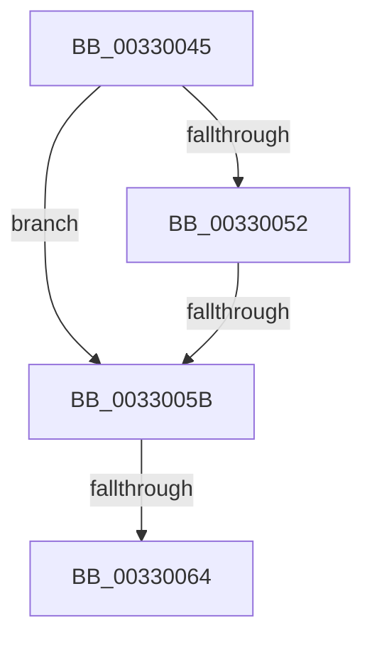

# sub_00330045

- RVA: `0x00330045`–`0x00330069` (길이 `36` bytes)
- VA: `0x0000000140330045`
- 실행 섹션: `.text`
- PDB 이름 있음: `아니요`; PDB Function 태그: `아니요`
- unwind 정보 RVA: `0x000764E0`
- 디코드: `10`개 명령, `36/36` bytes 표시
- 미해석 바이트: `0` (있으면 어셈블리에 `.byte`로 보존)

> 이 문서는 커널 이미지의 기계어와 PDB 기호를 분석해 생성했습니다. 4번과 5번은 함수 원형과 자료형을 바이너리 사용 방식에서 추정한 C 해석이며 원본 소스 복구 결과는 아닙니다.

## 1. Dependencies

- 직접 호출 지점: **0**; 고유 호출 대상: **0**
- 직접 호출자로 확인된 함수: **0**
- RIP 상대 이미지 참조: **0**

### Outgoing calls
- 직접 디코드된 call 명령이 없습니다.

### Direct callers
- 이 함수 시작 RVA로 연결되는 직접 call은 확인되지 않았습니다. 간접 호출은 완전히 역산할 수 없습니다.

### Static image references
- 디코드된 RIP-relative 메모리 참조가 없습니다.

## 2. Other-region calls and transfers

- 다른 실행 섹션으로 향하는 call: **0**
- call이 아닌 외부 분기/꼬리 이동: **3**
  - `0x00330055` → [sub_0032F7AB](../32/Unknown_function_0032F7AB.md) (`tail-transfer`)
  - `0x0033005E` → [sub_0032F7AB](../32/Unknown_function_0032F7AB.md) (`tail-transfer`)
  - `0x00330064` → [sub_0032FB87 + 0xA](../32/Unknown_function_0032FB87.md) (`tail-transfer`)

## 3. Assembly (complete function range)

```asm
00330045  8B 49 20                        mov ecx, dword ptr [rcx + 0x20]
00330048  8B C1                           mov eax, ecx
0033004A  C1 E8 03                        shr eax, 3
0033004D  83 F8 03                        cmp eax, 3
00330050  75 09                           jne 0x14033005b
00330052  F6 C1 07                        test cl, 7
00330055  0F 85 50 F7 FF FF               jne 0x14032f7ab
0033005B  83 F8 01                        cmp eax, 1
0033005E  0F 84 47 F7 FF FF               je 0x14032f7ab
00330064  E9 28 FB FF FF                  jmp 0x14032fb91
```

## 4. C-style interpretation (structured pseudocode)

```c
__int64 __fastcall sub_00330045(__int64 a1)
{
    __int64 result;

    result = (unsigned int)(((unsigned int)((unsigned int)((unsigned int)(*(unsigned int *)(a1 + 32))))) >> (3));
    if (((unsigned int)(result)) != 3) goto loc_0033005B;
loc_0033005B:
}
```

## 5. (Beta) C Style

```c
int64_t sub_00330045(void *Arg1)
{
    uint8_t *arg1 = (uint8_t *)Arg1;

    int64_t result;

    result = (uint32_t)(((uint32_t)((uint32_t)((uint32_t)(*(uint32_t *)(arg1 + 0x20))))) >> (3));
    if (((uint32_t)(result)) != 3) goto loc_0033005B;
loc_0033005B:
}
```

### 관측된 메모리 오프셋

구조체 형식이 확인되지 않은 접근은 인자 기준의 오프셋으로만 기록했습니다.

| 기준 인자 | 오프셋 표현 | 폭 (bit) | 접근 |
|---|---:|---:|---|
| `Arg1` | `+ 0x20` | `32` | `R` |

## 6. Execution-region graph

[열기: 2D/3D 그래프와 함수 탐색 컨트롤 패널](../../../control-panel.html?section=text&rva=0x00330045&view=graph)

- 2D 그래프는 위에서 아래로 흐르고, 3D 그래프는 빈 공간을 드래그해 회전합니다. Shift+드래그는 이동, 휠은 확대·축소, 함수 노드 선택은 대상 보고서 이동입니다.

### Static fallback


