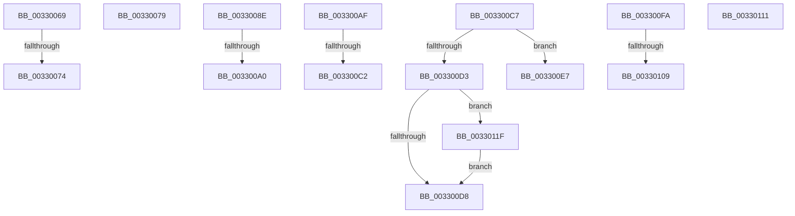

# sub_00330069

- RVA: `0x00330069`–`0x00330126` (길이 `189` bytes)
- VA: `0x0000000140330069`
- 실행 섹션: `.text`
- PDB 이름 있음: `아니요`; PDB Function 태그: `아니요`
- unwind 정보 RVA: `0x000764F0`
- 디코드: `39`개 명령, `189/189` bytes 표시
- 미해석 바이트: `0` (있으면 어셈블리에 `.byte`로 보존)

> 이 문서는 커널 이미지의 기계어와 PDB 기호를 분석해 생성했습니다. 4번과 5번은 함수 원형과 자료형을 바이너리 사용 방식에서 추정한 C 해석이며 원본 소스 복구 결과는 아닙니다.

## 1. Dependencies

- 직접 호출 지점: **0**; 고유 호출 대상: **0**
- 직접 호출자로 확인된 함수: **0**
- RIP 상대 이미지 참조: **0**

### Outgoing calls
- 직접 디코드된 call 명령이 없습니다.

### Direct callers
- 이 함수 시작 RVA로 연결되는 직접 call은 확인되지 않았습니다. 간접 호출은 완전히 역산할 수 없습니다.

### Static image references
- 디코드된 RIP-relative 메모리 참조가 없습니다.

## 2. Other-region calls and transfers

- 다른 실행 섹션으로 향하는 call: **0**
- call이 아닌 외부 분기/꼬리 이동: **12**
  - `0x0033006E` → [sub_0032F7AB + 0x2A](../32/Unknown_function_0032F7AB.md) (`tail-transfer`)
  - `0x00330074` → [sub_0032FE5C + 0x2A](../32/Unknown_function_0032FE5C.md) (`tail-transfer`)
  - `0x00330089` → [sub_0032F7AB + 0x125](../32/Unknown_function_0032F7AB.md) (`tail-transfer`)
  - `0x0033009A` → [sub_0032F7AB + 0x80](../32/Unknown_function_0032F7AB.md) (`tail-transfer`)
  - `0x003300AA` → [sub_0032FBA9 + 0x285](../32/Unknown_function_0032FBA9.md) (`tail-transfer`)
  - `0x003300BC` → [sub_0032F7AB + 0x21C](../32/Unknown_function_0032F7AB.md) (`tail-transfer`)
  - `0x003300C2` → [sub_0032FBA9 + 0x9D](../32/Unknown_function_0032FBA9.md) (`tail-transfer`)
  - `0x003300E2` → [sub_0032FBA9 + 0xE2](../32/Unknown_function_0032FBA9.md) (`tail-transfer`)
  - `0x003300F5` → [sub_0032FE5C + 0x2A](../32/Unknown_function_0032FE5C.md) (`tail-transfer`)
  - `0x00330103` → [sub_0032FBA9 + 0x9D](../32/Unknown_function_0032FBA9.md) (`tail-transfer`)
  - `0x0033010C` → [sub_0032FBA9 + 0x9D](../32/Unknown_function_0032FBA9.md) (`tail-transfer`)
  - `0x0033011A` → [sub_006E1F08](../6E/Unknown_function_006E1F08.md) (`tail-transfer`)

## 3. Assembly (complete function range)

```asm
00330069  8B 46 38                        mov eax, dword ptr [rsi + 0x38]
0033006C  A8 08                           test al, 8
0033006E  0F 84 61 F7 FF FF               je 0x14032f7d5
00330074  E9 0D FE FF FF                  jmp 0x14032fe86
00330079  41 8B 43 04                     mov eax, dword ptr [r11 + 4]
0033007D  A8 08                           test al, 8
0033007F  41 0F 45 C9                     cmovne ecx, r9d
00330083  89 8D C0 00 00 00               mov dword ptr [rbp + 0xc0], ecx
00330089  E9 42 F8 FF FF                  jmp 0x14032f8d0
0033008E  65 48 8B 04 25 88 01 00 00      mov rax, qword ptr gs:[0x188]
00330097  48 3B C8                        cmp rcx, rax
0033009A  0F 84 8B F7 FF FF               je 0x14032f82b
003300A0  41 83 4A 50 02                  or dword ptr [r10 + 0x50], 2
003300A5  B8 34 04 00 C0                  mov eax, 0xc0000434
003300AA  E9 7F FD FF FF                  jmp 0x14032fe2e
003300AF  48 B8 FF FF FF FF FF F6 FF FF   movabs rax, 0xfffff6ffffffffff
003300B9  4C 3B F8                        cmp r15, rax
003300BC  0F 87 05 F9 FF FF               ja 0x14032f9c7
003300C2  E9 7F FB FF FF                  jmp 0x14032fc46
003300C7  48 8B 85 C8 00 00 00            mov rax, qword ptr [rbp + 0xc8]
003300CE  48 85 C0                        test rax, rax
003300D1  75 14                           jne 0x1403300e7
003300D3  83 FE 08                        cmp esi, 8
003300D6  74 47                           je 0x14033011f
003300D8  C7 85 C0 00 00 00 09 00 00 00   mov dword ptr [rbp + 0xc0], 9
003300E2  E9 A4 FB FF FF                  jmp 0x14032fc8b
003300E7  49 89 85 80 00 00 00            mov qword ptr [r13 + 0x80], rax
003300EE  4D 89 BD 90 00 00 00            mov qword ptr [r13 + 0x90], r15
003300F5  E9 8C FD FF FF                  jmp 0x14032fe86
003300FA  4C 8B 95 D0 00 00 00            mov r10, qword ptr [rbp + 0xd0]
00330101  85 C0                           test eax, eax
00330103  0F 84 3D FB FF FF               je 0x14032fc46
00330109  83 0F 10                        or dword ptr [rdi], 0x10
0033010C  E9 35 FB FF FF                  jmp 0x14032fc46
00330111  4C 8D 9A 85 3B 00 00            lea r11, [rdx + 0x3b85]
00330118  32 D2                           xor dl, dl
0033011A  E9 E9 1D 3B 00                  jmp 0x1406e1f08
0033011F  41 83 4D 50 10                  or dword ptr [r13 + 0x50], 0x10
00330124  EB B2                           jmp 0x1403300d8
```

## 4. C-style interpretation (structured pseudocode)

```c
__int64 __fastcall sub_00330069(__int64 a1, __int64 a2, __int64 a3, int a4)
{
}
```

## 5. (Beta) C Style

```c
int64_t sub_00330069(int64_t Arg1, int64_t Arg2, int64_t Arg3, int32_t Arg4)
{
}
```

## 6. Execution-region graph

[열기: 2D/3D 그래프와 함수 탐색 컨트롤 패널](../../../control-panel.html?section=text&rva=0x00330069&view=graph)

- 2D 그래프는 위에서 아래로 흐르고, 3D 그래프는 빈 공간을 드래그해 회전합니다. Shift+드래그는 이동, 휠은 확대·축소, 함수 노드 선택은 대상 보고서 이동입니다.

### Static fallback


