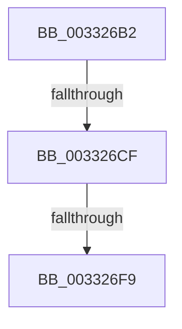

# sub_003326B2

- RVA: `0x003326B2`–`0x00332714` (길이 `98` bytes)
- VA: `0x00000001403326B2`
- 실행 섹션: `.text`
- PDB 이름 있음: `아니요`; PDB Function 태그: `아니요`
- unwind 정보 RVA: `0x000765C0`
- 디코드: `20`개 명령, `98/98` bytes 표시
- 미해석 바이트: `0` (있으면 어셈블리에 `.byte`로 보존)

> 이 문서는 커널 이미지의 기계어와 PDB 기호를 분석해 생성했습니다. 4번과 5번은 함수 원형과 자료형을 바이너리 사용 방식에서 추정한 C 해석이며 원본 소스 복구 결과는 아닙니다.

## 1. Dependencies

- 직접 호출 지점: **2**; 고유 호출 대상: **2**
- 직접 호출자로 확인된 함수: **0**
- RIP 상대 이미지 참조: **0**

### Outgoing calls
- `0x003326E0` → [MiMapPageInHyperSpaceWorker](MiMapPageInHyperSpaceWorker_function_00332B10.md) (function, `0x00332B10`)
- `0x00332701` → [KeZeroPages](../6B/KeZeroPages_function_006BA070.md) (function, `0x006BA070`)

### Direct callers
- 이 함수 시작 RVA로 연결되는 직접 call은 확인되지 않았습니다. 간접 호출은 완전히 역산할 수 없습니다.

### Static image references
- 디코드된 RIP-relative 메모리 참조가 없습니다.

## 2. Other-region calls and transfers

- 다른 실행 섹션으로 향하는 call: **0**
- call이 아닌 외부 분기/꼬리 이동: **3**
  - `0x003326C9` → [sub_0033284A](Unknown_function_0033284A.md) (`tail-transfer`)
  - `0x003326F3` → [sub_003327E9](Unknown_function_003327E9.md) (`tail-transfer`)
  - `0x0033270E` → [sub_003328DD](Unknown_function_003328DD.md) (`tail-transfer`)

## 3. Assembly (complete function range)

```asm
003326B2  48 89 6C 24 40                  mov qword ptr [rsp + 0x40], rbp
003326B7  4C 89 64 24 38                  mov qword ptr [rsp + 0x38], r12
003326BC  4C 8B E7                        mov r12, rdi
003326BF  48 8B A8 38 88 00 00            mov rbp, qword ptr [rax + 0x8838]
003326C6  48 85 ED                        test rbp, rbp
003326C9  0F 84 7B 01 00 00               je 0x14033284a
003326CF  41 B8 00 00 00 80               mov r8d, 0x80000000
003326D5  48 8D 94 24 90 00 00 00         lea rdx, [rsp + 0x90]
003326DD  48 8B CB                        mov rcx, rbx
003326E0  E8 2B 04 00 00                  call 0x140332b10
003326E5  48 8B F8                        mov rdi, rax
003326E8  48 8B 9C 24 80 00 00 00         mov rbx, qword ptr [rsp + 0x80]
003326F0  48 85 DB                        test rbx, rbx
003326F3  0F 85 F0 00 00 00               jne 0x1403327e9
003326F9  BA 00 10 00 00                  mov edx, 0x1000
003326FE  48 8B CF                        mov rcx, rdi
00332701  E8 6A 79 38 00                  call 0x1406ba070
00332706  48 85 ED                        test rbp, rbp
00332709  48 8B 6C 24 40                  mov rbp, qword ptr [rsp + 0x40]
0033270E  0F 84 C9 01 00 00               je 0x1403328dd
```

## 4. C-style interpretation (structured pseudocode)

```c
__int64 __fastcall sub_003326B2(__int64 a1, __int64 a2, __int64 a3, __int64 a4, __int64 a5, __int64 a6, __int64 a7, __int64 a8, __int64 a9, __int64 a10, __int64 a11, __int64 a12, __int64 a13, __int64 a14, __int64 a15, __int64 a16, __int64 a17, __int64 a18)
{
    __int64 result;
    unsigned __int64 v_stack_p38;
    unsigned __int64 v_stack_p40;

    v_stack_p40 = v_rbp;
    v_stack_p38 = v_r12;
    result = MiMapPageInHyperSpaceWorker(v_rbx, a18, (unsigned int)(0x80000000ULL), a4);
    result = KeZeroPages(result, (unsigned int)(0x1000ULL), (unsigned int)(0x80000000ULL), a4);
}
```

## 5. (Beta) C Style

```c
int64_t sub_003326B2(int64_t Arg1, int64_t Arg2, int64_t Arg3, int64_t Arg4, uint64_t Arg5, uint64_t Arg6, uint64_t Arg7, int64_t Arg8, uint64_t Arg9, uint64_t Arg10, uint64_t Arg11, uint64_t Arg12, uint64_t Arg13, uint64_t Arg14, uint64_t Arg15, int64_t Arg16, uint64_t Arg17, int64_t Arg18)
{
    int64_t result;
    uint64_t v_stack_p38;
    uint64_t v_stack_p40;

    v_stack_p40 = local_rbp;
    v_stack_p38 = local_r12;
    result = MiMapPageInHyperSpaceWorker(local_rbx, Arg18, (uint32_t)(0x80000000ULL), Arg4);
    result = KeZeroPages(result, (uint32_t)(0x1000ULL), (uint32_t)(0x80000000ULL), Arg4);
}
```

## 6. Execution-region graph

[열기: 2D/3D 그래프와 함수 탐색 컨트롤 패널](../../../control-panel.html?section=text&rva=0x003326B2&view=graph)

- 2D 그래프는 위에서 아래로 흐르고, 3D 그래프는 빈 공간을 드래그해 회전합니다. Shift+드래그는 이동, 휠은 확대·축소, 함수 노드 선택은 대상 보고서 이동입니다.

### Static fallback


