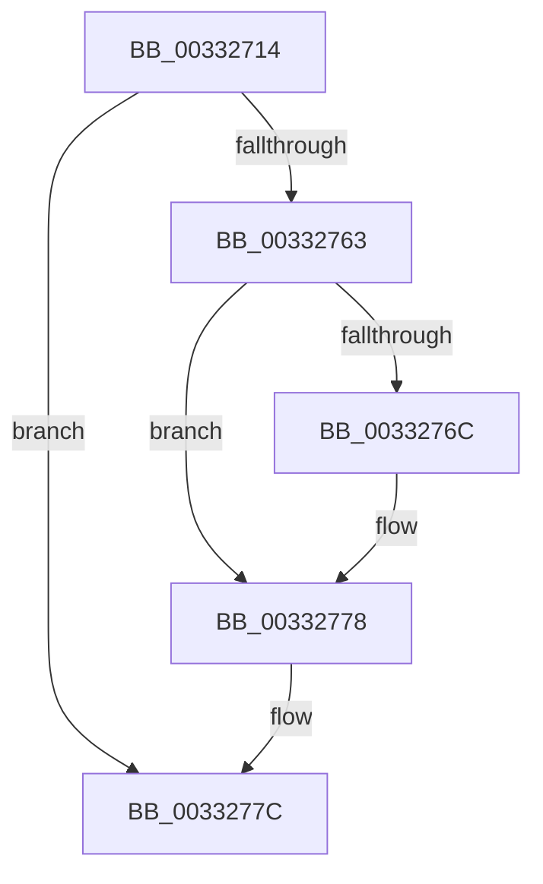

# sub_00332714

- RVA: `0x00332714`–`0x0033278A` (길이 `118` bytes)
- VA: `0x0000000140332714`
- 실행 섹션: `.text`
- PDB 이름 있음: `아니요`; PDB Function 태그: `아니요`
- unwind 정보 RVA: `0x000765D8`
- 디코드: `23`개 명령, `118/118` bytes 표시
- 미해석 바이트: `0` (있으면 어셈블리에 `.byte`로 보존)

> 이 문서는 커널 이미지의 기계어와 PDB 기호를 분석해 생성했습니다. 4번과 5번은 함수 원형과 자료형을 바이너리 사용 방식에서 추정한 C 해석이며 원본 소스 복구 결과는 아닙니다.

## 1. Dependencies

- 직접 호출 지점: **1**; 고유 호출 대상: **1**
- 직접 호출자로 확인된 함수: **0**
- RIP 상대 이미지 참조: **2**

### Outgoing calls
- `0x00332773` → [KiLowerIrqlProcessIrqlFlags](../4F/KiLowerIrqlProcessIrqlFlags_function_004F5698.md) (function, `0x004F5698`)

### Direct callers
- 이 함수 시작 RVA로 연결되는 직접 call은 확인되지 않았습니다. 간접 호출은 완전히 역산할 수 없습니다.

### Static image references
- `0x0033274D` → RVA `0x00010880` (`.rdata`; read)
- `0x00332763` → RVA `0x00FC6D20` (`ALMOSTRO`; read)

## 2. Other-region calls and transfers

- 다른 실행 섹션으로 향하는 call: **0**
- call이 아닌 외부 분기/꼬리 이동: **1**
  - `0x00332784` → [sub_0033282A](Unknown_function_0033282A.md) (`tail-transfer`)

## 3. Assembly (complete function range)

```asm
00332714  0F B6 9C 24 90 00 00 00         movzx ebx, byte ptr [rsp + 0x90]
0033271C  48 B8 F8 FF FF FF 7F 00 00 00   movabs rax, 0x7ffffffff8
00332726  48 C1 EF 09                     shr rdi, 9
0033272A  48 23 F8                        and rdi, rax
0033272D  48 B8 00 00 00 00 80 F6 FF FF   movabs rax, 0xfffff68000000000
00332737  48 8B C0                        mov rax, rax
0033273A  48 03 F8                        add rdi, rax
0033273D  65 48 8B 04 25 20 00 00 00      mov rax, qword ptr gs:[0x20]
00332746  48 8B 88 38 88 00 00            mov rcx, qword ptr [rax + 0x8838]
0033274D  48 8B 05 2C E1 CD FF            mov rax, qword ptr [rip - 0x321ed4]
00332754  48 C7 01 00 00 00 00            mov qword ptr [rcx], 0
0033275B  48 89 07                        mov qword ptr [rdi], rax
0033275E  80 FB 11                        cmp bl, 0x11
00332761  74 19                           je 0x14033277c
00332763  83 3D B6 45 C9 00 00            cmp dword ptr [rip + 0xc945b6], 0
0033276A  74 0C                           je 0x140332778
0033276C  44 0F 20 C1                     mov rcx, cr8
00332770  0F B6 D3                        movzx edx, bl
00332773  E8 20 2F 1C 00                  call 0x1404f5698
00332778  44 0F 22 C3                     mov cr8, rbx
0033277C  4C 8B 64 24 38                  mov r12, qword ptr [rsp + 0x38]
00332781  41 3B F6                        cmp esi, r14d
00332784  0F 85 A0 00 00 00               jne 0x14033282a
```

## 4. C-style interpretation (structured pseudocode)

```c
__int64 __fastcall sub_00332714(__int64 a1, __int64 a2, __int64 a3, __int64 a4, __int64 a5, __int64 a6, __int64 a7, __int64 a8, __int64 a9, __int64 a10, __int64 a11, __int64 a12, __int64 a13, __int64 a14, __int64 a15, __int64 a16, __int64 a17, unsigned __int8 a18)
{
    __int64 result;
    __int64 v_rdi;

    v_rdi = (v_rdi) >> (9);
    v_rdi = (v_rdi) & (result);
    v_rdi = (v_rdi) + (result);
    *(unsigned __int64 *)(*(unsigned __int64 *)(*(unsigned __int64 *)(gs_base + (0 + 32)) + 34872)) = 0;
    *(unsigned __int64 *)(v_rdi) = *(unsigned __int64 *)(v_rip - 3284692);
    if (a18 == 17) goto loc_0033277C;
    result = *(unsigned __int64 *)(v_rip - 3284692);
    if ((*(unsigned int *)(v_rip + 13190582)) != 0) {
        a1 = v_cr8;
        a2 = a18;
        result = KiLowerIrqlProcessIrqlFlags(a1, a2, a3, a4);
    }
loc_0033277C:
}
```

## 5. (Beta) C Style

```c
int64_t sub_00332714(int64_t Arg1, int64_t Arg2, int64_t Arg3, int64_t Arg4, uint64_t Arg5, uint64_t Arg6, int64_t Arg7, uint64_t Arg8, uint64_t Arg9, uint64_t Arg10, uint64_t Arg11, uint64_t Arg12, uint64_t Arg13, uint64_t Arg14, uint64_t Arg15, uint64_t Arg16, uint64_t Arg17, uint8_t Arg18)
{
    int64_t result;
    int64_t local_rdi;

    local_rdi = (local_rdi) >> (9);
    local_rdi = (local_rdi) & (result);
    local_rdi = (local_rdi) + (result);
    *(uint64_t *)(*(uint64_t *)(*(uint64_t *)(gs_base + (0 + 0x20)) + 0x8838)) = 0;
    *(uint64_t *)(local_rdi) = *(uint64_t *)(v_rip - 0x321ED4);
    if (Arg18 == 17) goto loc_0033277C;
    result = *(uint64_t *)(v_rip - 0x321ED4);
    if ((*(uint32_t *)(v_rip + 0xC945B6)) != 0) {
        Arg1 = v_cr8;
        Arg2 = Arg18;
        result = KiLowerIrqlProcessIrqlFlags(Arg1, Arg2, Arg3, Arg4);
    }
loc_0033277C:
}
```

## 6. Execution-region graph

[열기: 2D/3D 그래프와 함수 탐색 컨트롤 패널](../../../control-panel.html?section=text&rva=0x00332714&view=graph)

- 2D 그래프는 위에서 아래로 흐르고, 3D 그래프는 빈 공간을 드래그해 회전합니다. Shift+드래그는 이동, 휠은 확대·축소, 함수 노드 선택은 대상 보고서 이동입니다.

### Static fallback


