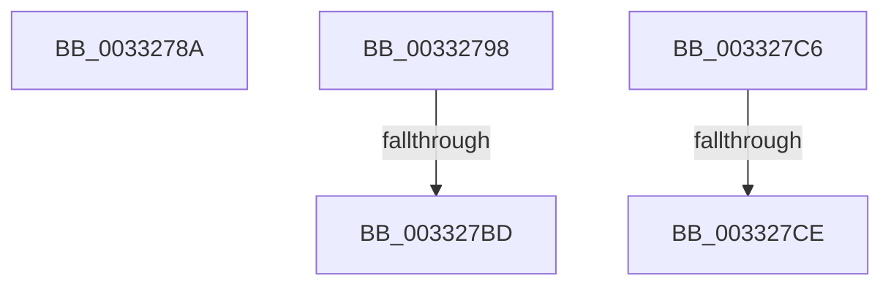

# sub_0033278A

- RVA: `0x0033278A`–`0x003327E9` (길이 `95` bytes)
- VA: `0x000000014033278A`
- 실행 섹션: `.text`
- PDB 이름 있음: `아니요`; PDB Function 태그: `아니요`
- unwind 정보 RVA: `0x000765EC`
- 디코드: `29`개 명령, `95/95` bytes 표시
- 미해석 바이트: `0` (있으면 어셈블리에 `.byte`로 보존)

> 이 문서는 커널 이미지의 기계어와 PDB 기호를 분석해 생성했습니다. 4번과 5번은 함수 원형과 자료형을 바이너리 사용 방식에서 추정한 C 해석이며 원본 소스 복구 결과는 아닙니다.

## 1. Dependencies

- 직접 호출 지점: **2**; 고유 호출 대상: **1**
- 직접 호출자로 확인된 함수: **0**
- RIP 상대 이미지 참조: **0**

### Outgoing calls
- `0x003327AD` → [KeBugCheckEx](../4F/KeBugCheckEx_function_004FD660.md) (function, `0x004FD660`)
- `0x003327E3` → [KeBugCheckEx](../4F/KeBugCheckEx_function_004FD660.md) (function, `0x004FD660`)

### Direct callers
- 이 함수 시작 RVA로 연결되는 직접 call은 확인되지 않았습니다. 간접 호출은 완전히 역산할 수 없습니다.

### Static image references
- 디코드된 RIP-relative 메모리 참조가 없습니다.

## 2. Other-region calls and transfers

- 다른 실행 섹션으로 향하는 call: **0**
- call이 아닌 외부 분기/꼬리 이동: **3**
  - `0x003327B7` → [MiZeroPhysicalPage + 0xCE](MiZeroPhysicalPage_function_00332590.md) (`tail-transfer`)
  - `0x003327C1` → [MiZeroPhysicalPage + 0x9C](MiZeroPhysicalPage_function_00332590.md) (`tail-transfer`)
  - `0x003327C8` → [sub_003328D5](Unknown_function_003328D5.md) (`tail-transfer`)

## 3. Assembly (complete function range)

```asm
0033278A  48 83 C4 48                     add rsp, 0x48
0033278E  41 5F                           pop r15
00332790  41 5E                           pop r14
00332792  41 5D                           pop r13
00332794  5F                              pop rdi
00332795  5E                              pop rsi
00332796  5B                              pop rbx
00332797  C3                              ret
00332798  CC                              int3
00332799  45 33 C9                        xor r9d, r9d
0033279C  48 89 7C 24 20                  mov qword ptr [rsp + 0x20], rdi
003327A1  4D 8B C2                        mov r8, r10
003327A4  BA 80 51 00 00                  mov edx, 0x5180
003327A9  41 8D 49 1A                     lea ecx, [r9 + 0x1a]
003327AD  E8 AE AE 1C 00                  call 0x1404fd660
003327B2  CC                              int3
003327B3  4C 3B 50 10                     cmp r10, qword ptr [rax + 0x10]
003327B7  0F 82 A1 FE FF FF               jb 0x14033265e
003327BD  44 8D 42 01                     lea r8d, [rdx + 1]
003327C1  E9 66 FE FF FF                  jmp 0x14033262c
003327C6  85 D2                           test edx, edx
003327C8  0F 85 07 01 00 00               jne 0x1403328d5
003327CE  4C 8B C8                        mov r9, rax
003327D1  48 89 7C 24 20                  mov qword ptr [rsp + 0x20], rdi
003327D6  4D 8B C2                        mov r8, r10
003327D9  BA 80 51 00 00                  mov edx, 0x5180
003327DE  B9 1A 00 00 00                  mov ecx, 0x1a
003327E3  E8 78 AE 1C 00                  call 0x1404fd660
003327E8  CC                              int3
```

## 4. C-style interpretation (structured pseudocode)

```c
__int64 __fastcall sub_0033278A(__int64 a1, __int64 a2, __int64 a3, int a4)
{
    __int64 v_rsp;
    unsigned __int64 v_stack_p98;

    v_rsp = (v_rsp) + (72);
    return result;
}
```

## 5. (Beta) C Style

```c
int64_t sub_0033278A(int64_t Arg1, int64_t Arg2, int64_t Arg3, int32_t Arg4)
{
    int64_t local_rsp;
    uint64_t v_stack_p98;

    local_rsp = (local_rsp) + (72);
    return result;
}
```

## 6. Execution-region graph

[열기: 2D/3D 그래프와 함수 탐색 컨트롤 패널](../../../control-panel.html?section=text&rva=0x0033278A&view=graph)

- 2D 그래프는 위에서 아래로 흐르고, 3D 그래프는 빈 공간을 드래그해 회전합니다. Shift+드래그는 이동, 휠은 확대·축소, 함수 노드 선택은 대상 보고서 이동입니다.

### Static fallback


