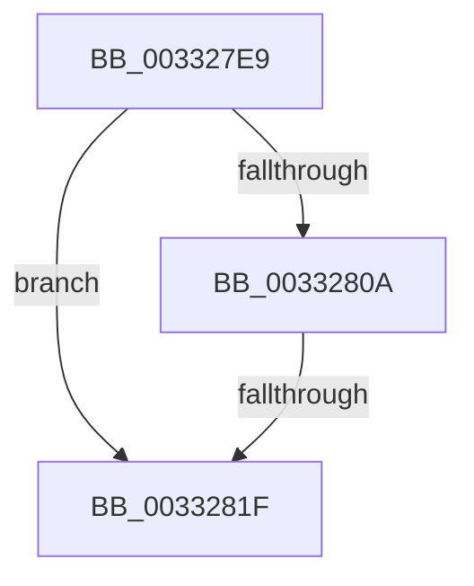

# sub_003327E9

- RVA: `0x003327E9`–`0x0033282A` (길이 `65` bytes)
- VA: `0x00000001403327E9`
- 실행 섹션: `.text`
- PDB 이름 있음: `아니요`; PDB Function 태그: `아니요`
- unwind 정보 RVA: `0x00076600`
- 디코드: `15`개 명령, `65/65` bytes 표시
- 미해석 바이트: `0` (있으면 어셈블리에 `.byte`로 보존)

> 이 문서는 커널 이미지의 기계어와 PDB 기호를 분석해 생성했습니다. 4번과 5번은 함수 원형과 자료형을 바이너리 사용 방식에서 추정한 C 해석이며 원본 소스 복구 결과는 아닙니다.

## 1. Dependencies

- 직접 호출 지점: **2**; 고유 호출 대상: **2**
- 직접 호출자로 확인된 함수: **0**
- RIP 상대 이미지 참조: **1**

### Outgoing calls
- `0x00332801` → [AccelBuildDescriptorMemoryFill](../2C/AccelBuildDescriptorMemoryFill_function_002C7CBC.md) (function, `0x002C7CBC`)
- `0x00332812` → [AccelpSubmitWork](../2C/AccelpSubmitWork_function_002C8190.md) (function, `0x002C8190`)

### Direct callers
- 이 함수 시작 RVA로 연결되는 직접 call은 확인되지 않았습니다. 간접 호출은 완전히 역산할 수 없습니다.

### Static image references
- `0x0033281F` → RVA `0x00EF508C` (`.data`; read/write)

## 2. Other-region calls and transfers

- 다른 실행 섹션으로 향하는 call: **0**
- call이 아닌 외부 분기/꼬리 이동: **2**
  - `0x00332819` → [sub_003326B2 + 0x54](Unknown_function_003326B2.md) (`tail-transfer`)
  - `0x00332825` → [sub_003326B2 + 0x47](Unknown_function_003326B2.md) (`tail-transfer`)

## 3. Assembly (complete function range)

```asm
003327E9  45 33 C9                        xor r9d, r9d
003327EC  48 C7 44 24 20 03 00 00 00      mov qword ptr [rsp + 0x20], 3
003327F5  41 B8 00 10 00 00               mov r8d, 0x1000
003327FB  48 8B D7                        mov rdx, rdi
003327FE  48 8B CB                        mov rcx, rbx
00332801  E8 B6 54 F9 FF                  call 0x1402c7cbc
00332806  85 C0                           test eax, eax
00332808  78 15                           js 0x14033281f
0033280A  BA 03 00 00 00                  mov edx, 3
0033280F  48 8B CB                        mov rcx, rbx
00332812  E8 79 59 F9 FF                  call 0x1402c8190
00332817  85 C0                           test eax, eax
00332819  0F 89 E7 FE FF FF               jns 0x140332706
0033281F  FF 05 67 28 BC 00               inc dword ptr [rip + 0xbc2867]
00332825  E9 CF FE FF FF                  jmp 0x1403326f9
```

## 4. C-style interpretation (structured pseudocode)

```c
__int64 __fastcall sub_003327E9(__int64 a1, __int64 a2, __int64 a3, int a4)
{
    __int64 result;
    unsigned __int64 v_stack_p20;

    a4 = 0;
    v_stack_p20 = 3;
    result = AccelBuildDescriptorMemoryFill(v_rbx, v_rdi, (unsigned int)(0x1000ULL), a4);
    if (sign_flag) goto loc_0033281F;
    result = AccelpSubmitWork(v_rbx, 3, (unsigned int)(0x1000ULL), a4);
loc_0033281F:
}
```

## 5. (Beta) C Style

```c
int64_t sub_003327E9(int64_t Arg1, int64_t Arg2, int64_t Arg3, int32_t Arg4)
{
    int64_t result;
    uint64_t v_stack_p20;

    Arg4 = 0;
    v_stack_p20 = 3;
    result = AccelBuildDescriptorMemoryFill(local_rbx, local_rdi, (uint32_t)(0x1000ULL), Arg4);
    if (sign_flag) goto loc_0033281F;
    result = AccelpSubmitWork(local_rbx, 3, (uint32_t)(0x1000ULL), Arg4);
loc_0033281F:
}
```

## 6. Execution-region graph

[열기: 2D/3D 그래프와 함수 탐색 컨트롤 패널](../../../control-panel.html?section=text&rva=0x003327E9&view=graph)

- 2D 그래프는 위에서 아래로 흐르고, 3D 그래프는 빈 공간을 드래그해 회전합니다. Shift+드래그는 이동, 휠은 확대·축소, 함수 노드 선택은 대상 보고서 이동입니다.

### Static fallback


