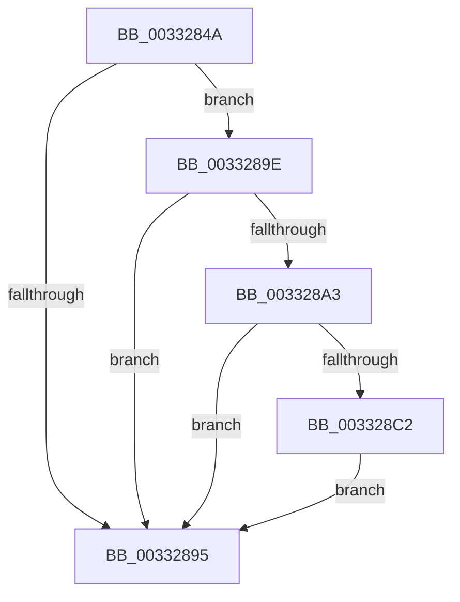

# sub_0033284A

- RVA: `0x0033284A`–`0x003328D5` (길이 `139` bytes)
- VA: `0x000000014033284A`
- 실행 섹션: `.text`
- PDB 이름 있음: `아니요`; PDB Function 태그: `아니요`
- unwind 정보 RVA: `0x00076628`
- 디코드: `31`개 명령, `139/139` bytes 표시
- 미해석 바이트: `0` (있으면 어셈블리에 `.byte`로 보존)

> 이 문서는 커널 이미지의 기계어와 PDB 기호를 분석해 생성했습니다. 4번과 5번은 함수 원형과 자료형을 바이너리 사용 방식에서 추정한 C 해석이며 원본 소스 복구 결과는 아닙니다.

## 1. Dependencies

- 직접 호출 지점: **3**; 고유 호출 대상: **3**
- 직접 호출자로 확인된 함수: **0**
- RIP 상대 이미지 참조: **1**

### Outgoing calls
- `0x0033284A` → [MxGetPhase0Mapping](../../init/BE/MxGetPhase0Mapping_function_00BEF000.md) (function, `0x00BEF000`)
- `0x00332882` → [MiMakeValidPte](../2C/MiMakeValidPte_function_002C5590.md) (function, `0x002C5590`)
- `0x003328CE` → [MiCheckLinearProtectedPteAccessedBit](../29/MiCheckLinearProtectedPteAccessedBit_function_00292D80.md) (function, `0x00292D80`)

### Direct callers
- 이 함수 시작 RVA로 연결되는 직접 call은 확인되지 않았습니다. 간접 호출은 완전히 역산할 수 없습니다.

### Static image references
- `0x00332887` → RVA `0x00FC6A88` (`ALMOSTRO`; read)

## 2. Other-region calls and transfers

- 다른 실행 섹션으로 향하는 call: **1**
  - `0x0033284A` → [MxGetPhase0Mapping](../../init/BE/MxGetPhase0Mapping_function_00BEF000.md) (`.text` → `INIT`)
- call이 아닌 외부 분기/꼬리 이동: **1**
  - `0x00332899` → [sub_003326B2 + 0x36](Unknown_function_003326B2.md) (`tail-transfer`)

## 3. Assembly (complete function range)

```asm
0033284A  E8 B1 C7 8B 00                  call 0x140bef000
0033284F  4C 8B E0                        mov r12, rax
00332852  48 8B F8                        mov rdi, rax
00332855  48 B8 F8 FF FF FF 7F 00 00 00   movabs rax, 0x7ffffffff8
0033285F  49 C1 EC 09                     shr r12, 9
00332863  4C 23 E0                        and r12, rax
00332866  48 B8 00 00 00 00 80 F6 FF FF   movabs rax, 0xfffff68000000000
00332870  48 8B C0                        mov rax, rax
00332873  4C 03 E0                        add r12, rax
00332876  41 B8 04 00 00 A0               mov r8d, 0xa0000004
0033287C  49 8B CC                        mov rcx, r12
0033287F  48 8B D3                        mov rdx, rbx
00332882  E8 09 2D F9 FF                  call 0x1402c5590
00332887  48 0F BA 25 F8 41 C9 00 24      bt qword ptr [rip + 0xc941f8], 0x24
00332890  48 8B D8                        mov rbx, rax
00332893  72 09                           jb 0x14033289e
00332895  49 89 1C 24                     mov qword ptr [r12], rbx
00332899  E9 4A FE FF FF                  jmp 0x1403326e8
0033289E  F6 C3 20                        test bl, 0x20
003328A1  75 F2                           jne 0x140332895
003328A3  48 B8 00 00 00 00 80 F6 FF FF   movabs rax, 0xfffff68000000000
003328AD  48 8B C8                        mov rcx, rax
003328B0  48 B8 00 00 00 00 40 00 00 00   movabs rax, 0x4000000000
003328BA  48 03 C8                        add rcx, rax
003328BD  4C 3B E1                        cmp r12, rcx
003328C0  72 D3                           jb 0x140332895
003328C2  41 B8 80 00 00 00               mov r8d, 0x80
003328C8  48 8B D3                        mov rdx, rbx
003328CB  49 8B CC                        mov rcx, r12
003328CE  E8 AD 04 F6 FF                  call 0x140292d80
003328D3  EB C0                           jmp 0x140332895
```

## 4. C-style interpretation (structured pseudocode)

```c
__int64 __fastcall sub_0033284A(void)
{
    __int64 result;
    __int64 v_r12;

    result = MxGetPhase0Mapping(a1, a2, a3, a4);
    v_r12 = (result) >> (9);
    v_r12 = (v_r12) & (result);
    v_r12 = (v_r12) + (result);
    result = MiMakeValidPte(v_r12, v_rbx, (unsigned int)(0xA0000004ULL), a4);
    if (condition_is_below) goto loc_0033289E;
loc_00332895:
    *(unsigned __int64 *)(v_r12) = result;
loc_0033289E:
    if ((((unsigned __int8)(result)) & (32)) != 0) goto loc_00332895;
    a1 = (result) + (result);
    if (v_r12 < a1) goto loc_00332895;
    result = MiCheckLinearProtectedPteAccessedBit(v_r12, result, 128, a4);
    goto loc_00332895;
}
```

## 5. (Beta) C Style

```c
void sub_0033284A(void)
{
    int64_t result;
    int64_t local_r12;

    result = MxGetPhase0Mapping(a1, a2, a3, a4);
    local_r12 = (result) >> (9);
    local_r12 = (local_r12) & (result);
    local_r12 = (local_r12) + (result);
    result = MiMakeValidPte(local_r12, local_rbx, (uint32_t)(0xA0000004ULL), a4);
    if (condition_is_below) goto loc_0033289E;
loc_00332895:
    *(uint64_t *)(local_r12) = result;
loc_0033289E:
    if ((((uint8_t)(result)) & (32)) != 0) goto loc_00332895;
    a1 = (result) + (result);
    if (local_r12 < a1) goto loc_00332895;
    result = MiCheckLinearProtectedPteAccessedBit(local_r12, result, 128, a4);
    goto loc_00332895;
}
```

## 6. Execution-region graph

[열기: 2D/3D 그래프와 함수 탐색 컨트롤 패널](../../../control-panel.html?section=text&rva=0x0033284A&view=graph)

- 2D 그래프는 위에서 아래로 흐르고, 3D 그래프는 빈 공간을 드래그해 회전합니다. Shift+드래그는 이동, 휠은 확대·축소, 함수 노드 선택은 대상 보고서 이동입니다.

### Static fallback


